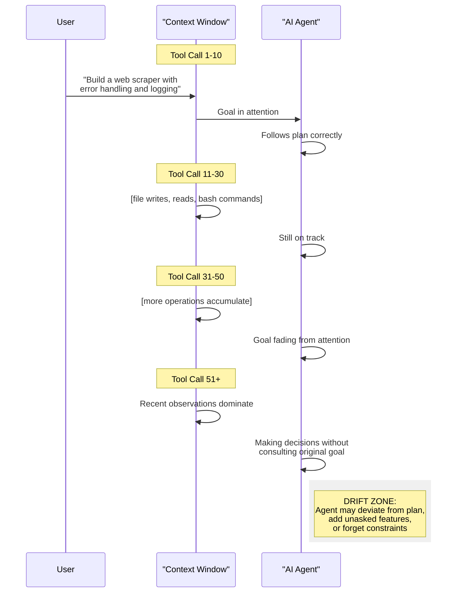
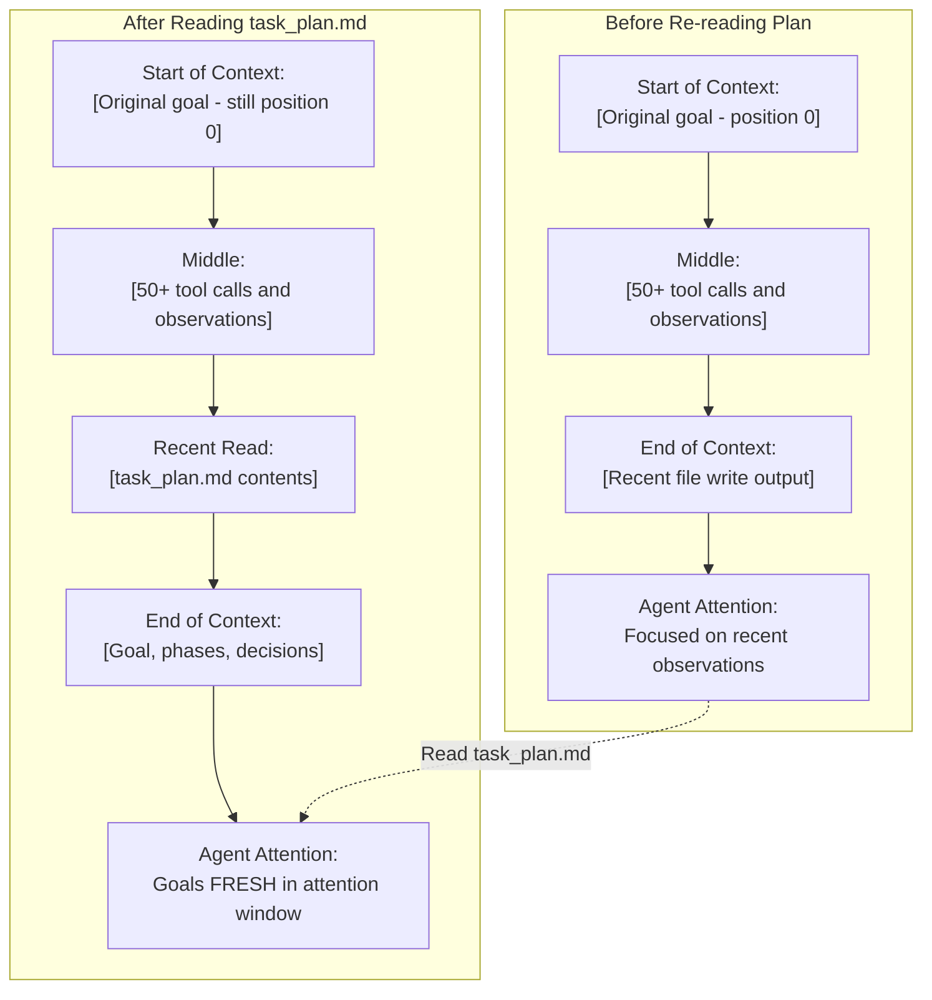
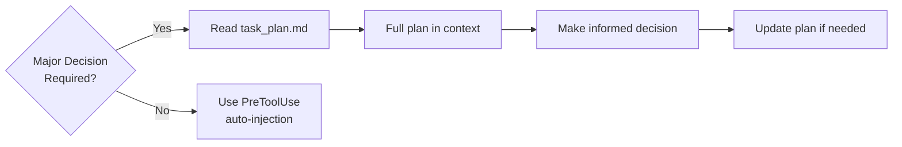
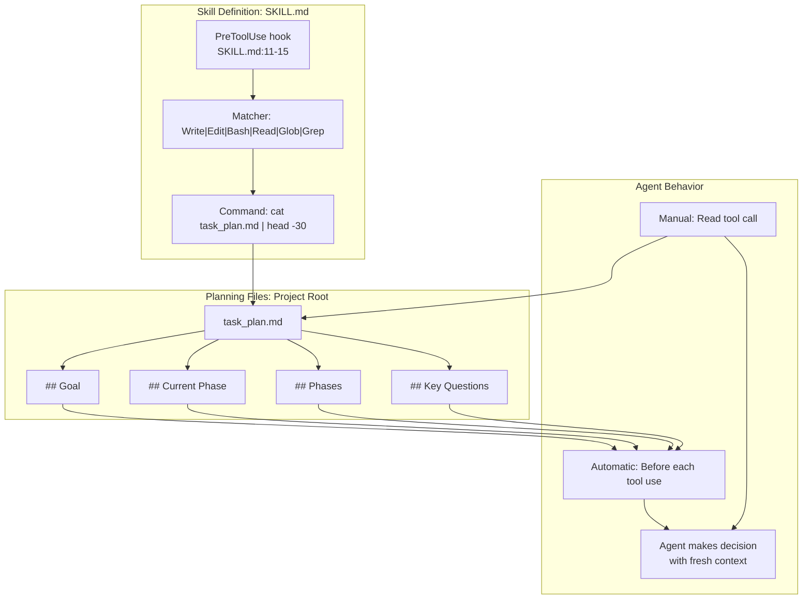
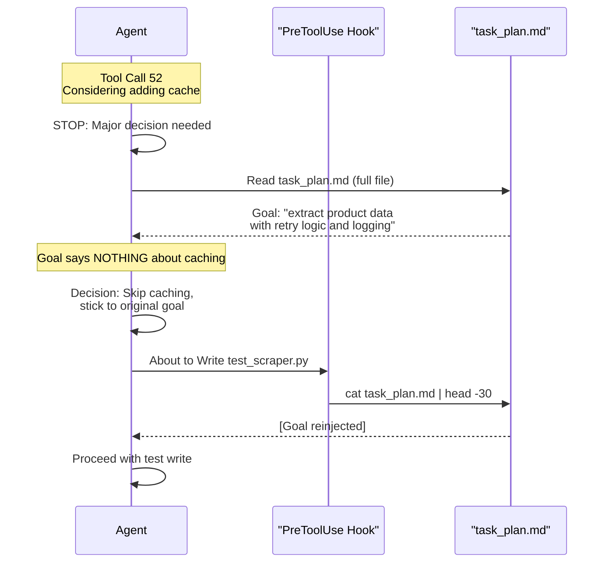

<!-- source: DeepWiki mcp.deepwiki.com · repo OthmanAdi/planning-with-files · page 6.3 Read-Before-Decide Pattern · fetched 2026-10-29 -->

# Read-Before-Decide Pattern

<details>
<summary>Relevant source files</summary>

The following files were used as context for generating this wiki page:

- [.codex/skills/planning-with-files/SKILL.md](.codex/skills/planning-with-files/SKILL.md)
- [.cursor/skills/planning-with-files/SKILL.md](.cursor/skills/planning-with-files/SKILL.md)
- [.gitignore](.gitignore)
- [.opencode/skills/planning-with-files/SKILL.md](.opencode/skills/planning-with-files/SKILL.md)
- [examples/README.md](examples/README.md)
- [skills/planning-with-files/examples.md](skills/planning-with-files/examples.md)
- [skills/planning-with-files/reference.md](skills/planning-with-files/reference.md)
- [skills/planning-with-files/templates/findings.md](skills/planning-with-files/templates/findings.md)
- [skills/planning-with-files/templates/progress.md](skills/planning-with-files/templates/progress.md)
- [skills/planning-with-files/templates/task_plan.md](skills/planning-with-files/templates/task_plan.md)

</details>


## Purpose and Scope

The Read-Before-Decide Pattern is a context management technique that prevents goal drift in long-running agent tasks by explicitly refreshing the task plan in the AI's attention window before making major decisions. This pattern addresses the "lost in the middle" problem where models forget original goals after approximately 50 tool calls.

This page covers the mechanics, implementation, and application of the Read-Before-Decide Pattern. It explains how the `PreToolUse` hook automates goal reinforcement and how manual re-reading acts as a "goal refresh" mechanism to maintain alignment during complex workflows.

**Sources:** [skills/planning-with-files/SKILL.md:103-104](), [skills/planning-with-files/reference.md:43-54](), [skills/planning-with-files/examples.md:189-202]()

---

## The Attention Drift Problem

AI agents operate within a context window that functions as volatile RAM: information at the beginning of the context becomes progressively less accessible as new tool calls and observations accumulate. After approximately 50 tool calls, the model's attention shifts toward recent observations, causing the original goals and plan structure to fade from active consideration.

### The "Lost in the Middle" Effect



**Sources:** [skills/planning-with-files/reference.md:43-54](), [skills/planning-with-files/SKILL.md:103-104]()

### Quantitative Impact

| Metric | Value | Source |
|--------|-------|--------|
| Average tool calls per complex task | ~50 | Manus statistics |
| Context position effect | Goals at start forgotten | "Lost in the middle" research |
| Input-to-output token ratio | 100:1 | Typical agent workload |
| Attention decay threshold | After ~30-50 tool calls | Empirical observation |

**Sources:** [skills/planning-with-files/reference.md:191-197]()

---

## How the Pattern Works

The Read-Before-Decide Pattern operates on a simple principle: **reading** `task_plan.md` appends its contents to the end of the context window, where attention is strongest. This brings the original goal, current phase, and remaining phases back into the model's active working memory.

### Context Window Mechanics



**Key Insight:** The act of reading does not modify the plan file, but it modifies the context window's attention distribution by placing goal information at the position with highest attention (the end of context).

**Sources:** [skills/planning-with-files/reference.md:43-54](), [skills/planning-with-files/examples.md:189-202]()

### Manus Principle 4: Attention Manipulation

The pattern implements Manus Principle 4 from [skills/planning-with-files/reference.md:43-54]():

> "Creates and updates todo.md throughout tasks to push global plan into model's recent attention span."

In the planning-with-files implementation, `task_plan.md` serves this role. The pattern transforms attention manipulation from a theoretical concept into a practical workflow rule.

**Sources:** [skills/planning-with-files/reference.md:43-54]()

---

## Implementation Mechanisms

The Read-Before-Decide Pattern is enforced through two complementary mechanisms: automatic injection via the `PreToolUse` hook and explicit manual reads in the agent workflow.

### Automatic: PreToolUse Hook

The `PreToolUse` hook automatically injects the first 30 lines of `task_plan.md` before every file operation across supported platforms like Claude Code and Cursor:

[.codex/skills/planning-with-files/SKILL.md:11-15]()
[.cursor/skills/planning-with-files/SKILL.md:11-15]()

```yaml
hooks:
  PreToolUse:
    - matcher: "Write|Edit|Bash|Read|Glob|Grep"
      hooks:
        - type: command
          command: "cat task_plan.md 2>/dev/null | head -30 || true"
```

**Trigger Conditions:**
- Agent is about to use: `Write`, `Edit`, `Bash`, `Read`, `Glob`, or `Grep` tools [.codex/skills/planning-with-files/SKILL.md:12]()
- Executes **before** the tool runs.
- Non-blocking: `|| true` ensures failure (e.g., file not found) doesn't halt the workflow [.codex/skills/planning-with-files/SKILL.md:15]().

**What Gets Injected:**

| Content | Lines | Purpose |
|---------|-------|---------|
| Goal | ~1-3 | Remind agent of end state |
| Current Phase | ~4-6 | Orient to current position |
| Phases list | ~7-25 | Show progress and remaining work |
| Key Questions | ~26-30 | Highlight open decisions |

**Sources:** [.codex/skills/planning-with-files/SKILL.md:11-15](), [skills/planning-with-files/templates/task_plan.md:1-96]()

### Manual: Explicit Read Operations

For major decisions or phase transitions, agents are instructed to explicitly read the full plan file:



**When to Manually Read:**

| Scenario | Reason | Example |
|----------|--------|---------|
| Starting new phase | Full context needed for planning | Phase 2 → Phase 3 transition [.codex/skills/planning-with-files/SKILL.md:161]() |
| After 20+ tool calls | Attention drift risk | Midway through implementation |
| Before architecture decisions | Need to verify requirements | Choosing library or pattern |
| After error in wrong phase | Reorient to correct phase | Bug occurred in Phase 4, not Phase 3 [.codex/skills/planning-with-files/SKILL.md:162]() |
| Resuming after context loss | Recover state | After `/clear` command [.codex/skills/planning-with-files/SKILL.md:163]() |

**Sources:** [.codex/skills/planning-with-files/SKILL.md:154-164](), [skills/planning-with-files/examples.md:189-202]()

---

## Read vs Write Decision Matrix

The pattern must balance reading (context refresh) with writing (memory persistence). Not every operation requires a read:

[.codex/skills/planning-with-files/SKILL.md:154-164]()

| Situation | Action | Reason |
|-----------|--------|--------|
| Just wrote a file | **DON'T read** | Content still in context [.codex/skills/planning-with-files/SKILL.md:158]() |
| Viewed image/PDF | **Write findings NOW** | Multimodal → text before lost [.codex/skills/planning-with-files/SKILL.md:159]() |
| Browser returned data | **Write to file** | Screenshots don't persist [.codex/skills/planning-with-files/SKILL.md:160]() |
| Starting new phase | **Read plan/findings** | Re-orient if context stale [.codex/skills/planning-with-files/SKILL.md:161]() |
| Error occurred | **Read relevant file** | Need current state to fix [.codex/skills/planning-with-files/SKILL.md:162]() |
| Resuming after gap | **Read all planning files** | Recover state [.codex/skills/planning-with-files/SKILL.md:163]() |

**Sources:** [.codex/skills/planning-with-files/SKILL.md:154-164]()

---

## Bridging Natural Language to Code

The Read-Before-Decide Pattern is implemented through specific code entities in the repository:



**Key Code Entities:**

| Entity | Location | Role |
|--------|----------|------|
| `PreToolUse` hook | [.codex/skills/planning-with-files/SKILL.md:11-15]() | Automates pattern enforcement |
| `cat task_plan.md \| head -30` | [.codex/skills/planning-with-files/SKILL.md:15]() | Injection command for context refresh |
| `task_plan.md` | Project root | The "Disk" serving as persistent memory |
| `## Goal` section | [skills/planning-with-files/templates/task_plan.md:8-14]() | North star for attention window |
| `## Current Phase` section | [skills/planning-with-files/templates/task_plan.md:16-21]() | Contextual anchor for "Where am I?" |

**Sources:** [.codex/skills/planning-with-files/SKILL.md:11-15](), [skills/planning-with-files/templates/task_plan.md:1-133]()

---

## Pattern in Action: Complete Example

This example demonstrates the Read-Before-Decide Pattern during a web scraper implementation task:

### Initial State (Tool Call 0)

Agent creates `task_plan.md`:

```markdown
# Task Plan: Web Scraper with Error Handling

## Goal
Build a Python web scraper that extracts product data with retry logic and logging.

## Current Phase
Phase 2

## Phases
### Phase 1: Requirements ✓
- Status: complete
### Phase 2: Implementation
- Status: in_progress
```

**Sources:** [skills/planning-with-files/examples.md:1-54]()

### Tool Call 25: PreToolUse Hook Triggers

Agent is about to write `scraper.py`. The `PreToolUse` hook automatically executes:

```bash
cat task_plan.md 2>/dev/null | head -30 || true
```

Output appended to context:
```
# Task Plan: Web Scraper with Error Handling
## Goal
Build a Python web scraper that extracts product data with retry logic and logging.
...
```

Agent proceeds with the write operation, aware of the goal.

**Sources:** [.codex/skills/planning-with-files/SKILL.md:11-15]()

### Tool Call 52: Manual Read Before Decision

After 52 tool calls, the agent needs to decide whether to add caching functionality. **Goal drift risk is high.**



**Without the pattern:** Agent might have added caching (scope creep), believing it was part of the original request.

**With the pattern:** Agent re-reads plan, confirms goal does NOT include caching, stays focused.

**Sources:** [skills/planning-with-files/examples.md:189-202](), [.codex/skills/planning-with-files/SKILL.md:103-104]()

---

## Performance Considerations

The Read-Before-Decide Pattern has measurable impacts on context usage and KV-cache efficiency:

### Token Economics

| Operation | Tokens Added | KV-Cache Status | Cost |
|-----------|--------------|-----------------|------|
| PreToolUse injection (30 lines) | ~500-800 | Cached (stable prefix) | $0.30/MTok |
| Manual full read (100 lines) | ~1500-2500 | Cached (append-only) | $0.30/MTok |
| Without pattern (goal drift) | 0 | - | High cost in rework |

**Why Caching Matters:** The `task_plan.md` file follows an **append-only update pattern** (new phases added, existing phases marked complete). This creates stable prefixes that maximize KV-cache hits. Reading the same file multiple times incurs minimal cost (~10x cheaper than uncached tokens).

**Sources:** [skills/planning-with-files/reference.md:7-14]()

---

## Validation: The 5-Question Reboot Check

The pattern's effectiveness can be measured using the 5-Question Reboot Test from [skills/planning-with-files/templates/progress.md:85-106]():

| Question | Answer Source | Read-Before-Decide Role |
|----------|---------------|-------------------------|
| Where am I? | Current phase in `task_plan.md` | Automatic via PreToolUse |
| Where am I going? | Remaining phases | Manual read before phase transition |
| What's the goal? | Goal statement in plan | Refreshed before major decisions |
| What have I learned? | `findings.md` | Captured via 2-Action Rule |
| What have I done? | `progress.md` | Logged throughout session |

**Success Criteria:** If an agent can answer the first three questions at any point in a 50+ tool call task, the Read-Before-Decide Pattern is working correctly.

**Sources:** [skills/planning-with-files/templates/progress.md:85-106](), [.codex/skills/planning-with-files/SKILL.md:165-176]()

---

