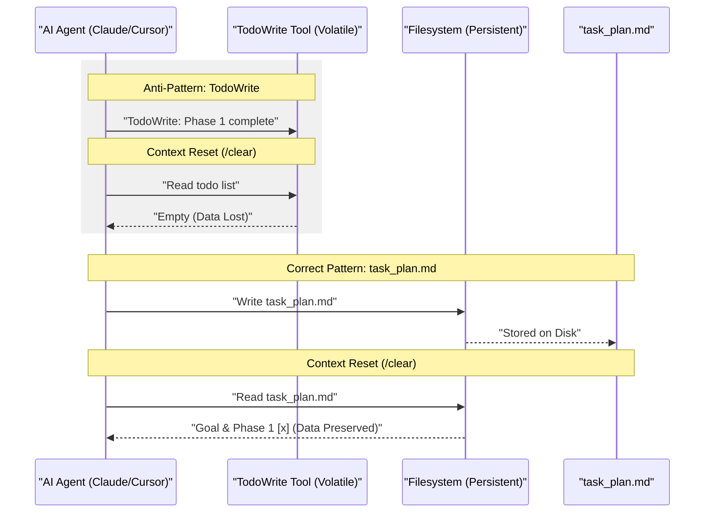
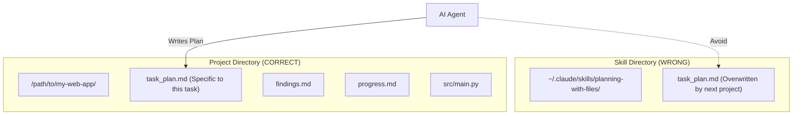

<!-- source: DeepWiki mcp.deepwiki.com · repo OthmanAdi/planning-with-files · page 6.4 Anti-Patterns to Avoid · fetched 2026-10-29 -->

# Anti-Patterns to Avoid

Relevant source files

The following files were used as context for generating this wiki page:

- [.codebuddy/skills/planning-with-files/SKILL.md](.codebuddy/skills/planning-with-files/SKILL.md)
- [.codex/skills/planning-with-files/SKILL.md](.codex/skills/planning-with-files/SKILL.md)
- [.cursor/skills/planning-with-files/SKILL.md](.cursor/skills/planning-with-files/SKILL.md)
- [.factory/skills/planning-with-files/SKILL.md](.factory/skills/planning-with-files/SKILL.md)
- [.mastracode/skills/planning-with-files/SKILL.md](.mastracode/skills/planning-with-files/SKILL.md)
- [.opencode/skills/planning-with-files/SKILL.md](.opencode/skills/planning-with-files/SKILL.md)
- [docs/troubleshooting.md](docs/troubleshooting.md)
- [templates/findings.md](templates/findings.md)
- [templates/progress.md](templates/progress.md)
- [templates/task_plan.md](templates/task_plan.md)

## Purpose and Scope

This document catalogs common mistakes when implementing the 3-File Pattern and provides corrective guidance. These anti-patterns emerge from misunderstanding or incomplete application of the core workflow principles. Each anti-pattern represents a failure mode that leads to goal drift, context overload, or lost state. 

For proper workflow implementation, see [The Core Workflow Loop](#4.1). For correct error recovery, see [Error Recovery Pattern](#6.2). For attention management techniques, see [Read-Before-Decide Pattern](#6.3).

---

## Anti-Pattern Summary

The following table summarizes all documented anti-patterns and their solutions:

| Anti-Pattern | Symptoms | Correct Approach | Core Principle Violated |
|-------------|----------|------------------|------------------------|
| Using TodoWrite for persistence | State lost after context reset | Create `task_plan.md` file | Filesystem as External Memory |
| State goals once and forget | Goal drift after 20+ tool calls | Re-read plan before each decision | Attention Manipulation |
| Hide errors and retry silently | Same mistakes repeated | Log to `Errors Encountered` table | Never Repeat Failures |
| Stuff everything in context | Context window exhaustion | Store in `findings.md` or separate files | Context Optimization |
| Start executing immediately | Disorganized work, no progress tracking | Create plan file FIRST | Systematic Planning |
| Creating files in skill directory | Files "disappear" between projects | Always create in project root | Persistent Working Memory |
| Writing untrusted content to plan | Potential prompt injection/risk | Write web content to `findings.md` | Security Boundary |

Sources: [.codex/skills/planning-with-files/SKILL.md:93-129](), [.factory/skills/planning-with-files/SKILL.md:203-215]()

---

## Anti-Pattern 1: Using TodoWrite for Persistence

### The Problem

Relying on Claude's built-in `TodoWrite` tool to track task state instead of creating a persistent `task_plan.md` file.

**Why this fails:**
- `TodoWrite` state is volatile and disappears on context reset or `/clear`.
- No persistent record accessible across different IDE sessions or platforms.
- Cannot be re-read via automated hooks to refresh the attention window.
- Lost when the agent process restarts.

### Correct Approach

Create `task_plan.md` as the first action for any complex task. This file persists on the filesystem, survives context resets, and is automatically injected into context via the `UserPromptSubmit` hook [[.codex/skills/planning-with-files/SKILL.md:7-10]]().

Sources: [.codex/skills/planning-with-files/SKILL.md:76-83](), [.factory/skills/planning-with-files/SKILL.md:211-215]()

---

## Diagram: Persistence Architecture

Sources: [.codex/skills/planning-with-files/SKILL.md:76-83](), [.factory/skills/planning-with-files/SKILL.md:57-64]()

---

## Anti-Pattern 2: State Goals Once and Forget

### The Problem

Writing goals in the initial context or in `task_plan.md` once, then never re-reading them during execution.

**Why this fails:**
- Goals fall out of the attention window after ~20-30 tool calls.
- Agent continues executing but forgets the original objective ("Goal Drift").
- Work becomes misaligned with user's actual needs.

### Correct Approach

**Read Before Decide:** Before major decisions, read the plan file [[.codex/skills/planning-with-files/SKILL.md:103-105]](). This is automated in most platforms via the `PreToolUse` hook which executes `cat task_plan.md` before tools like `Write`, `Edit`, or `Bash` [[.codex/skills/planning-with-files/SKILL.md:11-15]]().

Sources: [.codex/skills/planning-with-files/SKILL.md:103-105](), [.codex/skills/planning-with-files/SKILL.md:11-15]()

---

## Anti-Pattern 3: Hide Errors and Retry Silently

### The Problem

Encountering an error, retrying a different approach, and never documenting the failure in the planning files.

**Why this fails:**
- Same error will be repeated in future tasks or after context resets.
- Violates the "Keep Failure Traces" principle.
- The agent lacks the history needed to "Mutate the approach" [[.codex/skills/planning-with-files/SKILL.md:123-128]]().

### Correct Approach

**Log ALL Errors:** Every error must be logged in the `Errors Encountered` table in `task_plan.md` [[templates/task_plan.md:109-121]]() and the `Error Log` in `progress.md` [[templates/progress.md:71-84]](). This builds knowledge and prevents repetition [[.codex/skills/planning-with-files/SKILL.md:112-114]]().

Sources: [.codex/skills/planning-with-files/SKILL.md:112-114](), [templates/task_plan.md:109-121](), [templates/progress.md:71-84]()

---

## Anti-Pattern 4: Wrong Directory Creation

### The Problem

Creating `task_plan.md`, `findings.md`, and `progress.md` inside the skill installation directory (e.g., `~/.claude/skills/...`) instead of the project directory.

**Why this fails:**
- Files are not associated with the project source code.
- Different projects overwrite each other's plans.
- Git checkpoints cannot include the planning files.

### Correct Approach

**Where Files Go:** Templates stay in the skill directory, but **Your planning files** must go in **your project directory** [[.codex/skills/planning-with-files/SKILL.md:54-63]]().

Sources: [.codex/skills/planning-with-files/SKILL.md:54-63](), [docs/troubleshooting.md:40-77]()

---

## Diagram: Directory Structure Anti-Pattern

Sources: [.codex/skills/planning-with-files/SKILL.md:54-63](), [docs/troubleshooting.md:40-77]()

---

## Anti-Pattern 5: Security Boundary Violation

### The Problem

Writing raw web content, API responses, or untrusted search results directly into `task_plan.md`.

**Why this fails:**
- `task_plan.md` is read frequently (via `PreToolUse` hooks).
- Untrusted content in a high-frequency read file amplifies the risk of prompt injection.
- Adversarial instructions in web content could hijack the plan [[.factory/skills/planning-with-files/SKILL.md:205-210]]().

### Correct Approach

**Context Isolation:** Write web/search results to `findings.md` only [[.factory/skills/planning-with-files/SKILL.md:207]](). `task_plan.md` should remain a trusted file containing only structured goals, phases, and verified decisions.

Sources: [.factory/skills/planning-with-files/SKILL.md:203-210](), [.codex/skills/planning-with-files/SKILL.md:10-10]()

---

## Anti-Pattern 6: Silent Retries (3-Strike Protocol)

### The Problem

Retrying the exact same failing action multiple times without changing the strategy.

### Correct Approach

Follow the **3-Strike Error Protocol**:
1.  **Attempt 1:** Diagnose & Fix (Read error carefully) [[.codex/skills/planning-with-files/SKILL.md:133-136]]().
2.  **Attempt 2:** Alternative Approach (Different tool/library; NEVER repeat same action) [[.codex/skills/planning-with-files/SKILL.md:138-141]]().
3.  **Attempt 3:** Broader Rethink (Question assumptions, search for solutions) [[.codex/skills/planning-with-files/SKILL.md:143-146]]().
4.  **After 3 Failures:** Escalate to User [[.codex/skills/planning-with-files/SKILL.md:148-151]]().

Sources: [.codex/skills/planning-with-files/SKILL.md:130-152]()

---

## Summary Table: All Anti-Patterns

| Don't | Do Instead |
|-------|------------|
| Use `TodoWrite` for persistence | Create `task_plan.md`, `findings.md`, `progress.md` files |
| State goals once and forget | Re-read `task_plan.md` before major decisions |
| Repeat a failed action | Mutate the approach (3-Strike Protocol) |
| Create files in skill folder | Create files in project root |
| Stuff everything in context | Store large research/data in `findings.md` |
| Write web content to `task_plan.md` | Keep `task_plan.md` trusted; write to `findings.md` |

Sources: [.codex/skills/planning-with-files/SKILL.md:141-150](), [.factory/skills/planning-with-files/SKILL.md:211-215]()

---

