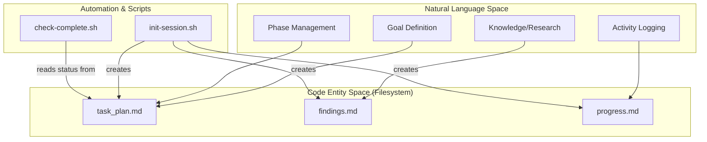
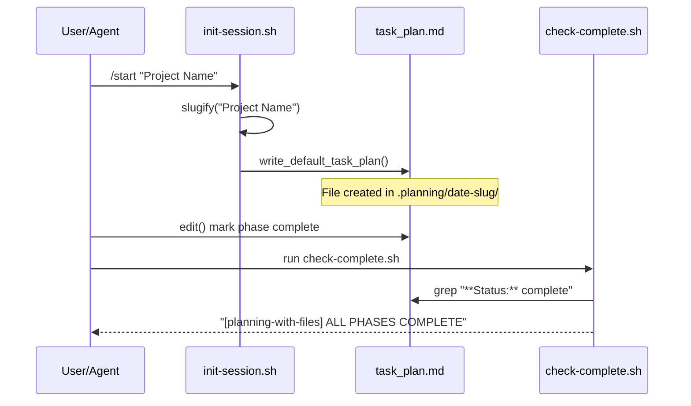

<!-- source: DeepWiki mcp.deepwiki.com · repo OthmanAdi/planning-with-files · page 7 Technical Reference · fetched 2026-10-29 -->

# Technical Reference

<details>
<summary>Relevant source files</summary>

The following files were used as context for generating this wiki page:

- [.gitignore](.gitignore)
- [examples/README.md](examples/README.md)
- [skills/planning-with-files/examples.md](skills/planning-with-files/examples.md)
- [skills/planning-with-files/reference.md](skills/planning-with-files/reference.md)
- [skills/planning-with-files/scripts/check-complete.sh](skills/planning-with-files/scripts/check-complete.sh)
- [skills/planning-with-files/scripts/init-session.sh](skills/planning-with-files/scripts/init-session.sh)
- [skills/planning-with-files/templates/findings.md](skills/planning-with-files/templates/findings.md)
- [skills/planning-with-files/templates/progress.md](skills/planning-with-files/templates/progress.md)
- [skills/planning-with-files/templates/task_plan.md](skills/planning-with-files/templates/task_plan.md)

</details>


## Purpose and Scope

This document provides detailed technical specifications for the planning-with-files system, including file structures, format requirements, script operations, and implementation details. It serves as the technical anchor for the 3-file pattern and the associated automation scripts.

For details on specific components, see the following child pages:
- [task_plan.md Specification](#7.1)
- [findings.md Specification](#7.2)
- [progress.md Specification](#7.3)
- [Helper Scripts Reference](#7.4)
- [Hook System Reference](#7.5)

**Sources:** [skills/planning-with-files/scripts/init-session.sh:1-15](), [skills/planning-with-files/reference.md:1-5]()

---

## File System Architecture

The system transitions from volatile "Context Window" memory to persistent "Filesystem" memory. It utilizes three primary files with specific structural requirements and operational semantics.

### File Type Classification

| File | Type | Persistence | Primary Operations | Template Path |
|------|------|-------------|-------------------|---------------|
| `task_plan.md` | Goal/Phase Tracker | Session-persistent | `read`, `edit` | `templates/task_plan.md` |
| `findings.md` | Knowledge Store | Session-persistent | `append`, `write` | `templates/findings.md` |
| `progress.md` | Chronological Log | Session-persistent | `append` | `templates/progress.md` |

**Sources:** [skills/planning-with-files/reference.md:27-35](), [skills/planning-with-files/scripts/init-session.sh:213-251]()

### Code-to-Filesystem Mapping

The following diagram bridges the high-level concepts to the specific code entities that manage them.


**Diagram: Mapping Natural Language Goals to Code Entities**

**Sources:** [skills/planning-with-files/scripts/init-session.sh:213-251](), [skills/planning-with-files/scripts/check-complete.sh:6-26](), [skills/planning-with-files/templates/task_plan.md:1-14]()

---

## File Format Specifications

### task_plan.md Structure
The `task_plan.md` file follows a strict format designed to manipulate the model's attention.

| Section | Content | Requirement |
|---------|---------|-------------|
| `## Goal` | Terminal state description | Required |
| `## Current Phase` | Current active phase name | Required |
| `## Phases` | Checkbox list with `**Status:**` | Required |
| `## Decisions Made` | Table: Decision \| Rationale | Required |
| `## Errors Encountered`| Table: Error \| Attempt \| Resolution | Required |

**Sources:** [skills/planning-with-files/templates/task_plan.md:8-137](), [skills/planning-with-files/scripts/init-session.sh:92-138]()

### findings.md Structure
Focused on capturing multimodal or transient data that might be lost during context resets.

| Section | Rule |
|---------|------|
| `## Requirements` | Captured from initial user request |
| `## Research Findings` | Updated after every 2 view/search actions |
| `## Visual/Browser Findings` | Critical for multimodal persistence |

**Sources:** [skills/planning-with-files/templates/findings.md:8-87](), [skills/planning-with-files/scripts/init-session.sh:140-161]()

---

## Script Interaction Model

The system uses a suite of scripts to manage the lifecycle of these files. The primary entry point is `init-session.sh` (or `.ps1` for Windows).


**Diagram: Session Initialization and Completion Check Flow**

**Sources:** [skills/planning-with-files/scripts/init-session.sh:54-90](), [skills/planning-with-files/scripts/check-complete.sh:13-46]()

---

## Technical Operation Reference

### Initialization (Slug Mode)
V2.x introduced "Slug Mode" to handle parallel task isolation. Instead of root-level files, it creates a directory structure under `.planning/`.

1. **Slugification**: Converts project names to lowercase, non-alphanumeric characters to `-` [skills/planning-with-files/scripts/init-session.sh:60-66]().
2. **Directory Creation**: Files are stored in `.planning/YYYY-MM-DD-slug/` [skills/planning-with-files/scripts/init-session.sh:258-267]().
3. **Active Pointer**: The file `.planning/.active_plan` is updated to point to the current session [skills/planning-with-files/scripts/init-session.sh:273-275]().

### Completion Logic
The `check-complete.sh` script parses `task_plan.md` to determine if the agent can safely stop. It looks for specific status markers:
- `**Status:** complete` [skills/planning-with-files/scripts/check-complete.sh:17]()
- `[complete]` (legacy fallback) [skills/planning-with-files/scripts/check-complete.sh:23]()

**Sources:** [skills/planning-with-files/scripts/check-complete.sh:1-46](), [skills/planning-with-files/scripts/init-session.sh:1-15]()

---

## Section Update Patterns

### Error Logging Pattern
When an error occurs, the agent must log it immediately to prevent repetition (Manus Principle 5).

```markdown
## Errors Encountered
| Error | Attempt | Resolution |
|-------|---------|------------|
| FileNotFoundError | 1 | Check if file exists, create empty list if not |
```

**Sources:** [skills/planning-with-files/templates/task_plan.md:109-121](), [skills/planning-with-files/reference.md:56-64]()

### The 2-Action Rule
Enforced in `findings.md`, this rule mandates an update after every two view, browser, or search operations to ensure multimodal data is captured as text.

**Sources:** [skills/planning-with-files/templates/findings.md:90-96](), [skills/planning-with-files/examples.md:33-39]()

---

