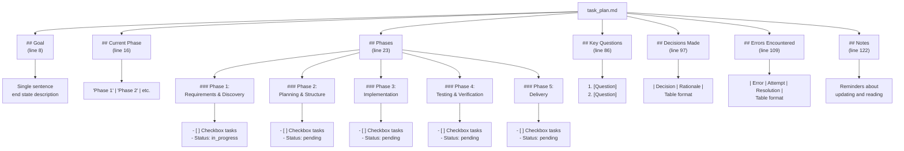
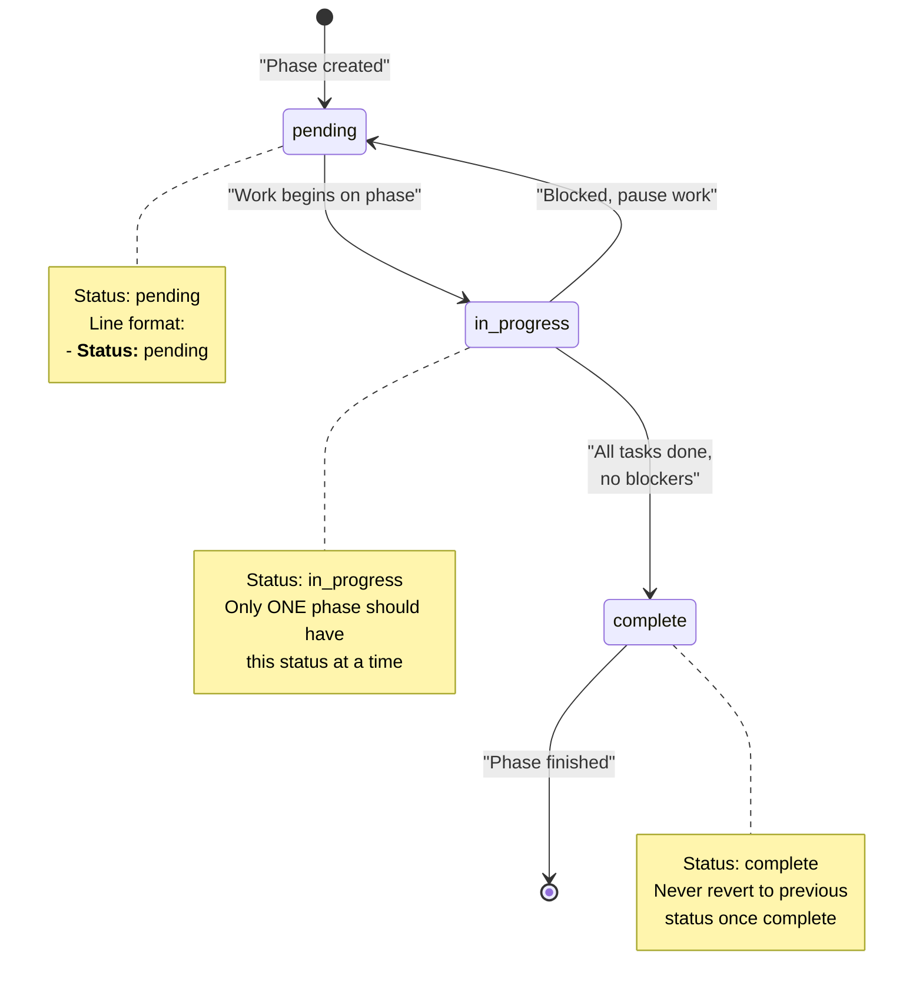
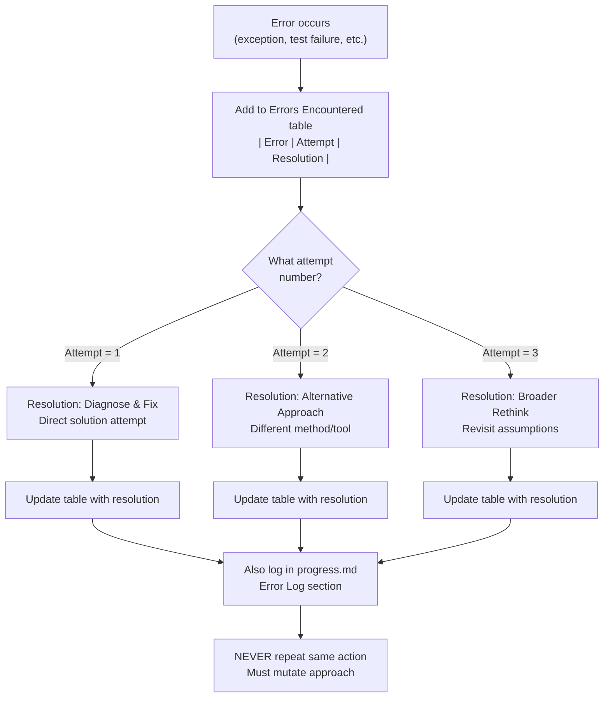
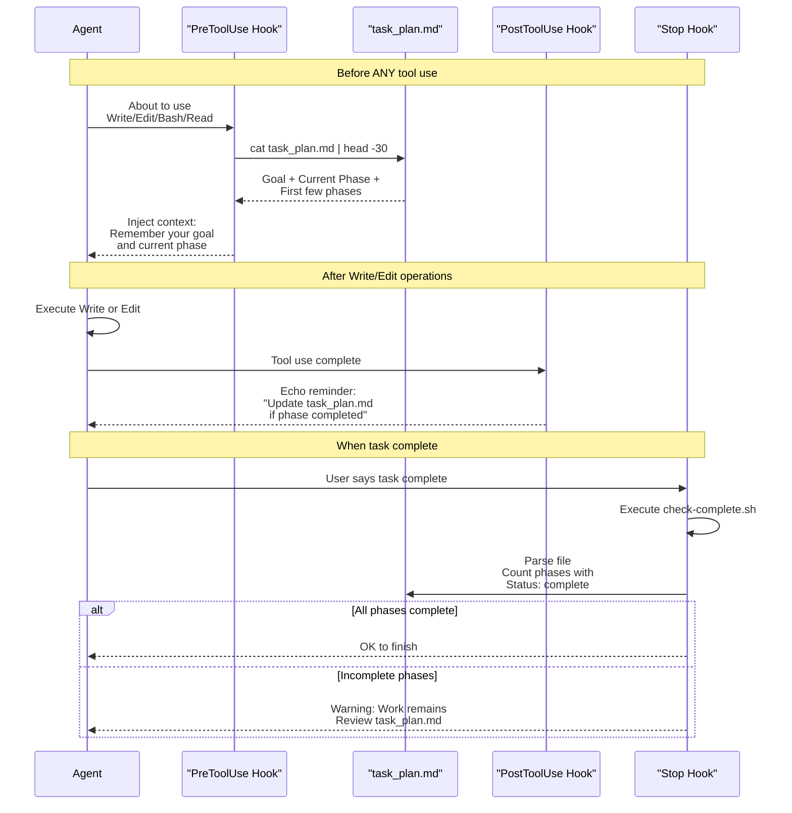
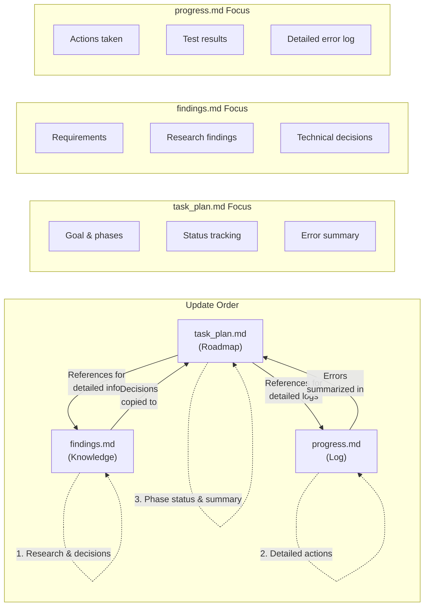

<!-- source: DeepWiki mcp.deepwiki.com · repo OthmanAdi/planning-with-files · page 7.1 task_plan.md Specification · fetched 2026-10-29 -->

# task_plan.md Specification

<details>
<summary>Relevant source files</summary>

The following files were used as context for generating this wiki page:

- [.codex/skills/planning-with-files/templates/findings.md](.codex/skills/planning-with-files/templates/findings.md)
- [.codex/skills/planning-with-files/templates/progress.md](.codex/skills/planning-with-files/templates/progress.md)
- [.codex/skills/planning-with-files/templates/task_plan.md](.codex/skills/planning-with-files/templates/task_plan.md)
- [.gitignore](.gitignore)
- [examples/README.md](examples/README.md)
- [skills/planning-with-files/examples.md](skills/planning-with-files/examples.md)
- [skills/planning-with-files/reference.md](skills/planning-with-files/reference.md)
- [skills/planning-with-files/templates/findings.md](skills/planning-with-files/templates/findings.md)
- [skills/planning-with-files/templates/progress.md](skills/planning-with-files/templates/progress.md)
- [skills/planning-with-files/templates/task_plan.md](skills/planning-with-files/templates/task_plan.md)

</details>


This document provides the complete technical specification for the `task_plan.md` file, which serves as the primary roadmap and working memory for AI agent tasks. It defines the file structure, all sections, status values, update rules, and integration with the hook system. For information about the other planning files (`findings.md` and `progress.md`), see [7.2]() and [7.3](). For workflow rules that govern when to update this file, see [4.2]().

## Purpose and Role

The `task_plan.md` file is the AI agent's persistent working memory on disk. It addresses the volatile context window problem by externalizing the task roadmap, current status, decision history, and error log to the filesystem. The file is structured to answer three critical questions:

1. **Where am I?** - Current Phase section
2. **Where am I going?** - Remaining phases with status
3. **What went wrong?** - Errors Encountered table

The file must be created **before** any work begins and updated after completing phases, making decisions, or encountering errors.

**Sources:** [skills/planning-with-files/templates/task_plan.md:1-6](); [skills/planning-with-files/reference.md:27-35]()

## File Structure Overview

**Diagram: task_plan.md Complete Section Hierarchy**



**Sources:** [skills/planning-with-files/templates/task_plan.md:1-133]()

## Section Specifications

### Goal Section

**Location:** [skills/planning-with-files/templates/task_plan.md:8-14]()

**Format:**
```markdown
## Goal
[One sentence describing the end state]
```

**Requirements:**
- Must be a single, clear sentence.
- Describes the **end state**, not the process.
- Acts as the "north star" for the entire task.
- Should be concrete enough to verify completion.

**Example:**
```markdown
## Goal
Create a Python CLI todo app with add, list, and delete functionality.
```

**Update Frequency:** Once at initialization, rarely modified thereafter.

**Sources:** [skills/planning-with-files/templates/task_plan.md:8-14](); [examples/README.md:22-24]()

### Current Phase Section

**Location:** [skills/planning-with-files/templates/task_plan.md:16-21]()

**Format:**
```markdown
## Current Phase
Phase 1
```

**Valid Values:**
- `Phase 1` through `Phase 5` (default phases).
- Custom phase numbers if more than 5 phases defined.

**Purpose:** Provides instant context on current location in the task. Used by the `PreToolUse` hook to inject relevant context.

**Update Rule:** Must be updated whenever transitioning to a new phase.

**Sources:** [skills/planning-with-files/templates/task_plan.md:16-21](); [examples/README.md:181-182]()

### Phases Section

**Location:** [skills/planning-with-files/templates/task_plan.md:23-84]()

Each phase follows this structure:

```markdown
### Phase N: [Title]
- [ ] Task description
- [ ] Task description
- [ ] Task description
- **Status:** [status_value]
```

#### Status Values State Machine

**Diagram: Phase Status Transition Model**



**Status Value Definitions:**

| Status | Meaning | Usage Rule |
|--------|---------|------------|
| `pending` | Not started yet | Initial state for all phases except Phase 1. |
| `in_progress` | Currently working on this | Only ONE phase should have this status at any time. |
| `complete` | Finished this phase | Set when all checkboxes are checked and no blockers remain. |

**Sources:** [skills/planning-with-files/templates/task_plan.md:39-44]()

#### Default Phase Definitions

**Phase 1: Requirements & Discovery**

**Location:** [skills/planning-with-files/templates/task_plan.md:30-44]()

**Purpose:** Understand what needs to be done and gather initial information.

**Standard Tasks:**
- Understand user intent.
- Identify constraints and requirements.
- Document findings in `findings.md`.

**Initial Status:** `in_progress` (Phase 1 always starts active).

---

**Phase 2: Planning & Structure**

**Location:** [skills/planning-with-files/templates/task_plan.md:46-54]()

**Purpose:** Decide technical approach and project structure.

**Standard Tasks:**
- Define technical approach.
- Create project structure if needed.
- Document decisions with rationale.

---

**Phase 3: Implementation**

**Location:** [skills/planning-with-files/templates/task_plan.md:56-64]()

**Purpose:** Build/create/write the solution.

**Standard Tasks:**
- Execute the plan step by step.
- Write code to files before executing.
- Test incrementally.

**Critical Rule:** Must write code to files before using bash tool (prevents "code exists only in context" problems).

---

**Phase 4: Testing & Verification**

**Location:** [skills/planning-with-files/templates/task_plan.md:66-74]()

**Purpose:** Verify everything works and meets requirements.

**Standard Tasks:**
- Verify all requirements met.
- Document test results in `progress.md`.
- Fix any issues found.

**Integration:** Test results should be logged in the `progress.md` Test Results table.

---

**Phase 5: Delivery**

**Location:** [skills/planning-with-files/templates/task_plan.md:76-84]()

**Purpose:** Final review and handoff to user.

**Standard Tasks:**
- Review all output files.
- Ensure deliverables are complete.
- Deliver to user.

**Verification:** The `check-complete.sh` or `check-complete.ps1` script verifies this phase is complete before allowing task closure.

**Sources:** [skills/planning-with-files/templates/task_plan.md:30-84](); [examples/README.md:205-216]()

### Key Questions Section

**Location:** [skills/planning-with-files/templates/task_plan.md:86-95]()

**Format:**
```markdown
## Key Questions
1. [Question to answer]
2. [Question to answer]
```

**Purpose:** Track important questions that guide research and decision-making. Questions should be answered as discoveries are made, with answers documented in `findings.md`.

**Example:**
```markdown
## Key Questions
1. Should tasks persist between sessions? (Yes - need file storage)
2. What format for storing tasks? (JSON file)
```

**Update Pattern:** Add questions during Phase 1 and Phase 2. Answer them by updating adjacent text or documenting in `findings.md`.

**Sources:** [skills/planning-with-files/templates/task_plan.md:86-95](); [examples/README.md:218-221]()

### Decisions Made Table

**Location:** [skills/planning-with-files/templates/task_plan.md:97-107]()

**Format:**
```markdown
## Decisions Made
| Decision | Rationale |
|----------|-----------|
| Use JSON for storage | Simple, human-readable, built-in Python support |
```

**Column Specifications:**

| Column | Content | Max Length |
|--------|---------|------------|
| Decision | What was decided (technology, approach, structure) | Keep concise, ~50 chars. |
| Rationale | Why this choice was made | Explain tradeoffs, ~100 chars. |

**When to Add Entries:**
- Choosing a technology or library.
- Selecting an architectural pattern.
- Making design tradeoffs.
- Rejecting alternatives.

**Critical Rule:** Always include rationale. Future sessions need to understand **why** decisions were made to avoid second-guessing.

**Sources:** [skills/planning-with-files/templates/task_plan.md:97-107](); [examples/README.md:223-229]()

### Errors Encountered Table

**Location:** [skills/planning-with-files/templates/task_plan.md:109-120]()

**Format:**
```markdown
## Errors Encountered
| Error | Attempt | Resolution |
|-------|---------|------------|
| FileNotFoundError | 1 | Check if file exists, create empty list if not |
| JSONDecodeError | 2 | Handle empty file case explicitly |
```

**Column Specifications:**

| Column | Content | Purpose |
|--------|---------|---------|
| Error | Error name or description | Identifies what went wrong. |
| Attempt | Numeric counter (1, 2, 3...) | Tracks how many attempts made. |
| Resolution | How it was fixed | Documents the solution. |

**Diagram: Error Logging and 3-Strike Protocol Integration**



**Critical Rules:**
1. **Log ALL errors** - Even if fixed quickly, document it.
2. **Increment attempt counter** - Each retry gets a new row with incremented attempt number.
3. **Never repeat failed actions** - Each resolution must describe a different approach.
4. **Use 3-Strike Protocol** - See [6.2]() for detailed error recovery patterns.

**Sources:** [skills/planning-with-files/templates/task_plan.md:109-120](); [skills/planning-with-files/examples.md:161-185]()

### Notes Section

**Location:** [skills/planning-with-files/templates/task_plan.md:122-133]()

**Standard Content:**
```markdown
## Notes
- Update phase status as you progress: pending → in_progress → complete
- Re-read this plan before major decisions (attention manipulation)
- Log ALL errors - they help avoid repetition
```

**Purpose:** Provides reminders about update rules and best practices. This section is static and rarely modified.

**Sources:** [skills/planning-with-files/templates/task_plan.md:122-133]()

## Integration with Hook System

**Diagram: task_plan.md in Hook System Lifecycle**



**Hook Integration Points:**

| Hook | File Operation | Purpose |
|------|----------------|---------|
| `PreToolUse` | `cat task_plan.md \| head -30` | Inject Goal + Current Phase into context before actions. |
| `PostToolUse` | Echo reminder | Prompt agent to update if phase completed. |
| `Stop` | Calls validation script | Verify all phases marked complete before finishing. |

**Sources:** [skills/planning-with-files/templates/task_plan.md:1-133](); [skills/planning-with-files/reference.md:43-54]()

## Git Checkpoint Workflow

In v2.37.0+, a "one phase, one commit" pattern is encouraged. The `task_plan.md` file should include a Git Checkpoints table to track these rollback points.

**Format:**
| Phase | Commit Hash | Note |
|-------|-------------|------|
| Phase 1 | `abc1234` | Requirements defined |
| Phase 2 | `def5678` | Architecture chosen |

**Rationale:** Provides a safety net for complex multi-phase tasks, allowing the agent to rollback to a known good state if implementation fails catastrophically.

**Sources:** [skills/planning-with-files/templates/task_plan.md:109-121]()

## Update Rules and Patterns

### Update Frequency Table

| Trigger Event | Section to Update | Required? |
|---------------|-------------------|-----------|
| Start new phase | Current Phase, Phase status | Yes |
| Complete phase | Phase status (→ complete), Current Phase | Yes |
| Make technical decision | Decisions Made table | Yes |
| Encounter error | Errors Encountered table | Yes |
| Before major decision | None (read-only) | No, but strongly recommended |
| Add phase checklist item | Phase tasks | Optional |
| Answer key question | Key Questions section | Optional |

### Read-Before-Decide Pattern

**When to Re-read:**
- Before choosing technologies or frameworks.
- Before changing architectural direction.
- After 10+ tool calls since last read.
- When feeling uncertain about next steps.

**Command Pattern:**
```bash
cat task_plan.md | head -30
```

This reads the first 30 lines (Goal, Current Phase, and early phases), which is sufficient for context refresh without overwhelming the context window.

**Rationale:** This is "attention manipulation" - forcing the agent to re-focus on the original goal and current phase prevents goal drift.

**Sources:** [skills/planning-with-files/templates/task_plan.md:126-127](); [skills/planning-with-files/examples.md:189-202]()

## Relationship to Other Planning Files

**Diagram: Information Flow Between Planning Files**



**Division of Responsibility:**

| Information Type | Primary File | Reference in task_plan.md? |
|------------------|--------------|---------------------------|
| Task roadmap | `task_plan.md` | N/A - this is the source. |
| Technical decisions | `findings.md` | Yes - copy to Decisions Made table. |
| Research findings | `findings.md` | No - reference externally. |
| Detailed actions | `progress.md` | No - reference externally. |
| Test results | `progress.md` | No - reference externally. |
| Error summary | `task_plan.md` | Yes - Errors Encountered table. |
| Detailed error log | `progress.md` | No - reference externally. |

**Sources:** [skills/planning-with-files/templates/task_plan.md:1-133](); [skills/planning-with-files/templates/findings.md:1-96](); [skills/planning-with-files/templates/progress.md:1-115]()

## Anti-Patterns and Common Mistakes

### Anti-Pattern 1: Creating task_plan.md in Skill Directory
Planning files must be in the project root directory. Files in the skill directory are often transient or inaccessible to the agent's primary tools.

### Anti-Pattern 2: Skipping Errors Table
Empty error tables after encountering issues indicate the agent is not learning. Every error must be logged to prevent "silent retries."

**Sources:** [skills/planning-with-files/examples.md:161-171]()

### Anti-Pattern 3: Multiple Phases with in_progress Status
Only ONE phase should be `in_progress` at a time to maintain focus and clear status tracking.

### Anti-Pattern 4: Writing Untrusted Content to task_plan.md
Never write raw web search results or untrusted data directly into `task_plan.md`. Use `findings.md` for raw research and only migrate validated decisions to the plan.

**Sources:** [skills/planning-with-files/examples.md:36]()

---

