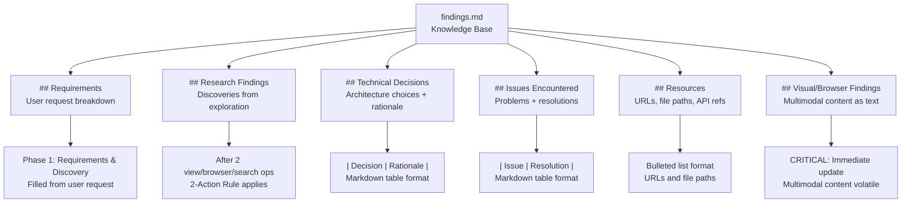
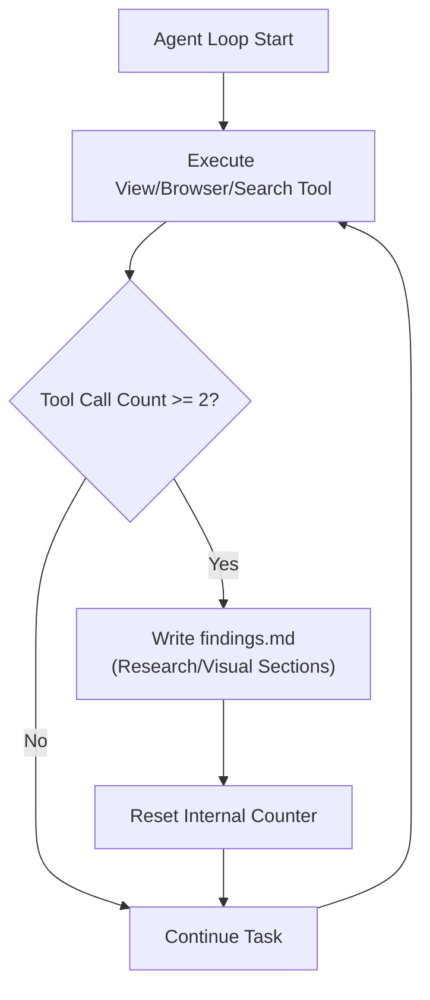
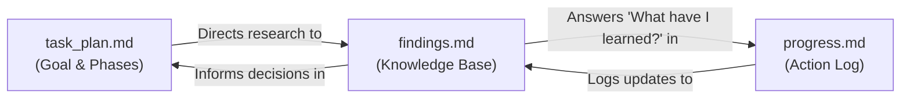

<!-- source: DeepWiki mcp.deepwiki.com · repo OthmanAdi/planning-with-files · page 7.2 findings.md Specification · fetched 2026-10-29 -->

# findings.md Specification

Relevant source files

The following files were used as context for generating this wiki page:

- [.codex/skills/planning-with-files/templates/findings.md](.codex/skills/planning-with-files/templates/findings.md)
- [.codex/skills/planning-with-files/templates/progress.md](.codex/skills/planning-with-files/templates/progress.md)
- [.codex/skills/planning-with-files/templates/task_plan.md](.codex/skills/planning-with-files/templates/task_plan.md)
- [.gitignore](.gitignore)
- [examples/README.md](examples/README.md)
- [skills/planning-with-files/examples.md](skills/planning-with-files/examples.md)
- [skills/planning-with-files/reference.md](skills/planning-with-files/reference.md)
- [skills/planning-with-files/templates/findings.md](skills/planning-with-files/templates/findings.md)
- [skills/planning-with-files/templates/progress.md](skills/planning-with-files/templates/progress.md)
- [skills/planning-with-files/templates/task_plan.md](skills/planning-with-files/templates/task_plan.md)

This document provides a complete technical specification for the `findings.md` file, one of the three core planning files in the planning-with-files system. It covers the file's structure, sections, update triggers, and integration with the agent workflow.

For information about the other planning files, see [task_plan.md Specification](#7.1) and [progress.md Specification](#7.3). For the overall workflow that uses these files, see [The Core Workflow Loop](#4.1).

---

## Purpose and Role

The `findings.md` file serves as a persistent knowledge base that stores all discoveries, decisions, and research findings during task execution. It functions as external memory, addressing the problem of limited and volatile context windows in AI agents.

**Core Functions:**
- **Knowledge Repository**: Captures requirements, research findings, and technical decisions.
- **Multimodal Persistence**: Critical for storing visual/browser information that doesn't persist in context [skills/planning-with-files/templates/findings.md:78-79]().
- **Decision Log**: Documents technical choices with rationale to prevent forgetting why decisions were made [skills/planning-with-files/templates/findings.md:39-40]().
- **Resource Index**: Maintains links to documentation, APIs, and file paths [skills/planning-with-files/templates/findings.md:66-67]().

**Key Principle**: Context windows are volatile and limited (RAM), while `findings.md` provides persistent, unlimited storage (disk) [skills/planning-with-files/reference.md:32-35](). This file is updated more frequently than `task_plan.md` but less frequently than `progress.md`.

Sources: [skills/planning-with-files/templates/findings.md:1-6](), [skills/planning-with-files/reference.md:32-35]()

---

## File Structure Overview

The `findings.md` file consists of six main sections, each serving a distinct purpose in the knowledge management workflow.

### Structure Diagram

Title: findings.md Logical Structure

**Section Hierarchy:**
1. **Requirements**: Structured as bulleted list [skills/planning-with-files/templates/findings.md:8-21]().
2. **Research Findings**: Structured as bulleted list [skills/planning-with-files/templates/findings.md:23-34]().
3. **Technical Decisions**: Structured as markdown table (Decision | Rationale) [skills/planning-with-files/templates/findings.md:36-48]().
4. **Issues Encountered**: Structured as markdown table (Issue | Resolution) [skills/planning-with-files/templates/findings.md:50-61]().
5. **Resources**: Structured as bulleted list [skills/planning-with-files/templates/findings.md:63-73]().
6. **Visual/Browser Findings**: Structured as bulleted list (most critical section) [skills/planning-with-files/templates/findings.md:75-86]().

Sources: [skills/planning-with-files/templates/findings.md:7-96]()

---

## Section Specifications

### Requirements Section
**Purpose**: Captures what the user requested, broken down into specific, actionable requirements [skills/planning-with-files/templates/findings.md:9-12]().
**Format**: Bulleted list (`-` prefix).
**When to Update**: During Phase 1 (Requirements & Discovery).

### Research Findings Section
**Purpose**: Documents key discoveries from web searches or documentation [skills/planning-with-files/templates/findings.md:24-26]().
**Format**: Bulleted list.
**When to Update**: After every 2 view/browser/search operations (2-Action Rule) [skills/planning-with-files/templates/findings.md:27]().

### Technical Decisions Section
**Purpose**: Logs architecture choices with reasoning to prevent "decision amnesia" [skills/planning-with-files/templates/findings.md:38-40]().
**Format**: Markdown table with "Decision" and "Rationale" columns [skills/planning-with-files/templates/findings.md:46-48]().

### Issues Encountered Section
**Purpose**: Documents broader problems beyond simple code errors (which go in `task_plan.md`) [skills/planning-with-files/templates/findings.md:52-54]().
**Format**: Markdown table with "Issue" and "Resolution" columns [skills/planning-with-files/templates/findings.md:59-61]().

### Visual/Browser Findings Section
**Purpose**: **CRITICAL SECTION** - Captures information from images, PDFs, or browser results that do not persist in context [skills/planning-with-files/templates/findings.md:77-79]().
**Format**: Bulleted list.
**When to Update**: **IMMEDIATELY** after viewing images or browser results [skills/planning-with-files/templates/findings.md:84-85]().

Sources: [skills/planning-with-files/templates/findings.md:8-86]()

---

## The 2-Action Rule

The 2-Action Rule is a critical workflow pattern specific to `findings.md` that prevents multimodal information loss [skills/planning-with-files/templates/findings.md:90-95]().

### Rule Specification
- **Trigger**: After every 2 tool operations involving visual or search content.
- **Affected Tools**: `View` (images/PDFs), `Browser`, search operations.
- **Required Action**: Update `findings.md` with discovered information.
- **Target Sections**: Research Findings and/or Visual/Browser Findings.

Title: 2-Action Rule Enforcement Logic

Sources: [skills/planning-with-files/templates/findings.md:90-96](), [skills/planning-with-files/reference.md:130-164]()

---

## Update Triggers and Workflow Integration

### Update Frequency by Section

| Section | Update Frequency | Trigger Event |
|---------|------------------|---------------|
| Requirements | Once | Phase 1 start [skills/planning-with-files/templates/findings.md:12]() |
| Research Findings | High (every 2 ops) | After 2 view/browser/search operations [skills/planning-with-files/templates/findings.md:27]() |
| Technical Decisions | Medium | When making significant architectural choices [skills/planning-with-files/templates/findings.md:40]() |
| Issues Encountered | Low-Medium | When encountering blockers or problems [skills/planning-with-files/templates/findings.md:54]() |
| Resources | Low-Medium | When discovering useful documentation [skills/planning-with-files/templates/findings.md:67]() |
| Visual/Browser Findings | High (immediate) | After EVERY view/browser operation [skills/planning-with-files/templates/findings.md:79]() |

Sources: [skills/planning-with-files/templates/findings.md:1-96]()

---

## Integration with Other Planning Files

### Relationship to task_plan.md and progress.md

Title: Planning File Interdependencies

**Key Differences:**
- **task_plan.md**: Individual error attempts with retry count [skills/planning-with-files/templates/task_plan.md:111-113]().
- **findings.md**: Broader issues with architectural or design implications [skills/planning-with-files/templates/findings.md:53-54]().
- **progress.md**: Chronological log of actions [skills/planning-with-files/templates/progress.md:3-5]().

Sources: [skills/planning-with-files/templates/task_plan.md:109-121](), [skills/planning-with-files/templates/findings.md:50-61](), [skills/planning-with-files/templates/progress.md:1-115]()

---

## Content Guidelines and Best Practices

### Technical Decisions Guidelines
- **DO**: Explain WHY decisions were made [skills/planning-with-files/templates/findings.md:39]().
- **DO**: Use markdown tables for clarity [skills/planning-with-files/templates/findings.md:46-48]().
- **DON'T**: Document individual actions (use `progress.md` for that).

### Visual/Browser Findings Guidelines
- **DO**: Describe visual content in detail immediately [skills/planning-with-files/templates/findings.md:79]().
- **DO**: Convert diagrams to textual structure descriptions [skills/planning-with-files/templates/findings.md:78]().
- **DON'T**: Assume visual content will persist in the context window [skills/planning-with-files/templates/findings.md:92]().

Sources: [skills/planning-with-files/templates/findings.md:1-96](), [skills/planning-with-files/reference.md:203-204]()

---

