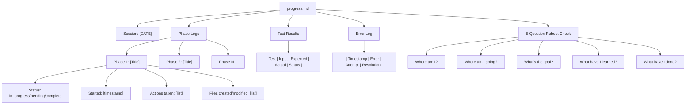
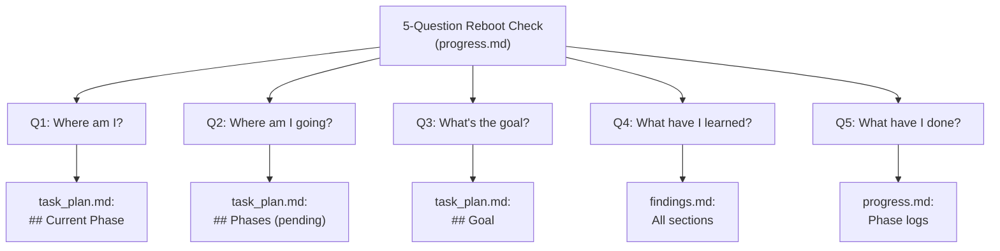
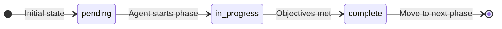

<!-- source: DeepWiki mcp.deepwiki.com · repo OthmanAdi/planning-with-files · page 7.3 progress.md Specification · fetched 2026-10-29 -->

# progress.md Specification

<details>
<summary>Relevant source files</summary>

The following files were used as context for generating this wiki page:

- [.codex/skills/planning-with-files/templates/findings.md](.codex/skills/planning-with-files/templates/findings.md)
- [.codex/skills/planning-with-files/templates/progress.md](.codex/skills/planning-with-files/templates/progress.md)
- [.codex/skills/planning-with-files/templates/task_plan.md](.codex/skills/planning-with-files/templates/task_plan.md)
- [.gitignore](.gitignore)
- [examples/README.md](examples/README.md)
- [skills/planning-with-files/examples.md](skills/planning-with-files/examples.md)
- [skills/planning-with-files/reference.md](skills/planning-with-files/reference.md)
- [skills/planning-with-files/templates/findings.md](skills/planning-with-files/templates/findings.md)
- [skills/planning-with-files/templates/progress.md](skills/planning-with-files/templates/progress.md)
- [skills/planning-with-files/templates/task_plan.md](skills/planning-with-files/templates/task_plan.md)

</details>


## Purpose and Scope

This document provides the complete technical specification for `progress.md`, the chronological action log in the planning-with-files system. It defines the file structure, update patterns, status conventions, and integration points with automation scripts.

For specifications of the other planning files, see [7.1 task_plan.md Specification]() and [7.2 findings.md Specification](). For how `progress.md` integrates with session recovery workflows, see [5.2 Session Recovery and Context Restoration]().

## Overview

`progress.md` serves as the **session log** in the 3-file pattern, providing a chronological record of actions, test results, and errors. Unlike `task_plan.md` (which tracks phase status) and `findings.md` (which stores knowledge), `progress.md` answers the question: **"What have I done?"** [skills/planning-with-files/templates/progress.md:1-6]()

### Role in the 3-File Pattern

| File | Purpose | Question Answered |
|------|---------|-------------------|
| `task_plan.md` | Roadmap and status | "Where am I? Where am I going?" |
| `findings.md` | Knowledge base | "What have I learned?" |
| `progress.md` | Action log | "What have I done?" |

### Update Frequency

- **Phase completion**: Log all actions taken during the phase. [skills/planning-with-files/templates/progress.md:110-111]()
- **Error occurrence**: Add to Error Log immediately. [skills/planning-with-files/templates/progress.md:75-76]()
- **Test execution**: Record results in Test Results table. [skills/planning-with-files/templates/progress.md:62-63]()
- **Session resume**: Update 5-Question Reboot Check. [skills/planning-with-files/templates/progress.md:88-89]()

**Sources:** [skills/planning-with-files/templates/progress.md:1-115]()

## File Structure

The following diagram illustrates the hierarchy of sections within the `progress.md` template.



**Structure Diagram: Complete progress.md Hierarchy**

**Sources:** [skills/planning-with-files/templates/progress.md:1-115](), [.codex/skills/planning-with-files/templates/progress.md:1-115]()

## Session Header

### Format

```markdown
## Session: [DATE]
```

### Specification

| Field | Type | Example | Purpose |
|-------|------|---------|---------|
| `[DATE]` | String | `2026-01-15` | Identifies when the work session occurred. [skills/planning-with-files/templates/progress.md:8-13]() |

The session header groups all work performed on a specific date. Multiple sessions on the same date share the same header.

**Sources:** [skills/planning-with-files/templates/progress.md:8-13]()

## Phase Log Sections

### Structure

Each phase has a dedicated subsection with the following structure: [skills/planning-with-files/templates/progress.md:15-56]()

```markdown
### Phase N: [Title]
- **Status:** in_progress|pending|complete
- **Started:** [timestamp]
- Actions taken:
  - [action 1]
  - [action 2]
- Files created/modified:
  - [file 1]
  - [file 2]
```

### Field Specifications

| Field | Type | Required | Description |
|-------|------|----------|-------------|
| `Phase N` | Integer | Yes | Phase number (1-5 typically). [skills/planning-with-files/templates/task_plan.md:30-84]() |
| `[Title]` | String | Yes | Descriptive phase name. |
| `Status` | Enum | Yes | One of: `pending`, `in_progress`, `complete`. [skills/planning-with-files/templates/progress.md:24-26]() |
| `Started` | Timestamp | No | When phase work began (format: `YYYY-MM-DD HH:MM`). |
| `Actions taken` | List | Yes | Bullet list of specific actions performed. [skills/planning-with-files/templates/progress.md:27-35]() |
| `Files created/modified` | List | Yes | Bullet list of file paths touched. [skills/planning-with-files/templates/progress.md:36-45]() |

### Example Phase Log

```markdown
### Phase 3: Implementation
- **Status:** complete
- **Started:** 2026-01-15 14:30
- Actions taken:
  - Created todo.py with CLI argument parsing
  - Implemented add_task() function with JSON persistence
- Files created/modified:
  - todo.py (created)
  - task_plan.md (updated status)
```

**Sources:** [skills/planning-with-files/templates/progress.md:15-56](), [examples/README.md:127-145]()

## Test Results Table

### Structure

```markdown
## Test Results
| Test | Input | Expected | Actual | Status |
|------|-------|----------|--------|--------|
| [test name] | [input data] | [expected outcome] | [actual outcome] | ✓ or ✗ |
```

### Column Specifications

| Column | Type | Description | Example |
|--------|------|-------------|---------|
| `Test` | String | Name or description of test | "Add task" |
| `Input` | String | Command or input data used | `python todo.py add "Buy milk"` |
| `Expected` | String | Expected behavior or output | "Task added successfully" |
| `Actual` | String | Actual behavior or output | "Task added successfully" |
| `Status` | Symbol | `✓` for pass, `✗` for fail | ✓ |

**Sources:** [skills/planning-with-files/templates/progress.md:58-70]()

## Error Log Table

### Structure

```markdown
## Error Log
| Timestamp | Error | Attempt | Resolution |
|-----------|-------|---------|------------|
| [ISO timestamp] | [error description] | [attempt number] | [how it was fixed] |
```

### Column Specifications

| Column | Type | Format | Description |
|--------|------|--------|-------------|
| `Timestamp` | DateTime | `YYYY-MM-DD HH:MM` | When error occurred. [skills/planning-with-files/templates/progress.md:81-84]() |
| `Error` | String | Error type | `FileNotFoundError`, `JSONDecodeError`, etc. |
| `Attempt` | Integer | `1`, `2`, `3` | Which attempt this represents. |
| `Resolution` | String | Action taken | How error was fixed or mitigated. |

### The 3-Strike Error Protocol

Errors are tracked with attempt numbers to enforce the **3-Strike Error Protocol**. If an action fails, the next action must be different (mutate the approach). [reference.md:184-185](), [reference.md:205-206]()

| Attempt | Action Required |
|---------|----------------|
| 1 | Diagnose & Fix: Standard debugging. |
| 2 | Alternative Approach: Try different method. |
| 3 | Broader Rethink: Escalate or redesign. |

**Sources:** [skills/planning-with-files/templates/progress.md:71-84](), [skills/planning-with-files/examples.md:161-185](), [reference.md:205-207]()

## 5-Question Reboot Check

### Purpose

The 5-Question Reboot Check is a **context verification mechanism**. If the agent can answer all five questions, it has sufficient context to resume work effectively. [skills/planning-with-files/templates/progress.md:85-89]()

### Structure

```markdown
## 5-Question Reboot Check
| Question | Answer |
|----------|--------|
| Where am I? | Phase X |
| Where am I going? | Remaining phases |
| What's the goal? | [goal statement] |
| What have I learned? | See findings.md |
| What have I done? | See above |
```

### Cross-File Dependencies

The following diagram bridges the natural language questions to the specific code entities (markdown sections) that provide the answers.



**5-Question Cross-File Dependencies**

**Sources:** [skills/planning-with-files/templates/progress.md:85-106](), [examples/README.md:156-167]()

## Update Patterns and Timing

### Update Trigger Matrix

| Event | Update Section | Required | Timing |
|-------|---------------|----------|--------|
| Phase completion | Phase log | Yes | Immediately after phase complete. [skills/planning-with-files/templates/progress.md:110-111]() |
| Test execution | Test Results table | Yes | Immediately after test run. [skills/planning-with-files/templates/progress.md:62-63]() |
| Error occurrence | Error Log table | Yes | Immediately when error occurs. [skills/planning-with-files/templates/progress.md:75-76]() |
| Context loss | 5-Question Reboot Check | Yes | After session recovery. [skills/planning-with-files/templates/progress.md:88-89]() |

### Status Synchronization

The `Status` field in `progress.md` phase logs **must match** the `Status` field in the corresponding phase in `task_plan.md`. [skills/planning-with-files/templates/progress.md:24-26](), [skills/planning-with-files/templates/task_plan.md:38-44]()



**Phase Status State Machine**

**Sources:** [skills/planning-with-files/templates/progress.md:108-115](), [skills/planning-with-files/templates/task_plan.md:130-132]()

## Integration with Session Recovery

When context is lost (e.g., after a `/clear` command), the `progress.md` file is essential for restoration.

1.  **Read Planning Files**: The agent must read `task_plan.md`, `findings.md`, and `progress.md`. [examples/README.md:198-203]()
2.  **Attention Manipulation**: Reading these files pushes the global plan into the model's recent attention span. [reference.md:43-49]()
3.  **Verify Context**: Complete the 5-Question Reboot Check in `progress.md`. [skills/planning-with-files/templates/progress.md:85-97]()

**Sources:** [reference.md:43-55](), [skills/planning-with-files/templates/progress.md:85-106](), [examples/README.md:189-203]()

---

