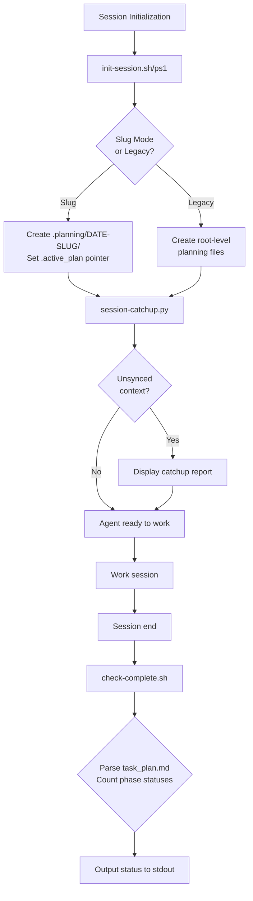
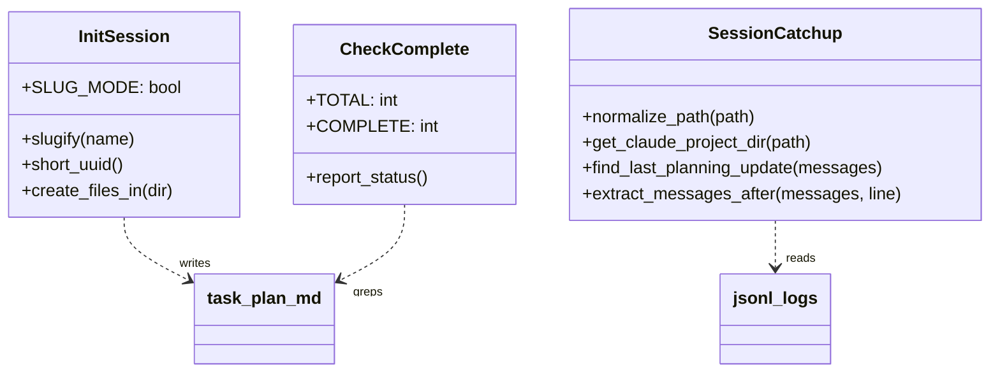
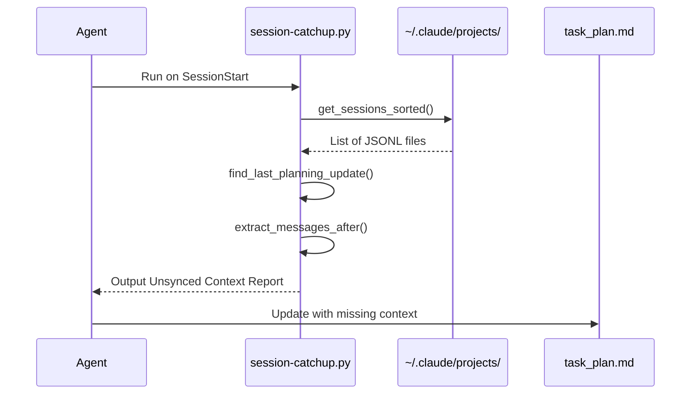

<!-- source: DeepWiki mcp.deepwiki.com · repo OthmanAdi/planning-with-files · page 7.4 Helper Scripts Reference · fetched 2026-10-29 -->

# Helper Scripts Reference

<details>
<summary>Relevant source files</summary>

The following files were used as context for generating this wiki page:

- [.codebuddy/skills/planning-with-files/scripts/resolve-plan-dir.ps1](.codebuddy/skills/planning-with-files/scripts/resolve-plan-dir.ps1)
- [.codebuddy/skills/planning-with-files/scripts/resolve-plan-dir.sh](.codebuddy/skills/planning-with-files/scripts/resolve-plan-dir.sh)
- [.codebuddy/skills/planning-with-files/scripts/session-catchup.py](.codebuddy/skills/planning-with-files/scripts/session-catchup.py)
- [.codebuddy/skills/planning-with-files/scripts/set-active-plan.ps1](.codebuddy/skills/planning-with-files/scripts/set-active-plan.ps1)
- [.codebuddy/skills/planning-with-files/scripts/set-active-plan.sh](.codebuddy/skills/planning-with-files/scripts/set-active-plan.sh)
- [.codex/skills/planning-with-files/scripts/resolve-plan-dir.ps1](.codex/skills/planning-with-files/scripts/resolve-plan-dir.ps1)
- [.codex/skills/planning-with-files/scripts/resolve-plan-dir.sh](.codex/skills/planning-with-files/scripts/resolve-plan-dir.sh)
- [.codex/skills/planning-with-files/scripts/session-catchup.py](.codex/skills/planning-with-files/scripts/session-catchup.py)
- [.codex/skills/planning-with-files/scripts/set-active-plan.ps1](.codex/skills/planning-with-files/scripts/set-active-plan.ps1)
- [.continue/skills/planning-with-files/scripts/session-catchup.py](.continue/skills/planning-with-files/scripts/session-catchup.py)
- [.factory/skills/planning-with-files/scripts/session-catchup.py](.factory/skills/planning-with-files/scripts/session-catchup.py)
- [.gemini/skills/planning-with-files/scripts/session-catchup.py](.gemini/skills/planning-with-files/scripts/session-catchup.py)
- [.pi/skills/planning-with-files/scripts/session-catchup.py](.pi/skills/planning-with-files/scripts/session-catchup.py)
- [scripts/check-complete.sh](scripts/check-complete.sh)
- [scripts/check-continue.sh](scripts/check-continue.sh)
- [scripts/init-session.sh](scripts/init-session.sh)
- [skills/planning-with-files/scripts/check-complete.sh](skills/planning-with-files/scripts/check-complete.sh)
- [skills/planning-with-files/scripts/init-session.sh](skills/planning-with-files/scripts/init-session.sh)
- [skills/planning-with-files/scripts/session-catchup.py](skills/planning-with-files/scripts/session-catchup.py)
- [tests/test_session_catchup.py](tests/test_session_catchup.py)

</details>


This page documents the core helper scripts that automate session initialization, completion verification, and context recovery in the `planning-with-files` system. These scripts are invoked by the hook system and can also be run manually when needed.

---

## Overview

The `planning-with-files` system includes several helper scripts that implement critical automation and cross-platform resolution.

| Script | Purpose | Triggered By | Exit Codes |
|--------|---------|--------------|------------|
| `init-session.sh/ps1` | Create planning files from templates (Legacy or Slug Mode) | SessionStart hook | N/A (always succeeds) |
| `check-complete.sh` | Verify all phases in `task_plan.md` are complete | Stop hook | 0 (always) — reports status to stdout |
| `session-catchup.py` | Recover context from previous sessions | SessionStart hook | N/A (informational) |
| `resolve-plan-dir.sh/ps1` | Locate the active planning directory | Internal tools | 0 (success) |
| `set-active-plan.sh/ps1` | Pin a specific plan as "active" | `init-session` | 0 (success) |

All scripts exist in both bash (`.sh`) and PowerShell (`.ps1`) versions for cross-platform compatibility, except `session-catchup.py` which is platform-agnostic Python.

**Sources:** [skills/planning-with-files/scripts/init-session.sh:1-15](), [skills/planning-with-files/scripts/check-complete.sh:1-4](), [skills/planning-with-files/scripts/session-catchup.py:1-9]()

---

## Script Execution Flow



**Sources:** [skills/planning-with-files/scripts/init-session.sh:54-58](), [skills/planning-with-files/scripts/check-complete.sh:34-45](), [skills/planning-with-files/scripts/session-catchup.py:5-6]()

---

## init-session.sh / init-session.ps1

### Purpose
Creates the three core planning files (`task_plan.md`, `findings.md`, `progress.md`). It supports **Legacy Mode** (root-level files) and **Slug Mode** (isolated directories under `.planning/`).

### Parameters
```bash
./init-session.sh [PROJECT_NAME] [--template TYPE] [--plan-dir]
```

| Parameter | Purpose |
|-----------|---------|
| `PROJECT_NAME` | Triggers Slug Mode using this name for the directory slug. |
| `--template` | Choice of `default` or `analytics` (specialized for data tasks). |
| `--plan-dir` | Forces Slug Mode with an auto-generated `untitled-<short-uuid>` name. |

**Sources:** [skills/planning-with-files/scripts/init-session.sh:4-14](), [skills/planning-with-files/scripts/init-session.sh:49-52]()

### Implementation Details
- **Slugify:** Converts project names to lowercase, alphanumeric strings with hyphens [skills/planning-with-files/scripts/init-session.sh:60-66]().
- **Short UUID:** Generates an 8-character hex identifier using Python or `uuidgen` [skills/planning-with-files/scripts/init-session.sh:68-90]().
- **Active Plan Pointer:** In Slug Mode, the script writes the path of the new directory to `${PWD}/.planning/.active_plan` [skills/planning-with-files/scripts/init-session.sh:271-274]().

---

## check-complete.sh

### Purpose
Parses `task_plan.md` to report completion status. Unlike legacy versions, it always exits 0 to avoid breaking hook chains, using stdout for messaging.

### Algorithm
1. **File Check:** Exits silently if `task_plan.md` is missing [skills/planning-with-files/scripts/check-complete.sh:8-11]().
2. **Phase Counting:** Counts `### Phase` headers to determine the total count [skills/planning-with-files/scripts/check-complete.sh:14]().
3. **Status Detection:** Greps for `**Status:** complete`, `in_progress`, or `pending` [skills/planning-with-files/scripts/check-complete.sh:17-19]().
4. **Fallback:** If no matches found, it checks for inline `[complete]`, `[in_progress]`, or `[pending]` formats [skills/planning-with-files/scripts/check-complete.sh:22-26]().

**Sources:** [skills/planning-with-files/scripts/check-complete.sh:1-46]()

---

## session-catchup.py

### Purpose
Analyzes session logs (JSONL) to detect context lost after `/clear` or session resets.

### Logic Flow
1. **Path Normalization:** Converts Git Bash/Unix paths to the native Windows format used by Claude Code for project indexing [skills/planning-with-files/scripts/session-catchup.py:46-69]().
2. **Session Discovery:** Locates the `~/.claude/projects/` directory and identifies the sanitized project folder [skills/planning-with-files/scripts/session-catchup.py:72-83]().
3. **Scanning:**
    - Identifies the last planning file update in previous sessions [skills/planning-with-files/scripts/session-catchup.py:203-210]().
    - Extracts all subsequent messages and tool calls (Bash, Edit, Write) [skills/planning-with-files/scripts/session-catchup.py:140-165]().
4. **Codex Support:** Detects if running in a Codex environment and uses `CODEX_THREAD_ID` to isolate session candidates [skills/planning-with-files/scripts/session-catchup.py:127-135]().

**Sources:** [skills/planning-with-files/scripts/session-catchup.py:1-210]()

---

## Cross-Platform Resolution Scripts

### resolve-plan-dir.sh/ps1
Used to determine where the planning files reside. It checks for:
1. An active plan pointer in `.planning/.active_plan`.
2. The existence of root-level planning files (Legacy Mode).

### set-active-plan.sh/ps1
Manually or automatically pins a directory as the "active" context. This allows multiple concurrent tasks to exist in `.planning/` while the agent focus is locked to one.

**Sources:** [.codebuddy/skills/planning-with-files/scripts/resolve-plan-dir.sh:1-5](), [.codebuddy/skills/planning-with-files/scripts/set-active-plan.sh:1-5]()

---

## Code Entity Association



**Sources:** [skills/planning-with-files/scripts/init-session.sh:60-251](), [skills/planning-with-files/scripts/session-catchup.py:46-210](), [skills/planning-with-files/scripts/check-complete.sh:14-45]()

---

## Data Flow: Session Recovery



**Sources:** [skills/planning-with-files/scripts/session-catchup.py:86-90](), [skills/planning-with-files/scripts/session-catchup.py:203-274]()

---

