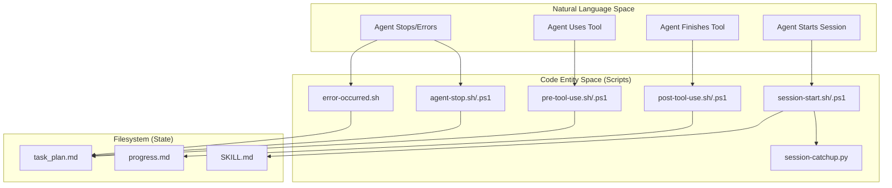
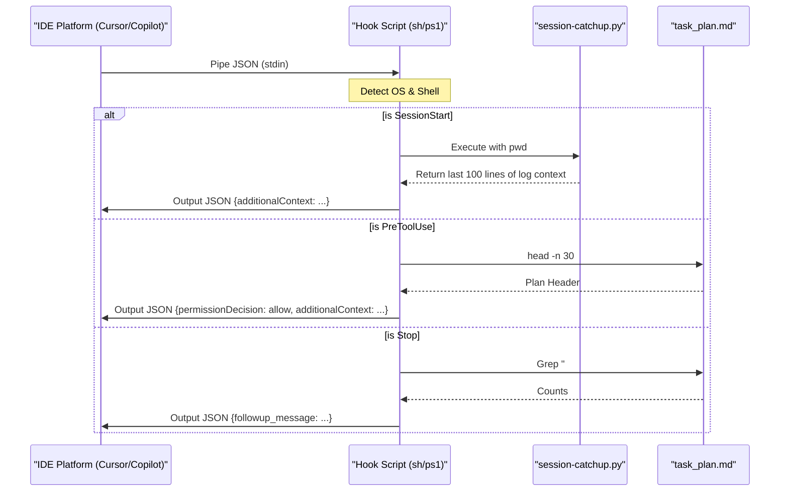

<!-- source: DeepWiki mcp.deepwiki.com · repo OthmanAdi/planning-with-files · page 7.5 Hook System Reference · fetched 2026-10-29 -->

# Hook System Reference

Relevant source files

The following files were used as context for generating this wiki page:

- [.codex/hooks/codex_hook_adapter.py](.codex/hooks/codex_hook_adapter.py)
- [.codex/hooks/post-tool-use.sh](.codex/hooks/post-tool-use.sh)
- [.codex/hooks/post_tool_use.py](.codex/hooks/post_tool_use.py)
- [.codex/hooks/pre-tool-use.sh](.codex/hooks/pre-tool-use.sh)
- [.codex/hooks/pre_tool_use.py](.codex/hooks/pre_tool_use.py)
- [.codex/hooks/stop.py](.codex/hooks/stop.py)
- [.codex/hooks/stop.sh](.codex/hooks/stop.sh)
- [.codex/hooks/user-prompt-submit.sh](.codex/hooks/user-prompt-submit.sh)
- [.cursor/hooks.json](.cursor/hooks.json)
- [.cursor/hooks.windows.json](.cursor/hooks.windows.json)
- [.cursor/hooks/post-tool-use.ps1](.cursor/hooks/post-tool-use.ps1)
- [.cursor/hooks/post-tool-use.sh](.cursor/hooks/post-tool-use.sh)
- [.cursor/hooks/stop.ps1](.cursor/hooks/stop.ps1)
- [.cursor/hooks/stop.sh](.cursor/hooks/stop.sh)
- [.github/hooks/scripts/agent-stop.ps1](.github/hooks/scripts/agent-stop.ps1)
- [.github/hooks/scripts/error-occurred.sh](.github/hooks/scripts/error-occurred.sh)
- [.github/hooks/scripts/post-tool-use.ps1](.github/hooks/scripts/post-tool-use.ps1)
- [.github/hooks/scripts/pre-tool-use.ps1](.github/hooks/scripts/pre-tool-use.ps1)
- [.github/hooks/scripts/pre-tool-use.sh](.github/hooks/scripts/pre-tool-use.sh)
- [.github/hooks/scripts/session-start.ps1](.github/hooks/scripts/session-start.ps1)
- [.github/hooks/scripts/session-start.sh](.github/hooks/scripts/session-start.sh)

This page provides the technical specification of the hook system used in `planning-with-files`. Hooks are automated triggers that execute commands at specific points in the agent's workflow, implementing the "attention manipulation" principle from the Manus architecture.

The hook system is designed to maintain state consistency and ensure the agent's context window is always anchored by the `task_plan.md` file, regardless of the platform (Claude Code, Cursor, GitHub Copilot, etc.).

---

## Hook System Architecture

The hook system bridges agent operations to persistent file management through automated command execution at four lifecycle points. While the YAML frontmatter in `SKILL.md` defines the canonical behavior, platform-specific implementations (like `.github/hooks/` or `.cursor/hooks/`) provide native integration.

### Logic Flow: Natural Language to Code Entity

This diagram maps the high-level hook events to the specific scripts and files that handle them across platforms.

**Sources:** [.github/hooks/scripts/session-start.sh:1-47](), [.cursor/hooks.json:1-33](), [.github/hooks/scripts/error-occurred.sh:1-41]()

---

## Hook Types and JSON Interfaces

Platforms like GitHub Copilot and Cursor interact with hooks via standard input/output (stdin/stdout) using JSON structures.

| Hook Event | Trigger | Core Purpose | JSON Output Field |
|:---|:---|:---|:---|
| `SessionStart` | Initial prompt / Session creation | Inject `SKILL.md` or catch up context | `additionalContext` |
| `PreToolUse` | Before `Write`, `Edit`, `Shell`, `Read` | Recite goals (Attention Manipulation) | `permissionDecision: allow` |
| `PostToolUse` | After `Write` or `Edit` | Remind to update `progress.md` | `additionalContext` |
| `AgentStop` | Before session termination | Verify all phases are `complete` | `followup_message` |
| `ErrorOccurred` | Tool execution failure | Log error directly to `task_plan.md` | `additionalContext` |

**Sources:** [.github/hooks/scripts/session-start.sh:46-46](), [.github/hooks/scripts/pre-tool-use.sh:32-32](), [.github/hooks/scripts/error-occurred.sh:35-35](), [.cursor/hooks/stop.sh:37-41]()

---

## SessionStart Hook

The `SessionStart` hook is the entry point for the planning workflow. It performs two critical checks:
1. **New Session:** If `task_plan.md` is missing, it injects the entire `SKILL.md` content into the agent's context so it knows how to use the planning-with-files system [.github/hooks/scripts/session-start.sh:31-36]().
2. **Existing Session:** If `task_plan.md` exists, it attempts to run `session-catchup.py` to restore the agent's state from previous logs [.github/hooks/scripts/session-start.sh:18-30]().

### PowerShell Implementation (Windows)
On Windows, the hook uses `Get-Content` with `-TotalCount 5` as a fallback if the catchup script fails, ensuring the agent at least sees the plan header [.github/hooks/scripts/session-start.ps1:26-30]().

**Sources:** [.github/hooks/scripts/session-start.sh:18-36](), [.github/hooks/scripts/session-start.ps1:14-36]()

---

## PreToolUse Hook

This hook implements **Attention Manipulation**. Before the agent performs any file modification or read operation, the hook injects the first 30 lines of `task_plan.md` [.github/hooks/scripts/pre-tool-use.sh:17-22](). This keeps the primary goal and current phase status at the "top of mind" for the LLM.

### Tool Matchers
The system uses regex matchers to decide when to trigger:
- **Cursor:** `Write|Edit|Shell|Read` [.cursor/hooks.json:13-13]()
- **GitHub Copilot:** Triggered by the platform before tool execution.

**Sources:** [.github/hooks/scripts/pre-tool-use.sh:17-22](), [.github/hooks/scripts/pre-tool-use.ps1:18-23](), [.cursor/hooks.json:10-16]()

---

## PostToolUse Hook

Triggered specifically after `Write` or `Edit` operations [.cursor/hooks.json:20-20](). It provides a passive reminder to the agent:
> `[planning-with-files] Update progress.md with what you just did. If a phase is now complete, update task_plan.md status.` [.cursor/hooks/post-tool-use.sh:6-6]()

This enforces the **Update After Act** rule without blocking the agent's flow.

**Sources:** [.cursor/hooks/post-tool-use.sh:1-8](), [.cursor/hooks/post-tool-use.ps1:1-8]()

---

## Stop / ErrorOccurred Hooks

### Stop Hook (Quality Gate)
The `Stop` hook (or `AgentStop` in Copilot) acts as a validator. It parses `task_plan.md` using regex to count total phases vs. completed phases [.cursor/hooks/stop.sh:15-27]().
- **Incomplete:** If phases remain, it returns a `followup_message` or `additionalContext` prompting the agent to continue [.cursor/hooks/stop.sh:41-41]().
- **Complete:** If all phases match, it confirms completion [.cursor/hooks/stop.sh:37-37]().

### ErrorOccurred Hook
Unique to the GitHub Copilot implementation, this hook extracts error messages from the agent's JSON input and instructs the agent to log the failure in the "Errors Encountered" table of `task_plan.md` [.github/hooks/scripts/error-occurred.sh:22-35]().

**Sources:** [.cursor/hooks/stop.sh:14-43](), [.github/hooks/scripts/agent-stop.ps1:20-55](), [.github/hooks/scripts/error-occurred.sh:1-41]()

---

## OS-Specific Behavior & Data Flow

The system maintains parity between Bash (Unix/macOS) and PowerShell (Windows) implementations.

### Data Flow Diagram: Hook Execution

### Path & Shell Resolution
Hooks dynamically locate Python and shell interpreters to ensure cross-platform reliability:
- **Python Search:** Iterates through `/usr/bin/python3`, `/usr/local/bin/python3`, and `command -v python3` [.github/hooks/scripts/session-start.sh:13-16]().
- **Windows Shell:** Prefers `pwsh` (PowerShell Core) over `powershell` (Windows PowerShell) [.github/hooks/scripts/session-start.ps1:19-19]().
- **JSON Escaping:** Uses a Python one-liner (`json.dumps(sys.stdin.read())`) to safely wrap multiline file content into JSON strings for the IDE [.github/hooks/scripts/session-start.sh:44-44]().

**Sources:** [.github/hooks/scripts/session-start.sh:12-16](), [.github/hooks/scripts/session-start.ps1:19-20](), [.github/hooks/scripts/session-start.sh:44-44]()

---

