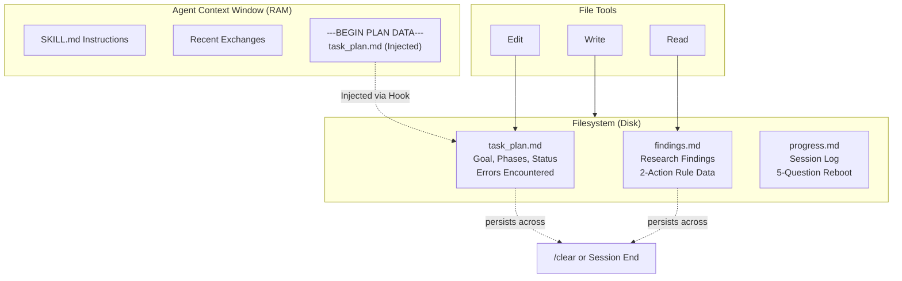
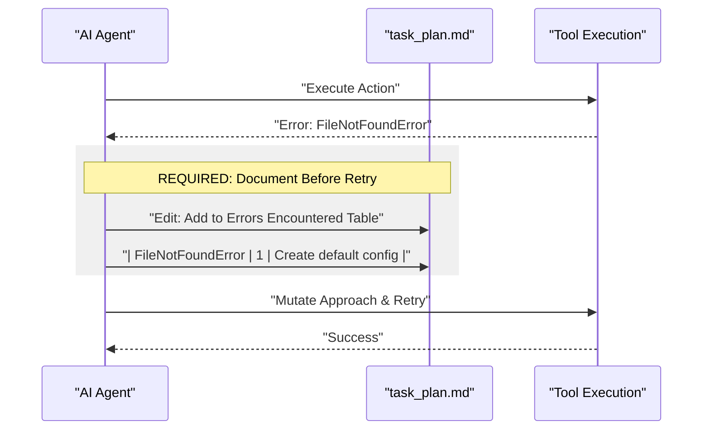
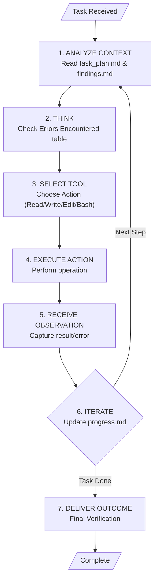

<!-- source: DeepWiki mcp.deepwiki.com · repo OthmanAdi/planning-with-files · page 8 Manus Principles Deep Dive · fetched 2026-10-29 -->

# Manus Principles Deep Dive

Relevant source files

The following files were used as context for generating this wiki page:

- [.claude-plugin/marketplace.json](.claude-plugin/marketplace.json)
- [.claude-plugin/plugin.json](.claude-plugin/plugin.json)
- [.gitignore](.gitignore)
- [CHANGELOG.md](CHANGELOG.md)
- [CITATION.cff](CITATION.cff)
- [CONTRIBUTORS.md](CONTRIBUTORS.md)
- [README.md](README.md)
- [examples/README.md](examples/README.md)
- [skills/planning-with-files/SKILL.md](skills/planning-with-files/SKILL.md)
- [skills/planning-with-files/examples.md](skills/planning-with-files/examples.md)
- [skills/planning-with-files/reference.md](skills/planning-with-files/reference.md)
- [skills/planning-with-files/templates/findings.md](skills/planning-with-files/templates/findings.md)
- [skills/planning-with-files/templates/progress.md](skills/planning-with-files/templates/progress.md)
- [skills/planning-with-files/templates/task_plan.md](skills/planning-with-files/templates/task_plan.md)

## Purpose and Scope

This page provides comprehensive coverage of the theoretical foundation underlying the planning-with-files system. It explains the 6 Manus context engineering principles, the Agent Loop architecture, and the technical mechanisms for context and attention management.

The principles documented here originate from Manus AI's context engineering research, which enabled them to build an AI agent system that Meta acquired for $2 billion.

**Sources:** [README.md:1-24](), [skills/planning-with-files/reference.md:1-3]()

---

## The Theoretical Foundation

The planning-with-files system is built on six core principles that address fundamental limitations in AI agent execution. These principles transform an ephemeral, stateless agent into a persistent, goal-oriented system.

### Principle 1: Filesystem as External Memory

**Core Concept:** The filesystem functions as unlimited working memory that persists beyond context window limitations.

**Problem Statement:** Context windows have fixed size limits. Stuffing all information into context degrades model performance and risks data loss during context resets (e.g., after a `/clear` command).

**Implementation:** Store large content in persistent files (`task_plan.md`, `findings.md`, `progress.md`) and keep only essential data in the active context. The agent reads files when information is needed, treating them as external memory lookups.

#### Filesystem as Memory Architecture

**Sources:** [skills/planning-with-files/reference.md:7-17](), [README.md:27-32](), [skills/planning-with-files/SKILL.md:78-85]()

---

### Principle 2: Attention Manipulation Through Repetition

**Core Concept:** Re-reading `task_plan.md` before major decisions keeps goals in the attention window, preventing goal drift.

**Problem Statement:** After approximately 50 tool calls, models experience the "lost in the middle" effect—original goals stated at the start of context are forgotten as new information accumulates.

**Implementation:** The `task_plan.md` file is read repeatedly. In this system, the `UserPromptSubmit` and `PreToolUse` hooks automate this by injecting the plan at the end of the context before every tool execution.

**Sources:** [skills/planning-with-files/reference.md:19-30](), [skills/planning-with-files/SKILL.md:7-15]()

---

### Principle 3: Keep Failure Traces

**Core Concept:** Document all errors in the `Errors Encountered` section of `task_plan.md`. Never hide failures.

**Problem Statement:** The default instinct is to hide errors and retry silently. This wastes tokens and allows repeated mistakes.

**Implementation:** When errors occur, immediately `Edit` the `task_plan.md` file to append to the `Errors Encountered` table before mutating the approach.

#### Error Documentation Pattern

**Sources:** [skills/planning-with-files/reference.md:33-46](), [skills/planning-with-files/templates/task_plan.md:109-121]()

---

### Principle 4: Avoid Few-Shot Overfitting

**Core Concept:** Introduce controlled variation to prevent drift and hallucination from repetitive patterns.

**Problem Statement:** Repetitive action-observation pairs (e.g., identical tool call sequences) cause the model to overfit to the pattern.

**Implementation:** Vary phrasings in `task_plan.md` updates. Avoid identical status messages. Use the `analytics` template variant for data-heavy tasks to change the structural pattern.

**Sources:** [skills/planning-with-files/reference.md:48-57](), [CHANGELOG.md:84-91]()

---

### Principle 5: Stable Prefixes for Cache Optimization

**Core Concept:** Structure context to maximize KV-cache hits, reducing token costs by up to 10x.

**Problem Statement:** AI agents have a 100:1 input-to-output token ratio. Every input token costs money. Frequent context modifications invalidate the KV-cache.

**Implementation:**
- Place static content (SKILL.md) at the start of context.
- Use append-only operations on files where possible.
- The system uses a stable hook injection pattern to ensure the "prefix" of the prompt remains deterministic.

**Sources:** [skills/planning-with-files/reference.md:59-66](), [skills/planning-with-files/reference.md:82-88]()

---

### Principle 6: Append-Only Context

**Core Concept:** Never modify previous context messages. Always append new information.

**Problem Statement:** Modifying previous messages in the conversation history invalidates the entire KV-cache.

**Implementation:** All updates are additive. The `progress.md` file acts as an append-only log of actions, ensuring that the history of the session is preserved without destructive edits.

**Sources:** [skills/planning-with-files/reference.md:68-72](), [skills/planning-with-files/templates/progress.md:1-6]()

---

## The Agent Loop Architecture

The system operates within a 7-step continuous loop, with file operations integrated at each stage.

**Sources:** [skills/planning-with-files/reference.md:74-79](), [skills/planning-with-files/SKILL.md:78-94]()

---

## Context Engineering Strategies

- **Context Reduction:** The `session-catchup.py` script summarizes past JSONL logs into a catchup report, allowing the agent to restore state without re-reading the entire previous session history. [CONTRIBUTORS.md:28-35]()
- **Context Isolation:** Slug-based directories (`.planning/<slug>/`) allow parallel tasks to maintain separate planning files, preventing state collision in multi-agent or multi-terminal workflows. [CHANGELOG.md:74-80]()
- **Context Offloading:** The "2-Action Rule" forces the agent to offload visual or research data into `findings.md` immediately, preventing "multimodal bloat" in the active context window. [skills/planning-with-files/SKILL.md:100-103]()

---

## KV-Cache Optimization

The system is designed for high-performance production environments where token costs matter.

| Optimization | Method | Cost Impact |
|--------------|--------|-------------|
| **Stable Prefix** | SKILL.md instructions remain static at the top. | High (Cache hits) |
| **Deterministic Serialization** | Hook commands use stable templates for injection. | Medium |
| **Append-Only Logs** | `progress.md` minimizes destructive context edits. | Medium |
| **Plan Attestation** | `/plan-attest` ensures injected data is verified, preventing re-processing of tampered files. | Security/Efficiency |

**Sources:** [skills/planning-with-files/reference.md:59-66](), [CHANGELOG.md:9-14]()

---

## Benchmark Results and Evals

Formal evaluation using Anthropic's skill-creator framework demonstrates the effectiveness of these principles:
- **Pass Rate:** 96.7% across 5 complex test cases (todo-cli, research-frameworks, debug-fastapi, django-migration, cicd-pipeline). [README.md:9-12]()
- **Security:** Audited and hardened in v2.21.0 and v2.37.0 to prevent prompt injection via `task_plan.md` using BEGIN/END delimiters and SHA-256 hash attestation. [CHANGELOG.md:9-14]()

**Sources:** [README.md:9-12](), [CHANGELOG.md:73-77]()

---

## Child Pages
- [8.1 The 6 Manus Principles](#)
- [8.2 Agent Loop Architecture](#)
- [8.3 Context Engineering Strategies](#)
- [8.4 KV-Cache Optimization](#)
- [8.5 Benchmark Results and Evals](#)

---

