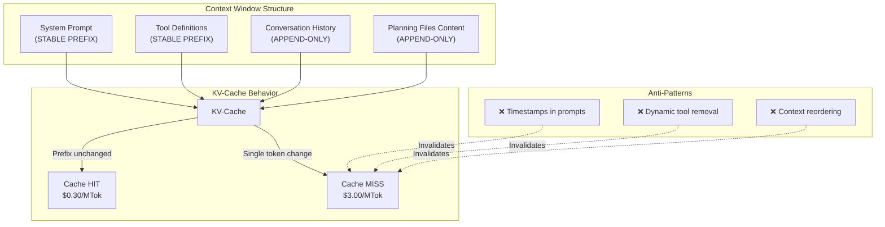
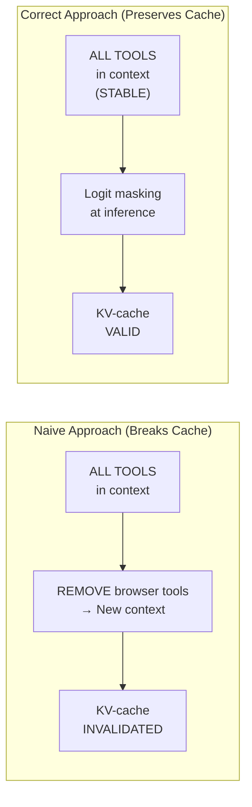
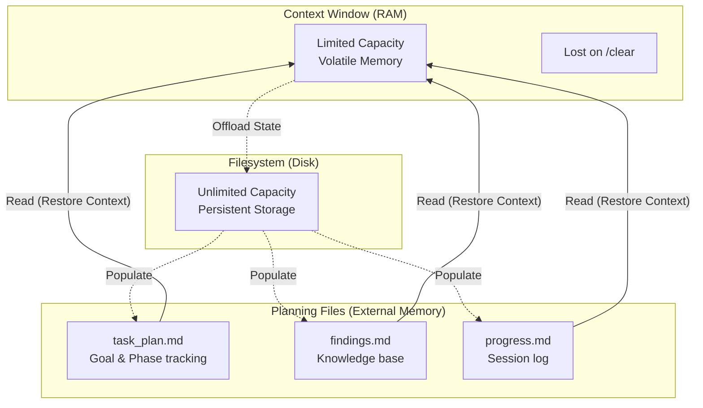
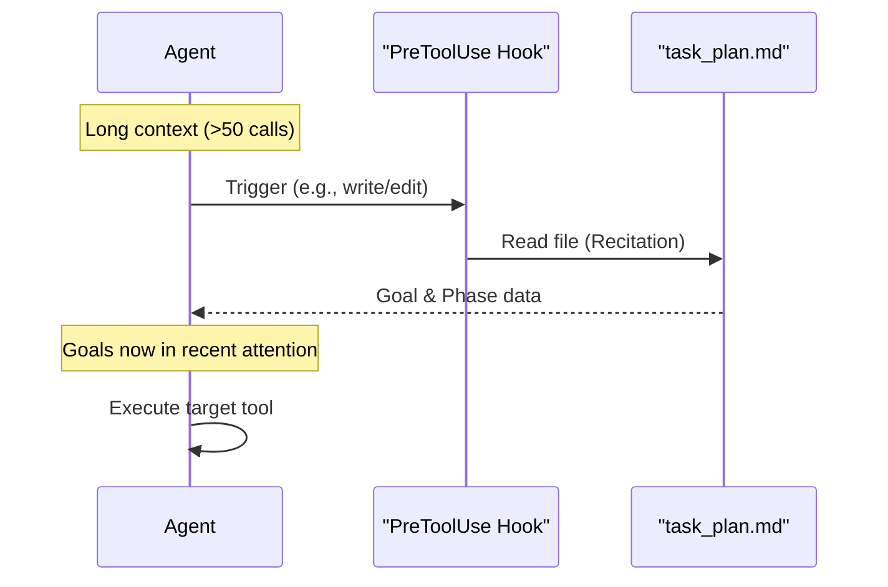
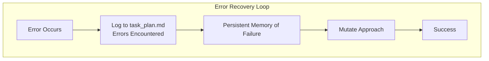

<!-- source: DeepWiki mcp.deepwiki.com · repo OthmanAdi/planning-with-files · page 8.1 The 6 Manus Principles · fetched 2026-10-29 -->

# The 6 Manus Principles

<details>
<summary>Relevant source files</summary>

The following files were used as context for generating this wiki page:

- [.codebuddy/skills/planning-with-files/templates/findings.md](.codebuddy/skills/planning-with-files/templates/findings.md)
- [.codebuddy/skills/planning-with-files/templates/progress.md](.codebuddy/skills/planning-with-files/templates/progress.md)
- [.codebuddy/skills/planning-with-files/templates/task_plan.md](.codebuddy/skills/planning-with-files/templates/task_plan.md)
- [.continue/skills/planning-with-files/reference.md](.continue/skills/planning-with-files/reference.md)
- [.gitignore](.gitignore)
- [examples/README.md](examples/README.md)
- [skills/planning-with-files/examples.md](skills/planning-with-files/examples.md)
- [skills/planning-with-files/reference.md](skills/planning-with-files/reference.md)
- [skills/planning-with-files/templates/findings.md](skills/planning-with-files/templates/findings.md)
- [skills/planning-with-files/templates/progress.md](skills/planning-with-files/templates/progress.md)
- [skills/planning-with-files/templates/task_plan.md](skills/planning-with-files/templates/task_plan.md)

</details>


## Purpose and Scope

This document provides a detailed technical explanation of the six context engineering principles developed by Manus AI (acquired by Meta for $2 billion in December 2025) that form the theoretical foundation of the `planning-with-files` system. These principles address fundamental challenges in long-running AI agent operations: context window management, cost optimization, attention decay, and error recovery.

## Overview: The Six Principles

The Manus principles represent a systematic approach to building production-grade AI agents that can handle tasks requiring 50+ tool calls without losing context, repeating errors, or incurring excessive costs. Each principle addresses a specific failure mode observed in naive agent implementations:

| Principle | Problem Addressed | Planning-with-Files Implementation |
|-----------|-------------------|-----------------------------------|
| 1. Design Around KV-Cache | 10x cost difference between cached/uncached tokens | Stable prompt prefixes, append-only files |
| 2. Mask, Don't Remove | Dynamic tool removal breaks cache | Consistent tool availability via hooks |
| 3. Filesystem as External Memory | Volatile, limited context window | 3-file pattern (`task_plan.md`, `findings.md`, `progress.md`) |
| 4. Manipulate Attention Through Recitation | Goal drift after many tool calls | PreToolUse hook re-reads `task_plan.md` |
| 5. Keep the Wrong Stuff In | Repeated errors, no learning | Error tables in `task_plan.md` |
| 6. Don't Get Few-Shotted | Pattern repetition causes drift | Controlled variation in prompts |

Sources: [skills/planning-with-files/reference.md:5-75]()

---

## Principle 1: Design Around KV-Cache

### The Core Metric

**KV-cache hit rate is the single most important metric for production AI agents.**

The economics are stark:
- Typical agent: ~100:1 input-to-output token ratio
- Cached tokens: $0.30 per million tokens
- Uncached tokens: $3.00 per million tokens
- **10x cost difference**

### Implementation Requirements



**Diagram: KV-Cache Hit/Miss Architecture**

Sources: [skills/planning-with-files/reference.md:7-19]()

### Planning-with-Files Implementation

The system enforces cache-friendly patterns through:

1. **Stable System Prompts**: No timestamps in system prompts to prevent cache invalidation [skills/planning-with-files/reference.md:18]().
2. **Append-Only Files**: Planning files grow via appends, ensuring deterministic serialization [skills/planning-with-files/reference.md:19]().
3. **Deterministic Serialization**: Files use consistent markdown structure defined in templates [skills/planning-with-files/templates/task_plan.md:1-133]().

The `task_plan.md` template is designed to maintain a stable structure while allowing incremental updates to the "Phases" and "Errors Encountered" sections [skills/planning-with-files/templates/task_plan.md:23-44](), [skills/planning-with-files/templates/task_plan.md:109-121]().

Sources: [skills/planning-with-files/reference.md:16-19](), [skills/planning-with-files/templates/task_plan.md:1-133]()

---

## Principle 2: Mask, Don't Remove

### The Problem

Dynamically removing tools from the agent's available actions breaks KV-cache because it changes the stable prefix of tool definitions in the context window.

### The Solution: Logit Masking

Instead of removing tools, use logit masking at inference time. The tool definitions remain in the prompt (preserving cache), but the model is prevented from selecting masked tools via manipulation of the output probability distribution.



**Diagram: Tool Availability Strategy**

### Best Practice: Consistent Tool Prefixes

Use consistent action prefixes (`browser_`, `shell_`, `file_`) to make masking patterns easier to define and maintain.

Sources: [skills/planning-with-files/reference.md:21-25]()

---

## Principle 3: Filesystem as External Memory

### The Core Formula

```
Context Window = RAM (volatile, limited capacity)
Filesystem = Disk (persistent, unlimited capacity)
```

This principle recognizes that the context window is fundamentally a working memory system with severe constraints:
- **Volatile**: Lost on context resets or session termination.
- **Limited**: Information is pushed out as new data arrives.
- **Expensive**: Costs scale with context size.

The filesystem provides complementary characteristics:
- **Persistent**: Survives session boundaries and `/clear` commands.
- **Unlimited**: No practical capacity constraints for text findings.
- **Free**: No per-access costs compared to token usage.



**Diagram: Memory Architecture Mapping**

### Implementation in Planning-with-Files

The 3-file pattern implements this principle directly:

| File | Memory Type | Persistence Model | Content Strategy |
|------|-------------|-------------------|------------------|
| `task_plan.md` | Goal state | Update after phases | [templates/task_plan.md:1-6]() |
| `findings.md` | Knowledge base | 2-Action Rule | [templates/findings.md:1-6]() |
| `progress.md` | Session history | Breakpoint updates | [templates/progress.md:1-6]() |

Sources: [skills/planning-with-files/reference.md:27-41](), [skills/planning-with-files/templates/findings.md:1-96]()

---

## Principle 4: Manipulate Attention Through Recitation

### The Problem: Lost in the Middle Effect

After ~50 tool calls, models forget original goals. This is the "lost in the middle" effect where information at the start of a long context receives less attention than recent content.

### The Solution: Recitation

Force the agent to re-read `task_plan.md` before major decisions, bringing goals back into the attention window:



**Diagram: Attention Manipulation via Recitation**

### Implementation in Planning-with-Files

The system instructs the agent to re-read the plan before major decisions to ensure the goal statement [skills/planning-with-files/templates/task_plan.md:8-14]() is fresh in the model's recent attention span. This is referred to as "attention manipulation" [skills/planning-with-files/templates/task_plan.md:126-131]().

Sources: [skills/planning-with-files/reference.md:43-54](), [skills/planning-with-files/examples.md:188-202]()

---

## Principle 5: Keep the Wrong Stuff In

### The Counterintuitive Truth

> "Leave the wrong turns in the context."

Most developers instinctively want to hide or remove errors from the conversation history. This is wrong for AI agents because failed actions with stack traces let models implicitly update beliefs and reduce mistake repetition [skills/planning-with-files/reference.md:58-63]().

### Implementation in Planning-with-Files

The `task_plan.md` and `progress.md` files include explicit error logging sections:
- **Errors Encountered Table**: Tracks the error, attempt count, and resolution [skills/planning-with-files/templates/task_plan.md:109-121]().
- **Detailed Error Log**: Includes timestamps and full resolution history [skills/planning-with-files/templates/progress.md:71-84]().



**Diagram: Agentic Error Recovery**

Sources: [skills/planning-with-files/reference.md:56-64](), [skills/planning-with-files/examples.md:161-185]()

---

## Principle 6: Don't Get Few-Shotted

### The Problem: Uniformity Breeds Fragility

Repetitive action-observation pairs cause drift and hallucination [skills/planning-with-files/reference.md:69-70](). If an agent performs the exact same sequence too many times, it may stop "thinking" and start "predicting" the next expected (but potentially incorrect) step.

### The Solution: Controlled Variation

Introduce deliberate variation in:
- Phrasing of tool calls [skills/planning-with-files/reference.md:72]().
- Avoiding blind copy-pasting of patterns [skills/planning-with-files/reference.md:73]().
- Recalibrating on repetitive tasks [skills/planning-with-files/reference.md:74]().

### Implementation in Planning-with-Files

The system encourages the agent to mutate its approach if an action fails [skills/planning-with-files/reference.md:184](). By tracking "Attempts" in the error tables, the agent is prompted to try a different method rather than repeating the same failed few-shot pattern.

Sources: [skills/planning-with-files/reference.md:66-75](), [skills/planning-with-files/templates/task_plan.md:128]()

---

## Production Statistics

| Metric | Value |
|--------|-------|
| Average tool calls per task | ~50 |
| Input-to-output token ratio | 100:1 |
| Acquisition price | $2 billion |
| Time to $100M revenue | 8 months |

Sources: [skills/planning-with-files/reference.md:189-198]()

---

