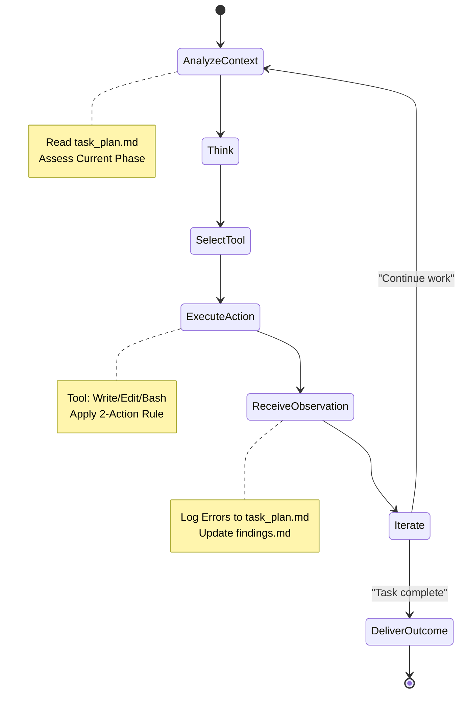
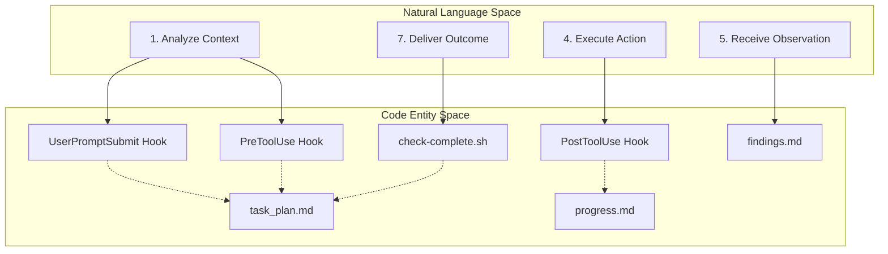
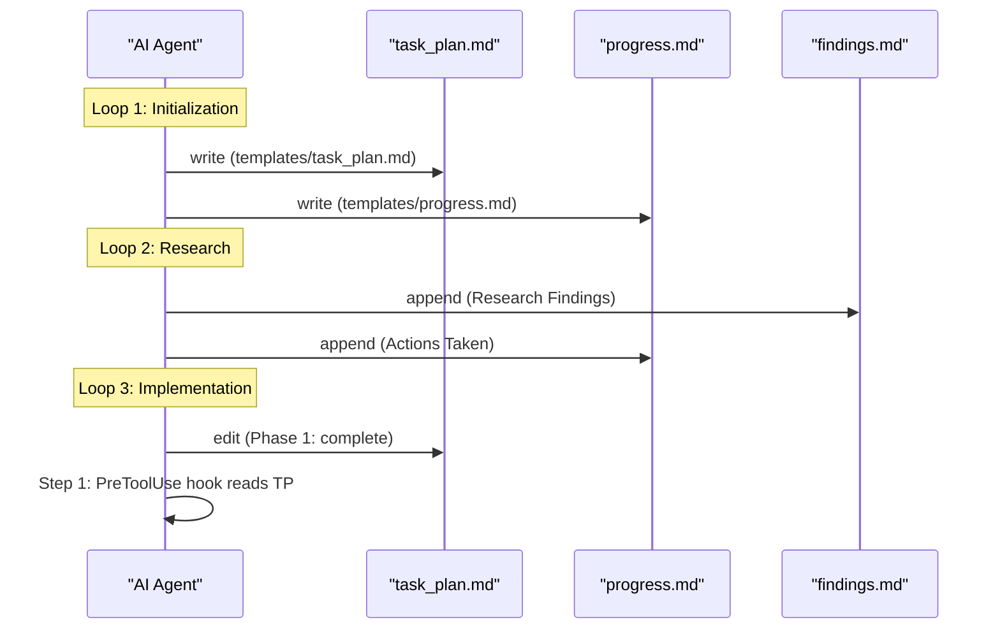

<!-- source: DeepWiki mcp.deepwiki.com · repo OthmanAdi/planning-with-files · page 8.2 Agent Loop Architecture · fetched 2026-10-29 -->

# Agent Loop Architecture

Relevant source files

The following files were used as context for generating this wiki page:

- [.codex/skills/planning-with-files/SKILL.md](.codex/skills/planning-with-files/SKILL.md)
- [.cursor/skills/planning-with-files/SKILL.md](.cursor/skills/planning-with-files/SKILL.md)
- [.gitignore](.gitignore)
- [.opencode/skills/planning-with-files/SKILL.md](.opencode/skills/planning-with-files/SKILL.md)
- [examples/README.md](examples/README.md)
- [skills/planning-with-files/examples.md](skills/planning-with-files/examples.md)
- [skills/planning-with-files/reference.md](skills/planning-with-files/reference.md)
- [skills/planning-with-files/templates/findings.md](skills/planning-with-files/templates/findings.md)
- [skills/planning-with-files/templates/progress.md](skills/planning-with-files/templates/progress.md)
- [skills/planning-with-files/templates/task_plan.md](skills/planning-with-files/templates/task_plan.md)

## Purpose and Scope

This document explains the 7-step Agent Loop that forms the execution model for the `planning-with-files` system. The Agent Loop describes the cycle that AI agents follow when executing tasks using this skill: **ANALYZE CONTEXT → THINK → SELECT TOOL → EXECUTE ACTION → RECEIVE OBSERVATION → ITERATE → DELIVER OUTCOME**.

This architecture bridges the gap between volatile AI context windows and persistent project requirements by integrating specific file operations into every stage of the agent's reasoning cycle.

**Sources:** [.codex/skills/planning-with-files/SKILL.md:76-83](), [skills/planning-with-files/reference.md:130-164]()

---

## The Agent Loop Overview

The Agent Loop is a continuous 7-step cycle. Unlike single-shot LLM interactions, this loop enables sustained, goal-directed behavior over 50+ tool calls by using the filesystem as "working memory on disk."

### Agent Loop State Machine

**Diagram: Agent Loop State Machine**

The loop repeats until the agent determines all phases in `task_plan.md` are complete and the deliverable is ready.

**Sources:** [skills/planning-with-files/reference.md:132-164](), [.codex/skills/planning-with-files/SKILL.md:103-105]()

---

## The 7 Steps Explained

### 1. ANALYZE CONTEXT
The agent reviews the current state to understand user intent and progress.
- **Code Entity Integration:** The `UserPromptSubmit` hook and `PreToolUse` hook automate this by injecting the first 50 lines of `task_plan.md` and the last 20 lines of `progress.md` into the context.
- **File Role:** `task_plan.md` provides the "North Star" goal.

### 2. THINK
The agent determines if the plan needs updating and identifies the next logical action.
- **Critical Rule:** "Read Before Decide" ([.codex/skills/planning-with-files/SKILL.md:103-105]()). Before major architectural choices, the agent must re-read the plan to refresh its attention window.

### 3. SELECT TOOL
The agent chooses one tool (e.g., `Bash`, `Write`, `Read`) to advance the current phase.
- **Constraint:** Manus principles dictate **Single-Action Execution**—one tool call per turn to ensure deterministic state tracking.

### 4. EXECUTE ACTION
The tool runs in the environment.
- **2-Action Rule:** If the tool is a browser or search operation, the agent is constrained to save findings to `findings.md` immediately after at most two such actions.

### 5. RECEIVE OBSERVATION
The result (output or error) is appended to the context.
- **Error Handling:** If the action fails, the agent follows the **3-Strike Error Protocol** (Diagnose → Alternative → Rethink).

### 6. ITERATE
The agent updates its internal state.
- **File Integration:** The `PostToolUse` hook triggers a reminder to update `progress.md` and `task_plan.md` if a phase is complete.

### 7. DELIVER OUTCOME
Final results are sent to the user.
- **Verification:** The `Stop` hook runs `check-complete.sh` to verify all phases are marked `complete` before the session ends.

**Sources:** [skills/planning-with-files/reference.md:135-163](), [.codex/skills/planning-with-files/SKILL.md:6-24](), [skills/planning-with-files/reference.md:181-186]()

---

## System Integration: Code Entity Mapping

This diagram maps the natural language steps of the loop to the specific code entities (hooks, scripts, and files) that implement them.

**Diagram: Natural Language to Code Entity Mapping**

**Sources:** [.codex/skills/planning-with-files/SKILL.md:6-24](), [skills/planning-with-files/reference.md:170-176]()

---

## State Transitions and the 3-File Pattern

The 3-File Pattern provides persistent state across loop iterations, acting as the "Disk" to the LLM's "RAM."

| File | Loop Role | Implementation Details |
| :--- | :--- | :--- |
| `task_plan.md` | **Control State** | Managed via `Phases` and `Current Phase` headers. Updated in Step 6. |
| `findings.md` | **Knowledge State** | Populated during Step 4/5 via the `2-Action Rule`. |
| `progress.md` | **Log State** | Chronological record of actions taken; used for Step 1 recovery. |

### Multi-Loop State Persistence

**Diagram: State Persistence Across Multiple Loop Iterations**

**Sources:** [skills/planning-with-files/reference.md:27-35](), [skills/planning-with-files/reference.md:170-176](), [.codex/skills/planning-with-files/SKILL.md:85-92]()

---

## Error Recovery Architecture

The loop includes a specific sub-routine for failures, ensuring the agent "mutates the approach" rather than repeating errors.

### The 3-Strike Error Protocol Implementation

| Strike | Strategy | Action within Loop |
| :--- | :--- | :--- |
| **1** | **Diagnose & Fix** | Read error, identify root cause, apply fix. |
| **2** | **Alternative** | Try different tool or library. Update `task_plan.md` **Errors Encountered**. |
| **3** | **Rethink** | Question assumptions. Read `findings.md` to re-evaluate technical decisions. |

**Sources:** [.codex/skills/planning-with-files/SKILL.md:130-152](), [skills/planning-with-files/reference.md:56-64]()

---

## Loop Termination and Verification

The loop exits when the agent determines that delivery is appropriate. This is enforced by the `Stop` hook, which executes the `check-complete.sh` (or `.ps1` on Windows) script.

**Completion Checklist enforced by the loop:**
1. **Phases:** All checkboxes in `task_plan.md` must be `[x]`.
2. **Status:** Phase status values must be `complete`.
3. **Reboot Check:** The agent must be able to answer the "5-Question Reboot Test" using the files.

**Sources:** [.codex/skills/planning-with-files/SKILL.md:21-24](), [skills/planning-with-files/templates/task_plan.md:39-44](), [.codex/skills/planning-with-files/SKILL.md:165-176]()

---

