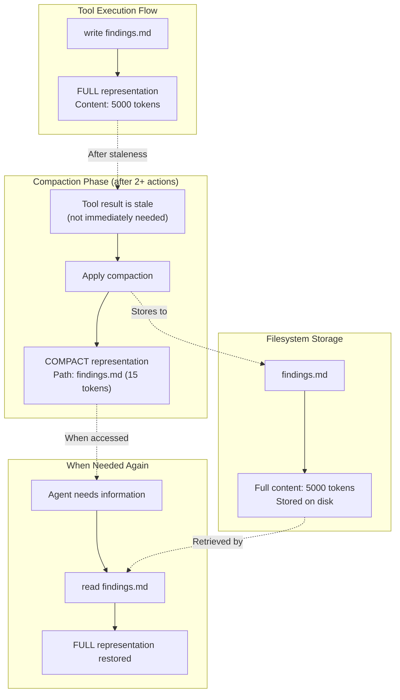
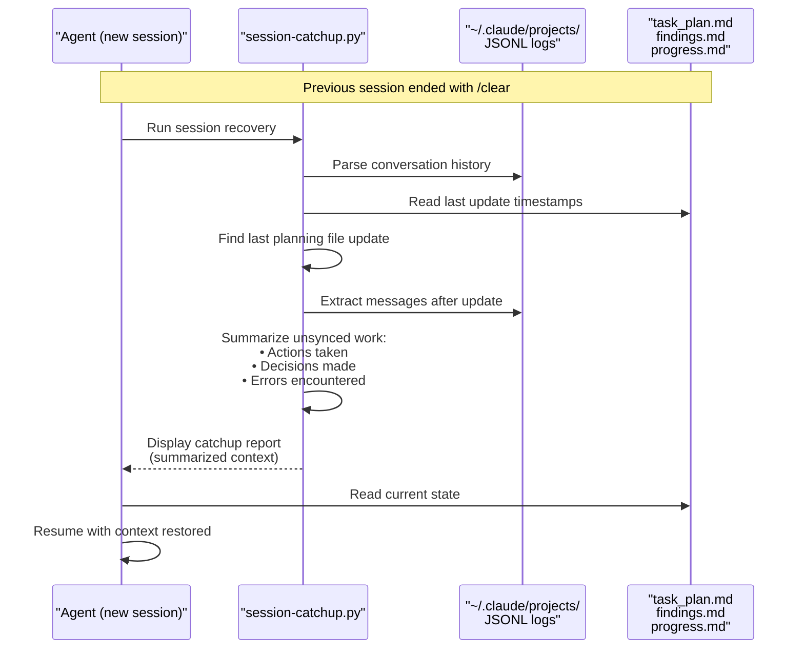
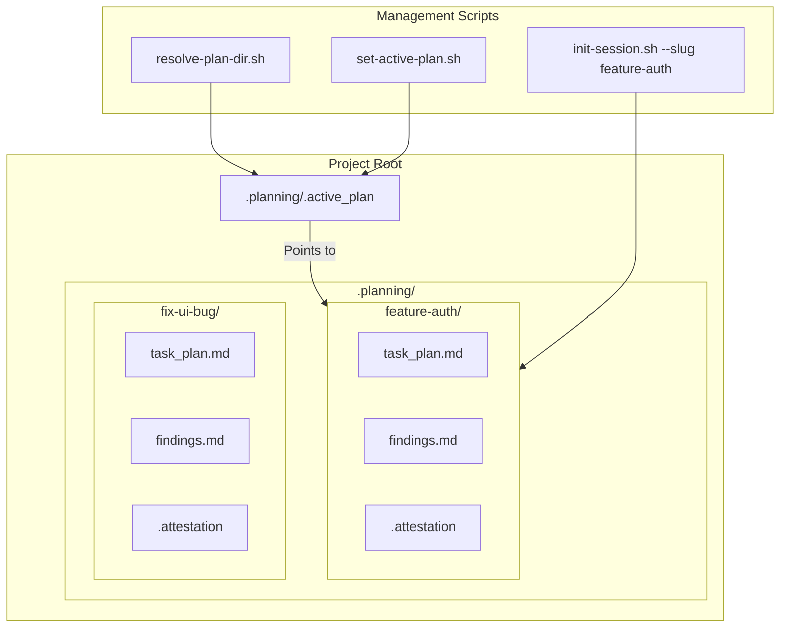
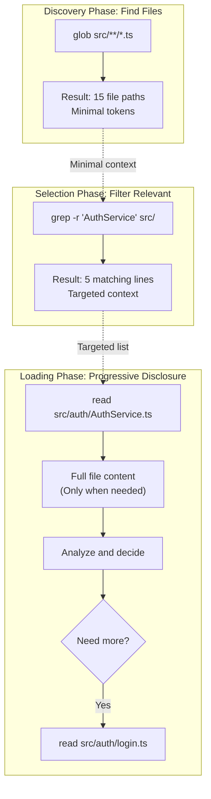

<!-- source: DeepWiki mcp.deepwiki.com · repo OthmanAdi/planning-with-files · page 8.3 Context Engineering Strategies · fetched 2026-10-29 -->

# Context Engineering Strategies

Relevant source files

The following files were used as context for generating this wiki page:

- [.claude-plugin/marketplace.json](.claude-plugin/marketplace.json)
- [.claude-plugin/plugin.json](.claude-plugin/plugin.json)
- [.gitignore](.gitignore)
- [CHANGELOG.md](CHANGELOG.md)
- [CITATION.cff](CITATION.cff)
- [CONTRIBUTORS.md](CONTRIBUTORS.md)
- [README.md](README.md)
- [examples/README.md](examples/README.md)
- [skills/planning-with-files/SKILL.md](skills/planning-with-files/SKILL.md)
- [skills/planning-with-files/examples.md](skills/planning-with-files/examples.md)
- [skills/planning-with-files/reference.md](skills/planning-with-files/reference.md)
- [skills/planning-with-files/templates/findings.md](skills/planning-with-files/templates/findings.md)
- [skills/planning-with-files/templates/progress.md](skills/planning-with-files/templates/progress.md)
- [skills/planning-with-files/templates/task_plan.md](skills/planning-with-files/templates/task_plan.md)

## Purpose and Scope

This page documents the three primary context engineering strategies used by `planning-with-files` to manage context window limitations: Context Reduction (compaction and summarization), Context Isolation (multi-agent patterns), and Context Offloading (progressive disclosure). These strategies are derived from the production architecture of agents like Manus and are adapted for single-agent execution using the 3-file pattern.

For the theoretical foundation, see page 8.1 (The 6 Manus Principles). For KV-cache optimization details, see page 8.4.

**Sources:** [skills/planning-with-files/reference.md:78-127]()

---

## The Three Context Engineering Strategies

Manus identified three complementary strategies for managing context windows in long-running agent tasks. Planning-with-files implements all three, adapted for single-agent execution via the filesystem.

| Strategy | Mechanism | Implementation in planning-with-files |
|----------|-----------|--------------------------------------|
| **Context Reduction** | Compress stale tool results | Store full content in filesystem, reference by path in memory |
| **Context Isolation** | Separate agent contexts | Use slug-based directories and the 3-file separation |
| **Context Offloading** | Minimize tool result size | Atomic tools + progressive disclosure via `read` |

**Sources:** [skills/planning-with-files/reference.md:78-127]()

---

## Strategy 1: Context Reduction

Context Reduction compresses stale tool results while preserving access to full information. Planning-with-files implements this through filesystem-based storage where the "Memory" (Context Window) only holds the current state, while "Disk" (Filesystem) holds the history.

### The Compaction Pattern

Tool call results have two representations: FULL (complete content) and COMPACT (file path reference). Compaction applies to stale (older) results while keeping recent results full.

**Diagram: Compaction Architecture**

**Implementation in planning-with-files:**

| File Type | When Written (FULL) | When Compacted | When Re-read (Restore FULL) |
|-----------|---------------------|----------------|----------------------------|
| `task_plan.md` | Session start via `init-session.sh` | Never (always read before decisions) | Before major decisions |
| `findings.md` | After 2 view/browser operations | After appending | When synthesis needed |
| `progress.md` | Session logging | After phase completion | Session recovery via `session-catchup.py` |

**Sources:** [skills/planning-with-files/reference.md:82-97](), [skills/planning-with-files/scripts/init-session.sh:1-121]()

### The Summarization Pattern (Session Recovery)

When compaction reaches diminishing returns (many file references), summarization generates standardized summary objects. Planning-with-files uses this for session recovery via `session-catchup.py`.

**Diagram: Summarization in Session Recovery**

The `session-catchup.py` script implements summarization by analyzing JSONL logs to extract the conversation since the last planning file update, then presenting a condensed report instead of replaying the full conversation.

**Sources:** [skills/planning-with-files/reference.md:94-98](), [CONTRIBUTORS.md:28-34]()

---

## Strategy 2: Context Isolation

Context Isolation separates concerns across different directories or files to prevent state collision.

### Parallel Plan Isolation (Slug-based)

Introduced in v2.36.0, `init-session.sh` supports a `--slug` mode. This creates isolated environments in `.planning/<slug>/`, allowing multiple agents or tasks to run in parallel without overwriting `task_plan.md` in the root.

**Diagram: Context Isolation via Slug Mode**

**Implementation Details:**
- **`resolve-plan-dir.sh`**: Determines the active planning directory by checking the `$PLAN_ID` environment variable or the `.planning/.active_plan` pointer file [CHANGELOG.md:37-40]().
- **`set-active-plan.sh`**: Updates the pointer to switch the agent's focus between isolated contexts [CHANGELOG.md:43-45]().

**Sources:** [CHANGELOG.md:74-81](), [skills/planning-with-files/SKILL.md:10-15]()

---

## Strategy 3: Context Offloading

Context Offloading minimizes tool result size by storing full results in the filesystem and using progressive disclosure to load information only when needed.

### Atomic Tool Design and the 2-Action Rule

Planning-with-files uses atomic file operations that return minimal context. The **2-Action Rule** is the primary driver for offloading: after every 2 view/browser/search operations, the agent MUST update `findings.md` [skills/planning-with-files/SKILL.md:100-103]().

**Diagram: Progressive Disclosure Pattern**

### Prompt Injection and Delimiters

To safely offload context and then re-inject it, the system uses delimiters. In `SKILL.md`, the `UserPromptSubmit` hook injects the plan using `---BEGIN PLAN DATA---` and `---END PLAN DATA---` tags [skills/planning-with-files/SKILL.md:10-15]().

**Security Layer (v2.37.0):**
If a plan is finalized, the user can run `/plan-attest` (calling `scripts/attest-plan.sh`). This creates a SHA-256 hash in `.attestation`. The hooks then verify the hash before injection. If `task_plan.md` was tampered with (e.g., via a malicious `Edit` call), injection is blocked with `[PLAN TAMPERED — injection blocked]` [CHANGELOG.md:5-15]().

**Sources:** [skills/planning-with-files/SKILL.md:10-15](), [CHANGELOG.md:5-15](), [skills/planning-with-files/templates/findings.md:90-95]()

---

## Summary of Benefits

| Technique | Problem Solved | Token Savings |
|-----------|----------------|---------------|
| **Compaction** | Context stuffing with old tool outputs | Up to 90% |
| **Slug Isolation** | Multi-task state collision | N/A (Accuracy gain) |
| **Progressive Disclosure** | Loading unnecessary file content | Variable (High) |
| **Attestation** | Prompt injection/Plan tampering | N/A (Security gain) |

**Sources:** [skills/planning-with-files/reference.md:78-127](), [CHANGELOG.md:5-15]()

---

