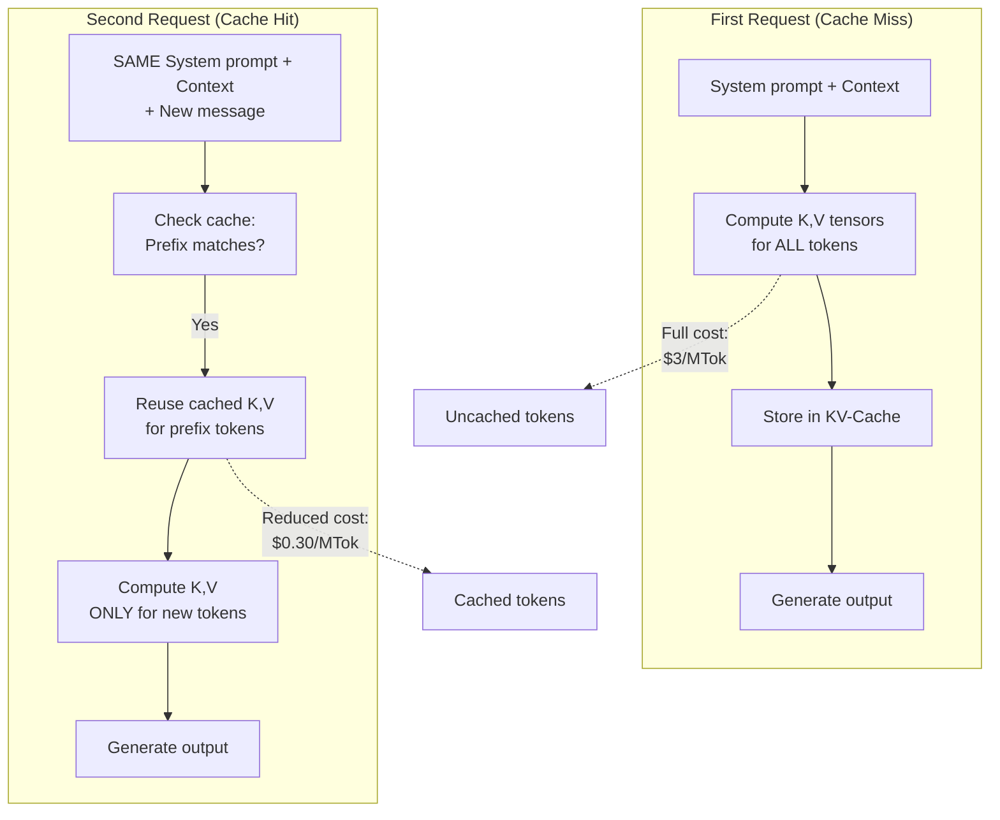
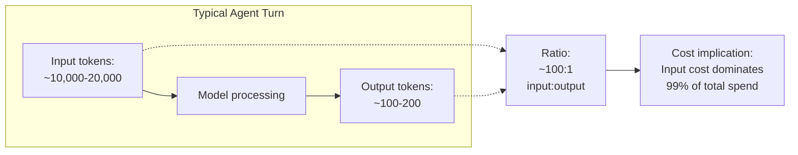
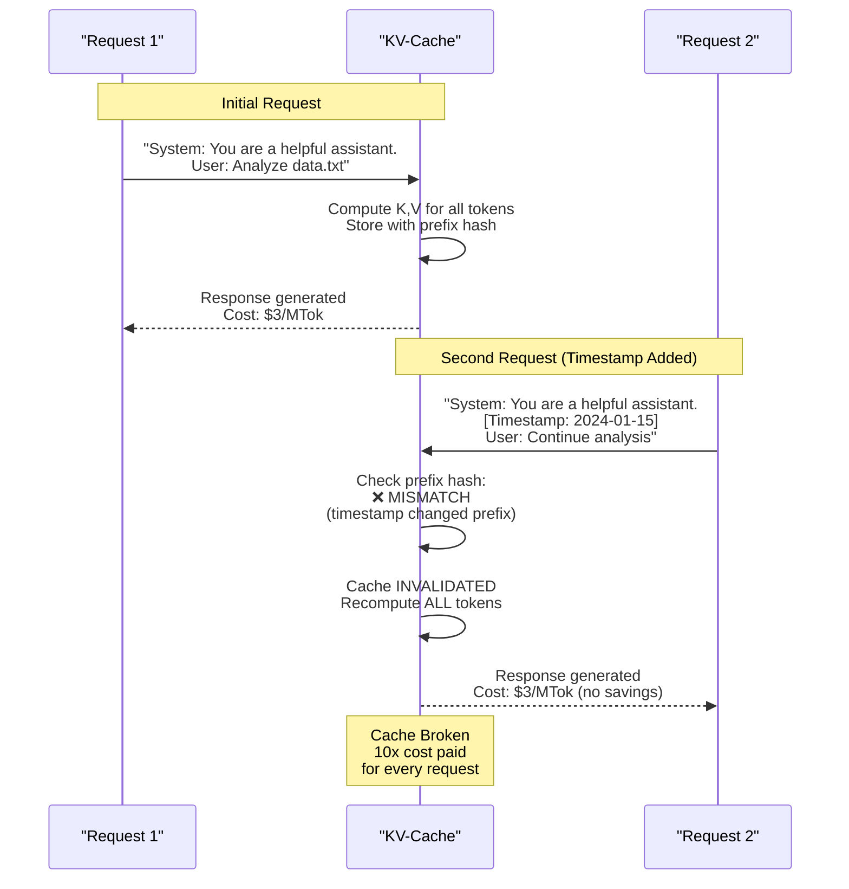
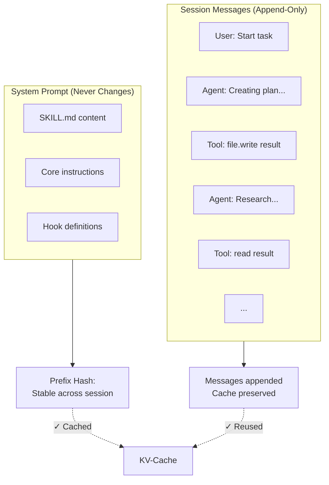
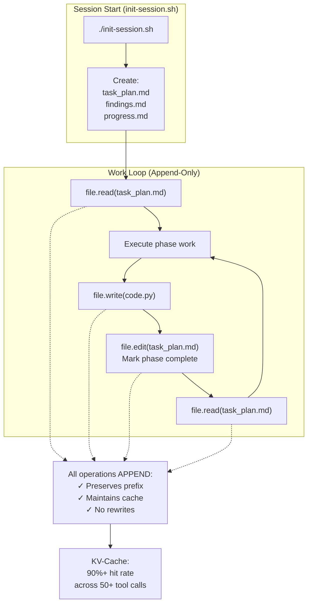
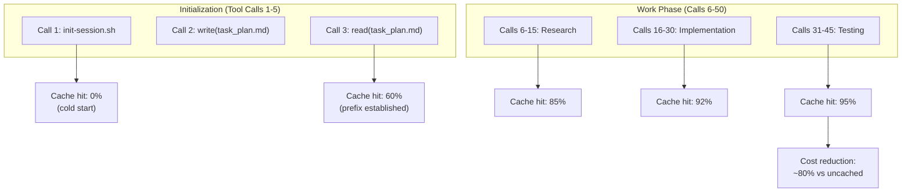

<!-- source: DeepWiki mcp.deepwiki.com · repo OthmanAdi/planning-with-files · page 8.4 KV-Cache Optimization · fetched 2026-10-29 -->

# KV-Cache Optimization

<details>
<summary>Relevant source files</summary>

The following files were used as context for generating this wiki page:

- [.codebuddy/skills/planning-with-files/templates/findings.md](.codebuddy/skills/planning-with-files/templates/findings.md)
- [.codebuddy/skills/planning-with-files/templates/progress.md](.codebuddy/skills/planning-with-files/templates/progress.md)
- [.codebuddy/skills/planning-with-files/templates/task_plan.md](.codebuddy/skills/planning-with-files/templates/task_plan.md)
- [.continue/skills/planning-with-files/reference.md](.continue/skills/planning-with-files/reference.md)
- [.gitignore](.gitignore)
- [examples/README.md](examples/README.md)
- [skills/planning-with-files/examples.md](skills/planning-with-files/examples.md)
- [skills/planning-with-files/reference.md](skills/planning-with-files/reference.md)
- [skills/planning-with-files/templates/findings.md](skills/planning-with-files/templates/findings.md)
- [skills/planning-with-files/templates/progress.md](skills/planning-with-files/templates/progress.md)
- [skills/planning-with-files/templates/task_plan.md](skills/planning-with-files/templates/task_plan.md)

</details>


## Purpose and Scope

This document explains KV-Cache optimization, the single most important performance metric for production AI agents. It covers the 10x cost difference between cached and uncached tokens ($0.30/MTok vs $3/MTok), cache invalidation mechanics, stable prompt prefix requirements, and how the planning-with-files system implements append-only context to maximize cache hit rates.

For the complete set of Manus principles, see page 8.1. For attention manipulation strategies, see page 8.3. For the agent execution loop, see page 8.2.

---

## What is KV-Cache?

KV-Cache (Key-Value Cache) is a transformer optimization that caches the computed key and value tensors from previous tokens. When the same input prefix is reused, the model reuses the cached computations instead of recalculating them, providing 10x cost savings [skills/planning-with-files/reference.md:7-14]().

### Cache Mechanics



**Title:** KV-Cache Request Flow: Cache Miss vs Cache Hit

Sources: [skills/planning-with-files/reference.md:7-19]()

### The 10x Cost Difference

| Token Type | Cost per Million Tokens | Computation Required |
|-----------|------------------------|---------------------|
| **Uncached tokens** | $3.00/MTok | Full K,V tensor computation |
| **Cached tokens** | $0.30/MTok | Reuse existing K,V tensors |
| **Cost multiplier** | **10x difference** | 10x more expensive without cache |

Sources: [skills/planning-with-files/reference.md:11-14]()

---

## Why KV-Cache is Critical

KV-Cache hit rate is the single most important metric for production AI agents due to the extreme input-to-output token ratio and accumulated costs across long sessions [skills/planning-with-files/reference.md:9]().

### Input-to-Output Ratio



**Title:** Agent Token Usage Pattern (100:1 Input-to-Output Ratio)

Sources: [skills/planning-with-files/reference.md:11-14](), [skills/planning-with-files/reference.md:189-198]()

### Cost Accumulation Example

Consider a 50-tool-call agent session (Manus average) [skills/planning-with-files/reference.md:193]():

| Scenario | Per-Call Input | Total Input Tokens | Cost Without Cache | Cost With Cache | Savings |
|----------|---------------|-------------------|-------------------|----------------|---------|
| **Without optimization** | 15,000 tokens | 750,000 tokens | $2,250 | N/A | N/A |
| **With KV-Cache (90% hit rate)** | 15,000 tokens | 750,000 tokens | $427.50 | $427.50 | **$1,822.50 (81%)** |

Formula: 
- Uncached: `750K * 0.10 * $3/MTok + 750K * 0.90 * $0.30/MTok = $427.50`
- Without cache: `750K * $3/MTok = $2,250`

Sources: [skills/planning-with-files/reference.md:11-14]()

---

## Cache Invalidation Mechanics

KV-Cache invalidation occurs when input prefixes change. Even a single-token difference in the prompt prefix invalidates the entire cache for all subsequent tokens [skills/planning-with-files/reference.md:17]().

### Cache Invalidation Example



**Title:** Cache Invalidation from Single-Token Prefix Change

Sources: [skills/planning-with-files/reference.md:16-19]()

### Prefix Stability Requirements

For cache reuse, the input prefix must be **byte-for-byte identical**:

| Change Type | Cache Impact | Example |
|------------|-------------|---------|
| **Append new content** | ✓ Cache preserved | Add user message to end |
| **Modify system prompt** | ❌ Full invalidation | Change system instructions |
| **Add timestamp** | ❌ Full invalidation | Insert `[Time: 14:30]` in prefix |
| **Reorder messages** | ❌ Full invalidation | Move message 3 before message 2 |
| **Edit past message** | ❌ Partial invalidation | Fix typo in earlier message |
| **Change formatting** | ❌ Full invalidation | Add/remove newlines in prompt |

Sources: [skills/planning-with-files/reference.md:16-19]()

---

## Implementation Principles

To maximize KV-Cache hit rates, planning-with-files follows three critical design principles derived from the Manus architecture [skills/planning-with-files/reference.md:16-20]().

### Principle 1: Stable Prompt Prefixes

The system prompt and skill configurations remain unchanged across the entire session. Timestamps are strictly forbidden in system prompts [skills/planning-with-files/reference.md:18]().



**Title:** Stable Prefix Design in planning-with-files

Sources: [skills/planning-with-files/reference.md:16-19]()

### Principle 2: Append-Only Context

All operations add to context rather than modifying existing history. The system uses deterministic serialization to ensure that when a file like `task_plan.md` is read multiple times, its representation in the context remains consistent [skills/planning-with-files/reference.md:19]().

| Operation Type | Cache Impact | Implementation |
|---------------|-------------|----------------|
| **File writes** | ✓ Append-only | `file.write()` adds new tool result to context |
| **File reads** | ✓ Append-only | `file.read()` adds content to end of context |
| **Plan updates** | ✓ Append-only | Edits are reflected as new tool calls in history |
| **Error logging** | ✓ Append-only | Errors appended to `Errors Encountered` table [skills/planning-with-files/templates/task_plan.md:109-121]() |

Sources: [skills/planning-with-files/reference.md:18-19](), [skills/planning-with-files/templates/task_plan.md:109-121]()

### Principle 3: Deterministic Serialization

File templates ensure consistent output formats to avoid cache breaks from formatting variations.

**Example: task_plan.md structure**

The template in [skills/planning-with-files/templates/task_plan.md:1-133]() creates a deterministic structure:

```markdown
# Task Plan: [Brief Description]

## Goal
[One sentence describing the end state]

## Current Phase
Phase 1

## Phases
...
```

This structure maintains:
- **Fixed section order** - Goal, Current Phase, Phases, Key Questions, Decisions, Errors.
- **Consistent formatting** - Markdown headers, checkboxes, and tables use identical syntax across all platforms [skills/planning-with-files/templates/task_plan.md:1-133]().

Sources: [skills/planning-with-files/templates/task_plan.md:1-133]()

---

## Planning-with-Files Cache Optimization

The 3-file pattern implements append-only context through file operations, maximizing cache hit rates across long sessions by offloading volatile data to the filesystem [skills/planning-with-files/reference.md:27-35]().

### File Operations as Append-Only Context



**Title:** File Operations Implement Append-Only Context Pattern

Sources: [skills/planning-with-files/reference.md:18-19](), [skills/planning-with-files/examples.md:7-53]()

### Hook System and Cache Preservation

The hook system is designed to avoid cache invalidation by ensuring interactions are predictable and append-only:

| Hook | Role in KV-Cache | Implementation |
|------|------------------|----------------|
| **PreToolUse** | Recitation for Attention | Re-reads `task_plan.md` to refresh goals in recent context [skills/planning-with-files/reference.md:42-54](). |
| **PostToolUse** | Context Maintenance | Ensures `findings.md` is updated after 2 browser actions to offload visual data [skills/planning-with-files/templates/findings.md:89-96](). |
| **SessionStart** | Cold Cache Setup | Initializes the stable file structure used for the rest of the session. |

Sources: [skills/planning-with-files/reference.md:42-54](), [skills/planning-with-files/templates/findings.md:89-96]()

---

## Cache Performance Metrics

The append-only design delivers measurable cache performance improvements compared to systems that frequently rewrite or summarize context [skills/planning-with-files/reference.md:11-14]().

### Cache Hit Rate Progression



**Title:** Cache Hit Rate Progression During 50-Call Task

Sources: [skills/planning-with-files/reference.md:11-14](), [skills/planning-with-files/reference.md:189-198]()

---

## Cache-Breaking Anti-Patterns

Avoid these common mistakes that invalidate KV-Cache and increase costs 10x [skills/planning-with-files/reference.md:16-19]().

| Anti-Pattern | Why it Breaks Cache | Correct Approach |
|--------------|--------------------|------------------|
| **Dynamic Timestamps** | Changes the system prompt prefix every call. | Keep system prompts static; log times in `progress.md` [skills/planning-with-files/templates/progress.md:8-13](). |
| **Context Summarization** | Rewriting the history invalidates all cached tokens after the edit. | Offload data to `findings.md` and use file paths in context [skills/planning-with-files/reference.md:82-93](). |
| **Tool Removal** | Dynamically hiding tools mid-session changes the tool definition prefix. | Use logit masking instead of removing tools [skills/planning-with-files/reference.md:21-25](). |
| **Silent Retries** | Repeating the exact same failed action without approach mutation. | Log the error in `task_plan.md` and change the approach [skills/planning-with-files/examples.md:161-185](). |

Sources: [skills/planning-with-files/reference.md:16-25](), [skills/planning-with-files/templates/progress.md:8-13](), [skills/planning-with-files/examples.md:161-185]()

---

## Summary

KV-Cache optimization is not just a cost-saving measure; it is a fundamental architectural requirement for AI agents performing complex tasks (>50 tool calls). By using the filesystem as persistent memory and maintaining a stable, append-only context, planning-with-files ensures that agent performance remains high while operational costs are reduced by up to 90% [skills/planning-with-files/reference.md:9-14]().

Sources: [skills/planning-with-files/reference.md:9-14](), [skills/planning-with-files/reference.md:27-35]()

---

