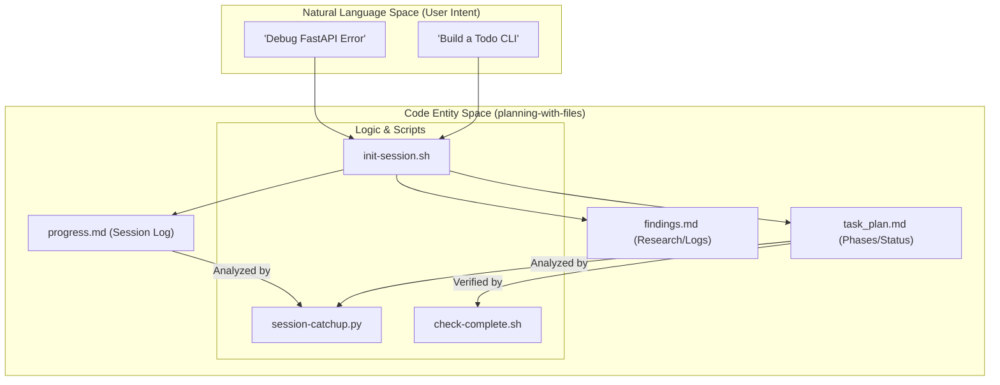
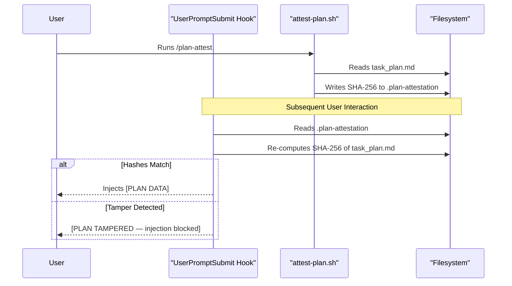

<!-- source: DeepWiki mcp.deepwiki.com · repo OthmanAdi/planning-with-files · page 8.5 Benchmark Results and Evals · fetched 2026-10-29 -->

# Benchmark Results and Evals

Relevant source files

The following files were used as context for generating this wiki page:

- [.claude-plugin/marketplace.json](.claude-plugin/marketplace.json)
- [.claude-plugin/plugin.json](.claude-plugin/plugin.json)
- [CHANGELOG.md](CHANGELOG.md)
- [CITATION.cff](CITATION.cff)
- [CONTRIBUTORS.md](CONTRIBUTORS.md)
- [README.md](README.md)
- [docs/article.md](docs/article.md)
- [docs/evals.md](docs/evals.md)
- [skills/planning-with-files/SKILL.md](skills/planning-with-files/SKILL.md)

This page documents the formal evaluation of the `planning-with-files` skill using Anthropic's `skill-creator` framework. It covers the methodology, test cases, and the critical security audit that led to the v2.21.0 hardening and subsequent v2.37.0 cryptographic attestation features.

## Evaluation Methodology

The evaluation was conducted to verify workflow fidelity—ensuring the agent strictly adheres to the 3-file pattern (`task_plan.md`, `findings.md`, `progress.md`) and the 6 Manus Principles. As an **encoded preference skill**, the goal is not to grant Claude new capabilities, but to enforce a specific, high-reliability discipline [docs/evals.md:31-34]().

### Test Environment
The evaluation utilized the following stack:
*   **Framework:** Anthropic `skill-creator` [docs/evals.md:20]().
*   **Model:** `claude-sonnet-4-6` [docs/evals.md:21]().
*   **Execution:** 10 parallel subagents (5 `with_skill`, 5 `without_skill`) [docs/evals.md:24]().
*   **Comparison:** 3 blind A/B comparisons by independent agents [docs/evals.md:25]().

### Test Cases
Five distinct scenarios were used to stress-test the planning logic:
1.  **todo-cli:** Building a Python CLI tool with persistence [docs/evals.md:39]().
2.  **research-frameworks:** Comparative analysis of Python testing frameworks [docs/evals.md:40]().
3.  **debug-fastapi:** Systematic debugging of a FastAPI `TypeError` [docs/evals.md:41]().
4.  **django-migration:** Planning a 50k LOC migration from Django 3.2 to 4.2 [docs/evals.md:42]().
5.  **cicd-pipeline:** Architecting a CI/CD pipeline for a TypeScript monorepo [docs/evals.md:43]().

Sources: [docs/evals.md:1-48]()

## Performance Metrics

The benchmark results show a significant delta in workflow adherence when the skill is active.

### Aggregate Results
| Configuration | Pass Rate | Total Passed |
| :--- | :--- | :--- |
| **with_skill** | **96.7%** | 29/30 assertions |
| **without_skill** | 6.7% | 2/30 assertions |
| **Delta** | **+90.0 pp** | +27 assertions |

*Source: [docs/evals.md:79-85]()*

### Cost-Structure Tradeoff
The skill optimizes for reliability over raw speed. On average, the `with_skill` configuration uses **~68% more tokens** and **~17% more time** [docs/evals.md:98](). This overhead is attributed to:
*   Creating and maintaining 3 separate files instead of 1 [docs/evals.md:98]().
*   Populating structured tables for `Decisions Made` and `Errors Encountered` [docs/evals.md:98]().
*   Frequent context re-injection via `PreToolUse` hooks [skills/planning-with-files/SKILL.md:11-15]().

### Workflow Fidelity Diagram
The following diagram illustrates how the `skill-creator` framework maps natural language tasks to the creation of specific code entities.

**Natural Language to Code Entity Mapping**

Sources: [docs/evals.md:35-43](), [skills/planning-with-files/SKILL.md:87-94](), [CONTRIBUTORS.md:28-34]()

## Security Audit and Hardening

In March 2026, a proactive audit identified a **Prompt Injection Amplification** vector [docs/evals.md:9]().

### The Vulnerability
The `PreToolUse` hook [skills/planning-with-files/SKILL.md:11-15]() re-reads `task_plan.md` before every tool call to prevent goal drift. If an agent used `WebFetch` to read a malicious site and wrote those findings into `task_plan.md`, the adversarial instructions would be re-injected into the context window indefinitely [docs/article.md:49-56]().

### Hardening Implementation (v2.21.0 - v2.37.0)
The following measures were implemented to secure the workflow:
1.  **Tool Restriction:** `WebFetch` and `WebSearch` were removed from `allowed-tools` to break the injection chain [docs/article.md:68-70]().
2.  **Security Boundaries:** An explicit rule was added: Web results must go to `findings.md` (not auto-read by hooks), never `task_plan.md` [docs/article.md:77-84]().
3.  **Delimiter Framing:** v2.36.1 introduced `---BEGIN PLAN DATA---` and `---END PLAN DATA---` tags in hook outputs to isolate plan content from model instructions [CHANGELOG.md:77-78]().
4.  **Cryptographic Attestation:** v2.37.0 added the `/plan-attest` command. It generates a SHA-256 hash of `task_plan.md` stored in `.planning/<plan_id>/.attestation`. Hooks re-verify this hash before injection [CHANGELOG.md:9]().

### Security Verification Flow

Sources: [CHANGELOG.md:5-18](), [skills/planning-with-files/SKILL.md:6-10](), [docs/article.md:77-88]()

## Summary of Results
The `planning-with-files` system demonstrates a **96.7% success rate** in maintaining structured workflow fidelity across diverse technical tasks [docs/evals.md:83](). While it introduces a token overhead, the A/B blind comparisons confirm that the resulting outputs are significantly more robust, particularly in complex migrations and debugging scenarios [docs/evals.md:113-119](). The security hardening in v2.37.0 provides a verifiable cryptographic guarantee that the automated context injection mechanism cannot be exploited by external content [CHANGELOG.md:9]().

Sources: [docs/evals.md:139-145](), [CHANGELOG.md:5-10]()

---

