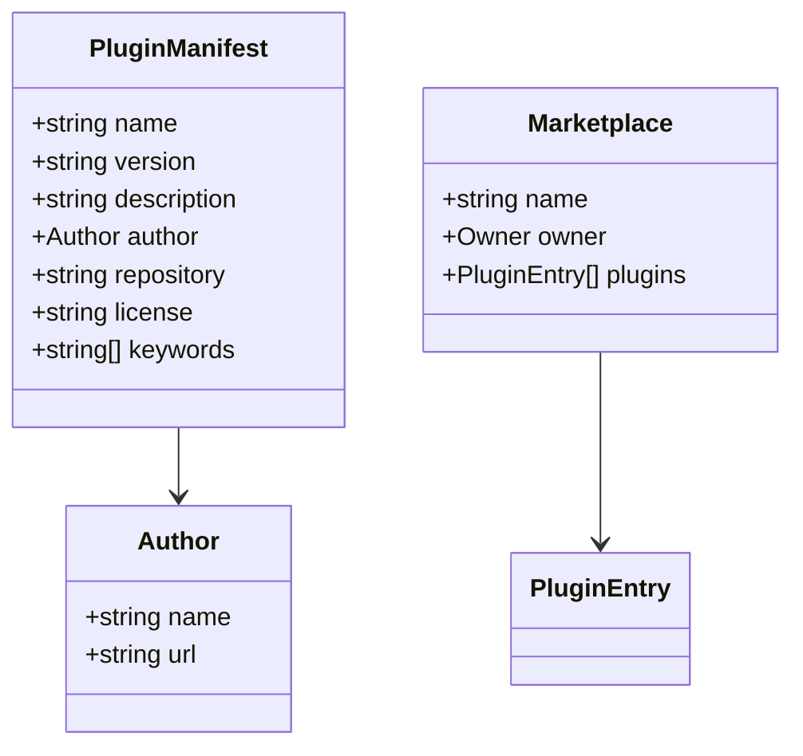
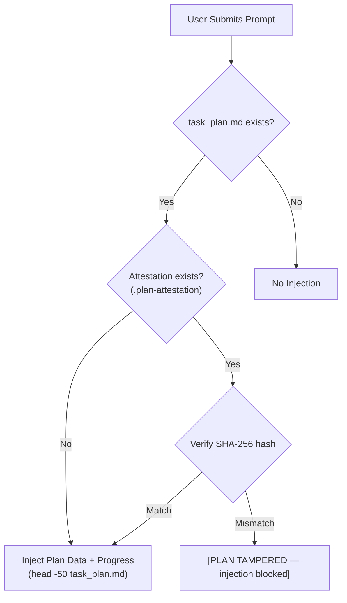
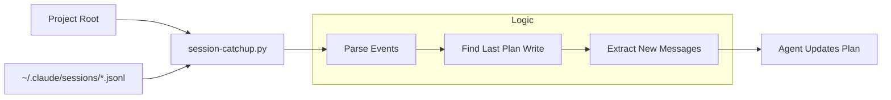

<!-- source: DeepWiki mcp.deepwiki.com · repo OthmanAdi/planning-with-files · page 9.1 Claude Code Integration · fetched 2026-10-29 -->

# Claude Code Integration

Relevant source files

The following files were used as context for generating this wiki page:

- [.claude-plugin/marketplace.json](.claude-plugin/marketplace.json)
- [.claude-plugin/plugin.json](.claude-plugin/plugin.json)
- [.github/hooks/scripts/error-occurred.sh](.github/hooks/scripts/error-occurred.sh)
- [.github/hooks/scripts/pre-tool-use.sh](.github/hooks/scripts/pre-tool-use.sh)
- [.github/hooks/scripts/session-start.sh](.github/hooks/scripts/session-start.sh)
- [CHANGELOG.md](CHANGELOG.md)
- [CITATION.cff](CITATION.cff)
- [CONTRIBUTORS.md](CONTRIBUTORS.md)
- [README.md](README.md)
- [skills/planning-with-files/SKILL.md](skills/planning-with-files/SKILL.md)

## Purpose and Scope

This page documents the integration of `planning-with-files` with Claude Code, Anthropic's AI-powered coding assistant. Claude Code is the primary platform for which this skill was designed, utilizing the native Agent Skills and Plugin systems. 

Key features include automated context injection via the `UserPromptSubmit` pipeline, cryptographic plan attestation, and seamless session recovery after `/clear` commands.

**Sources**: [README.md:1-58](), [skills/planning-with-files/SKILL.md:1-5]()

---

## Installation Architecture

Claude Code supports two installation methods: plugin marketplace installation (recommended) and manual skill copy. Both methods leverage different directory structures within the `~/.claude/` folder.

### Installation Methods Comparison

| Method | Directory | Command Availability | Auto-Updates |
|--------|-----------|---------------------|--------------|
| Plugin Marketplace | `~/.claude/plugins/cache/planning-with-files/` | `/planning-with-files:plan`, `/planning-with-files:start` | Yes |
| Manual Copy | `~/.claude/skills/planning-with-files/` | `/planning-with-files` | No |

### Plugin Manifest Structure

The `.claude-plugin/plugin.json` and `marketplace.json` files define plugin metadata and triggers marketplace registration.

**Sources**: [.claude-plugin/plugin.json:1-40](), [.claude-plugin/marketplace.json:1-15]()

---

## Slash Command System

Claude Code v2.6.0+ introduced namespace commands to enable plugin-based slash commands. These commands are defined in the `commands/` directory and point to the main `SKILL.md`.

### Command Mappings

| User Types | Claude Shows | Target File |
|------------|--------------|-------------|
| `/p` | `/planning-with-files:plan` | `commands/plan.md` |
| `/planning` | `/planning-with-files:start` | `commands/start.md` |
| `/plan-attest` | `/planning-with-files:plan-attest` | `commands/plan-attest.md` |

The `/plan-attest` command (v2.37.0) is a wrapper around `attest-plan.sh`, used to lock `task_plan.md` with a SHA-256 hash to prevent unauthorized context injection if the file is tampered with.

**Sources**: [CHANGELOG.md:5-17](), [README.md:70-74]()

---

## Hook System and Context Pipeline

The `SKILL.md` frontmatter defines the automation triggers that manage context. The most critical is the `UserPromptSubmit` hook, which forms the context injection pipeline.

### The UserPromptSubmit Pipeline

This hook fires on every user message. It performs a security check and injects the plan if valid.

### Hook Configuration Reference

| Hook Type | Matcher | Action | Purpose |
|-----------|---------|--------|---------|
| `UserPromptSubmit` | N/A | Injects `task_plan.md` (50 lines) + `progress.md` (20 lines) | Global context synchronization |
| `PreToolUse` | `Write\|Edit\|Bash\|Read\|Glob\|Grep` | Injects `task_plan.md` (30 lines) | Attention manipulation before acting |
| `PostToolUse` | `Write\|Edit` | Reminder to update `progress.md` | Status maintenance |
| `Stop` | N/A | Runs `check-complete.ps1/sh` | Quality gate before delivery |

**Sources**: [skills/planning-with-files/SKILL.md:6-24](), [CHANGELOG.md:9-11]()

---

## Security and Plan Attestation

Introduced in v2.37.0, **Plan Attestation** provides a cryptographic guarantee that the injected context matches what the user approved.

### Security Logic in UserPromptSubmit
The pipeline uses `sha256sum` or `shasum -a 256` to recompute the hash of `task_plan.md` on every hook fire. If the recomputed hash does not match the stored hash in `.plan-attestation` (or `.planning/<PLAN_ID>/.attestation`), the injection is blocked.

### Key Security Entities
- **`scripts/attest-plan.sh`**: Computes and stores the SHA-256 hash.
- **`.plan-attestation`**: The file containing the trusted hash.
- **`PLAN TAMPERED`**: The error message sent to the model when verification fails.

**Sources**: [CHANGELOG.md:5-17](), [skills/planning-with-files/SKILL.md:10-15]()

---

## Session Recovery and JSONL Analysis

Claude Code stores session logs in `~/.claude/projects/<project-hash>/sessions/`. The `session-catchup.py` script analyzes these logs to recover context after a `/clear` command.

### Recovery Data Flow

**Sources**: [skills/planning-with-files/SKILL.md:33-54](), [CONTRIBUTORS.md:28-34]()

---

## Directory Layout and File Resolution

Claude Code uses the `CLAUDE_SKILL_DIR` environment variable to locate scripts. 

### Path Resolution
- **Templates**: `${CLAUDE_SKILL_DIR}/templates/`
- **Scripts**: `${CLAUDE_SKILL_DIR}/scripts/`
- **User Files**: `$(pwd)/task_plan.md`

### Parallel Plan Isolation (Slug Mode)
In v2.36.0, the system added support for parallel plans. The `resolve-plan-dir.sh` script determines if a session is using a specific `PLAN_ID`. If so, attestation and state files are stored in `.planning/<PLAN_ID>/` instead of the project root.

**Sources**: [README.md:70-80](), [CHANGELOG.md:34-45](), [skills/planning-with-files/SKILL.md:56-65]()

---

