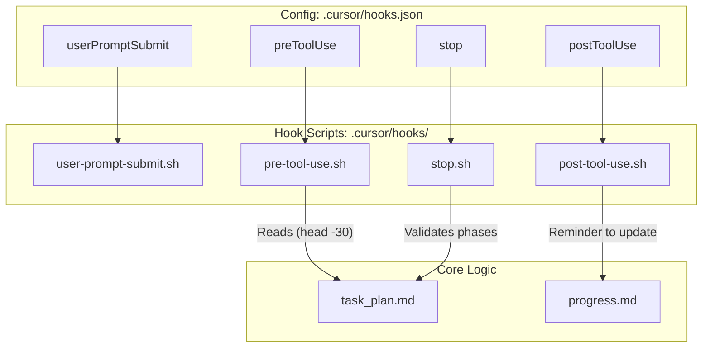
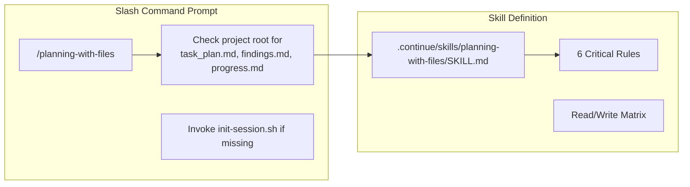
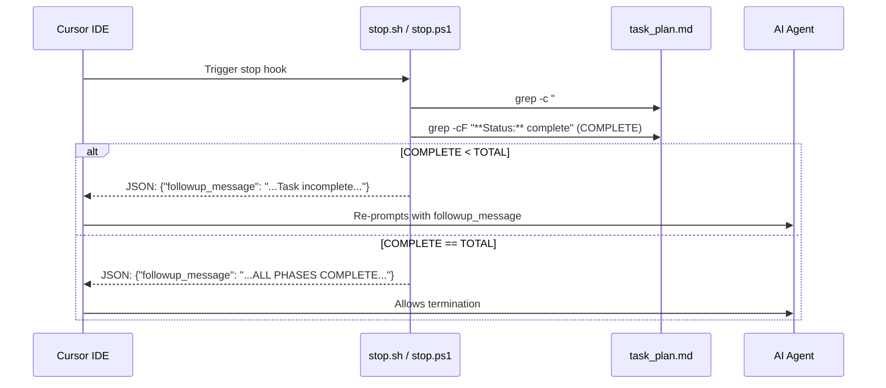

<!-- source: DeepWiki mcp.deepwiki.com · repo OthmanAdi/planning-with-files · page 9.2 Cursor and Continue IDEs · fetched 2026-10-29 -->

# Cursor and Continue IDEs

<details>
<summary>Relevant source files</summary>

The following files were used as context for generating this wiki page:

- [.continue/prompts/planning-with-files.prompt](.continue/prompts/planning-with-files.prompt)
- [.continue/skills/planning-with-files/SKILL.md](.continue/skills/planning-with-files/SKILL.md)
- [.cursor/hooks.json](.cursor/hooks.json)
- [.cursor/hooks.windows.json](.cursor/hooks.windows.json)
- [.cursor/hooks/post-tool-use.ps1](.cursor/hooks/post-tool-use.ps1)
- [.cursor/hooks/post-tool-use.sh](.cursor/hooks/post-tool-use.sh)
- [.cursor/hooks/pre-tool-use.ps1](.cursor/hooks/pre-tool-use.ps1)
- [.cursor/hooks/pre-tool-use.sh](.cursor/hooks/pre-tool-use.sh)
- [.cursor/hooks/stop.ps1](.cursor/hooks/stop.ps1)
- [.cursor/hooks/stop.sh](.cursor/hooks/stop.sh)
- [docs/continue.md](docs/continue.md)
- [docs/cursor.md](docs/cursor.md)

</details>


This document covers the installation, configuration, and usage of planning-with-files within **Cursor** and **Continue** IDEs. While both are VS Code-based (Continue also supports JetBrains), they differ significantly in their automation capabilities: Cursor now supports a native hook system mirroring Claude Code, while Continue relies on a manual workflow with slash command prompts.

---

## Overview and Scope

The integration for these IDEs follows a **directory-based skill installation** pattern. Instead of a centralized marketplace, the IDE discovers the planning-with-files skill by scanning specific project directories (`.cursor/skills/` or `.continue/skills/`) for a `SKILL.md` file.

| Feature | Cursor | Continue |
|---------|--------|----------|
| **Hook System** | Native via `.cursor/hooks.json` | Not supported (Manual) |
| **Automation** | Pre/Post Tool Use & Stop Hooks | Manual script execution |
| **Slash Commands** | Not natively via files | Supported via `.prompt` files |
| **Session Recovery** | `session-catchup.py` | `session-catchup.py` |
| **IDE Platform** | VS Code fork | VS Code + JetBrains |

**Sources:** [docs/cursor.md:1-44](), [docs/continue.md:1-14]()

---

## Cursor Integration: Native Hooks

Cursor supports a native hook system defined in `.cursor/hooks.json` [.cursor/hooks.json:1-32](). This allows the IDE to automate the "Manus-style" planning loop by executing scripts at key lifecycle points.

### Hook Architecture

The following diagram maps the Cursor hook configuration to the underlying script entities:



**Sources:** [.cursor/hooks.json:1-32](), [docs/cursor.md:26-35]()

### Hook Implementation Details

| Hook | Trigger Matcher | Implementation | Purpose |
|------|-----------------|----------------|---------|
| `preToolUse` | `Write\|Edit\|Shell\|Read` | `pre-tool-use.sh` | Reads first 30 lines of `task_plan.md` to refresh agent context [docs/cursor.md:93-100](). |
| `postToolUse` | `Write\|Edit` | `post-tool-use.sh` | Reminds agent to update `progress.md` and phase status [docs/cursor.md:101-108](). |
| `stop` | N/A | `stop.sh` | Checks if all `### Phase` headers are marked `complete`. Returns `followup_message` to block exit if incomplete [docs/cursor.md:109-120](). |

**Sources:** [.cursor/hooks.json:1-32](), [.cursor/hooks/stop.sh:1-44](), [.cursor/hooks/pre-tool-use.sh:1-15]()

---

## Continue Integration: Prompts and Skills

Continue uses a project-level skill directory and a `.prompt` file system to guide the agent. It does not currently support the automatic tool hooks found in Cursor.

### Slash Command Prompt

The `/planning-with-files` command is defined in `.continue/prompts/planning-with-files.prompt` [.continue/prompts/planning-with-files.prompt:1-5]().



**Sources:** [.continue/prompts/planning-with-files.prompt:1-35](), [docs/continue.md:44-52]()

---

## Installation Workflows

### 1. Cursor Setup
To install in Cursor, copy the `.cursor` directory to your project root. This includes the skills, hook configurations, and scripts [docs/cursor.md:9-17]().

```bash
# Recommended installation
git clone https://github.com/OthmanAdi/planning-with-files.git
cp -r planning-with-files/.cursor .cursor
```

**Windows Note:** For native PowerShell support, use `.cursor/hooks.windows.json` which executes `.ps1` scripts with `-ExecutionPolicy Bypass` [docs/cursor.md:73-88]().

### 2. Continue Setup
Continue supports both project-level and global installations [docs/continue.md:12-40]().

```bash
# Project-level (Recommended)
cp -r planning-with-files/.continue .continue
```

**Sources:** [docs/cursor.md:9-17](), [docs/continue.md:16-40]()

---

## Technical Reference: The Stop Hook

The `stop` hook is the most critical automation component in Cursor. It prevents the agent from finishing a task until all planned phases are verified as complete.

### Data Flow: Completion Validation



**Sources:** [.cursor/hooks/stop.sh:1-44](), [.cursor/hooks/stop.ps1:1-35](), [docs/cursor.md:36-45]()

---

## Session Catchup and Recovery

Both IDEs utilize `session-catchup.py` to restore context after a session clear or IDE restart. This script analyzes logs to find unsynced work [SKILL.md:12-25]().

**Execution Command:**
```bash
python3 .continue/skills/planning-with-files/scripts/session-catchup.py "$(pwd)"
```

**Workflow:**
1. Run `session-catchup.py` to identify changes since the last file sync [SKILL.md:17-18]().
2. Perform `git diff --stat` to verify physical code changes [SKILL.md:21]().
3. Update `task_plan.md` and `progress.md` based on the catchup report [SKILL.md:23]().

**Sources:** [.continue/skills/planning-with-files/SKILL.md:12-25](), [docs/continue.md:65-67]()

---

## Comparison of Automation

| Feature | Cursor Implementation | Continue Implementation |
|---------|-----------------------|-------------------------|
| **Goal Persistence** | `pre-tool-use.sh` logs `task_plan.md` to stderr before tools [docs/cursor.md:97-100](). | Manual "Read Before Decide" rule in `SKILL.md` [.continue/skills/planning-with-files/SKILL.md:65-67](). |
| **Phase Tracking** | `stop.sh` blocks exit until `task_plan.md` is complete [.cursor/hooks/stop.sh:35-43](). | Manual check via `check-complete.sh` [docs/continue.md:62-63](). |
| **Reminders** | `post-tool-use.sh` triggers after every `Write/Edit` [docs/cursor.md:105-107](). | Manual "Update After Act" rule in `SKILL.md` [.continue/skills/planning-with-files/SKILL.md:69-71](). |

**Sources:** [docs/cursor.md:91-120](), [.continue/skills/planning-with-files/SKILL.md:55-80]()

---

