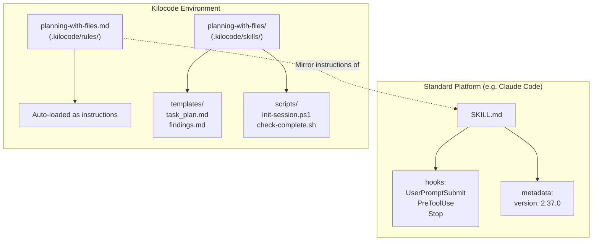
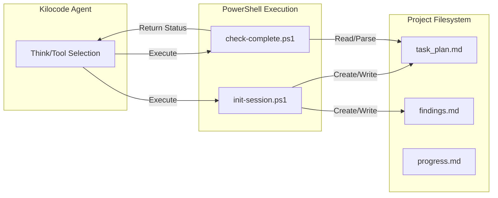

<!-- source: DeepWiki mcp.deepwiki.com · repo OthmanAdi/planning-with-files · page 9.3 Kilocode Integration · fetched 2026-10-29 -->

# Kilocode Integration

<details>
<summary>Relevant source files</summary>

The following files were used as context for generating this wiki page:

- [.claude-plugin/marketplace.json](.claude-plugin/marketplace.json)
- [.claude-plugin/plugin.json](.claude-plugin/plugin.json)
- [CHANGELOG.md](CHANGELOG.md)
- [CITATION.cff](CITATION.cff)
- [CONTRIBUTORS.md](CONTRIBUTORS.md)
- [README.md](README.md)
- [skills/planning-with-files/SKILL.md](skills/planning-with-files/SKILL.md)

</details>


This document describes the platform-specific integration of `planning-with-files` with the Kilocode IDE. Kilocode utilizes a unique "rules system" architecture that differs from the standard `SKILL.md` hook-based format used by platforms like Claude Code.

## Purpose and Scope

Kilocode integration provides full support for the planning-with-files workflow through:
- Native `.kilocode/rules/` system for automatic rule loading.
- Standard `.kilocode/skills/` directory for skill bundles (templates and scripts).
- Cross-platform script support for both Bash and Windows PowerShell.
- Global (user-level) and project-level installation options.

This document covers Kilocode-specific installation, file structures, and the rules system architecture.

## Kilocode Rules System Architecture

Kilocode differs from other platforms by using a **rules system** instead of standard skills. Rules are automatically loaded from `.kilocode/rules/` directories, while the skill folder provides supporting resources such as templates and automation scripts.

### Architecture Comparison: Code Entity Space

The following diagram bridges the "Natural Language Space" (instructions) to "Code Entity Space" (files and directories).

**Diagram: Kilocode vs Standard Architecture**

Sources: [README.md:69-74](), [skills/planning-with-files/SKILL.md:1-27](), [CONTRIBUTORS.md:36-42]()

### Rules File Structure
The rules file `.kilocode/rules/planning-with-files.md` contains the same instructional content as `SKILL.md` but without YAML frontmatter. This ensures the Kilocode agent always has the "Manus Principles" in its context window without needing a specific trigger command.

Sources: [skills/planning-with-files/SKILL.md:29-131](), [CONTRIBUTORS.md:36-42]()

## Installation Methods

Kilocode supports two installation scopes: **Global** (available to all projects) and **Project** (isolated to a specific repository).

### Global Installation
Global installation makes the skill available across all projects by placing files in the user's home directory.

**Windows (PowerShell):**
```powershell
# Create directories
New-Item -ItemType Directory -Force -Path "$env:USERPROFILE\.kilocode\rules"
New-Item -ItemType Directory -Force -Path "$env:USERPROFILE\.kilocode\skills"

# Copy rules and skill bundle
Copy-Item -Force ".kilocode\rules\planning-with-files.md" "$env:USERPROFILE\.kilocode\rules\"
Copy-Item -Recurse -Force "skills\planning-with-files" "$env:USERPROFILE\.kilocode\skills\"
```

### Project-Level Installation
Project-level installation is ideal for teams who want to version-control their AI rules alongside their code.

**Unix/Linux/macOS:**
```bash
mkdir -p .kilocode/rules .kilocode/skills
cp .kilocode/rules/planning-with-files.md .kilocode/rules/
cp -r skills/planning-with-files .kilocode/skills/
```

Sources: [CONTRIBUTORS.md:36-42](), [CHANGELOG.md:313-321]()

## Windows PowerShell Support

A major feature of the Kilocode integration (introduced in v2.2.0) is native Windows PowerShell support. This ensures that the automation scripts (`init-session` and `check-complete`) work seamlessly in Windows environments.

**Diagram: Data Flow for Windows PowerShell Scripts**

Sources: [CHANGELOG.md:326-330](), [CHANGELOG.md:365-369](), [CONTRIBUTORS.md:36-42]()

### PowerShell Script Functionality

| Script | Purpose | Implementation Detail |
|--------|---------|-----------------------|
| `init-session.ps1` | Setup project | Copies `task_plan.md`, `findings.md`, and `progress.md` from `templates/` to the project root. |
| `check-complete.ps1` | Validation | Parses `task_plan.md` using regex to ensure all phases are marked as `complete`. |
| `attest-plan.ps1` | Security | Computes SHA-256 of `task_plan.md` for the v2.37.0 attestation system. |

Sources: [CHANGELOG.md:14-15](), [CHANGELOG.md:54-57](), [CHANGELOG.md:365-369]()

## Platform-Specific Adaptations

Kilocode does not support the hook system (e.g., `UserPromptSubmit`) natively within the IDE's rule parser. Therefore, the "Persistent Memory" must be maintained through explicit agent instructions contained in the rules file.

### Rules vs Skills Comparison

| Feature | Standard (Claude Code) | Kilocode |
|---------|-----------------------|----------|
| **Trigger** | Automatic Hooks | Rule-based Instruction |
| **Config File** | `plugin.json` | `.kilocode/rules/*.md` |
| **Context Injection** | Automated via `command` | Agent-led (Read tools) |
| **OS Support** | Bash focus | Bash + PowerShell |

Sources: [skills/planning-with-files/SKILL.md:6-24](), [CONTRIBUTORS.md:36-42](), [.claude-plugin/plugin.json:1-40]()

### Security and Attestation in Kilocode
With the release of v2.37.0, the `/plan-attest` command and the `attest-plan.ps1` script allow Kilocode users to secure their `task_plan.md`. While Kilocode lacks the automatic `UserPromptSubmit` hook to block tampered injections, the agent is instructed via rules to verify the plan's SHA-256 hash using `attest-plan.ps1` before proceeding with high-stakes operations.

Sources: [CHANGELOG.md:9-17](), [skills/planning-with-files/SKILL.md:10-15]()

---

