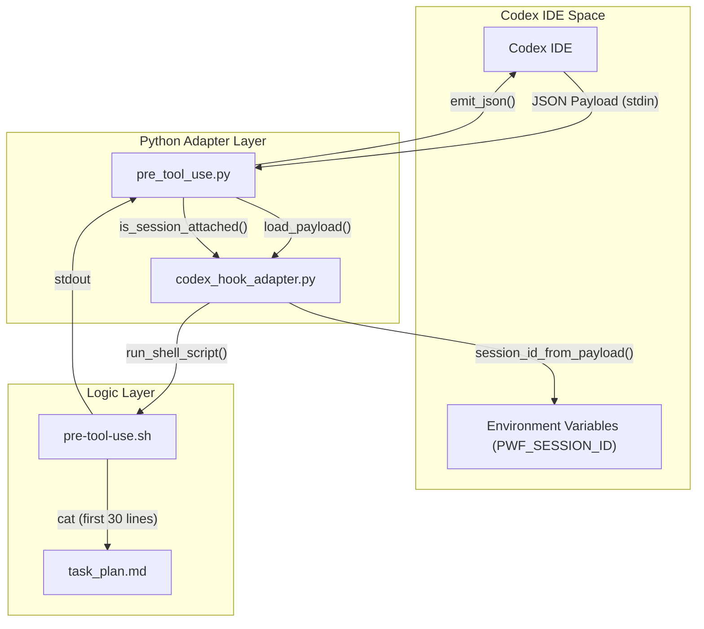

<!-- source: DeepWiki mcp.deepwiki.com · repo OthmanAdi/planning-with-files · page 9.4 Codex and OpenCode · fetched 2026-10-29 -->

# Codex and OpenCode

<details>
<summary>Relevant source files</summary>

The following files were used as context for generating this wiki page:

- [.codex/hooks/codex_hook_adapter.py](.codex/hooks/codex_hook_adapter.py)
- [.codex/hooks/post-tool-use.sh](.codex/hooks/post-tool-use.sh)
- [.codex/hooks/post_tool_use.py](.codex/hooks/post_tool_use.py)
- [.codex/hooks/pre-tool-use.sh](.codex/hooks/pre-tool-use.sh)
- [.codex/hooks/pre_tool_use.py](.codex/hooks/pre_tool_use.py)
- [.codex/hooks/stop.py](.codex/hooks/stop.py)
- [.codex/hooks/stop.sh](.codex/hooks/stop.sh)
- [.codex/hooks/user-prompt-submit.sh](.codex/hooks/user-prompt-submit.sh)
- [.codex/skills/planning-with-files/SKILL.md](.codex/skills/planning-with-files/SKILL.md)
- [.cursor/skills/planning-with-files/SKILL.md](.cursor/skills/planning-with-files/SKILL.md)
- [.opencode/skills/planning-with-files/SKILL.md](.opencode/skills/planning-with-files/SKILL.md)
- [docs/codex.md](docs/codex.md)
- [docs/opencode.md](docs/opencode.md)
- [scripts/session-catchup.py](scripts/session-catchup.py)

</details>


This page documents the specific integrations and hook architectures for **OpenAI Codex** and **OpenCode**. While both platforms leverage the core 3-file pattern (`task_plan.md`, `findings.md`, `progress.md`), they utilize a specialized Python-based hook adapter system to manage session isolation and lifecycle automation.

## Codex Integration Architecture

The Codex integration is designed to be either global (user-level) or workspace-specific (project-level). It utilizes a multi-layered hook system where Python scripts act as adapters for underlying shell logic, providing robust session management.

### The Hook Adapter Pattern
Codex hooks rely on `codex_hook_adapter.py` to bridge the JSON-based Codex hook protocol with the system's standard shell scripts. This adapter handles payload parsing, directory resolution, and session validation.

**Key Components:**
*   **`codex_hook_adapter.py`**: The central utility for loading payloads from `stdin` `[.codex/hooks/codex_hook_adapter.py:15-23]()`, resolving the current working directory `[.codex/hooks/codex_hook_adapter.py:26-30]()`, and emitting JSON responses to `stdout` `[.codex/hooks/codex_hook_adapter.py:56-60]()`.
*   **Session Isolation**: Uses `.planning/sessions/` to track active sessions. The function `is_session_attached` ensures that plan context is only injected into sessions that have an explicit `.attached` sentinel file `[.codex/hooks/codex_hook_adapter.py:41-53]()`.

### Codex Hook Data Flow
The following diagram illustrates how a hook request (e.g., `PreToolUse`) flows from the Codex IDE through the Python adapter to the execution of planning logic.

**Diagram: Codex Hook Execution Flow**

Sources: `[.codex/hooks/codex_hook_adapter.py:1-81]()`, `[.codex/hooks/pre_tool_use.py:1-25]()`, `[.codex/hooks/pre-tool-use.sh:1-10]()`

## Lifecycle Hooks Detail

Codex implements five specific lifecycle hooks defined in `.codex/hooks.json` `[docs/codex.md:103-112]()`.

| Hook | Implementation File | Purpose |
| :--- | :--- | :--- |
| **SessionStart** | `session-catchup.py` | Runs recovery logic and injects initial plan state `[docs/codex.md:107]()`. |
| **UserPromptSubmit** | `user-prompt-submit.sh` | Injects the first 50 lines of `task_plan.md` and last 20 lines of `progress.md` before every user message `[.codex/hooks/user-prompt-submit.sh:20-27]()`. |
| **PreToolUse** | `pre_tool_use.py` | Refreshes the agent's attention by reading the top of the plan before tool execution `[.codex/hooks/pre_tool_use.py:15-17]()`. |
| **PostToolUse** | `post_tool_use.py` | Reminds the agent to update progress after file modifications `[.codex/hooks/post_tool_use.py:14-16]()`. |
| **Stop** | `stop.py` | Checks phase completion status and issues a `followup_message` if phases remain `[.codex/hooks/stop.sh:28-34]()`. |

Sources: `[.codex/skills/planning-with-files/SKILL.md:7-24]()`, `[docs/codex.md:103-112]()`

## OpenCode Integration

OpenCode support is provided through both the `superpowers` plugin and native skill loading via `oh-my-opencode`.

### Session Storage Differences
A primary technical distinction for OpenCode is its session storage format. While Claude Code uses `.jsonl` files in `~/.claude/projects/`, OpenCode uses `.json` files located at `~/.local/share/opencode/storage/session/` `[docs/opencode.md:88-91]()`.

**Session Recovery Logic:**
The `session-catchup.py` script includes a `detect_ide()` function that checks for the `OPENCODE_DATA_DIR` environment variable or the existence of the `~/.local/share/opencode` directory `[scripts/session-catchup.py:25-44]()`. It uses `get_sessions_sorted_opencode()` to traverse the project hash directories and retrieve session JSON files `[scripts/session-catchup.py:81-96]()`.

### Configuration via oh-my-opencode
To enable the skill in OpenCode, it must be registered in `oh-my-opencode.json` `[docs/opencode.md:54-68]()`:
```json
{
  "skills": {
    "sources": [
      { "path": "~/.config/opencode/skills/planning-with-files", "recursive": false }
    ],
    "enable": ["planning-with-files"]
  }
}
```

## Session Isolation and Rollouts

For both platforms, session isolation is critical when multiple tasks occur in the same directory.

1.  **CODEX_THREAD_ID / PWF_SESSION_ID**: The adapter attempts to extract a session ID from the hook payload or the `PWF_SESSION_ID` environment variable `[.codex/hooks/codex_hook_adapter.py:33-38]()`.
2.  **Sentinel Files**: If a directory contains `.planning/sessions/`, the hooks check for a file named `{session_id}.attached` `[.codex/hooks/codex_hook_adapter.py:53]()`. If missing, the hook remains silent to avoid "context bleeding" between unrelated sessions in the same workspace `[.codex/hooks/user-prompt-submit.sh:12-17]()`.
3.  **Rollout Logs**: Conversation history is tracked via `.jsonl` files (Codex/Claude) or `.json` files (OpenCode). `session-catchup.py` scans these logs for the string `"Write"` or `"Edit"` targeting `task_plan.md` to find the last synchronization point `[scripts/session-catchup.py:116-157]()`.

**Diagram: Session Isolation Logic**
```mermaid
graph TD
    subgraph "Workspace Root"
        TP["task_plan.md"]
        subgraph ".planning/sessions/"
            S1[{"session_A.attached"}]
            S2[{"session_B.attached"}]
        end
    end

    subgraph "Hook Adapter Logic"
        ID_CHECK{"Get Session ID"}
        DIR_CHECK{".planning/sessions exists?"}
        ATTACH_CHECK{"{ID}.attached exists?"}
        EMIT["Inject Plan Context"]
        SILENT["Silent (Allow)"]
    end

    ID_CHECK --> DIR_CHECK
    DIR_CHECK -- "No (Legacy)" --> EMIT
    DIR_CHECK -- "Yes" --> ATTACH_CHECK
    ATTACH_CHECK -- "Yes" --> EMIT
    ATTACH_CHECK -- "No" --> SILENT
```
Sources: `[.codex/hooks/codex_hook_adapter.py:41-53]()`, `[.codex/hooks/user-prompt-submit.sh:9-17]()`

## Installation and Setup

### Codex
Codex requires explicit activation of hooks in the global configuration `[docs/codex.md:70-79]()`:
```toml
# ~/.codex/config.toml
[features]
codex_hooks = true
```
The skill files are typically placed in `~/.codex/skills/planning-with-files/` `[docs/codex.md:53-54]()`.

### OpenCode
OpenCode skills can be installed globally in `~/.config/opencode/skills/` or locally in `.opencode/skills/` `[docs/opencode.md:11-25]()`.

Sources: `[docs/codex.md:44-66]()`, `[docs/opencode.md:11-25]()`

---

