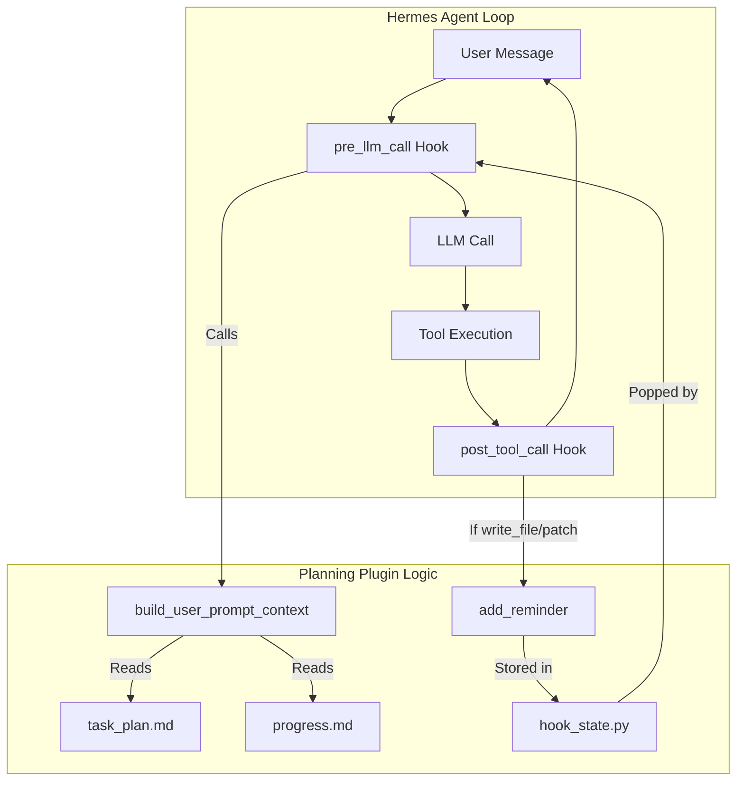

<!-- source: DeepWiki mcp.deepwiki.com · repo OthmanAdi/planning-with-files · page 9.6 Hermes Adapter · fetched 2026-10-29 -->

# Hermes Adapter

<details>
<summary>Relevant source files</summary>

The following files were used as context for generating this wiki page:

- [.hermes/commands/plan-status.md](.hermes/commands/plan-status.md)
- [.hermes/commands/plan.md](.hermes/commands/plan.md)
- [.hermes/plugins/planning-with-files/__init__.py](.hermes/plugins/planning-with-files/__init__.py)
- [.hermes/plugins/planning-with-files/constants.py](.hermes/plugins/planning-with-files/constants.py)
- [.hermes/plugins/planning-with-files/hooks.py](.hermes/plugins/planning-with-files/hooks.py)
- [.hermes/plugins/planning-with-files/paths.py](.hermes/plugins/planning-with-files/paths.py)
- [.hermes/plugins/planning-with-files/planning_files.py](.hermes/plugins/planning-with-files/planning_files.py)
- [.hermes/plugins/planning-with-files/plugin.yaml](.hermes/plugins/planning-with-files/plugin.yaml)
- [.hermes/plugins/planning-with-files/tools.py](.hermes/plugins/planning-with-files/tools.py)
- [.hermes/skills/planning-with-files/SKILL.md](.hermes/skills/planning-with-files/SKILL.md)
- [docs/hermes.md](docs/hermes.md)

</details>


The Hermes adapter provides a specialized integration layer for the `planning-with-files` system within the Hermes agent environment. It bridges the gap between the canonical file-based planning workflow and the Hermes plugin architecture by implementing custom tools and lifecycle hooks that approximate the behavior of hook-native platforms like Claude Code.

### Overview and Architecture

The adapter is split into two distinct components to satisfy Hermes' skill and plugin requirements:
1.  **Skill Component**: Located at `.hermes/skills/planning-with-files/`, containing the `SKILL.md` workflow instructions, templates, and helper scripts [[.hermes/skills/planning-with-files/SKILL.md:7-8]]().
2.  **Plugin Component**: Located at `.hermes/plugins/planning-with-files/`, containing the Python-based logic for tool registration and context injection [[docs/hermes.md:7-8]]().

#### Data Flow and Context Injection
The adapter maintains planning discipline by monitoring tool usage and injecting relevant file snippets into the LLM context before each call.

Title: Hermes Adapter Context Injection Flow

Sources: [[.hermes/plugins/planning-with-files/hooks.py:11-46]](), [[.hermes/plugins/planning-with-files/hooks.py:49-68]](), [[docs/hermes.md:12-15]]()

---

### Provided Tools

The adapter registers three primary tools via the `register` function in `__init__.py` [[.hermes/plugins/planning-with-files/__init__.py:13-67]](). These tools allow the agent to programmatically manage the 3-file pattern.

| Tool Name | Implementation Function | Purpose |
| :--- | :--- | :--- |
| `planning_with_files_init` | `planning_with_files_init` | Copies templates (`task_plan.md`, `findings.md`, `progress.md`) to the project root [[.hermes/plugins/planning-with-files/tools.py:8-11]](). |
| `planning_with_files_status` | `summarize_status` | Returns a JSON summary of current phases, error counts, and recent progress [[.hermes/plugins/planning-with-files/planning_files.py:144-173]](). |
| `planning_with_files_check_complete` | `planning_with_files_check_complete` | Invokes `check-complete.sh` to verify if all phases in `task_plan.md` are marked complete [[.hermes/plugins/planning-with-files/tools.py:20-47]](). |

Sources: [[.hermes/plugins/planning-with-files/tools.py:1-48]](), [[.hermes/plugins/planning-with-files/planning_files.py:144-173]]()

---

### Context Injection and Lifecycle Hooks

Unlike platforms with native stop-hooks, Hermes uses a Python-based hook system to maintain the planning state.

#### Context Injection (`pre_llm_call`)
The `pre_llm_call` function in `hooks.py` prepares the LLM's prompt by:
*   Reading the first 50 lines of `task_plan.md` as a preview [[.hermes/plugins/planning-with-files/hooks.py:16-18]](), [[.hermes/plugins/planning-with-files/constants.py:5]]().
*   Reading the last 20 lines of `progress.md` to provide recent execution history [[.hermes/plugins/planning-with-files/hooks.py:19-22]](), [[.hermes/plugins/planning-with-files/constants.py:6]]().
*   Injecting pending reminders (e.g., "Update progress.md") generated by previous tool calls [[.hermes/plugins/planning-with-files/hooks.py:35-41]]().

#### Reminder System (`post_tool_call`)
The `post_tool_call` function monitors for "write-like" actions. If the agent calls `write_file` or `patch`, the adapter adds a reminder to the `hook_state` [[.hermes/plugins/planning-with-files/hooks.py:49-68]](). This reminder is surfaced in the next turn to ensure the agent logs the action in `progress.md` or updates `task_plan.md` [[.hermes/plugins/planning-with-files/hooks.py:66-67]]().

Title: Code Entity Relationship for Hermes Adapter
```mermaid
classDiagram
    class "hooks.py" {
        +pre_llm_call()
        +post_tool_call()
        +build_user_prompt_context()
    }
    class "planning_files.py" {
        +ensure_planning_files()
        +summarize_status()
        +phase_counts()
        +extract_current_phase()
    }
    class "tools.py" {
        +planning_with_files_init()
        +planning_with_files_status()
        +planning_with_files_check_complete()
    }
    class "paths.py" {
        +resolve_skill_dir()
        +normalize_cwd()
    }

    "tools.py" ..> "planning_files.py" : uses
    "hooks.py" ..> "planning_files.py" : uses
    "hooks.py" ..> "paths.py" : uses
    "tools.py" ..> "paths.py" : uses
```
Sources: [[.hermes/plugins/planning-with-files/hooks.py:1-69]](), [[.hermes/plugins/planning-with-files/planning_files.py:1-174]](), [[.hermes/plugins/planning-with-files/tools.py:1-48]](), [[.hermes/plugins/planning-with-files/paths.py:1-82]]()

---

### Setup Instructions

To enable the adapter, users must configure both the Hermes environment and the specific project.

1.  **Enable Plugins**: Set `HERMES_ENABLE_PROJECT_PLUGINS=1` in the shell environment [[docs/hermes.md:22]]().
2.  **Register Skill**: Add the skill directory to the Hermes profile YAML [[docs/hermes.md:29-33]]().
3.  **Install Plugin**: Copy the `.hermes/plugins/planning-with-files/` directory into the target profile or repository [[docs/hermes.md:37]]().
4.  **Initialize**: Run the `/plan` command or call `planning_with_files_init` from within the target project directory [[docs/hermes.md:45]](), [[.hermes/commands/plan.md:8]]().

Sources: [[docs/hermes.md:17-42]](), [[.hermes/commands/plan.md:1-11]]()

---

### Limitations vs. Hook-Native Platforms

The Hermes adapter is an "approximation" of the full lifecycle automation found in platforms like Claude Code [[.hermes/skills/planning-with-files/SKILL.md:37-42]]().

*   **Advisory Enforcement**: Completion checks are surfaced as tool responses rather than platform-level interrupts. The agent can technically ignore a "blocked" status [[docs/hermes.md:82-87]]().
*   **No Interception**: The plugin cannot intercept a tool call mid-flight or force a rollback; it can only provide context before a call or reminders after one [[docs/hermes.md:88-90]]().
*   **Manual Activation**: Project plugins must be explicitly enabled and the skill bundle registered manually [[docs/hermes.md:91-94]]().

Sources: [[docs/hermes.md:77-132]](), [[.hermes/skills/planning-with-files/SKILL.md:37-42]]()

---

