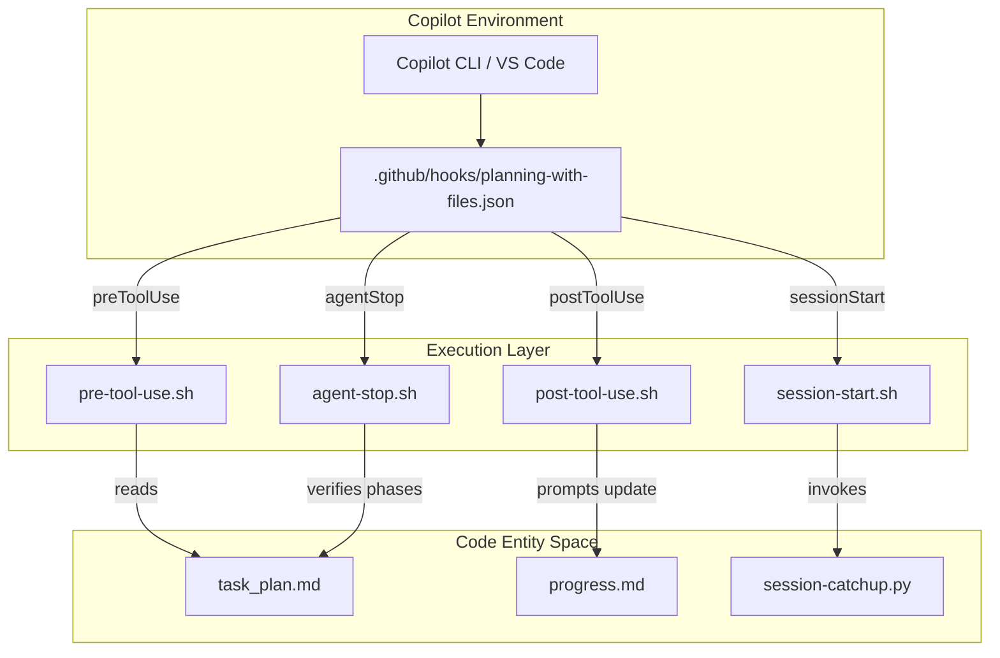
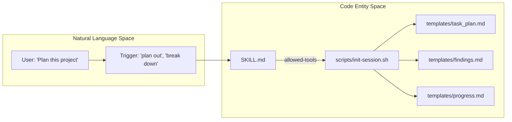

<!-- source: DeepWiki mcp.deepwiki.com · repo OthmanAdi/planning-with-files · page 9.7 Other Platforms · fetched 2026-10-29 -->

# Other Platforms

<details>
<summary>Relevant source files</summary>

The following files were used as context for generating this wiki page:

- [.codebuddy/skills/planning-with-files/SKILL.md](.codebuddy/skills/planning-with-files/SKILL.md)
- [.factory/skills/planning-with-files/SKILL.md](.factory/skills/planning-with-files/SKILL.md)
- [.github/hooks/planning-with-files.json](.github/hooks/planning-with-files.json)
- [.github/hooks/scripts/agent-stop.sh](.github/hooks/scripts/agent-stop.sh)
- [.github/hooks/scripts/post-tool-use.sh](.github/hooks/scripts/post-tool-use.sh)
- [.kiro/skills/planning-with-files/SKILL.md](.kiro/skills/planning-with-files/SKILL.md)
- [.mastracode/skills/planning-with-files/SKILL.md](.mastracode/skills/planning-with-files/SKILL.md)
- [docs/adal.md](docs/adal.md)
- [docs/copilot.md](docs/copilot.md)
- [docs/mastra.md](docs/mastra.md)

</details>


This page documents the integration of planning-with-files with AI coding platforms beyond Claude Code, Cursor, Continue, and Kilocode. These platforms include GitHub Copilot, Mastra Code, CodeBuddy, Factory, Kiro, AdaL CLI, Gemini CLI, Moltbot, OpenCode, Codex, and Antigravity. Each platform has specific directory structures, skill formats, and integration methods.

## Overview of Supported Platforms

The following table summarizes the platforms covered in this section, their skill formats, and installation methods:

| Platform | Skill Directory | Format | Hook Support |
|----------|----------------|--------|--------------|
| GitHub Copilot | `.github/hooks/` | JSON + Scripts | Native |
| Mastra Code | `.mastracode/skills/` | `SKILL.md` + `hooks.json` | Native |
| CodeBuddy | `.codebuddy/skills/` | `SKILL.md` | Via SKILL.md |
| Factory | `.factory/skills/` | `SKILL.md` | Via SKILL.md |
| Kiro | `.kiro/plan/` | Steering + Skills | Bootstrap |
| AdaL CLI | `.adal/skills/` | `SKILL.md` | Via SKILL.md |
| Gemini CLI | `.gemini/skills/` | `SKILL.md` | Manual Prompt |
| Moltbot | `.moltbot/skills/` | `SKILL.md` | Manual Prompt |

**Sources:** [.mastracode/skills/planning-with-files/SKILL.md:1-26](), [.codebuddy/skills/planning-with-files/SKILL.md:1-26](), [.factory/skills/planning-with-files/SKILL.md:1-26](), [.kiro/skills/planning-with-files/SKILL.md:1-10](), [.github/hooks/planning-with-files.json:1-45](), [docs/adal.md:51-60]()

## GitHub Copilot Integration

GitHub Copilot supports planning-with-files via a native hook system. Unlike Claude Code which uses `SKILL.md` frontmatter, Copilot uses a JSON configuration and standalone scripts.

### Copilot Hook Architecture



**Sources:** [.github/hooks/planning-with-files.json:1-45](), [.github/hooks/scripts/agent-stop.sh:1-47](), [docs/copilot.md:42-49]()

### Copilot Implementation Details
- **Protocol**: Hook scripts must read from `stdin` (JSON piped from Copilot) and output JSON to `stdout` `[.github/hooks/scripts/agent-stop.sh:7-9]()`.
- **Completion Check**: The `agent-stop.sh` script parses `task_plan.md` for `**Status:** complete` or `[complete]` markers. If incomplete, it injects `additionalContext` into the agent's stop event to force continuation `[.github/hooks/scripts/agent-stop.sh:38-46]()`.

## Mastra Code Integration

Mostra Code provides a dedicated integration using `.mastracode/skills/`. It supports native hooks via a separate `hooks.json` file.

### Mastra Hook Configuration
Mastra Code reads hooks from `.mastracode/hooks.json` (project-level) or `~/.mastracode/hooks.json` (global) `[docs/mastra.md:69-75]()`.

| Hook | Matcher | Purpose |
|------|---------|---------|
| `PreToolUse` | `Write\|Edit\|Bash\|Read\|Glob\|Grep` | Reads first 30 lines of `task_plan.md` `[.mastracode/skills/planning-with-files/SKILL.md:11-15]()` |
| `PostToolUse` | `Write\|Edit` | Reminds agent to update `progress.md` and `task_plan.md` status `[.mastracode/skills/planning-with-files/SKILL.md:16-20]()` |
| `Stop` | (All) | Runs `check-complete.ps1` or `check-complete.sh` `[.mastracode/skills/planning-with-files/SKILL.md:21-24]()` |

**Sources:** [.mastracode/skills/planning-with-files/SKILL.md:6-24](), [docs/mastra.md:78-83]()

## CodeBuddy and Factory Integration

Both CodeBuddy and Factory platforms use the standard `SKILL.md` format with embedded hooks.

### Data Flow for CodeBuddy/Factory



**Sources:** [.codebuddy/skills/planning-with-files/SKILL.md:1-5](), [.factory/skills/planning-with-files/SKILL.md:1-5](), [.factory/skills/planning-with-files/SKILL.md:66-72]()

### Security Hardening
CodeBuddy and Factory include specific security boundaries. External content from web/search must only be written to `findings.md`, as `task_plan.md` is read frequently and untrusted content there could amplify prompt injection risks `[.factory/skills/planning-with-files/SKILL.md:203-210]()`.

## Kiro Integration

Kiro uses a **Steering** architecture. It relies on a bootstrap process to create the necessary directory structure under `.kiro/plan/`.

### Kiro Bootstrap and Steering
1. **Bootstrap**: Run `.kiro/skills/planning-with-files/assets/scripts/bootstrap.sh` to initialize the environment `[.kiro/skills/planning-with-files/SKILL.md:25-31]()`.
2. **Steering**: Kiro uses `.kiro/steering/planning-context.md` with `inclusion: auto` to live-reference the planning files `[.kiro/skills/planning-with-files/SKILL.md:18-19]()`.
3. **Persistent Reminder**: Kiro requires a manual "Planning Active" block at the end of replies to maintain context since hooks are not bundled `[.kiro/skills/planning-with-files/SKILL.md:50-55]()`.

**Sources:** [.kiro/skills/planning-with-files/SKILL.md:14-22](), [.kiro/skills/planning-with-files/SKILL.md:39-43]()

## AdaL CLI (Sylph AI) Integration

AdaL CLI is compatible with Claude Code skills and supports a tiered skill priority system.

### AdaL Skill Priority
| Source | Location | Priority |
|--------|----------|----------|
| Personal | `~/.adal/skills/` | Highest |
| Project | `.adal/skills/` | Medium |
| Plugin | `~/.adal/plugin-cache/` | Lowest |

**Sources:** [docs/adal.md:51-60]()

### Installation Methods
AdaL supports installation via a plugin marketplace:
```bash
/plugin marketplace add OthmanAdi/planning-with-files
/plugin install planning-with-files@planning-with-files
```
**Sources:** [docs/adal.md:15-26]()

## Session Recovery across Platforms

All mentioned platforms support session recovery using `session-catchup.py`. This script analyzes logs to recover context after a `/clear` command or context window compaction.

### Recovery Workflow
1. **Check**: Run `session-catchup.py` with the current workspace path `[.mastracode/skills/planning-with-files/SKILL.md:38-41]()`.
2. **Analyze**: Compare catchup report with `git diff --stat` `[.codebuddy/skills/planning-with-files/SKILL.md:48-51]()`.
3. **Sync**: Update `task_plan.md` and `progress.md` to reflect the current state of the filesystem `[.factory/skills/planning-with-files/SKILL.md:41-45]()`.

**Sources:** [.mastracode/skills/planning-with-files/SKILL.md:34-52](), [.codebuddy/skills/planning-with-files/SKILL.md:34-52](), [.factory/skills/planning-with-files/SKILL.md:33-45]()

## Cross-Platform Script Reference

| Script | Purpose | Path Pattern |
|--------|---------|--------------|
| `init-session.sh` | Initialize planning files | `scripts/init-session.sh` |
| `check-complete.sh` | Verify all phases complete | `scripts/check-complete.sh` |
| `session-catchup.py` | Recover context from logs | `scripts/session-catchup.py` |

**Sources:** [.mastracode/skills/planning-with-files/SKILL.md:201-206](), [.codebuddy/skills/planning-with-files/SKILL.md:201-206](), [docs/adal.md:143-156]()

---

