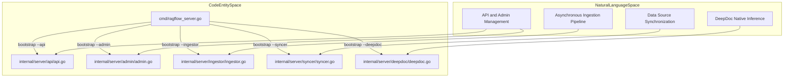
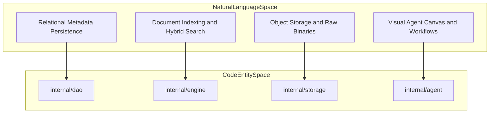

<!-- source: DeepWiki mcp.deepwiki.com · repo infiniflow/ragflow · page 1 Overview · fetched 2026-10-29 -->

# Overview

Relevant source files

The following files were used as context for generating this wiki page:

- [Dockerfile](Dockerfile)
- [README.md](README.md)
- [README_ar.md](README_ar.md)
- [README_fr.md](README_fr.md)
- [README_id.md](README_id.md)
- [README_ja.md](README_ja.md)
- [README_ko.md](README_ko.md)
- [README_pt_br.md](README_pt_br.md)
- [README_ru.md](README_ru.md)
- [README_tr.md](README_tr.md)
- [README_tzh.md](README_tzh.md)
- [README_zh.md](README_zh.md)
- [docker/.env](docker/.env)
- [docker/README.md](docker/README.md)
- [docker/docker-compose-base.yml](docker/docker-compose-base.yml)
- [docker/docker-compose.yml](docker/docker-compose.yml)
- [docker/entrypoint.sh](docker/entrypoint.sh)
- [docker/infinity_conf.toml](docker/infinity_conf.toml)
- [docker/launch_backend_service.sh](docker/launch_backend_service.sh)
- [docs/quickstart.mdx](docs/quickstart.mdx)
- [pyproject.toml](pyproject.toml)
- [sdk/python/pyproject.toml](sdk/python/pyproject.toml)
- [sdk/python/uv.lock](sdk/python/uv.lock)
- [uv.lock](uv.lock)

## Purpose and Scope

RAGFlow is a Go-native, open-source Retrieval-Augmented Generation (RAG) engine that integrates deep document understanding with advanced agentic capabilities [README.md:70-73](). Its primary purpose is to transform complex, unstructured documents into high-fidelity, production-ready AI knowledge bases by combining specialized parsing pipelines, multi-template chunking, hybrid vector-keyword retrieval, and configurable large language model (LLM) agent workflows [README.md:103-128]().

The backend is consolidated into a single Go binary, `ragflow_server`, which operates across various operational modes (`--api`, `--admin`, `--ingestor`, `--syncer`, `--deepdoc`, `--migrate`) managed via container entrypoints like `docker/entrypoint.sh` [cmd/ragflow_server.go:125-127](). This architecture delivers high concurrency and low latency while leveraging native bindings for ONNX Runtime and C++ tokenizers.

This overview page establishes the high-level system architecture and key features of RAGFlow. For detailed technical breakdowns, refer to the child pages:
- **[Repository Map and Technology Stack](#1.1)**
- **[Core Concepts and End-to-End Data Flow](#1.2)**

Sources: [README.md:70-73](), [README.md:103-128](), [cmd/ragflow_server.go:125-127]()

## Key Features

- **Deep Document Understanding via DeepDoc**: Integrates vision-based layout analysis, OCR, and table recognition to extract structured text from complex formats (PDF, DOCX, Excel, PPT) [README.md:107-108]().
- **Template-Based Chunking**: Offers explainable, configurable chunking strategies (Naive, Book, Law, Presentation) to generate semantically rich segments [README.md:112-115]().
- **Knowledge Compilation**: Compiles document and dataset contents into structured artifacts such as Wikis, Graphs, Trees, Mind Maps, Timelines, and Skill objects [README.md:117-120]().
- **Agentic Retrieval**: Implements multi-step query decomposition, iterative context gathering, and verification across Low, Medium, High, and Ultra thinking modes [README.md:123-126]().
- **Visual Workflow Canvas**: Provides a React-based node graph editor for orchestrating multi-turn agents, persistent memory, and integrated tool calling [README.md:72-73]().
- **Polyglot Persistence & Multi-Engine Support**: Supports document engines (Elasticsearch, Infinity, OceanBase, SereneDB, OpenSearch), relational metadata stores (MySQL, Postgres), object storage (MinIO, S3), caching (Kvrocks), and analytics (ClickHouse) [docker/.env:27-40]().

Sources: [README.md:103-145](), [docker/.env:27-40]()

---

## High-Level Architecture

### Core Subsystems

RAGFlow's architecture is divided into three primary tiers:
1. **Frontend & API Layer**: A React single-page application (`web/`) communicating with the `ragflow_server --api` and `--admin` endpoints [cmd/ragflow_server.go:40-46]().
2. **Asynchronous Execution & Ingestion**: Background workers (`ragflow_server --ingestor` and `--syncer`) consume tasks distributed via NATS JetStream, executing document parsing, embedding generation, and third-party data synchronization [cmd/ragflow_server.go:45-46]().
3. **Polyglot Storage & Inference**: Relational stores handle metadata (`internal/dao`), document engines index chunks for hybrid search, object stores retain raw binaries, and native CGO/ONNX wrappers execute DeepDoc models [cmd/ragflow_server.go:36-48]().

Sources: [cmd/ragflow_server.go:36-48](), [docker/docker-compose-base.yml:1-221]()

### Diagram: Server Modes to Code Entity Mapping

Sources: [cmd/ragflow_server.go:35-127](), [internal/server/api/api.go:1-30]()

### Diagram: Polyglot Storage and Features to Code Modules

Sources: [cmd/ragflow_server.go:36-48](), [docker/docker-compose-base.yml:1-221]()

---

## Links to Child Pages

- **[Repository Map and Technology Stack](#1.1)** — Detailed review of top-level directory layouts (`cmd/`, `internal/`, `web/`, `conf/`, `docker/`, `rag/prompts`), the Go/React/C++ technology stack, and the transition from Python.
- **[Core Concepts and End-to-End Data Flow](#1.2)** — Comprehensive trace of the data lifecycle from dataset creation and document upload through the ingestion pipeline, vector indexing, retrieval, and citation-backed answer generation.

Sources: [README.md:70-145]()

---

