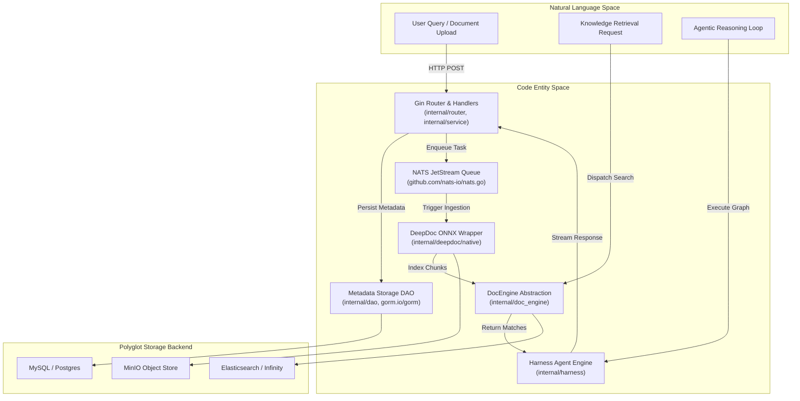
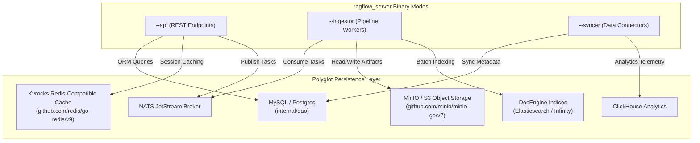

<!-- source: DeepWiki mcp.deepwiki.com · repo infiniflow/ragflow · page 1.1 Repository Map and Technology Stack · fetched 2026-10-29 -->

# Repository Map and Technology Stack

Relevant source files

The following files were used as context for generating this wiki page:

- [.github/workflows/sep-tests.yml](.github/workflows/sep-tests.yml)
- [Dockerfile_ci](Dockerfile_ci)
- [README.md](README.md)
- [README_ar.md](README_ar.md)
- [README_fr.md](README_fr.md)
- [README_id.md](README_id.md)
- [README_ja.md](README_ja.md)
- [README_ko.md](README_ko.md)
- [README_pt_br.md](README_pt_br.md)
- [README_ru.md](README_ru.md)
- [README_tr.md](README_tr.md)
- [README_tzh.md](README_tzh.md)
- [README_zh.md](README_zh.md)
- [build.sh](build.sh)
- [docker/nginx/ragflow.conf](docker/nginx/ragflow.conf)
- [docs/quickstart.mdx](docs/quickstart.mdx)
- [go.mod](go.mod)
- [go.sum](go.sum)
- [internal/common/trusted_proxies.go](internal/common/trusted_proxies.go)
- [internal/development.md](internal/development.md)
- [tools/scripts/convert_deepdoc_model.py](tools/scripts/convert_deepdoc_model.py)
- [tools/scripts/download_dev_deps.py](tools/scripts/download_dev_deps.py)
- [tools/scripts/test_download_dev_deps.py](tools/scripts/test_download_dev_deps.py)

This page provides an in-depth technical overview of the top-level directory structure of the RAGFlow codebase and the core technologies it employs. RAGFlow is structured as a Go-native Retrieval-Augmented Generation (RAG) engine, having transitioned from a legacy Python backend to a high-performance Go stack, complemented by a React single-page frontend and C++ native libraries for document parsing and ONNX Runtime inference.

---

## Purpose and Scope

This document details the repository layout, architectural components, and technology stack of the codebase. It examines top-level directories, language choices, frameworks, and integration points. As a leaf documentation page, it focuses on precise architectural facts, implementation details, and structural organization.

Sources: `go.mod:1-3`, `docs/quickstart.mdx:1-25`

---

## Repository Top-Level Directories

RAGFlow organizes code, resources, and deployment configurations into a modular set of top-level directories.

| Directory          | Description                                                                                               |
|--------------------|-----------------------------------------------------------------------------------------------------------|
| `cmd/`             | Entrypoint Go binaries. Houses `ragflow_server` which supports multiple operational modes via CLI flags (`--api`, `--admin`, `--ingestor`, `--syncer`, `--deepdoc`, `--migrate`) [go.mod:1-3]() |
| `internal/`        | Core backend implementation packages, covering API routing, metadata DAOs, the harness framework, ingestion pipelines, document engines, and native bindings. |
| `web/`             | React TypeScript single-page application providing the frontend interface for datasets, chat, agent canvas, and settings. |
| `conf/`            | Configuration templates (such as `service_conf.yaml.template`) and runtime YAML configurations for services, databases, and LLM factories. |
| `docker/`          | Docker deployment manifests, including `docker-compose.yml`, environment templates (`.env`), multi-stage `Dockerfile`, and container entrypoint scripts. |
| `docs/`            | Technical documentation in Markdown and MDX formats, covering guides, deployment instructions, and release notes [docs/quickstart.mdx:1-27]() |
| `sdk/`             | Software Development Kits, including the Python SDK under `python/` for programmatic interaction with RAGFlow APIs. |
| `test/`            | Integration and unit test suites, test case definitions, pytest files, and end-to-end testing resources. |
| `tools/`           | Auxiliary utility scripts, data migration tools, and ecosystem adapters. |
| `rag/prompts/`     | Prompt templates utilized across LLM-driven workflows, chat completions, and retrieval augmentation tasks. |

Sources: `go.mod:1-3`, `docs/quickstart.mdx:1-27`

---

### Detailed Directory Breakdown

#### `cmd/`
- Contains executable entrypoints, primarily `ragflow_server.go`.
- The binary uses runtime flags to determine its execution profile:
  - `--api`: Starts the core REST API server.
  - `--admin`: Serves administrative and monitoring endpoints.
  - `--ingestor`: Initiates document ingestion workers consuming from NATS JetStream (`github.com/nats-io/nats.go`) [go.mod:58]().
  - `--syncer`: Runs incremental synchronization across connected data sources.
  - `--deepdoc`: Provisions native deep document processing workers.
  - `--migrate`: Executes database schema migrations prior to service startup.

Sources: `go.mod:1-58`, `build.sh:20-24`

#### `internal/`
- Implements the core backend logic across dedicated packages:
  - `internal/harness/`: Graph-based agent execution engine with Pregel BSP execution.
  - `internal/binding/`: C++ tokenizer bindings and native integration wrappers [build.sh:20-21]().
  - `internal/deepdoc/native/`: ONNX Runtime wrappers for layout analysis and OCR inference (`github.com/infiniflow/onnxruntime_go`) [go.mod:48]().
  - `internal/dao/`: Polyglot database access layer for MySQL, PostgreSQL, and SQLite [go.mod:40-41](), [go.mod:49](), [go.mod:54]().
  - `internal/router/`: Gin-based REST route registrations and middleware handlers (`github.com/gin-gonic/gin`) [go.mod:39]().

Sources: `go.mod:39-54`, `build.sh:20-21`

#### `web/`
- React frontend built with TypeScript.
- Integrates Ant Design and Radix UI primitives for accessible component design.
- Uses Tailwind CSS with CSS-variable theming for dark/light mode support.
- Implements client state management via Zustand and server state synchronization via React Query.
- Utilizes React Flow for visual agent canvas composition.

Sources: `README.md:1-50`

#### `docker/`
- Houses containerization manifests and bootstrap scripts.
- `docker-compose.yml` configures service dependencies including MySQL, Elasticsearch/Infinity, MinIO, Kvrocks, NATS, and ClickHouse.
- `entrypoint.sh` initializes runtime environment variables, processes configuration templates, and executes database migrations.

Sources: `docs/quickstart.mdx:20-83`

---

## Technology Stack

### Go (Golang)
- The backend is written natively in Go (`go.mod` specifying Go 1.27) [go.mod:1-3].
- Replaces the legacy Python backend to achieve lower latency, higher concurrency efficiency, and simplified container deployments.
- Relies on frameworks such as Gin (`github.com/gin-gonic/gin`) for routing, GORM (`gorm.io/gorm`) for database access, Viper (`github.com/spf13/viper`) for configuration parsing, and Zap (`go.uber.org/zap`) for structured logging [go.mod:39-96].
- Utilizes NATS JetStream (`github.com/nats-io/nats.go`) for asynchronous task distribution and queue management [go.mod:58].

Sources: `go.mod:1-96`, `build.sh:1-62`

### React (TypeScript/JavaScript)
- Single-page application providing rich user interfaces for dataset curation, chat orchestration, and visual workflow building.
- Leverages Vite as its build tool and dev server.
- Communicates with the backend REST API via standardized request clients with JWT/API-key authentication headers.

Sources: `README.md:1-50`

### C++ / Native Components
- High-performance document processing and tokenization utilize C++ and static bindings.
- `internal/binding` includes the C++ tokenizer (`RAGAnalyzer`) bridged via CGO [build.sh:20-21].
- DeepDoc leverages ONNX Runtime static libraries (`github.com/infiniflow/onnxruntime_go`) for CPU-based layout analysis, OCR detection, and table structure recognition [go.mod:48], [build.sh:55-61].
- Native parsing libraries such as `office_oxide`, `pdf_oxide`, and `pdfium-static` are statically linked during compilation [build.sh:33-53].

Sources: `go.mod:48`, `build.sh:28-61`

### Python (Legacy)
- The historical Python backend has been fully deprecated and replaced by the Go runtime.
- Python is retained strictly within `sdk/` for client-side SDK usage and integration test suites (`test/`).

Sources: `go.mod:1-3`

---

## Data and Control Flow Architecture

The following diagrams illustrate the mapping between conceptual system domains and their concrete Go code entities across the RAGFlow backend.

### Diagram: Natural Language Space to Code Entity Space

Sources: `go.mod:39-96`, `docs/quickstart.mdx:70-84`

### Diagram: Storage and Server Mode Interaction

Sources: `go.mod:39-96`, `build.sh:1-62`

---

## Summary

RAGFlow’s repository structure is engineered around a modular, Go-native architecture. By replacing the legacy Python backend with a multi-mode Go binary (`ragflow_server`), the system achieves robust concurrency, lower memory footprints, and streamlined deployments. Polyglot storage integrations, C++ native bindings for ONNX Runtime inference, and a React-based frontend form a cohesive, production-ready stack for enterprise RAG and agentic workflows.

Sources: `go.mod:1-96`, `docs/quickstart.mdx:1-27`

---

