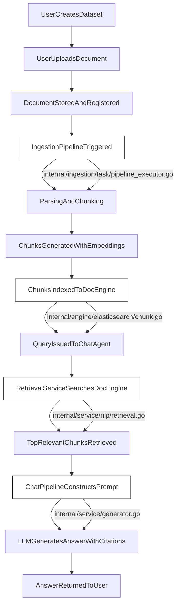
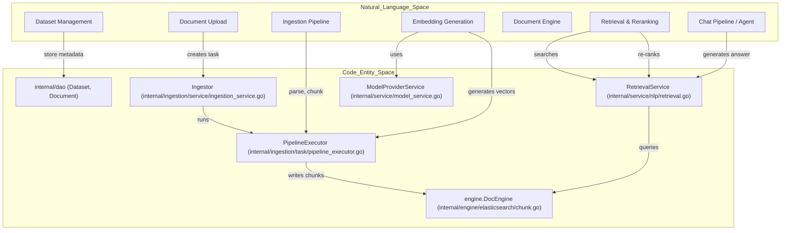

<!-- source: DeepWiki mcp.deepwiki.com · repo infiniflow/ragflow · page 1.2 Core Concepts and End-to-End Data Flow · fetched 2026-10-29 -->

# Core Concepts and End-to-End Data Flow

Relevant source files

The following files were used as context for generating this wiki page:

- [README.md](README.md)
- [README_ar.md](README_ar.md)
- [README_fr.md](README_fr.md)
- [README_id.md](README_id.md)
- [README_ja.md](README_ja.md)
- [README_ko.md](README_ko.md)
- [README_pt_br.md](README_pt_br.md)
- [README_ru.md](README_ru.md)
- [README_tr.md](README_tr.md)
- [README_tzh.md](README_tzh.md)
- [README_zh.md](README_zh.md)
- [docs/quickstart.mdx](docs/quickstart.mdx)
- [internal/dao/ingestion_task_test.go](internal/dao/ingestion_task_test.go)
- [internal/ingestion/pipeline/pipeline.go](internal/ingestion/pipeline/pipeline.go)
- [internal/ingestion/pipeline/pipeline_test.go](internal/ingestion/pipeline/pipeline_test.go)
- [internal/ingestion/service/ingestion_service.go](internal/ingestion/service/ingestion_service.go)
- [internal/ingestion/service/progress_sink.go](internal/ingestion/service/progress_sink.go)
- [internal/ingestion/service/progress_sink_test.go](internal/ingestion/service/progress_sink_test.go)
- [internal/ingestion/service/worker_dispatcher_integration_test.go](internal/ingestion/service/worker_dispatcher_integration_test.go)
- [internal/ingestion/task/pipeline_executor.go](internal/ingestion/task/pipeline_executor.go)
- [internal/ingestion/task/pipeline_executor_test.go](internal/ingestion/task/pipeline_executor_test.go)
- [internal/service/document/document_list.go](internal/service/document/document_list.go)
- [internal/service/ingestion_task_service.go](internal/service/ingestion_task_service.go)
- [internal/service/ingestion_task_service_test.go](internal/service/ingestion_task_service_test.go)

## Purpose and Scope

This page explains the core lifecycle of data within RAGFlow, detailing the process from dataset creation, document upload and ingestion, chunking and embedding, document engine indexing, retrieval, and finally chat or agent interaction that returns answers with citations. This technical deep dive covers key components, data flows, and implementation details with references to exact code locations.

Sources: `README.md:57-73()`, `internal/ingestion/task/pipeline_executor.go:44-70()`

---

## 1. Dataset Creation and Document Upload

RAGFlow manages knowledge repositories as **datasets**. A dataset is a logical container grouping related documents as a knowledge base. Users create these datasets through the web UI or API, specifying configurations such as the chunking template and embedding model which are enforced consistently across the dataset.

When a dataset is ready, users upload files to it, which can include:

- Various document formats: PDF, DOC/DOCX, TXT, Markdown (`[docs/quickstart.mdx:104-105]()`).
- Spreadsheets (CSV, XLSX) (`[docs/quickstart.mdx:104-105]()`).
- Images (JPEG, PNG, TIFF) (`[docs/quickstart.mdx:104-105]()`).
- Presentations (PPT, PPTX) (`[docs/quickstart.mdx:104-105]()`).
  
Uploaded files are mapped into **document** entities in the backend that maintain metadata (filename, tenant, dataset linkage, status, etc.). Upon upload, the system triggers an asynchronous ingestion task to process them via NATS JetStream and the ingestion worker pool (`[internal/ingestion/service/ingestion_service.go:54-149]()`).

Key details:

- The chunking template and embedding model are fixed once ingestion starts, ensuring chunks are embedded in the same vector space (`[docs/quickstart.mdx:114-116]()`).
- Document entities are recorded with the knowledgebase and tenant associations for multi-tenant isolation (`[internal/ingestion/task/pipeline_executor.go:86-104]()`).

**Key classes and files:**

- Dataset and document persistence is handled by DAO layers under `[internal/dao/ingestion.go]()`.
- The document entity model is part of `[internal/entity/ingestion_task.go]()`.
- Frontend pages for dataset and document management are under `[web/src/pages/dataset]()`.
- Task creation on upload is triggered through the ingestion infrastructure (`[internal/ingestion/service/ingestion_service.go:54-149]()`).

Sources: `docs/quickstart.mdx:104-120()`, `internal/ingestion/task/pipeline_executor.go:86-104()`, `internal/ingestion/service/ingestion_service.go:54-149()`

---

## 2. Ingestion Pipeline: Parsing, Chunking, Embedding, and Knowledge Compilation

Once a document upload is complete, an **ingestion pipeline** asynchronously processes it to generate searchable data and compiled artifacts.

Pipeline workflow:

1. **Parsing:** The pipeline chooses an appropriate parser component based on document format (PDF, Markdown, image OCR, spreadsheet parser, etc.). It extracts raw text and document structural metadata (`[internal/ingestion/component/parser.go]()`).

2. **Chunking:** Extracted text is segmented into semantically coherent units called chunks. Multiple chunking strategies/templates are available to suit different document types and use cases.

3. **Content Enhancement:** Optional enhancements via LLM extractors may add keywords, questions, tags, or metadata fields to chunks.

4. **Embedding:** Each chunk's textual content is converted into a vector embedding with the configured embedding model, producing dense vector representations.

5. **Batch Writing:** Chunks are batched and inserted into the document engine's index store asynchronously using `insertChunksForIngestion` to minimize refresh latency (`[internal/ingestion/task/pipeline_executor.go:124-131]()`). The final batch triggers a blocking refresh to guarantee search availability (`[internal/ingestion/task/pipeline_executor.go:136-140]()`).

6. **Knowledge Compilation:** Document- and dataset-level post-processing compiles contents into structured knowledge artifacts such as Wikis, Graphs, Trees, Mind Maps, and Skills (`[README.md:88-91]()`, `[internal/ingestion/service/ingestion_service.go:104-116]()`).

**Core implementation elements:**

- The core orchestration and execution are carried out by `PipelineExecutor` in `[internal/ingestion/task/pipeline_executor.go:73-174]()`.
- Chunk writing uses `chunkIndexWriter`, which interfaces via the `engine.DocEngine` abstraction to write chunk data.
- Ingestion workers run concurrently within `Ingestor` (`[internal/ingestion/service/ingestion_service.go:54-116]()`), maintaining heartbeats (`[internal/ingestion/service/ingestion_service.go:44-52]()`) to renew lease deadlines.

Sources: `README.md:88-91()`, `internal/ingestion/task/pipeline_executor.go:44-174()`, `internal/ingestion/service/ingestion_service.go:54-116()`

---

## 3. Document Engine: Vector Store and Indexing

The **Document Engine** is the vector store backend that supports:

- Storing chunk documents containing extracted text, chunk metadata, and vector embeddings.
- Supporting hybrid search combining fulltext (BM25) and vector similarity.
- Querying and filtering by metadata fields, dataset, and tenant constraints.
- Bulk insertion (`InsertChunks` / `InsertChunksNoRefresh`) and deletion for document reingestion (`[internal/engine/elasticsearch/chunk.go:154-183]()`).

RAGFlow supports multiple interchangeable document engines like Elasticsearch (`[internal/engine/elasticsearch/chunk.go:17-52]()`), Infinity, OceanBase, and SereneDB, unified under the `engine.DocEngine` interface.

Key interface traits:

- `CreateChunkStore` for initializing index mappings per dataset or memory store (`[internal/engine/elasticsearch/chunk.go:53-152]()`).
- `InsertChunks` and `InsertChunksNoRefresh` methods for adding chunk documents (`[internal/engine/elasticsearch/chunk.go:154-176]()`).
- Hybrid retrieval combining vector kNN and BM25 full-text matching.

Sources: `internal/engine/elasticsearch/chunk.go:17-183()`

---

## 4. Retrieval and Query Processing

When a user or agent poses a query via chat or API:

- The query text is preprocessed, tokenized, and refined using NLP heuristics or LLM query rewriting via `RetrievalService` (`[internal/service/nlp/retrieval.go:39-48]()`).
- A hybrid search (`Retrieval`) retrieves matching chunks using dense vector similarity and BM25 keyword matching (`[internal/service/nlp/retrieval.go:88-140]()`).
- Configuration parameters such as `KNNTopK`, `SimilarityThreshold`, and `VectorSimilarityWeight` control candidate selection (`[internal/service/nlp/retrieval.go:103-126]()`).
- Metadata and dataset filters are applied based on the user's scope.
- Results from multiple recall modes are merged and optionally re-ranked using rerank models before pagination and chunk construction (`[internal/service/nlp/retrieval.go:88-97]()`).

Sources: `README.md:120-127()`, `internal/service/nlp/retrieval.go:39-178()`

---

## 5. Chat and Agent Answer Generation with Citations

The chat/agent pipeline executes the final step, combining retrieval with LLM answer generation:

- Retrieved chunks (with provenance info) compose a system prompt context supplied to the configured chat model.
- The chat model generates an answer enhanced by retrieval context.
- Citations anchored to document chunks and their source documents are embedded in the answer, supporting traceability and reducing hallucination.
- Agentic retrieval modes decompose complex questions into multi-step queries and verification phases, producing structured reasoning events.
- The pipeline supports both streaming and batch completion modes and advanced modalities including audio/TTS outputs.

Sources: `README.md:128-133()`, `internal/ingestion/task/pipeline_executor.go:44-70()`

---

## Mermaid Diagrams

### Diagram 1: High-Level Data Flow from Dataset to Answer

Sources: `internal/ingestion/task/pipeline_executor.go:44-168()`, `internal/engine/elasticsearch/chunk.go:154-183()`, `internal/service/nlp/retrieval.go:88-140()`

---

### Diagram 2: Mapping Natural Language Components to Go Code Entities

Sources: `internal/dao/ingestion.go:1-50()`, `internal/ingestion/task/pipeline_executor.go:73-174()`, `internal/ingestion/service/ingestion_service.go:54-149()`, `internal/service/nlp/retrieval.go:39-48()`

---

## Summary Table of Key Entities and Files

| Concept               | Code Artifact / Class                                  | File / Location                                        |
|-----------------------|-------------------------------------------------------|-------------------------------------------------------|
| Dataset and Documents  | DAO layer for datasets and documents                   | `[internal/dao/ingestion.go]()`                        |
| Document Entity        | Document and ingestion task entities                   | `[internal/entity/ingestion_task.go]()`                |
| Ingestion Pipeline     | PipelineExecutor, chunkIndexWriter                     | `[internal/ingestion/task/pipeline_executor.go]()`     |
| Ingestion Worker Pool  | Ingestor, worker management, heartbeats                | `[internal/ingestion/service/ingestion_service.go]()`  |
| Document Engine        | DocEngine interface and Elasticsearch chunk methods    | `[internal/engine/elasticsearch/chunk.go]()`           |
| Retrieval Pipeline     | RetrievalService and hybrid search logic               | `[internal/service/nlp/retrieval.go]()`                |
| Chat and Agent Answer  | Chat completion and generation handlers                | `[internal/service/generator.go]()`                    |

Sources: `internal/dao/ingestion.go:1-50()`, `internal/ingestion/task/pipeline_executor.go:44-174()`, `internal/ingestion/service/ingestion_service.go:54-149()`, `internal/engine/elasticsearch/chunk.go:154-183()`, `internal/service/nlp/retrieval.go:39-48()`

---

