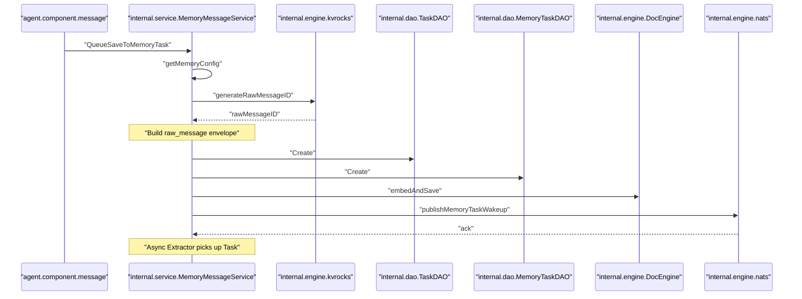
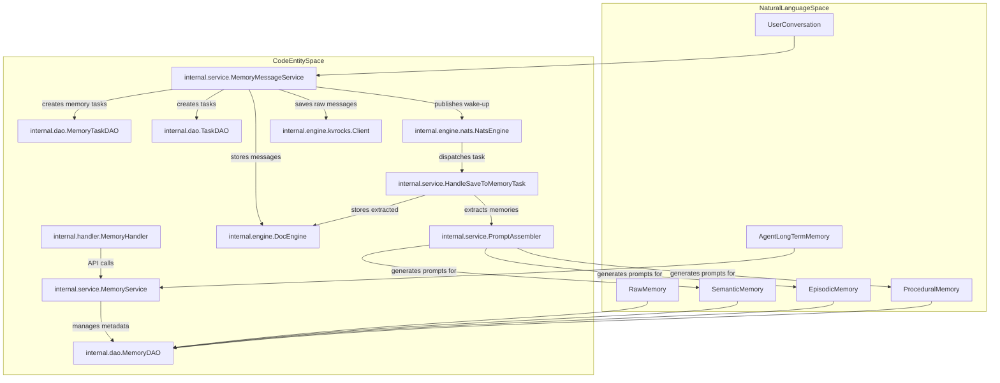
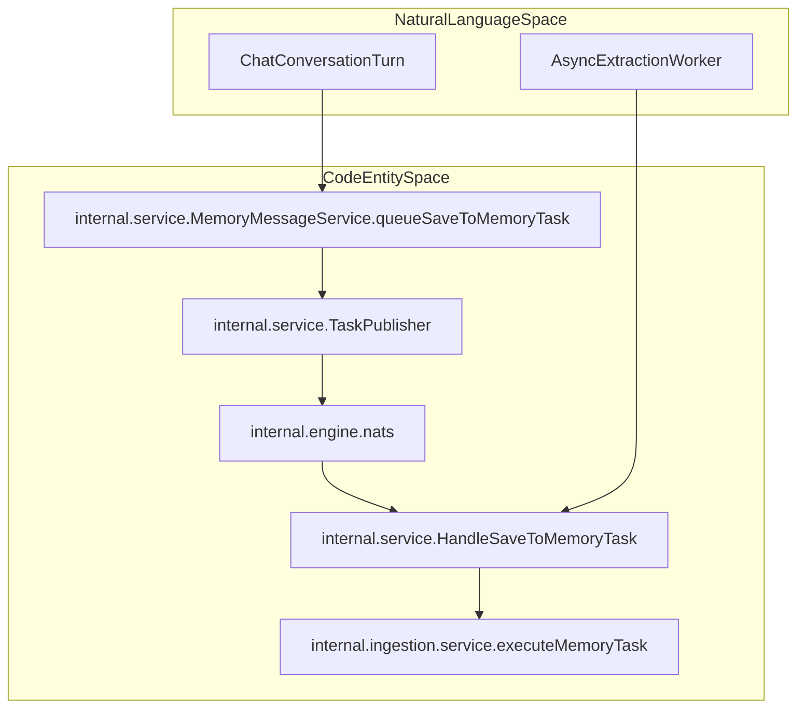

<!-- source: DeepWiki mcp.deepwiki.com · repo infiniflow/ragflow · page 10.1 Memory Types, Extraction and Storage · fetched 2026-10-29 -->

# Memory Types, Extraction and Storage

Relevant source files

The following files were used as context for generating this wiki page:

- [internal/dao/memory.go](internal/dao/memory.go)
- [internal/handler/memory.go](internal/handler/memory.go)
- [internal/service/memory.go](internal/service/memory.go)
- [internal/service/memory_extractor.go](internal/service/memory_extractor.go)
- [internal/service/memory_extractor_test.go](internal/service/memory_extractor_test.go)
- [internal/service/memory_message_service.go](internal/service/memory_message_service.go)
- [internal/service/memory_message_service_test.go](internal/service/memory_message_service_test.go)
- [internal/service/memory_message_test.go](internal/service/memory_message_test.go)

## Purpose and Scope

This page documents the persistent memory subsystem in RAGFlow. The memory system provides agents with long-term context by categorizing interaction data into specific types, extracting structured information using LLMs, and storing them in specialized document store indices with per-user isolation. It details the implementation of memory types, storage indices, and the `MemoryMessageService` interface.

Sources: `[internal/service/memory.go:1-43]()`, `[internal/service/memory_message_service.go:17-54]()`

---

## 1. Memory Types and Extraction Mechanics

RAGFlow implements four distinct memory types to handle different aspects of agent-user interactions. While "Raw" memory serves as the mandatory baseline transcript, the other three types utilize Large Language Models (LLMs) to analyze and structure dialogue for enhanced semantic retrieval.

| Memory Type | Description | Implementation Detail |
| :--- | :--- | :--- |
| **Raw** | The literal transcript of the conversation between the user and the agent. | Stored as baseline dialogue content. `[internal/dao/memory.go:31-37]()` |
| **Semantic** | Universal facts, definitions, concepts, and relationships. | Time-invariant information extracted via LLM. `[internal/service/memory.go:134-145]()` |
| **Episodic** | Specific experiences, events, and personal stories. | Time-bound, person-specific contextual records. `[internal/service/memory.go:146-156]()` |
| **Procedural** | Processes, methods, and step-by-step instructions. | Goal-oriented, actionable knowledge. `[internal/service/memory.go:157-170]()` |

The Go-based `PromptAssembler` handles the assembly of system prompts for these extractions, using the `SYSTEM_BASE_TEMPLATE` `[internal/service/memory.go:114-127]()` and type-specific instructions from `TYPE_INSTRUCTIONS` `[internal/service/memory.go:134-169]()`. In the data access layer, the `MemoryType` bit flags and utility functions manage these types: `dao.CalculateMemoryType` converts an array of memory type names into a bit-flag integer, and `dao.GetMemoryTypeHuman` converts bit flags back into human-readable strings `[internal/dao/memory.go:31-96]()`.

Sources: `[internal/service/memory.go:109-170]`, `[internal/dao/memory.go:31-96]()`

---

## 2. Storage Architecture and Per-User Indexing

RAGFlow employs a polyglot persistence strategy for memories:
1. **Metadata Storage**: Configurations, settings, and memory definitions are managed via MySQL/PostgreSQL using `MemoryService`.
2. **Document Store**: High-volume message content, tokens, and dense vectors are handled by document store connectors (Elasticsearch, Infinity, OpenSearch) via `MemoryMessageService`.

### Per-User Indexing and Isolation
Messages are stored in indices partitioned by user/tenant ID to enforce data isolation. The naming convention for these indices is generated via `MemoryIndexName(tenantID)`, resolving to `memory_{prefix}_{tenantID}` `[internal/service/memory_message_test.go:36-45]()`.

### Message Storage Sequence
The storage flow operates in two stages: saving the raw interaction synchronously, followed by queuing an asynchronous task for LLM-based memory extraction.

Title: "Message Extraction and Persistence Sequence"

Sources: `[internal/service/memory_message_service.go:136-196]`, `[internal/service/memory_message_test.go:36-45]()`

The `queueSaveToMemoryTask` function in `MemoryMessageService` is the entry point for saving messages to memory `[internal/service/memory_message_service.go:161]()`. It performs the following steps:
1. Looks up the memory configuration `[internal/service/memory_message_service.go:175]()`.
2. Generates a `rawMessageID` using Kvrocks auto-increment `[internal/service/memory_message_service.go:48]()`.
3. Builds the `raw_message` envelope `[internal/service/memory_message_service.go:187]()`.
4. Inserts the UI `Task` and durable `MemoryTask` rows atomically `[internal/service/memory_message_service.go:144-145]()`.
5. Calls `embed_and_save` on the memory and `raw_message` to store it in the document engine `[internal/service/memory_message_service.go:51]()`.
6. Publishes a task-id wake-up message to NATS for the asynchronous extractor `[internal/service/memory_message_service.go:52]()`.

Sources: `[internal/service/memory_message_service.go:136-196]`, `[internal/service/memory_message_test.go:36-45]()`

---

## 3. Code Entity Mapping & Natural Language Space Bridge

The following diagrams bridge the natural language and conceptual memory space with internal code symbols, classes, and storage connectors across the backend codebase.

Title: "Memory Entity Mapping Bridge"

Sources: `[internal/handler/memory.go:41-56]`, `[internal/service/memory.go:17-43]`, `[internal/service/memory_message_service.go:106-124]`, `[internal/dao/memory.go:103-112]`, `[internal/service/memory.go:110-111]`, `[internal/service/memory_extractor.go:133-163]()`

---

## 4. Queue-Driven Processing, Task Lifecycle and Panic Recovery

Memory extraction operates asynchronously via NATS task dispatch, coordinating between the API request path and worker node execution.

Title: "Queue-Driven Processing and Recovery Flow"

Sources: `[internal/service/memory_message_service.go:136-196]`, `[internal/service/memory_extractor.go:133-163]`, `[internal/service/memory_extractor_test.go:39-60]()`

### Key Execution Mechanics
1. **Raw Message Storage**: `MemoryMessageService.queueSaveToMemoryTask` stores the raw message and creates a `Task` and `MemoryTask` record `[internal/service/memory_message_service.go:161-190]()`.
2. **Task Publishing**: A wake-up message is published to NATS JetStream `[internal/service/memory_message_service.go:146]()`.
3. **Asynchronous Extraction**: The Ingestor worker pool dispatches tasks to `HandleSaveToMemoryTask` `[internal/service/memory_extractor.go:133]`, claiming the durable task and running LLM extraction for non-raw memory types `[internal/service/memory_extractor.go:27-32]()`.
4. **Error Handling & Panic Recovery**: Panics during memory extraction are recovered to prevent worker crashes, leaving the MQ message unsettled for durable recovery.
5. **Timestamp Handling**: `valid_at` and `invalid_at` fields are stored as server-local wall-clock strings (`YYYY-MM-DD HH:MM:SS`) `[internal/service/memory_extractor.go:58]()`. The `formatMemoryTime` function ensures parsed timestamps retain their local wall-clock values `[internal/service/memory_extractor_test.go:64-85]()`.

Sources: `[internal/service/memory_message_service.go:136-196]`, `[internal/service/memory_extractor.go:27-163]`, `[internal/service/memory_extractor_test.go:64-85]()`

---

## 5. Storage Schema, Mapping, and Access Control

Memory entries are indexed according to strict type mappings defined in configuration files and connection utilities.

### Message Mapping Logic
Field suffixes determine Elasticsearch and Infinity dynamic indexing behavior as defined in configuration schemas.

| Field Name | Storage Type | Suffix / Mapping Rule | Purpose |
| :--- | :--- | :--- | :--- |
| `message_id` | long / varchar | `*_long` | Unique ID for the message entry. |
| `message_type_kwd` | keyword / varchar | `*_kwd` | Categorization (`raw`, `semantic`, etc.). |
| `status_int` | integer | `*_int` | Active/Inactive status flag. |
| `content_ltks` | text / varchar | `*_ltks` | Original message content. |
| `tokenized_content_ltks`| text | `*_ltks` | Fine-grained tokenized content for search. |
| `q_{dims}_vec` | dense_vector | `*_{dims}_vec` | Embedding vector for semantic search. |

### Permission and Access Control
Access to memory resources is governed by `TenantPermission` levels `[internal/service/memory.go:56-67]`:
* **me**: Restricted strictly to the owner `[internal/service/memory.go:61-62]`.
* **team**: Accessible within the same team or tenant group `[internal/service/memory.go:63-64]`.
* **all**: Accessible globally across all tenants `[internal/service/memory.go:65-67]`.

Sources: `[internal/service/memory.go:56-67]()`

---

