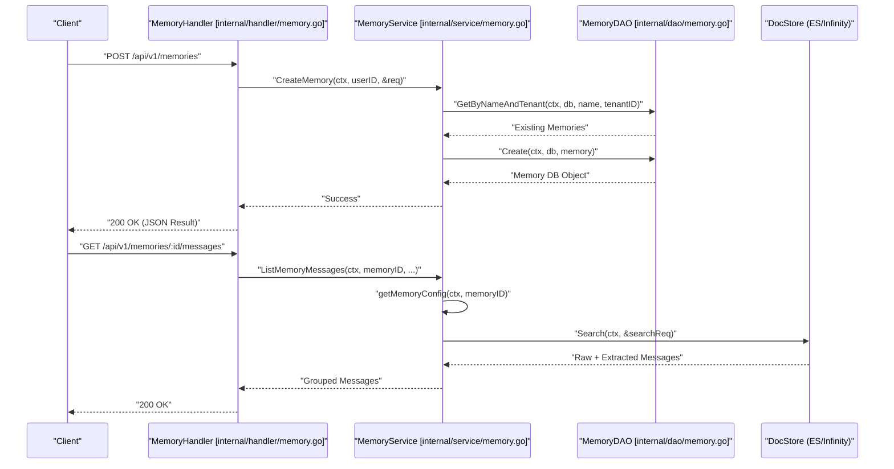

<!-- source: DeepWiki mcp.deepwiki.com · repo infiniflow/ragflow · page 10.2 Memory Management UI and API · fetched 2026-10-29 -->

# Memory Management UI and API

<details>
<summary>Relevant source files</summary>

The following files were used as context for generating this wiki page:

- [internal/dao/memory.go](internal/dao/memory.go)
- [internal/handler/memory.go](internal/handler/memory.go)
- [internal/service/memory.go](internal/service/memory.go)
- [internal/service/memory_extractor.go](internal/service/memory_extractor.go)
- [internal/service/memory_extractor_test.go](internal/service/memory_extractor_test.go)
- [internal/service/memory_message_service.go](internal/service/memory_message_service.go)
- [internal/service/memory_message_service_test.go](internal/service/memory_message_service_test.go)
- [internal/service/memory_message_test.go](internal/service/memory_message_test.go)
- [web/src/pages/home/memory-list.tsx](web/src/pages/home/memory-list.tsx)
- [web/src/pages/memories/add-or-edit-modal.tsx](web/src/pages/memories/add-or-edit-modal.tsx)
- [web/src/pages/memories/constants/index.tsx](web/src/pages/memories/constants/index.tsx)
- [web/src/pages/memories/hooks.ts](web/src/pages/memories/hooks.ts)
- [web/src/pages/memories/index.tsx](web/src/pages/memories/index.tsx)
- [web/src/pages/memories/interface.ts](web/src/pages/memories/interface.ts)
- [web/src/pages/memory/memory-message/hook.ts](web/src/pages/memory/memory-message/hook.ts)
- [web/src/pages/memory/memory-message/index.tsx](web/src/pages/memory/memory-message/index.tsx)
- [web/src/pages/memory/memory-message/interface.ts](web/src/pages/memory/memory-message/interface.ts)
- [web/src/pages/memory/memory-message/message-table.tsx](web/src/pages/memory/memory-message/message-table.tsx)
- [web/src/pages/memory/memory-setting/advanced-settings-form.tsx](web/src/pages/memory/memory-setting/advanced-settings-form.tsx)
- [web/src/pages/memory/memory-setting/index.tsx](web/src/pages/memory/memory-setting/index.tsx)
- [web/src/pages/memory/memory-setting/memory-model-form.tsx](web/src/pages/memory/memory-setting/memory-model-form.tsx)
- [web/src/pages/memory/sidebar/index.tsx](web/src/pages/memory/sidebar/index.tsx)
- [web/src/services/memory-service.ts](web/src/services/memory-service.ts)

</details>


The Memory System in RAGFlow provides persistent, long-term storage for agent interactions, moving beyond single-session history. This wiki page documents the memory REST API endpoints, the frontend memory configuration (`AdvancedSettingsForm` [web/src/pages/memory/memory-setting/advanced-settings-form.tsx:28-177](), `MemoryModelForm`), the message table browser (`MemoryTable` [web/src/pages/memory/memory-message/message-table.tsx:122-238]()), and how chat sessions or agents attach and extract memories across the Go backend implementation.

---

## 1. Memory Management API

The backend exposes a comprehensive REST API for managing memory buckets and their contained messages via the Go Gin framework in `internal/handler/memory.go` [internal/handler/memory.go:38-43](), delegated to business logic in `internal/service/memory.go` [internal/service/memory.go:17-43](). Frontend clients communicate with these endpoints using wrapper functions defined in `web/src/services/memory-service.ts` and React hooks in `web/src/pages/memories/hooks.ts` [web/src/pages/memories/hooks.ts:36-223]().

### 1.1 Memory Entity Endpoints
Management of memory metadata and configuration buckets.

| Method | Endpoint | Description |
|:---|:---|:---|
| `POST` | `/api/v1/memories` | Create a new memory entity specifying LLM and embedding models [internal/handler/memory.go:58-172]() |
| `GET` | `/api/v1/memories` | List tenant memories with pagination and keyword filters [internal/handler/memory.go:300-349]() |
| `PUT` | `/api/v1/memories/:memory_id` | Update configuration (prompts, forgetting policy, temperature) [internal/handler/memory.go:174-298]() |
| `DELETE` | `/api/v1/memories/:memory_id` | Delete a memory bucket and its associated messages [internal/handler/memory.go:351-380]() |

Sources: [internal/handler/memory.go:58-380](), [web/src/services/memory-service.ts:33-58]()

### 1.2 Message Operations
Granular operations over stored message records within a memory bucket.

| Method | Endpoint | Description |
|:---|:---|:---|
| `GET` | `/api/v1/memories/:memory_id/messages` | Retrieve messages filtered by `agent_id` and keywords [internal/handler/memory.go:382-490]() |
| `PUT` | `/api/v1/memories/:memory_id/messages/:message_id` | Update state (enabled/disabled) of a specific message [internal/handler/memory.go:492-540]() |
| `DELETE` | `/api/v1/memories/:memory_id/messages/:message_id` | "Forget" a specific message by ID [internal/handler/memory.go:542-571]() |

Sources: [internal/handler/memory.go:382-571](), [web/src/services/memory-service.ts:51-53]()

### Data Flow: API to Service (Natural Language to Code Entity Space)
The sequence diagram below maps high-level HTTP client requests to Go code entities.

**Memory API Sequence**

Sources: [internal/handler/memory.go:58-172](), [internal/service/memory.go:17-43](), [internal/dao/memory.go:161-175](), [internal/dao/memory.go:114-123](), [internal/handler/memory.go:382-490]()

---

## 2. Frontend Memory UI, Settings, and Attachment

The React frontend organizes memory management through list views (`MemoryList` [web/src/pages/memories/index.tsx:25-182]()), settings configuration (`MemoryMessage` [web/src/pages/memory/memory-setting/index.tsx:25-116]()), message browsers (`MemoryTable` [web/src/pages/memory/memory-message/message-table.tsx:122-238]()), and agent node attachments.

### 2.1 Memory Configuration UI
Users configure memory behaviors, embedding models, and extraction prompts via `AdvancedSettingsForm` [web/src/pages/memory/memory-setting/advanced-settings-form.tsx:28-177]() and `MemoryModelForm`. State and forms are bound using React Hook Form and Zod validators [web/src/pages/memory/memory-setting/index.tsx:31-39]().
*   **Model Selection**: Specifies `embd_id` and `llm_id` for background extraction and search retrieval.
*   **Memory Types**: Concurrent bitmask types (`raw`, `semantic`, `episodic`, `procedural`) defined in `internal/dao/memory.go` [internal/dao/memory.go:32-37]() and computed via `dao.CalculateMemoryType` [internal/dao/memory.go:59-68]().
*   **Advanced Settings**:
    *   **Permissions**: Restricts access via `permissions` (`me` or `team`) [web/src/pages/memory/memory-setting/advanced-settings-form.tsx:55-74]().
    *   **Storage Type**: Selects backend structures like `table` [web/src/pages/memory/memory-setting/advanced-settings-form.tsx:85]().
    *   **Forgetting Policy**: Configures deletion logic such as `FIFO` [web/src/pages/memory/memory-setting/advanced-settings-form.tsx:100]().
    *   **Temperature & Prompts**: Customizes `temperature`, `system_prompt`, and `user_prompt` [web/src/pages/memory/memory-setting/advanced-settings-form.tsx:105-172]().

Sources: [web/src/pages/memory/memory-setting/advanced-settings-form.tsx:28-177](), [internal/dao/memory.go:32-68](), [web/src/pages/memory/memory-setting/index.tsx:31-39]()

### 2.2 Message Table (Memory Browser)
The `MemoryTable` component audits stored memories with session grouping and task logs [web/src/pages/memory/memory-message/message-table.tsx:122-238]().
*   **Session ID**: Collapsible groups using `session_id` [web/src/pages/memory/memory-message/message-table.tsx:171-215]().
*   **Agent**: Identifies originating agent via `agent_name` [web/src/pages/memory/memory-message/message-table.tsx:217-224]().
*   **Type**: Displays category (`message_type`) [web/src/pages/memory/memory-message/message-table.tsx:226-238]().
*   **Status Switch**: Optimistically updates enabled state via `StatusSwitch` and `useMessageAction` [web/src/pages/memory/memory-message/message-table.tsx:85-120]().

Sources: [web/src/pages/memory/memory-message/message-table.tsx:85-238]()

### 2.3 Attaching Memories to Chats and Agents
Chats and agent workflow nodes attach memory buckets through configuration identifiers (`memory_ids`).
*   **Embedding Compatibility Enforcement**: Frontend hooks monitor selected memory items in the form context. If a memory bucket is already selected, any other memory buckets utilizing a *different* embedding model (`embd_id`) are automatically disabled in the UI multiselect options to prevent vector space mismatch during retrieval and ingestion.

Sources: [web/src/pages/memories/hooks.ts:36-68]()

---

## 3. Storage Architecture and Asynchronous Extraction

### 3.1 UI-to-Code Entity Mapping
The following diagram connects React components and hooks to backend service layers and persistence engines.

**UI to Code Entity Mapping**
```mermaid
graph TD
    subgraph "Frontend (React)"
        MS_UI["AdvancedSettingsForm [web/src/pages/memory/memory-setting/advanced-settings-form.tsx]"]
        MT_UI["MemoryTable [web/src/pages/memory/memory-message/message-table.tsx]"]
        M_HOOK["useCreateMemory [web/src/pages/memories/hooks.ts]"]
        MM_HOOK["useFetchMemoryList [web/src/pages/memories/hooks.ts]"]
    end

    subgraph "Backend API (Go)"
        M_HANDLER["MemoryHandler [internal/handler/memory.go]"]
        M_SRV["MemoryService [internal/service/memory.go]"]
        MM_SRV["MemoryMessageService [internal/service/memory_message_service.go]"]
    end

    subgraph "Core Logic & Storage"
        DAO["MemoryDAO [internal/dao/memory.go]"]
        DS[("Document Store (ES/Infinity)")]
        NATS[("NATS JetStream")]
        DB[("MySQL (entity.Memory)")]
    end

    MS_UI --> M_HOOK
    MT_UI --> MM_HOOK
    M_HOOK --> M_HANDLER: "Calls /memories API"
    MM_HOOK --> M_HANDLER: "Calls /memories API"
    M_HANDLER --> M_SRV: "Delegates business logic"
    M_SRV --> DAO: "Interacts with DB"
    M_SRV --> MM_SRV: "Handles message-related operations"
    MM_SRV --> NATS: "Publishes tasks (extraction)"
    MM_SRV --> DS: "Stores raw messages"
    DAO --> DB: "Persists memory metadata"
    DS -- "Stores messages and embeddings" --> DB: "References memory metadata"
```
Sources: [web/src/pages/memories/hooks.ts:36-68](), [web/src/pages/memory/memory-setting/advanced-settings-form.tsx:28-177](), [internal/handler/memory.go:38-43](), [internal/service/memory.go:17-43](), [internal/service/memory_message_service.go:104-124](), [internal/dao/memory.go:103-113]()

### 3.2 Polyglot Persistence and Limits
*   **Metadata**: Managed via GORM in MySQL through `entity.Memory` [internal/dao/memory.go:114-123]().
*   **Bitmask Constants**: Memory types are bitflags (`MemoryTypeRaw`, `MemoryTypeSemantic`, `MemoryTypeEpisodic`, `MemoryTypeProcedural`) managed by `dao.CalculateMemoryType` [internal/dao/memory.go:32-68]().
*   **Size Constraint**: Enforced by `MemorySizeLimit` (5MB) [internal/service/memory.go:48-50]().
*   **Index Isolation**: Computed per tenant using `MemoryIndexName` [internal/service/memory_message_test.go:36-44]().

Sources: [internal/dao/memory.go:32-123](), [internal/service/memory.go:45-50](), [internal/service/memory_message_test.go:36-44]()

### 3.3 Task Execution and LLM Extraction
When an agent session concludes with memory saving enabled, `MemoryMessageService.queueSaveToMemoryTask` records raw messages and triggers asynchronous extraction [internal/service/memory_message_service.go:161-190]().
*   **Queueing**: Publishes wake-up signals over NATS JetStream consumed by worker pools [internal/service/memory_extractor.go:25-34]().
*   **Lease Claiming**: `MemoryMessageService.HandleSaveToMemoryTask` safely leases and executes durable memory tasks [internal/service/memory_extractor.go:132-162]().
*   **Timezone Preservation**: Wall-clock timestamps are retained using `memoryTimeLayout` ("2006-01-02 15:04:05") via `formatMemoryTime` without unintended UTC shifts [internal/service/memory_extractor.go:56-58](), [internal/service/memory_extractor_test.go:64-84]().

Sources: [internal/service/memory_message_service.go:161-190](), [internal/service/memory_extractor.go:25-162](), [internal/service/memory_extractor_test.go:64-84]()

---

