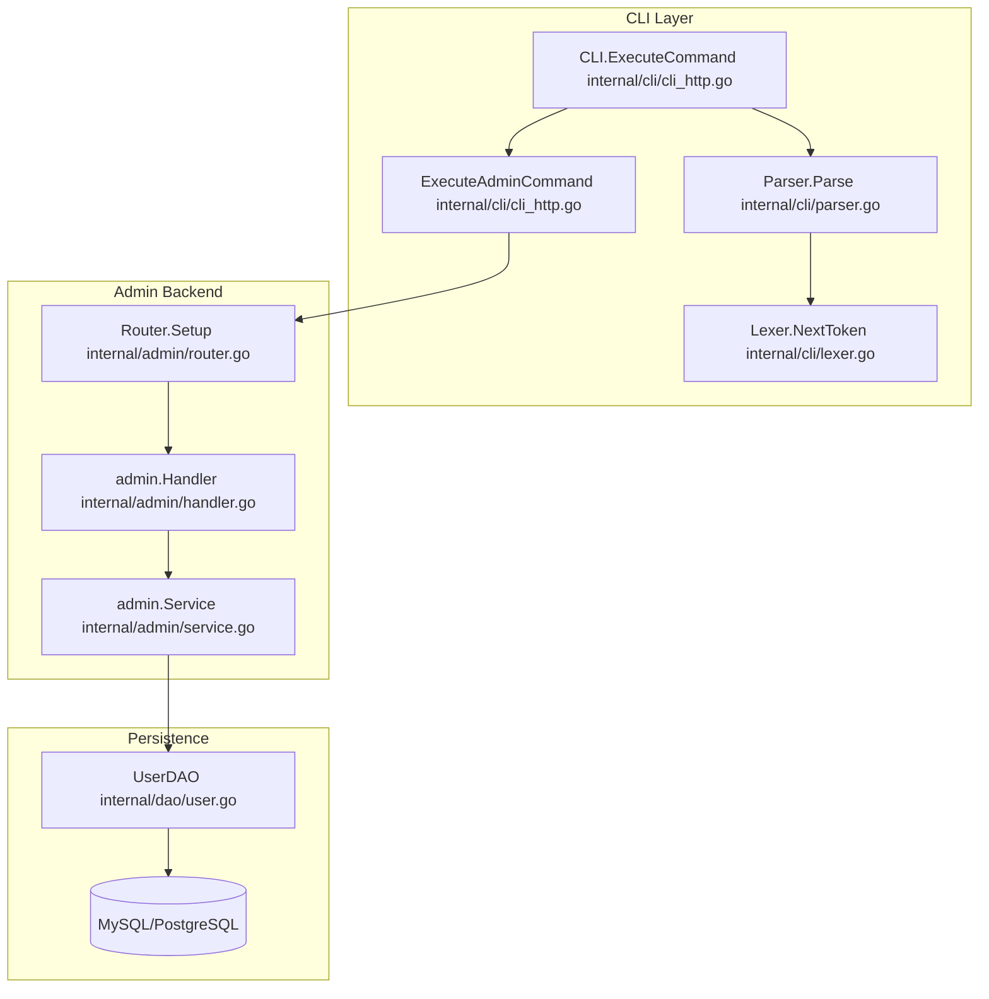
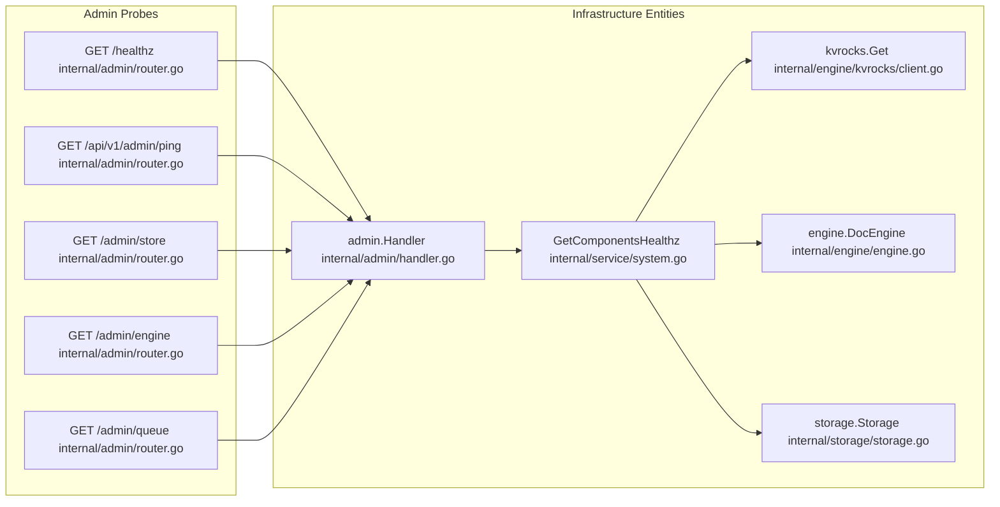

<!-- source: DeepWiki mcp.deepwiki.com · repo infiniflow/ragflow · page 11 Administration and Operations · fetched 2026-10-29 -->

# Administration and Operations

Relevant source files

The following files were used as context for generating this wiki page:

- [internal/admin/handler.go](internal/admin/handler.go)
- [internal/admin/handler_ee.go](internal/admin/handler_ee.go)
- [internal/admin/router.go](internal/admin/router.go)
- [internal/admin/router_ee.go](internal/admin/router_ee.go)
- [internal/admin/service.go](internal/admin/service.go)
- [internal/admin/service_ee.go](internal/admin/service_ee.go)
- [internal/cli/admin_command.go](internal/cli/admin_command.go)
- [internal/cli/admin_command_ee.go](internal/cli/admin_command_ee.go)
- [internal/cli/admin_parser.go](internal/cli/admin_parser.go)
- [internal/cli/cli.go](internal/cli/cli.go)
- [internal/cli/cli_http.go](internal/cli/cli_http.go)
- [internal/cli/common_command.go](internal/cli/common_command.go)
- [internal/cli/http_client.go](internal/cli/http_client.go)
- [internal/cli/lexer.go](internal/cli/lexer.go)
- [internal/cli/parser.go](internal/cli/parser.go)
- [internal/cli/response.go](internal/cli/response.go)
- [internal/cli/types.go](internal/cli/types.go)
- [internal/cli/user_command.go](internal/cli/user_command.go)
- [internal/cli/user_parser.go](internal/cli/user_parser.go)
- [internal/handler/system_ee.go](internal/handler/system_ee.go)
- [internal/handler/user_auth_ee.go](internal/handler/user_auth_ee.go)
- [internal/router/router.go](internal/router/router.go)
- [internal/router/router_ee.go](internal/router/router_ee.go)

This page provides a high-level technical overview of RAGFlow's administrative and operational infrastructure. RAGFlow features a robust Go-native administration layer (`internal/admin/`) [internal/admin/router.go:24-33](), a recursive-descent CLI utility (`internal/cli/`) [internal/cli/parser.go:27-42](), secure sandboxed code execution for agent components, comprehensive system testing frameworks, and migration tools.

For detailed documentation, refer to the respective child pages:
- [Admin Service, CLI and Admin UI](#11.1) — internal/admin service/handler/router, enterprise (_ee) variants, the ragflow-cli lexer/parser/command model, and the web admin pages for users, services and monitoring.
- [Sandbox Code Executor](#11.2) — internal/agent/sandbox providers (local, self-managed gVisor containers, Aliyun, E2B), the Code component integration, limits and security.
- [Testing Infrastructure](#11.3) — Go unit/integration tests, test/testcases REST API pytest suites, sdk/python tests, Playwright e2e, benchmarks, and how to run them against different backends.
- [Migration and Utility Tools](#11.4) — tools/: ES-to-OceanBase migration, firecrawl, canvas migration, component parity generator, chatgpt-on-wechat plugins, git hooks, install scripts, ragflow_deps and scripts/.

---

## Admin Service, CLI and Admin UI

The administrative infrastructure manages system-wide operations, multi-tenant boundaries, service health probes, and role-based access control.

*   **Go Admin Backend**: Implemented in `internal/admin/`, the admin service defines routing `Router` structures [internal/admin/router.go:24-33]() and request handlers `Handler` [internal/admin/handler.go:40-50]() that handle superuser authentication [internal/admin/handler.go:94-115]() and resource coordination.
*   **Enterprise Variants**: Enterprise-specific administration extensions are integrated via `SetupEERouter` and `RegisterEERouter` [internal/admin/router.go:37,125](), alongside features in `internal/admin/service_ee.go` and `internal/admin/handler_ee.go`.
*   **RAGFlow CLI (`ragflow-cli`)**: Located in `internal/cli/`, the CLI uses a recursive-descent `Parser` [internal/cli/parser.go:27-42]() to translate SQL-like administration statements into authenticated HTTP requests across `AdminMode` and `APIMode` [internal/cli/cli_http.go:25-36]().
*   **Web Admin Pages**: The frontend interacts with backend endpoints to present control panels for user lifecycle management, service inspection, configuration overrides, and task queues.

For details, see [Admin Service, CLI and Admin UI](#11.1).

Sources:
- `internal/admin/router.go` [24-33](), [37](), [125]()
- `internal/admin/handler.go` [40-50](), [94-115]()
- `internal/cli/parser.go` [27-42]()
- `internal/cli/cli_http.go` [25-36]()

---

## Sandbox Code Executor

RAGFlow integrates isolated script execution environments to support the **Code** component within visual workflows and agent tool loops.

*   **Sandbox Providers**: The system supports multiple backend providers (local execution, containerized gVisor, Aliyun, and E2B) managed through `internal/agent/sandbox` [internal/admin/service.go:31]() and exposed via admin configuration endpoints [internal/admin/router.go:116-122]().
*   **Security and Limits**: Unsafe code supplied by agent nodes is constrained within ephemeral sandboxes to prevent unauthorized filesystem access, network queries, or resource exhaustion on the host server.

For details, see [Sandbox Code Executor](#11.2).

Sources:
- `internal/admin/router.go` [116-122]()
- `internal/admin/service.go` [31]()

---

## Testing Infrastructure

To maintain stability across polyglot storage backends and AI model providers, RAGFlow employs a multi-tiered testing suite.

*   **Backend Validation**: Go unit and integration tests verify dao operations, service business logic, and server bootstrap phases.
*   **API and SDK Suites**: End-to-end Python pytest suites (`test/testcases`) and `sdk/python` tests validate REST contracts and client bindings against live servers.
*   **CLI Benchmarking**: The CLI infrastructure supports command iteration benchmarking [internal/cli/cli_http.go:58-59]() to measure throughput and latency under load.

For details, see [Testing Infrastructure](#11.3).

Sources:
- `internal/cli/cli_http.go` [58-59]()

---

## Migration and Utility Tools

Operational maintenance, schema migrations, and external data connectors are supported by dedicated utility packages under `tools/` and system scripts.

*   **Database and Engine Migrations**: Scripts manage data transitions between versions, such as Elasticsearch-to-OceanBase storage migrations and canvas schema upgrades.
*   **Install and Dependency Assets**: Install scripts, `ragflow_deps` packaging models, and CI workflows ensure reproducible builds and environment setups.

For details, see [Migration and Utility Tools](#11.4).

Sources:
- `internal/admin/router.go` [125-127]()

---

## System Interaction Diagrams

### Administrative Control Flow
This diagram illustrates how SQL-like admin CLI commands are tokenized, parsed, and dispatched to the Go backend services.

Sources:
- `internal/cli/cli_http.go` [25-36]()
- `internal/cli/parser.go` [1-30]()
- `internal/admin/router.go` [36-60]()
- `internal/admin/handler.go` [40-50]()
- `internal/admin/service.go` [52-80]()

### System Health and Monitoring Probes
This diagram maps administrative health and diagnostic probes to underlying infrastructure components.

Sources:
- `internal/admin/router.go` [39-49](), [100-112]()
- `internal/admin/handler.go` [58-73]()

---

