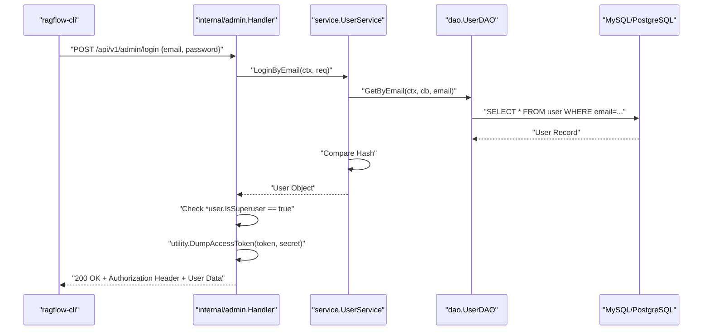
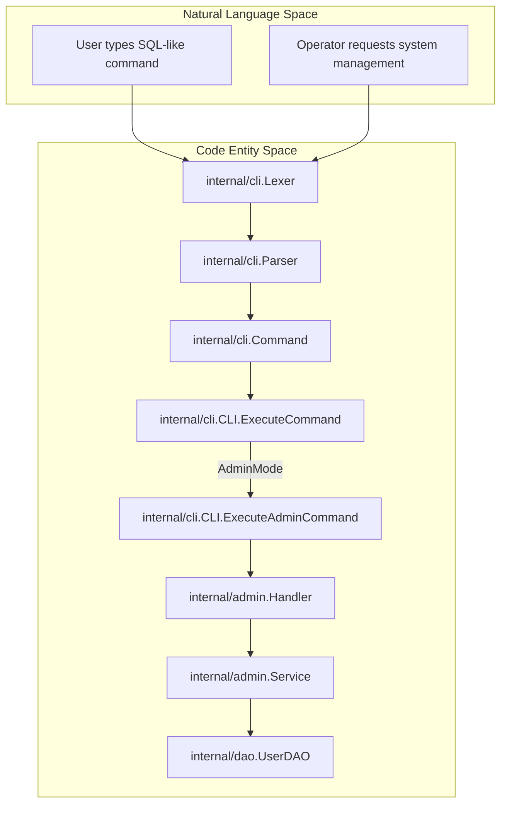
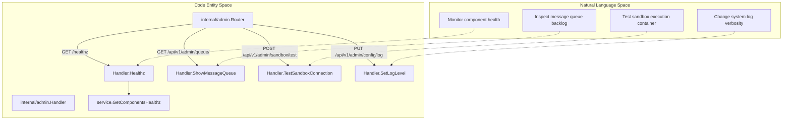

<!-- source: DeepWiki mcp.deepwiki.com · repo infiniflow/ragflow · page 11.1 Admin Service, CLI and Admin UI · fetched 2026-10-29 -->

# Admin Service, CLI and Admin UI

Relevant source files

The following files were used as context for generating this wiki page:

- [internal/admin/handler.go](internal/admin/handler.go)
- [internal/admin/handler_ee.go](internal/admin/handler_ee.go)
- [internal/admin/license_ee.go](internal/admin/license_ee.go)
- [internal/admin/router.go](internal/admin/router.go)
- [internal/admin/router_ee.go](internal/admin/router_ee.go)
- [internal/admin/service.go](internal/admin/service.go)
- [internal/admin/service_ee.go](internal/admin/service_ee.go)
- [internal/admin/state.go](internal/admin/state.go)
- [internal/cli/admin_command.go](internal/cli/admin_command.go)
- [internal/cli/admin_command_ee.go](internal/cli/admin_command_ee.go)
- [internal/cli/admin_parser.go](internal/cli/admin_parser.go)
- [internal/cli/cli.go](internal/cli/cli.go)
- [internal/cli/cli_http.go](internal/cli/cli_http.go)
- [internal/cli/common_command.go](internal/cli/common_command.go)
- [internal/cli/http_client.go](internal/cli/http_client.go)
- [internal/cli/lexer.go](internal/cli/lexer.go)
- [internal/cli/parser.go](internal/cli/parser.go)
- [internal/cli/response.go](internal/cli/response.go)
- [internal/cli/types.go](internal/cli/types.go)
- [internal/cli/user_command.go](internal/cli/user_command.go)
- [internal/cli/user_parser.go](internal/cli/user_parser.go)
- [internal/common/error_code.go](internal/common/error_code.go)
- [internal/common/status_message.go](internal/common/status_message.go)
- [internal/handler/system_ee.go](internal/handler/system_ee.go)
- [internal/handler/user_auth_ee.go](internal/handler/user_auth_ee.go)
- [internal/router/router.go](internal/router/router.go)
- [internal/router/router_ee.go](internal/router/router_ee.go)
- [internal/server/admin/server.go](internal/server/admin/server.go)
- [internal/server/bootstrap/bootstrap.go](internal/server/bootstrap/bootstrap.go)
- [internal/server/bootstrap/bootstrap_test.go](internal/server/bootstrap/bootstrap_test.go)
- [internal/service/admin_client.go](internal/service/admin_client.go)
- [internal/service/admin_client_ee.go](internal/service/admin_client_ee.go)
- [internal/utility/fingerprint_ee.go](internal/utility/fingerprint_ee.go)
- [web/src/constants/authorization.ts](web/src/constants/authorization.ts)
- [web/src/hooks/auth-hooks.ts](web/src/hooks/auth-hooks.ts)
- [web/src/hooks/use-login-request.ts](web/src/hooks/use-login-request.ts)
- [web/src/pages/admin/layouts/authorized-layout.tsx](web/src/pages/admin/layouts/authorized-layout.tsx)
- [web/src/pages/admin/layouts/navigation-layout.tsx](web/src/pages/admin/layouts/navigation-layout.tsx)
- [web/src/pages/admin/layouts/root-layout.tsx](web/src/pages/admin/layouts/root-layout.tsx)
- [web/src/pages/admin/login.tsx](web/src/pages/admin/login.tsx)
- [web/src/pages/home/agent-list.tsx](web/src/pages/home/agent-list.tsx)
- [web/src/pages/home/application-card.tsx](web/src/pages/home/application-card.tsx)
- [web/src/pages/home/chat-list.tsx](web/src/pages/home/chat-list.tsx)
- [web/src/pages/home/search-list.tsx](web/src/pages/home/search-list.tsx)
- [web/src/routes.tsx](web/src/routes.tsx)
- [web/src/services/admin-service.ts](web/src/services/admin-service.ts)
- [web/src/services/user-service.ts](web/src/services/user-service.ts)
- [web/src/utils/authorization-util.ts](web/src/utils/authorization-util.ts)

The RAGFlow Admin Service, CLI, and Admin UI provide a comprehensive, Go-native management plane for system administrators and operators. This layer handles administrative authentication, user lifecycle management, service monitoring, component health checks, message queue inspection, and sandbox environment configuration.

---

## Admin Service Architecture

The Admin Service operates as a privileged management backend initialized within the Go server framework. It defines specialized administration logic isolated from standard tenant and user workflows.

### Server and Handler Implementation
Administrative operations are driven by the Gin framework, housing request dispatchers in dedicated structs and packages:

- **Admin Handler**: Encapsulates administrative HTTP handlers in the `Handler` struct [internal/admin/handler.go:39-43]().
- **Admin Service Layer**: Core business logic is implemented by the `Service` struct [internal/admin/service.go:52-80](), which coordinates interactions with various DAOs (`UserDAO`, `LicenseDAO`, `SystemSettingsDAO`, `TaskDAO`, `KnowledgebaseDAO`, etc.) [internal/admin/service.go:52-76]().
- **Routing**: Routes are registered under the `/api/v1/admin` prefix in `Router.Setup` [internal/admin/router.go:36-131](), featuring protected endpoints secured by middleware (`r.handler.AuthMiddleware()`) [internal/admin/router.go:57-60]().
- **Enterprise Variants**: Enterprise extensions (`_ee`) are integrated through `SetupEERouter` [internal/admin/router.go:37-37]() and `RegisterEERouter` [internal/admin/router.go:125-125](), enabling conditional logic via `common.GetRAGFlowType()` [internal/admin/handler.go:213-215]().

**Data Flow: Admin Authentication**

Sources: [internal/admin/handler.go:39-130](), [internal/admin/service.go:52-80](), [internal/admin/router.go:36-131]()

---

## ragflow-cli Lexer, Parser and Command Model

The `ragflow-cli` utility provides a command-line interface supporting SQL-like statements and meta-commands for both regular users and system administrators.

### Lexical Analysis and Parsing
- **Lexer**: Tokenizes input statement streams, identifying language constructs such as `LOGIN`, `LIST`, `SERVICES`, `ADMIN`, `STORE`, and `ENGINE` [internal/cli/lexer.go:25-30](), [internal/cli/lexer.go:187-252]().
- **Parser**: Converts token streams into structured `Command` objects [internal/cli/types.go:19-23]() using recursive descent parsing methods such as `parseAPILoginUser` [internal/cli/user_parser.go:19-53](), `parseAPIRegister` [internal/cli/user_parser.go:75-120](), and `parseAdminLoginUser` [internal/cli/admin_parser.go:26-60]().
- **Mode Control**: The `CLI` struct routes execution depending on `CLIMode` (`APIMode` vs `AdminMode`) [internal/cli/cli_http.go:25-36]().

### Supported Command Catalog

| Category | Example Statements | Parser Method | Executor Method |
| :--- | :--- | :--- | :--- |
| **System (Admin)** | `ADMIN PING STORE`, `ADMIN HEALTH` | `parseAdminPingServer` [internal/cli/admin_parser.go:72-98]() | `AdminPingStoreCommand` [internal/cli/admin_command.go:41-49]() |
| **User Mgmt (Admin)**| `ADMIN CREATE USER '...' AS '...'` | `parseAdminCreateUser` [internal/cli/admin_parser.go:303-315]() | `AdminCreateUserCommand` [internal/cli/admin_command.go:171-187]() |
| **Service Mgmt** | `ADMIN LIST SERVICES`, `ADMIN START SERVICE` | `parseAdminListServices` [internal/cli/admin_parser.go:154-162]() | `AdminListServicesCommand` [internal/cli/cli_http.go:60-61]() |
| **Task Mgmt** | `ADMIN LIST INGESTION TASKS` | `parseAdminListIngestionTasks` [internal/cli/admin_parser.go:258-274]() | `ListAdminIngestionTasks` [internal/cli/cli_http.go:162-163]() |

Sources: [internal/cli/user_parser.go:19-120](), [internal/cli/admin_parser.go:26-315](), [internal/cli/cli_http.go:25-165]()

---

## CLI and Admin Command Processing Architecture

The following diagram bridges the **Natural Language Space** (user statement input) to the **Code Entity Space** (handlers, services, and DAO execution routines).

**Command Processing Architecture**

Sources: [internal/cli/cli_http.go:25-36](), [internal/cli/types.go:19-23](), [internal/admin/handler.go:39-50](), [internal/admin/service.go:52-80]()

---

## Admin Service Operations, Monitoring and Queue Management

The admin service exposes administrative endpoints for inspecting runtime variables, managing message queues, and configuring sandboxed code execution.

### Key Administrative Capabilities
- **Health Aggregation**: System health is computed across Kvrocks, MySQL, and Document Engines via `service.GetComponentsHealthz` [internal/admin/handler.go:59-66]().
- **Message Queue Inspection**: Administrators can inspect, publish, and pull messages from the queue group (`/api/v1/admin/queue`) [internal/admin/router.go:100-106]().
- **Sandbox Configuration**: Endpoints under `/api/v1/admin/sandbox/*` manage secure script/code execution providers (`internal/agent/sandbox`) [internal/admin/router.go:116-120]().
- **Log Level Dynamic Adjustment**: Log verbosity can be altered at runtime via `Handler.SetLogLevel` [internal/admin/router.go:90-91]().

**Code Entity Mapping: Admin Service Subsystems**

Sources: [internal/admin/router.go:36-131](), [internal/admin/handler.go:59-130]()

---

## Admin UI Architecture

The Admin UI provides a React-based web interface communicating with the Go admin backend.

### Frontend Structure and Integration
- **Admin Pages**: Implemented in React (`web/src/pages/admin/`), covering service status (`service-status.tsx`), user records (`users.tsx`), sandbox environment options (`sandbox-settings.tsx`), and ingestion execution metrics (`task-executor-detail.tsx`).
- **Service Adapters**: Frontend API requests are routed through dedicated service wrappers (`web/src/services/admin-service.ts`) which map frontend payloads to backend `/api/v1/admin/*` REST routes.

Sources: [web/src/pages/admin/layouts/root-layout.tsx](), [web/src/pages/admin/login.tsx](), [web/src/services/admin-service.ts]()

---

