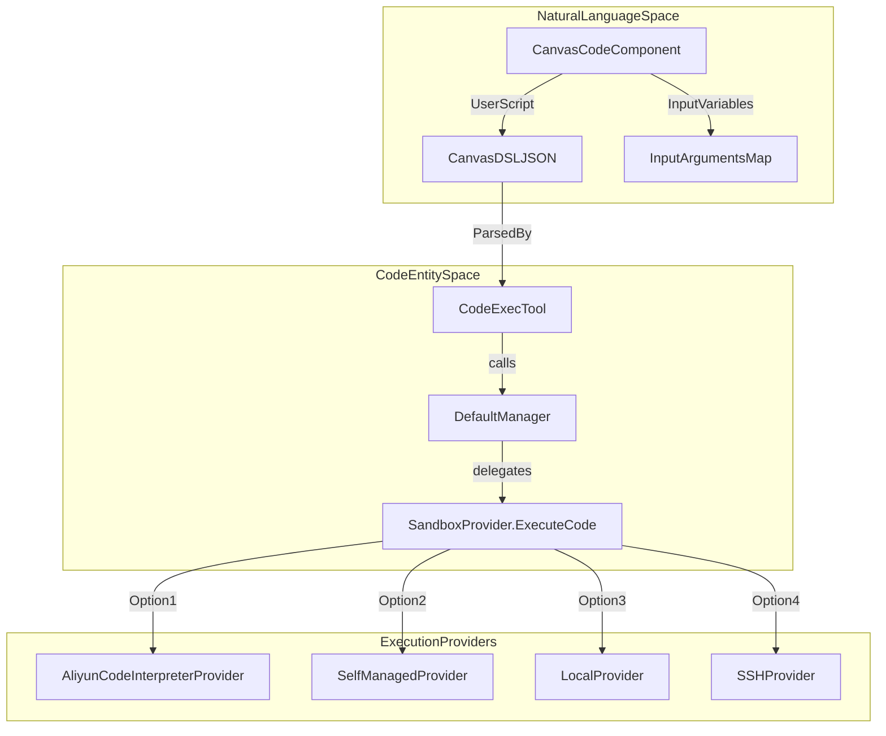
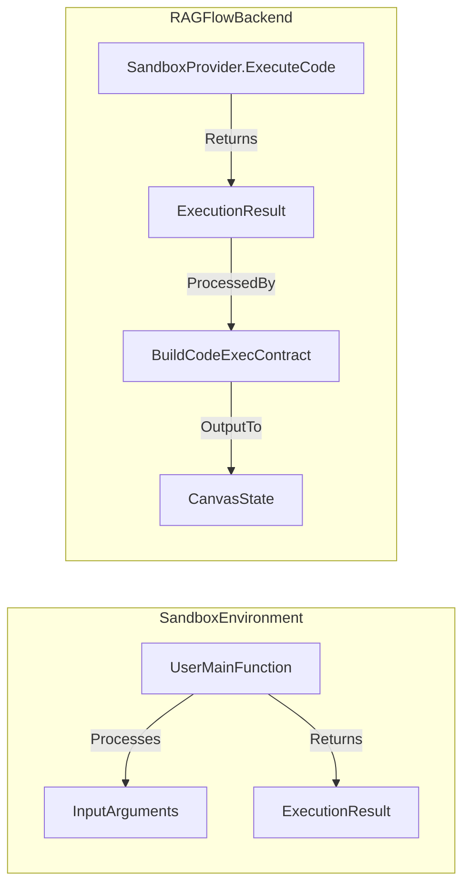

<!-- source: DeepWiki mcp.deepwiki.com · repo infiniflow/ragflow · page 11.2 Sandbox Code Executor · fetched 2026-10-29 -->

# Sandbox Code Executor

Relevant source files

The following files were used as context for generating this wiki page:

- [internal/agent/component/fixture_stubs.go](internal/agent/component/fixture_stubs.go)
- [internal/agent/component/invoke.go](internal/agent/component/invoke.go)
- [internal/agent/component/invoke_test.go](internal/agent/component/invoke_test.go)
- [internal/agent/component/production_chain_fixes_test.go](internal/agent/component/production_chain_fixes_test.go)
- [internal/agent/component/retrieval_params_test.go](internal/agent/component/retrieval_params_test.go)
- [internal/agent/component/retrieval_swap_test.go](internal/agent/component/retrieval_swap_test.go)
- [internal/agent/component/tool_component.go](internal/agent/component/tool_component.go)
- [internal/agent/component/universe_a_wrappers.go](internal/agent/component/universe_a_wrappers.go)
- [internal/agent/component/verify_p1_test.go](internal/agent/component/verify_p1_test.go)
- [internal/agent/retrievalbridge/memory.go](internal/agent/retrievalbridge/memory.go)
- [internal/agent/retrievalbridge/memory_test.go](internal/agent/retrievalbridge/memory_test.go)
- [internal/agent/retrievalbridge/runtime_adapter.go](internal/agent/retrievalbridge/runtime_adapter.go)
- [internal/agent/retrievalbridge/runtime_adapter_test.go](internal/agent/retrievalbridge/runtime_adapter_test.go)
- [internal/agent/tool/agentic_search.go](internal/agent/tool/agentic_search.go)
- [internal/agent/tool/registry.go](internal/agent/tool/registry.go)
- [internal/agent/tool/registry_test.go](internal/agent/tool/registry_test.go)
- [internal/agent/tool/retrieval.go](internal/agent/tool/retrieval.go)
- [internal/agent/tool/retrieval_service.go](internal/agent/tool/retrieval_service.go)
- [internal/agent/tool/retrieval_test.go](internal/agent/tool/retrieval_test.go)
- [internal/agent/tool/retrieval_wiring_test.go](internal/agent/tool/retrieval_wiring_test.go)
- [web/src/components/collapse.tsx](web/src/components/collapse.tsx)
- [web/src/components/ui/sheet.tsx](web/src/components/ui/sheet.tsx)
- [web/src/global.less](web/src/global.less)
- [web/src/pages/agent/form-sheet/next.tsx](web/src/pages/agent/form-sheet/next.tsx)
- [web/src/pages/agent/form/code-form/index.tsx](web/src/pages/agent/form/code-form/index.tsx)
- [web/src/pages/agent/form/code-form/next-variable.tsx](web/src/pages/agent/form/code-form/next-variable.tsx)
- [web/src/pages/agent/form/code-form/schema.ts](web/src/pages/agent/form/code-form/schema.ts)
- [web/src/pages/agent/form/code-form/use-values.ts](web/src/pages/agent/form/code-form/use-values.ts)
- [web/src/pages/agent/form/code-form/use-watch-change.ts](web/src/pages/agent/form/code-form/use-watch-change.ts)
- [web/src/pages/agent/hooks.tsx](web/src/pages/agent/hooks.tsx)
- [web/src/pages/agent/hooks/use-watch-form-change.ts](web/src/pages/agent/hooks/use-watch-form-change.ts)
- [web/src/pages/agent/utils/build-output-list.ts](web/src/pages/agent/utils/build-output-list.ts)

The Sandbox Code Executor is a secure, multi-provider execution environment designed to run arbitrary Python or JavaScript code within RAGFlow agent workflows and tool bindings [internal/agent/tool/code_exec.go:38-58](). It provides a pluggable architecture supporting local execution, self-managed gVisor-based containers, SSH remote hosts, and cloud-based sandbox services (`Aliyun`, `E2B`, `Tenki`, `UCloud`) [internal/agent/sandbox/provider.go:33-64](). This system ensures user-provided scripts remain strictly isolated from the host environment while maintaining high-performance data exchange with the workflow engine and tool layer [internal/agent/tool/code_exec.go:159-171]().

Sources: [internal/agent/tool/code_exec.go:38-58](), [internal/agent/sandbox/provider.go:33-64]()

## System Architecture

The sandbox system is managed by `ProviderManager` in package `sandbox` [internal/agent/sandbox/manager.go:50-58](), exposing a unified `SandboxProvider` interface [internal/agent/sandbox/provider.go:116-149](). Configuration is resolved dynamically either from the admin-panel settings stored in the `system_settings` MySQL table or from environment variables [internal/agent/sandbox/manager.go:17-28]().

### Natural Language to Code Entity Mapping

The following diagrams illustrate how user-defined logic in the RAGFlow Canvas translates into backend execution entities and how data flows through the system, bridging the Natural Language Space to the Code Entity Space.

**Workflow to Execution Mapping**

Sources: [internal/agent/sandbox/provider.go:116-149](), [internal/agent/sandbox/manager.go:66-74]()

**Data and Component Integration Flow**

Sources: [internal/agent/sandbox/provider.go:83-95](), [internal/agent/sandbox/provider.go:130-135]()

Sources: [internal/agent/sandbox/provider.go:33-149](), [internal/agent/sandbox/manager.go:50-74]()

## Provider Implementations

RAGFlow supports 7 sandbox backends configured via system settings (`conf/system_settings.json:64-92`) and registered through the catalog (`internal/agent/sandbox/catalog.go:15-27`).

| Provider ID | Description | File Reference |
| :--- | :--- | :--- |
| `self_managed` | Default provider utilizing external executor-manager HTTP API (Daytona/Docker/gVisor). | [internal/agent/sandbox/self_managed.go:83-103]() |
| `ssh` | Executes code on a remote machine over SSH using `golang.org/x/crypto/ssh`. | [internal/agent/sandbox/ssh.go:79-99]() |
| `aliyun_codeinterpreter` | Aliyun Function Compute Code Interpreter microVMs. | [internal/agent/sandbox/aliyun.go]() |
| `e2b` | E2B Cloud code execution sandboxes. | [internal/agent/sandbox/e2b.go]() |
| `tenki` | Disposable Tenki microVM code sandboxes. | [internal/agent/sandbox/tenki.go]() |
| `ucloud_agent_sandbox` | UCloud disposable cloud sandboxes for agents. | [internal/agent/sandbox/ucloud_agent_sandbox.go]() |
| `local` | Executes code directly on the host machine process via `os/exec`. **Development/trusted use only.** | [internal/agent/sandbox/local.go:111-124]() |

Sources: [internal/agent/sandbox/catalog.go:15-27](), [internal/agent/sandbox/provider.go:33-65]()

## Execution Lifecycle

The lifecycle of a code execution task is managed by `ProviderManager` and concrete `SandboxProvider` instances:

1.  **Initialization**: `ProviderManager.LoadFromSettings()` or `InitFromEnv()` resolves the active provider type and invokes `Initialize(ctx)` [internal/agent/sandbox/manager.go:123-146]().
2.  **Instance Creation**: `CreateInstance(ctx, template)` provisions a logical instance handle or container session [internal/agent/sandbox/provider.go:125-128]().
3.  **Code Execution**: `ExecuteCode(ctx, inst, code, language, timeoutSec, args)` runs the user script with specified resource bounds and arguments [internal/agent/sandbox/provider.go:130-134]().
4.  **Result Extraction**: The system returns an `ExecutionResult` containing `Stdout`, `Stderr`, `ExitCode`, `ExecutionTime`, and provider metadata [internal/agent/sandbox/provider.go:83-95]().
5.  **Cleanup**: `DestroyInstance(ctx, inst)` releases remote or container resources [internal/agent/sandbox/provider.go:136-139]().

Sources: [internal/agent/sandbox/manager.go:123-206](), [internal/agent/sandbox/provider.go:116-149]()

## Security and Constraints

### Isolation and Resource Limits
- **Self-Managed**: Relies on container-level isolation (gVisor / `runsc`) managed by the `sandbox-executor-manager` service [internal/agent/sandbox/self_managed.go:17-47]().
- **Local Provider**: Applies process-level constraints such as memory bounds (`localDefaultMaxMemoryMB`), output capture limits (`localDefaultMaxOutputBytes`), open file limits (`localDefaultNoFile`), and execution timeouts [internal/agent/sandbox/local.go:68-84]().
- **SSH Provider**: Enforces strict output caps, artifact size restrictions, and known-hosts key verification [internal/agent/sandbox/ssh.go:146-161]().

### Configuration Validation
Configuration payloads are strictly validated against JSON schemas in `internal/agent/sandbox/catalog.go` before being applied to ensure required fields, numeric ranges, and URI formats are correct [internal/agent/sandbox/catalog.go:54-162]().

Sources: [internal/agent/sandbox/self_managed.go:17-80](), [internal/agent/sandbox/local.go:65-90](), [internal/agent/sandbox/catalog.go:54-162]()

## Troubleshooting

| Error | Root Cause | Resolution |
| :--- | :--- | :--- |
| `unknown provider` | An unrecognized provider ID was passed in `sandbox.provider_type`. | Update system settings to one of the 7 supported provider identifiers [internal/agent/sandbox/catalog.go:15-17](). |
| `sandbox: initialize provider ...` | Upstream service is unreachable or credentials are missing/invalid. | Verify connection parameters, API tokens, or SSH keys in the admin sandbox settings page [web/src/pages/admin/sandbox-settings.tsx:78-163](). |
| `local: output exceeds ... bytes` | The script produced stdout/stderr exceeding `max_output_bytes`. | Optimize script logging or increase output size constraints in provider configuration [internal/agent/sandbox/local.go:72](). |

Sources: [internal/agent/sandbox/catalog.go:33-42](), [internal/agent/sandbox/manager.go:123-146](), [web/src/pages/admin/sandbox-settings.tsx:78-163]()

---

