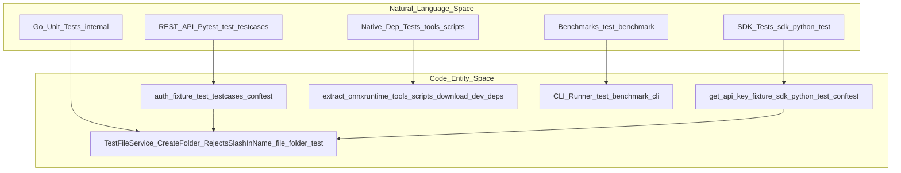
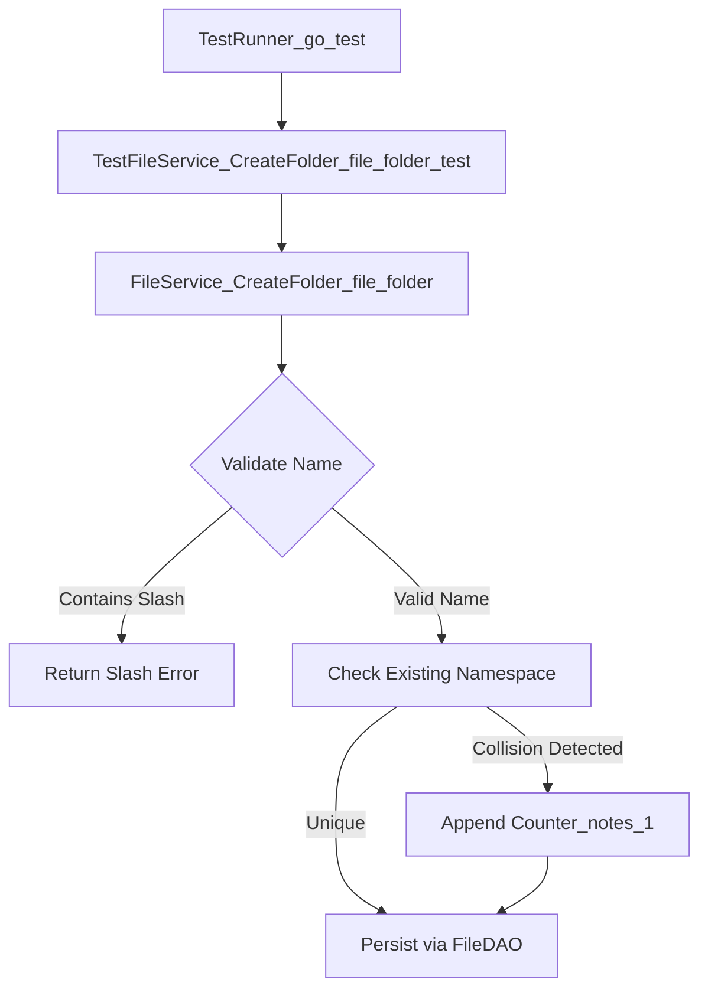

<!-- source: DeepWiki mcp.deepwiki.com · repo infiniflow/ragflow · page 11.3 Testing Infrastructure · fetched 2026-10-29 -->

# Testing Infrastructure

Relevant source files

The following files were used as context for generating this wiki page:

- [internal/dao/file.go](internal/dao/file.go)
- [internal/dao/file_test.go](internal/dao/file_test.go)
- [internal/handler/file.go](internal/handler/file.go)
- [internal/handler/skill_search.go](internal/handler/skill_search.go)
- [internal/ingestion/service/redelivery_counter_test.go](internal/ingestion/service/redelivery_counter_test.go)
- [internal/service/chunk/chunk_permissions_test.go](internal/service/chunk/chunk_permissions_test.go)
- [internal/service/document/apply_doc_counts_test.go](internal/service/document/apply_doc_counts_test.go)
- [internal/service/file/file_folder.go](internal/service/file/file_folder.go)
- [internal/service/file/file_folder_test.go](internal/service/file/file_folder_test.go)
- [internal/service/skill_space.go](internal/service/skill_space.go)
- [sdk/python/test/conftest.py](sdk/python/test/conftest.py)
- [sdk/python/test/test_frontend_api/common.py](sdk/python/test/test_frontend_api/common.py)
- [sdk/python/test/test_frontend_api/test_chunk.py](sdk/python/test/test_frontend_api/test_chunk.py)
- [sdk/python/test/test_frontend_api/test_dataset.py](sdk/python/test/test_frontend_api/test_dataset.py)
- [test/api/chunk_api_test.go](test/api/chunk_api_test.go)
- [test/api/dataset_api_test.go](test/api/dataset_api_test.go)
- [test/api/dataset_features_test.go](test/api/dataset_features_test.go)
- [test/api/dataset_list_delete_test.go](test/api/dataset_list_delete_test.go)
- [test/api/dataset_validation_test.go](test/api/dataset_validation_test.go)
- [test/api/files_api_test.go](test/api/files_api_test.go)
- [test/api/rest_request_test.go](test/api/rest_request_test.go)
- [test/api/retrieval_api_test.go](test/api/retrieval_api_test.go)
- [test/benchmark/README.md](test/benchmark/README.md)
- [test/benchmark/__init__.py](test/benchmark/__init__.py)
- [test/benchmark/__main__.py](test/benchmark/__main__.py)
- [test/benchmark/auth.py](test/benchmark/auth.py)
- [test/benchmark/chat.py](test/benchmark/chat.py)
- [test/benchmark/cli.py](test/benchmark/cli.py)
- [test/benchmark/dataset.py](test/benchmark/dataset.py)
- [test/benchmark/http_client.py](test/benchmark/http_client.py)
- [test/benchmark/metrics.py](test/benchmark/metrics.py)
- [test/benchmark/report.py](test/benchmark/report.py)
- [test/benchmark/retrieval.py](test/benchmark/retrieval.py)
- [test/benchmark/tests/test_cli_failures.py](test/benchmark/tests/test_cli_failures.py)
- [test/benchmark/tests/test_reports.py](test/benchmark/tests/test_reports.py)
- [test/benchmark/tests/test_samples.py](test/benchmark/tests/test_samples.py)
- [test/testcases/configs.py](test/testcases/configs.py)
- [test/testcases/conftest.py](test/testcases/conftest.py)
- [test/testcases/test_sdk_api/test_agent_management/test_agent_crud_unit.py](test/testcases/test_sdk_api/test_agent_management/test_agent_crud_unit.py)
- [test/testcases/test_sdk_api/test_chat_assistant_management/test_chat_crud_unit.py](test/testcases/test_sdk_api/test_chat_assistant_management/test_chat_crud_unit.py)
- [test/testcases/test_sdk_api/test_dataset_mangement/conftest.py](test/testcases/test_sdk_api/test_dataset_mangement/conftest.py)
- [test/testcases/test_sdk_api/test_dataset_mangement/test_create_dataset.py](test/testcases/test_sdk_api/test_dataset_mangement/test_create_dataset.py)
- [test/testcases/test_sdk_api/test_dataset_mangement/test_delete_datasets.py](test/testcases/test_sdk_api/test_dataset_mangement/test_delete_datasets.py)
- [test/testcases/test_sdk_api/test_dataset_mangement/test_list_datasets.py](test/testcases/test_sdk_api/test_dataset_mangement/test_list_datasets.py)
- [test/testcases/test_sdk_api/test_dataset_mangement/test_update_dataset.py](test/testcases/test_sdk_api/test_dataset_mangement/test_update_dataset.py)
- [test/testcases/test_sdk_api/test_file_management_within_dataset/test_list_documents.py](test/testcases/test_sdk_api/test_file_management_within_dataset/test_list_documents.py)
- [test/testcases/test_sdk_api/test_file_management_within_dataset/test_update_document.py](test/testcases/test_sdk_api/test_file_management_within_dataset/test_update_document.py)
- [test/testcases/test_sdk_api/test_file_management_within_dataset/test_upload_documents.py](test/testcases/test_sdk_api/test_file_management_within_dataset/test_upload_documents.py)

The purpose of this page is to document the comprehensive validation and testing infrastructure of RAGFlow. This includes Go unit and integration tests, `test/testcases/` REST API pytest suites, Python SDK tests (`sdk/python/test/`), Playwright E2E suites, native dependency extraction test suites (`tools/scripts/test_download_dev_deps.py`), benchmark suites (`test/benchmark/`), and execution mechanics against varying storage and model backends as defined in CI workflows and build configurations.

## Test Suite Organization

The RAGFlow test suite is partitioned into distinct layers targeting specific runtime components, SDK clients, API endpoints, and dependency management scripts.

| Category | Location | Purpose | Key Tools |
| :--- | :--- | :--- | :--- |
| **SDK Tests** | `sdk/python/test/` | Validates Python SDK client logic and server interoperability [sdk/python/test/conftest.py:63-76]() | `ragflow-sdk`, `pytest` |
| **REST API Pytest Suites** | `test/testcases/` | Tests high-level RESTful API contracts directly via HTTP requests [test/testcases/configs.py:21-64]() | `requests`, `pytest` |
| **Go Unit/Integration Tests** | `internal/` | Tests Go internal services, ingestion workers, and data access layers [internal/service/file/file_folder_test.go:19-27]() | `go test`, `sqlmock`, `miniredis` |
| **Native Dep Tests** | `tools/scripts/` | Validates static dependency downloads, ORT asset extraction, and version bumps [tools/scripts/test_download_dev_deps.py:36-64]() | `pytest`, python unittest |
| **Benchmarks** | `test/benchmark/` | Performance, chat throughput, and retrieval scalability tests [test/benchmark/cli.py]() | `pytest`, custom scripts |

Sources: [sdk/python/test/conftest.py:63-76](), [test/testcases/configs.py:21-64](), [internal/service/file/file_folder_test.go:19-27](), [tools/scripts/test_download_dev_deps.py:36-64](), [test/benchmark/cli.py]()

### System Data Flow in Testing
The following diagram illustrates how different test harnesses interact with the RAGFlow runtime architecture, bridging natural language test specifications to code entities.

**Testing Interface Architecture**

Sources: [sdk/python/test/conftest.py:63-76](), [test/testcases/conftest.py:156-183](), [internal/service/file/file_folder_test.go:19-27](), [tools/scripts/test_download_dev_deps.py:36-64](), [test/benchmark/cli.py]()

## CI/CD Integration and Preflight Validation

RAGFlow integrates heavily with GitHub Actions and relies on environment configurations, dependency pre-seeding, and test harness hooks.

*   **Preflight and Environment Checks**: CI workflows execute preflight jobs (`ragflow_preflight`) that verify workspace ownership, check workflow duplication, and run static checks via `lefthook` [.github/workflows/sep-tests.yml:42-120]().
*   **Private Module Resolution**: The environment sets `GOPRIVATE: github.com/infiniflow/onnxruntime_go` to ensure Go skips the public checksum database and proxy for the in-process DeepDoc ONNX bindings [.github/workflows/sep-tests.yml:38-39]().
*   **Concurrency and Workflow Deduplication**: Workflows enforce concurrency controls and inspect recent PR commit trees to prevent duplicate or redundant builds [.github/workflows/sep-tests.yml:29-32]().

Sources: [.github/workflows/sep-tests.yml:29-120]()

## Test Configuration and Fixture Lifecycle

Test frameworks across both Python and Go maintain robust fixtures for bootstrapping tenants, authenticating requests, and managing models.

### Authentication and Tenant Fixtures
1.  **Python SDK Authentication**: The `get_api_key_fixture` handles user registration, login, and system token acquisition [sdk/python/test/conftest.py:63-76]().
2.  **REST API Authentication**: The `auth` fixture handles retry-based registration and login against the admin bootstrap service [test/testcases/conftest.py:156-183]().
3.  **Tenant Model Setup**: The `set_tenant_info` fixture automatically registers model providers (such as `ZHIPU-AI`) and assigns default chat, embedding, and vision models for test tenants [sdk/python/test/conftest.py:126-152]().

Sources: [sdk/python/test/conftest.py:63-152](), [test/testcases/conftest.py:156-183]()

### CLI and Pytest Options
The test runner configures command-line options via `pytest_addoption`, allowing operators to select test levels (`p1` for smoke, `p2` for core, `p3` for full) and client execution types (`python_sdk`, `http`, `web`) [test/testcases/conftest.py:107-124]().

Sources: [test/testcases/conftest.py:107-124]()

## Go Unit/Integration Tests and Native Dependency Validation

Go tests under `internal/` leverage standard testing primitives alongside mock libraries such as SQLite-based test fixtures and GORM drivers [internal/service/file/file_folder_test.go:15-17](). For instance, folder creation and name validation rules are rigorously tested:
*   **Slash Rejection**: `TestFileService_CreateFolder_RejectsSlashInName` ensures that directory paths containing slashes are correctly rejected [internal/service/file/file_folder_test.go:19-27]().
*   **Deduplication**: `TestFileService_CreateFolderDedupesDuplicateName` validates counter appends (e.g., `notes(1)`) on name collisions [internal/service/file/file_folder_test.go:29-77]().

Furthermore, native asset extraction and dependency compilation scripts are thoroughly tested by python test suites:
*   **ORT Asset Extraction**: `test_extracts_on_first_run` and `test_extracts_after_version_bump_when_static_lib_exists` verify that ONNX Runtime static archives are correctly unpacked and stale directories are pruned [tools/scripts/test_download_dev_deps.py:52-87]().
*   **Platform Target Alignment**: Tests assert that per-platform asset names and normalized directories match upstream release layouts for `linux/amd64`, `linux/arm64`, `darwin/amd64`, and `darwin/arm64` [tools/scripts/test_download_dev_deps.py:122-136]().

**Go Unit Test and Folder Execution Flow**

Sources: [internal/service/file/file_folder_test.go:19-77](), [internal/service/file/file_folder.go:18-28](), [tools/scripts/test_download_dev_deps.py:36-87]()

## REST API Pytest Suites and Configurations

The `test/testcases/` package provides comprehensive API endpoint test suites governed by explicit configurations:
*   **Configuration Parameters**: `test/testcases/configs.py` defines API host addresses, default parser configurations (`DEFAULT_PARSER_CONFIG`), and test constraints for datasets and document name lengths [test/testcases/configs.py:21-64]().
*   **API Stubs and Mocking**: `test/testcases/conftest.py` installs dynamic stubs for internal modules like `rag.llm` to isolate REST API integration tests from local execution dependencies [test/testcases/conftest.py:42-77]().
*   **Dataset Management Tests**: Test cases such as `TestDatasetCreate` in `test/testcases/test_sdk_api/test_dataset_mangement/test_create_dataset.py` validate concurrent creations, name limits, and boundary conditions [test/testcases/test_sdk_api/test_dataset_mangement/test_create_dataset.py:47-66]().

Sources: [test/testcases/configs.py:21-64](), [test/testcases/conftest.py:42-77](), [test/testcases/test_sdk_api/test_dataset_mangement/test_create_dataset.py:47-66]()

## Benchmarks and Performance Testing

Performance testing suites located under `test/benchmark/` validate throughput, latency, and operational scalability:
*   **CLI Orchestration**: `test/benchmark/cli.py` coordinates load execution against chat and retrieval services.
*   **Metrics Reporting**: Specialized modules compile test results, request latency histograms, and failure rates to assess system stability under high concurrency.

Sources: [test/benchmark/cli.py]()

---

