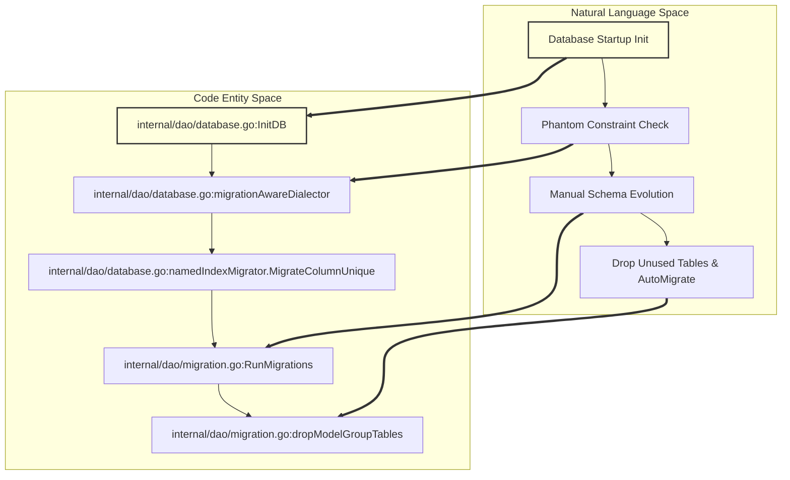
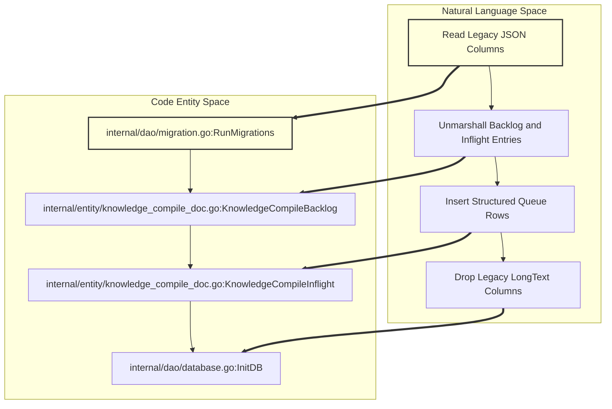

<!-- source: DeepWiki mcp.deepwiki.com · repo infiniflow/ragflow · page 11.4 Migration and Utility Tools · fetched 2026-10-29 -->

# Migration and Extraction Tools

Relevant source files

The following files were used as context for generating this wiki page:

- [.gitattributes](.gitattributes)
- [.github/workflows/release.yml](.github/workflows/release.yml)
- [cmd/ragflow-cli.go](cmd/ragflow-cli.go)
- [docs/administrator/upgrade_and_migration/database_change_log.md](docs/administrator/upgrade_and_migration/database_change_log.md)
- [internal/agent/component/runtime_wire.go](internal/agent/component/runtime_wire.go)
- [internal/cli/README.md](internal/cli/README.md)
- [internal/dao/database.go](internal/dao/database.go)
- [internal/dao/dsl_version_migration.go](internal/dao/dsl_version_migration.go)
- [internal/dao/dsl_version_migration_test.go](internal/dao/dsl_version_migration_test.go)
- [internal/dao/knowledge_compile_queue_migration.go](internal/dao/knowledge_compile_queue_migration.go)
- [internal/dao/knowledge_compile_queue_migration_test.go](internal/dao/knowledge_compile_queue_migration_test.go)
- [internal/dao/migration.go](internal/dao/migration.go)
- [internal/dao/migration_integration_test.go](internal/dao/migration_integration_test.go)
- [internal/dao/migration_test.go](internal/dao/migration_test.go)
- [internal/dao/user_canvas_version_keepall_test.go](internal/dao/user_canvas_version_keepall_test.go)
- [internal/entity/knowledge_compile_doc.go](internal/entity/knowledge_compile_doc.go)
- [internal/handler/compilation_status_test.go](internal/handler/compilation_status_test.go)
- [internal/parser/parser/testdata/sample.msg](internal/parser/parser/testdata/sample.msg)
- [internal/service/dataset/compilation_status.go](internal/service/dataset/compilation_status.go)
- [internal/service/dataset/compilation_status_test.go](internal/service/dataset/compilation_status_test.go)
- [lefthook.yml](lefthook.yml)
- [test/test_check_files.py](test/test_check_files.py)
- [tools/hooks/check_files.py](tools/hooks/check_files.py)
- [tools/scripts/INSTALL_SCRIPTS_README.md](tools/scripts/INSTALL_SCRIPTS_README.md)
- [tools/scripts/install.ps1](tools/scripts/install.ps1)
- [tools/scripts/install.sh](tools/scripts/install.sh)
- [web/src/components/ui/label.tsx](web/src/components/ui/label.tsx)
- [web/src/components/ui/modal/modal.tsx](web/src/components/ui/modal/modal.tsx)
- [web/src/hooks/common-hooks.tsx](web/src/hooks/common-hooks.tsx)
- [web/src/pages/user-setting/components/user-setting-header/index.tsx](web/src/pages/user-setting/components/user-setting-header/index.tsx)
- [web/src/pages/user-setting/sidebar/hooks.tsx](web/src/pages/user-setting/sidebar/hooks.tsx)

## Purpose and Scope

This section documents the operational utilities, database migration frameworks, administrative scripts, dependency management infrastructure, and developer tooling provided in the RAGFlow codebase. These tools facilitate system maintenance, data transformation between storage engines, schema evolution in MySQL via `internal/dao/database.go` [internal/dao/database.go:113-205](), versioned data backfills, native dependency management, code formatting hooks (`lefthook.yml`) [lefthook.yml:1-116](), release pipelines (`.github/workflows/release.yml`) [.github/workflows/release.yml:1-193](), and integration utilities like installation scripts and the CLI (`cmd/ragflow-cli.go`) [cmd/ragflow-cli.go:1-86]().

---

## MySQL Migration and Schema Evolution

RAGFlow employs a multi-stage migration framework to handle schema evolution and data transformations in relational databases. The `internal/dao` package manages database initialization, automated GORM model synchronization, and manual versioned migrations [internal/dao/database.go:113-205](), [internal/dao/migration.go:34-90]().

### Core Components and Implementation

*   `migrationAwareDialector`: A custom GORM dialector wrapper that injects a specialized `namedIndexMigrator` to prevent phantom unique constraint drops during schema migrations [internal/dao/database.go:57-85](). This prevents runtime panics and MySQL error 1091 when GORM attempts to drop unique constraints that were never created under its default naming convention (`uni_<table>_<column>`) [internal/dao/database.go:90-115]().
*   `namedIndexMigrator`: Extends `mysql.Migrator` and overrides `MigrateColumnUnique` to check `phantomUniqueDrop` before executing constraint modifications [internal/dao/database.go:84-110]().
*   `RunMigrations`: Executes manual database migrations that cannot be handled by `AutoMigrate` alone, including primary key migrations for `tenant_llm`, column renames, unique index additions, and table cleanups like `dropModelGroupTables` [internal/dao/migration.go:34-90](), [internal/dao/migration.go:104-116]().

Sources: [internal/dao/database.go:57-115](), [internal/dao/database.go:113-205](), [internal/dao/migration.go:34-116]()

---

## Knowledge Compile Queue Migration

To transition from legacy JSON-blob storage (`backlog_doc_ids` and `inflight_doc_ids` columns on `knowledge_compile_docs`) to structured, transactional relational queues (`knowledge_compile_docs_backlog` and `knowledge_compile_docs_inflight`), RAGFlow includes a dedicated queue migration process [internal/entity/knowledge_compile_doc.go:36-87]() [internal/service/dataset/compilation_status.go:41-99]().

### Implementation Details

*   **Queue Parsing & Normalization**: The migration reads legacy longtext payloads, unmarshals array entries into structured `KnowledgeCompileEntry` items, and inserts them with sequential queue positions under the dataset's lock [internal/entity/knowledge_compile_doc.go:68-87]() [internal/service/dataset/compilation_status.go:101-124]().
*   **Idempotency & Rollback**: Failed JSON deserialization steps abort without advancing the schema version marker, allowing safe retries after data correction [internal/service/dataset/compilation_status.go:59-97]().

Sources: [internal/entity/knowledge_compile_doc.go:36-87](), [internal/dao/database.go:113-205](), [internal/service/dataset/compilation_status.go:41-124]()

---

## Development Tools, Release Automation and Pre-Commit Hooks

RAGFlow utilizes `lefthook` to manage pre-commit code verification and formatting enforcement [lefthook.yml:1-116](), alongside GitHub Actions workflows for release management [github/workflows/release.yml:1-193]().

*   **Dual-Mode Pre-Commit Hooks**: Local development runs fix-capable jobs (`end-of-file-fixer`, `trailing-whitespace`, `mixed-line-ending`, `ruff`, `gofmt`) and automatically stages modified files (`stage_fixed: true`) [lefthook.yml:3-73]().
*   **CI Verification**: Setting `LEFTHOOK_CHECK_ONLY=1` forces non-zero exit codes on violations without modifying files [lefthook.yml:5-70]().
*   **Frontend Checks**: The `web-checks` workflow executes `oxfmt` and `oxlint` against web sources using cached Node modules [lefthook.yml:90-106]().
*   **Release Pipeline**: `.github/workflows/release.yml` handles multi-architecture binary compilation for `ragflow-cli` across Linux, macOS, and Windows runners [github/workflows/release.yml:82-193]().

Sources: [lefthook.yml:1-116](), [.github/workflows/release.yml:1-193]()

---

## Installation and CLI Utilities

The `tools/scripts/` directory contains installation scripts for the RAGFlow CLI, supporting both Linux/macOS and Windows environments.

*   `install.sh`: Shell script for Linux and macOS systems that detects platform architecture, fetches release versions, and verifies SHA-256 sums.
*   `cmd/ragflow-cli.go`: Entry point for the Go-based command line interface utility, initializing the CLI configuration, command runner, and signal handlers [cmd/ragflow-cli.go:31-86]().

Sources: [cmd/ragflow-cli.go:1-86]()

---

