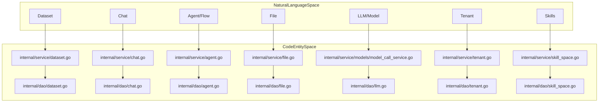
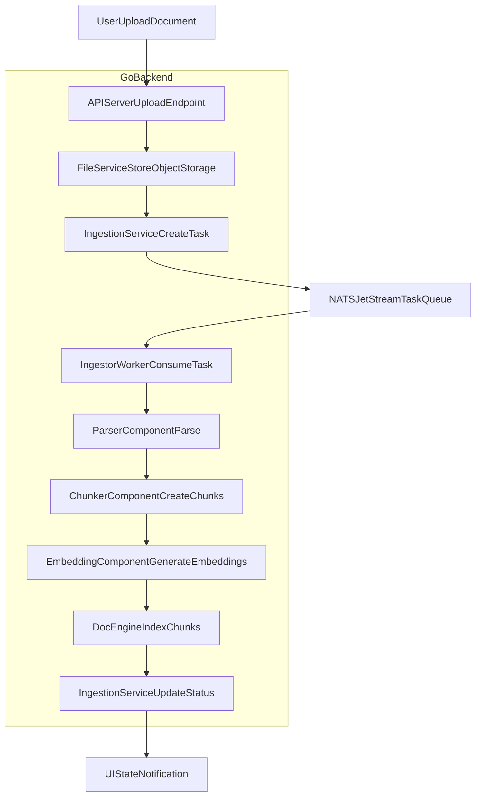

<!-- source: DeepWiki mcp.deepwiki.com · repo infiniflow/ragflow · page 12 Glossary · fetched 2026-10-29 -->

# Glossary

Relevant source files

The following files were used as context for generating this wiki page:

- [README.md](README.md)
- [README_ar.md](README_ar.md)
- [README_fr.md](README_fr.md)
- [README_id.md](README_id.md)
- [README_ja.md](README_ja.md)
- [README_ko.md](README_ko.md)
- [README_pt_br.md](README_pt_br.md)
- [README_ru.md](README_ru.md)
- [README_tr.md](README_tr.md)
- [README_tzh.md](README_tzh.md)
- [README_zh.md](README_zh.md)
- [docs/develop/acquire_ragflow_api_key.md](docs/develop/acquire_ragflow_api_key.md)
- [docs/faq.mdx](docs/faq.mdx)
- [docs/guides/models/deploy_local_llm.mdx](docs/guides/models/deploy_local_llm.mdx)
- [docs/guides/models/llm_api_key_setup.md](docs/guides/models/llm_api_key_setup.md)
- [docs/quickstart.mdx](docs/quickstart.mdx)
- [docs/references/http_api_reference.md](docs/references/http_api_reference.md)
- [docs/references/python_api_reference.md](docs/references/python_api_reference.md)
- [docs/release_notes.md](docs/release_notes.md)
- [sdk/python/ragflow_sdk/modules/agent.py](sdk/python/ragflow_sdk/modules/agent.py)
- [sdk/python/ragflow_sdk/modules/base.py](sdk/python/ragflow_sdk/modules/base.py)
- [sdk/python/ragflow_sdk/modules/chat.py](sdk/python/ragflow_sdk/modules/chat.py)
- [sdk/python/ragflow_sdk/modules/chunk.py](sdk/python/ragflow_sdk/modules/chunk.py)
- [sdk/python/ragflow_sdk/modules/dataset.py](sdk/python/ragflow_sdk/modules/dataset.py)
- [sdk/python/ragflow_sdk/modules/document.py](sdk/python/ragflow_sdk/modules/document.py)
- [sdk/python/ragflow_sdk/modules/session.py](sdk/python/ragflow_sdk/modules/session.py)
- [sdk/python/ragflow_sdk/ragflow.py](sdk/python/ragflow_sdk/ragflow.py)
- [test/testcases/test_sdk_api/test_file_management_within_dataset/test_download_document.py](test/testcases/test_sdk_api/test_file_management_within_dataset/test_download_document.py)
- [web/src/locales/ar.ts](web/src/locales/ar.ts)
- [web/src/locales/bg.ts](web/src/locales/bg.ts)
- [web/src/locales/de.ts](web/src/locales/de.ts)
- [web/src/locales/en.ts](web/src/locales/en.ts)
- [web/src/locales/es.ts](web/src/locales/es.ts)
- [web/src/locales/fr.ts](web/src/locales/fr.ts)
- [web/src/locales/id.ts](web/src/locales/id.ts)
- [web/src/locales/it.ts](web/src/locales/it.ts)
- [web/src/locales/ja.ts](web/src/locales/ja.ts)
- [web/src/locales/ko.ts](web/src/locales/ko.ts)
- [web/src/locales/pt-br.ts](web/src/locales/pt-br.ts)
- [web/src/locales/ru.ts](web/src/locales/ru.ts)
- [web/src/locales/tr.ts](web/src/locales/tr.ts)
- [web/src/locales/vi.ts](web/src/locales/vi.ts)
- [web/src/locales/zh-traditional.ts](web/src/locales/zh-traditional.ts)
- [web/src/locales/zh.ts](web/src/locales/zh.ts)

This page provides definitions and technical pointers for codebase-specific terms, jargon, abbreviations, and domain concepts used within RAGFlow. It aims to clarify the meaning of these terms and link them to their relevant Go server implementations, React frontend components, and storage layers.

## Purpose and Scope

The RAGFlow glossary serves as a comprehensive reference for onboarding engineers to understand the specific nomenclature used across the Go backend and React frontend. It bridges high-level Retrieval-Augmented Generation (RAG) concepts with their specific implementations in the `internal/` and `web/` directories.

Sources: [README.md:70-73]()

---

## Core Domain Terms

### RAG (Retrieval-Augmented Generation)
The core architectural pattern of the system. It involves retrieving relevant document chunks from a document engine or vector store to provide contextual grounding for a Large Language Model (LLM) to generate verified responses with citations.
Sources: [README.md:70-73]()

### Chunk
A smaller, searchable unit of a document, generated during the parsing and chunking process. Chunks are embedded and indexed in a `DocEngine` instance for similarity and hybrid retrieval.
Sources: [README.md:81-82]()

### DocEngine
An abstraction layer over various document stores and vector databases (e.g., Elasticsearch, Infinity, OpenSearch, OceanBase, SereneDB, SeekDB, Vastbase). It provides a unified Go interface for index management, chunk storage, and hybrid vector-keyword retrieval.
*   **Description:** The DocEngine interface over Elasticsearch/Infinity/OceanBase/SereneDB, index mappings, chunk schema, metadata filters, and engine selection.
*   **Configuration:** `DOC_ENGINE` environment variable configured in `docker/.env`.
Sources: [docker/.env:27-37]()

### DeepDoc
The in-process document parsing and computer vision backend responsible for advanced document understanding, including PDF layout analysis, OCR detection/recognition, and table structure recognition. It executes inference using ONNX Runtime.
*   **Description:** The in-process DeepDoc backend: ONNX .ort models, PDF layout analysis, OCR detect/recognize, table structure recognition, and inference/page concurrency budgets.
*   **Implementation:** Located under `internal/deepdoc/native` with ONNX Runtime wrappers.
Sources: [README_zh.md:107-111]()

### ORT (ONNX Runtime)
A cross-platform machine learning inference accelerator utilized by DeepDoc to execute layout analysis, OCR, and table structure recognition models efficiently inside the Go server environment.
*   **Implementation:** `internal/deepdoc/native` contains CGO bindings and runtime execution wrappers.
Sources: [README_zh.md:107-111]()

### RAPTOR
(Recursive Abstractive Processing for Tree-Organized Retrieval) A hierarchical document clustering and summarization strategy for long documents that constructs a tree of summaries to improve multi-hop retrieval and context depth.
*   **Configuration:** Managed via the `raptor` parameter in dataset configuration structures.
Sources: [sdk/python/ragflow_sdk/modules/dataset.py:175-180]()

### GraphRAG
A mechanism for extracting named entities, semantic relationships, and hierarchical structures from documents to construct a knowledge graph, enabling graph-augmented retrieval and reasoning paths.
*   **Description:** Knowledge graph extraction and node/edge enumeration for advanced dataset reasoning.
Sources: [README.md:89-91]()

### Canvas / DSL
The visual workflow system for designing AI agents and pipelines. The "Canvas" represents the React Flow graphical editor interface in the web frontend, while the "DSL" (Domain Specific Language) defines the JSON schema representing the agent's graph execution model.
*   **Implementation:** `internal/agent/dsl` handles schema validation, compilation, and execution graph decoding.
Sources: [web/src/locales/en.ts:132-132]()

### ModelDriver / ModelSolver
`ModelDriver` is an interface that abstracts distinct LLM, embedding, rerank, ASR, TTS, and OCR providers, enabling uniform client calls. `ModelSolver` resolves runtime model references (e.g., `model@instance@provider`) to concrete driver instances.
*   **`ModelDriver` Interface:** Defined in `internal/entity/models/base_model.go`.
*   **`ModelSolver` Implementation:** Located in `internal/service/models/model_call_service.go`.
Sources: [web/src/locales/en.ts:1-20]()

### MCP (Model Context Protocol)
A standardized protocol for tool calling, resource sharing, and function execution, allowing LLMs and agentic loops to interact securely with external tools, APIs, and servers.
*   **Implementation:** Client and server architectures implemented in `internal/mcp` and utility helpers.
*   **Frontend Localization:** Defined under the `mcp` translation keys.
Sources: [web/src/locales/en.ts:85-93]()

### Harness
The execution framework that orchestrates agentic workflows, multi-step reasoning loops, memory injection, tool calls, and event logging.
*   **Implementation:** `internal/harness` provides the Pregel BSP graph engine, AgentCore abstractions, ReAct execution middleware, and replay capabilities.
Sources: [README.md:70-73]()

### Ingestor
A dedicated operational mode of the Go server responsible for consuming document ingestion tasks, executing parser and chunker pipelines, generating embeddings, and writing indices to the document store.
*   **Execution Mode:** Started via the `cmd/ragflow_server.go` entrypoint with the `--ingestor` flag.
Sources: [README.md:135-143]()

### Syncer
A specialized operational mode of the Go server that handles scheduled and incremental data synchronization from external data sources (e.g., Confluence, Jira, Google Drive, S3, WebDAV) into RAGFlow datasets.
*   **Execution Mode:** Started via `cmd/ragflow_server.go` using the `--syncer` flag.
*   **Registry:** Connector registry housed in `internal/syncer/connector`.
Sources: [README.md:135-143]()

### Skill Space
A modular subsystem for organizing, validating, and searching reusable skills and skill packages (containing `SKILL.md` frontmatter) used by user workflows and agents.
*   **Frontend Localization:** `skills` object in translation stores.
*   **Validation Rules:** Validated in file system cli utilities and frontend schema checks.
Sources: [web/src/locales/en.ts:142-187]()

### Compilation Template
Predefined configuration templates utilized by the knowledge compilation subsystem to transform unstructured document content into structured knowledge artifacts such as wikis, mind maps, trees, and timelines.
*   **Description:** Used to compile dataset artifacts for enhanced knowledge organization and reuse.
Sources: [README.md:117-122]()

### Tenant
The top-level organizational entity for multi-tenancy isolation. All users, datasets, documents, chat histories, agent definitions, and model instances are scoped to a specific `tenant_id`.
*   **Data Models:** Backed by tenant configuration and mapping tables in `internal/dao`.
Sources: [web/src/locales/en.ts:1-20]()

### Kvrocks
A fast, distributed key-value database compatible with the Redis protocol, utilized by RAGFlow to store runtime caches, task checkpoints, and ephemeral state.
*   **Description:** Serves as the high-performance backing store for cache management and execution checkpoints.
Sources: [docs/quickstart.mdx:20-25]()

### JetStream
The persistent messaging and streaming engine built into NATS, used by RAGFlow for robust task distribution, asynchronous queueing, and reliable ingestor worker coordination.
*   **Description:** Replaced legacy Redis streams as the core message distribution queue in RAGFlow 1.0.
Sources: [docs/quickstart.mdx:20-25]()

### Beta Token
A scoped authentication credential used alongside JWT and API keys to grant restricted access to beta features and endpoints.
*   **Middleware:** Validated via `AuthMiddleware` and `BetaAuthMiddleware`.
Sources: [docs/quickstart.mdx:20-25]()

### parser_id
An identifier string used in the RAGFlow Go backend configuration to specify the active document parsing strategy for a dataset (e.g., `general`, `naive`, `qa`, `table`), replacing legacy Python configuration keys.
*   **API Reference:** Dataset creation and update endpoints accept `parser_id`.
*   **Python SDK:** Parameter exposed in `RAGFlow.create_dataset`.
Sources: [sdk/python/ragflow_sdk/modules/dataset.py:150-165]()

### Pipeline
The sequential execution graph governing document processing from initial file storage upload through parsing, chunking, content enhancement, embedding generation, and final indexing.
*   **Implementation:** Managed by `internal/ingestion/pipeline/pipeline_executor.go` and the ingestion service layer.
Sources: [docs/quickstart.mdx:10-15]()

Sources: [README.md:70-122](), [docker/.env:27-37](), [sdk/python/ragflow_sdk/modules/dataset.py:150-175](), [web/src/locales/en.ts:85-187]()

---

## System Space Mapping

### Natural Language to Code Entity Mapping
This diagram bridges user-facing concepts from the UI and documentation with their corresponding backend service implementations and database access DAO layers.

**Concept Mapping Diagram**

Sources: [web/src/locales/en.ts:123-140](), [README.md:70-73]()

### Ingestion Pipeline Data Flow
This diagram illustrates the architectural execution flow during document ingestion, mapping user uploads through NATS JetStream task dispatch to worker chunking and document engine indexing.

**Ingestion Pipeline Data Flow**

Sources: [docs/quickstart.mdx:10-15](), [README.md:135-143]()

---

## Technical Abbreviations

| Abbreviation | Full Name | Description | Code Pointer |
| :--- | :--- | :--- | :--- |
| **DSL** | Domain Specific Language | JSON representation of agent workflow graphs. | `internal/agent/dsl` |
| **MCP** | Model Context Protocol | Protocol for connecting LLMs to external tools and data. | `internal/mcp` |
| **ORT** | ONNX Runtime | Cross-platform ML model accelerator used by DeepDoc. | `internal/deepdoc/native` |
| **RAPTOR** | Recursive Abstractive Processing for Tree-Organized Retrieval | Tree-organized hierarchical summarization for long texts. | `sdk/python/ragflow_sdk/modules/dataset.py:175-180` |
| **OCR** | Optical Character Recognition | Text extraction from scanned document images and PDFs. | `internal/deepdoc/native` |
| **ReAct** | Reasoning and Acting | Multi-step agent reasoning loop combining thought and action. | `internal/harness` |
| **TTS** | Text To Speech | Audio generation model integration service. | `internal/service/models/model_call_service.go` |
| **ASR** | Automatic Speech Recognition | Speech-to-text transcription model integration service. | `internal/service/models/model_call_service.go` |
| **DLA** | Document Layout Analysis | Structural layout detection for headers, tables, and blocks. | `internal/deepdoc/native` |

Sources: [sdk/python/ragflow_sdk/modules/dataset.py:175-180](), [web/src/locales/en.ts:85-93]()