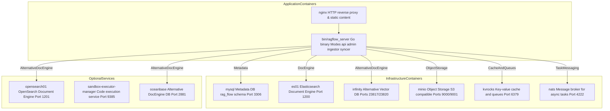
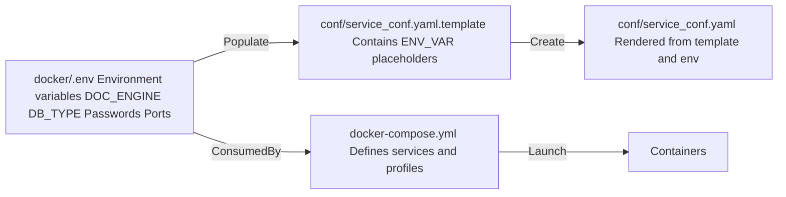
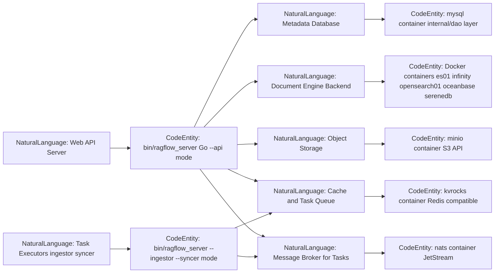
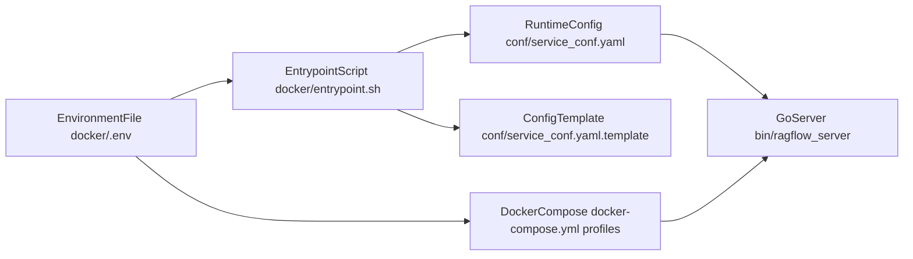

<!-- source: DeepWiki mcp.deepwiki.com · repo infiniflow/ragflow · page 2 Getting Started and Deployment · fetched 2026-10-29 -->

# Getting Started and Deployment

<details>
<summary>Relevant source files</summary>

The following files were used as context for generating this wiki page:

- [Dockerfile](Dockerfile)
- [docker/.env](docker/.env)
- [docker/README.md](docker/README.md)
- [docker/docker-compose-base.yml](docker/docker-compose-base.yml)
- [docker/docker-compose.yml](docker/docker-compose.yml)
- [docker/entrypoint.sh](docker/entrypoint.sh)
- [docker/infinity_conf.toml](docker/infinity_conf.toml)
- [docker/launch_backend_service.sh](docker/launch_backend_service.sh)
- [pyproject.toml](pyproject.toml)
- [sdk/python/pyproject.toml](sdk/python/pyproject.toml)
- [sdk/python/uv.lock](sdk/python/uv.lock)
- [uv.lock](uv.lock)

</details>


This document provides a high-level overview of RAGFlow's deployment options and initial setup procedures. It outlines system prerequisites, primary deployment methods, and the essential configuration files used to run RAGFlow. For in-depth instructions and technical details, please refer to the dedicated child pages:

- [Docker Compose Deployment](#2.1) — Detailed guide for deploying RAGFlow using Docker Compose, including service architecture, container configuration, and port mappings.
- [Configuration Management](#2.2) — Explanation of the configuration system including `service_conf.yaml`, environment variables, and the relationship between configuration sources.
- [Document Engine Selection](#2.3) — Guide for choosing and configuring document engines (Elasticsearch, Infinity, OpenSearch, OceanBase, SereneDB) with their tradeoffs.
- [Build System and CI/CD](#2.4) — Explanation of the build pipeline, dependency management with `uv`, multi-language compilation, GitHub Actions workflows, the `ragflow_deps` image for pre-downloading NLP models, and install scripts.

---

## Deployment Architecture Overview

RAGFlow adopts a modular containerized microservices architecture, with each key subsystem running in its own container. This approach isolates concerns such as API serving, data storage, caching, task execution, and optional sandboxing, facilitating scalability and maintainability. For details, see [Docker Compose Deployment](#2.1).

### Containerized Service Architecture



This architecture demonstrates the following:
- The primary Go server binary `ragflow_server` runs in multiple modes such as API server, Admin UI server, ingestion workers, and data synchronization workers [docker/README.md:1-5]().
- Document engines provide vector and text indexing. Elasticsearch is the default engine, but Infinity, OpenSearch, OceanBase, and SereneDB are supported alternatives [docker/.env:27-36]().
- MySQL holds metadata about datasets, users, and system state [docker/.env:38-40]().
- MinIO exposes S3-compatible object storage for storing raw document files and blobs [docker/README.md:115-121]().
- Kvrocks offers Redis-compatible caching and task queue functionality [docker/README.md:124-132]().
- NATS JetStream acts as a reliable message broker for async ingestion and synchronization tasks [docker/README.md:135-143]().
- An optional sandbox executor service provides isolated code execution environments invoked by agent workflows [docker/docker-compose-base.yml:218-221]().

Sources: [docker/docker-compose-base.yml:1-221](), [docker/.env:10-63](), [docker/README.md:1-149]()

---

## Configuration Management Overview

RAGFlow uses a configuration system that merges environment variables, YAML templates, and Docker Compose profiles to customize deployment behavior according to use case and selected document engine. For details, see [Configuration Management](#2.2).

### Configuration Sources and Runtime Flow



Key points:
- The `.env` file defines environment variables with defaults and secrets including document engine type (`DOC_ENGINE`), metadata database type, passwords, ports, and device targets [docker/.env:27-54]().
- A YAML template (`service_conf.yaml.template`) uses environment variable substitution to produce the actual runtime configuration which the Go server reads at startup [docker/entrypoint.sh:76-98]().
- Docker Compose references these variables and selects service profiles dynamically to include containers for the correct document engine, device (CPU/GPU), and metadata DB [docker/.env:52-54]().

Sources: [docker/.env:1-165](), [docker/entrypoint.sh:1-130]()

---

## System Prerequisites

### Hardware Requirements

| Component | Minimum Specification         |
|-----------|-------------------------------|
| CPU       | x86 architecture, ≥ 4 cores   |
| RAM       | ≥ 16 GB                      |
| Disk      | ≥ 50 GB free space           |

> Note: Official prebuilt Docker images are compiled for x86_64 Linux. Native Apple Silicon ARM64 requires specific cross-compilation or container platform emulation due to dependencies on native C++ libraries and ONNX runtime binaries.

Sources: [docker/README.md:1-25]()

### Software Requirements

| Software         | Minimum Version             |
|------------------|-----------------------------|
| Docker           | 24.0.0 or newer             |
| Docker Compose   | v2.26.1 or newer            |
| Python           | 3.13+ (for SDK/tools)       |

Sources: [pyproject.toml:8-8](), [docker/README.md:1-58]()

### Linux Kernel Parameter

To support document engines (notably Elasticsearch and Infinity), set Linux kernel parameter `vm.max_map_count` to at least 262144 on the Docker host [docker/README.md:39-45]():

```bash
# Check current setting
sysctl vm.max_map_count

# Temporarily set (resets at reboot)
sudo sysctl -w vm.max_map_count=262144

# To make persistent, add line to /etc/sysctl.conf:
echo "vm.max_map_count=262144" | sudo tee -a /etc/sysctl.conf
```

Sources: [docker/README.md:39-46]()

---

## Deployment Methods

### 1. Docker Compose Deployment (Recommended)

RAGFlow provides official multi-container Docker images orchestrated by Docker Compose. For details, see [Docker Compose Deployment](#2.1).

- The `docker/.env` file controls key variables such as document engine type (`DOC_ENGINE`), metadata database (`DB_TYPE`), service ports, and credentials [docker/.env:27-54]().
- The main Go backend container runs `bin/ragflow_server` supporting API server, admin UI, ingestor, and syncer modes [docker/entrypoint.sh:164-188]().
- Compose profiles allow switching between Elasticsearch, Infinity, OpenSearch, OceanBase, and SereneDB as document storage [docker/.env:27-37]().

Sources: [docker/.env:20-65](), [docker/docker-compose-base.yml:1-221](), [docker/entrypoint.sh:1-190]()

---

### 2. Source-Based Development and Deployment

For developers and contributors, RAGFlow supports building and running directly from source. For details, see [Build System and CI/CD](#2.4).

- The Go backend is built from `cmd/ragflow_server.go`, handling all server modes.
- Python dependencies are managed by the `uv` package manager [pyproject.toml:41-90]().
- Native components are linked with CGO [Dockerfile:1-137]().

Sources: [Dockerfile:1-137](), [pyproject.toml:1-175](), [uv.lock:1-76]()

---

## Bridging User Concepts to Code Entities

### Runtime Component Map



This diagram illustrates how user-friendly terms map to specific code entities, containers, and configuration files.

Sources: [docker/docker-compose-base.yml:1-221](), [docker/entrypoint.sh:1-190]()

---

### Configuration Flow from Environment to Service Behavior



Summary:
- Environment variables in `.env` set base configuration and secrets [docker/.env:1-165]().
- Docker Compose reads `.env` to activate relevant service profiles and container parameters [docker/.env:52-54]().
- The entrypoint script renders YAML configuration from the template using environment variables [docker/entrypoint.sh:76-98]().
- The Go server reads the final `service_conf.yaml` for its runtime configuration.

Sources: [docker/.env:1-165](), [docker/entrypoint.sh:1-190]()

---

