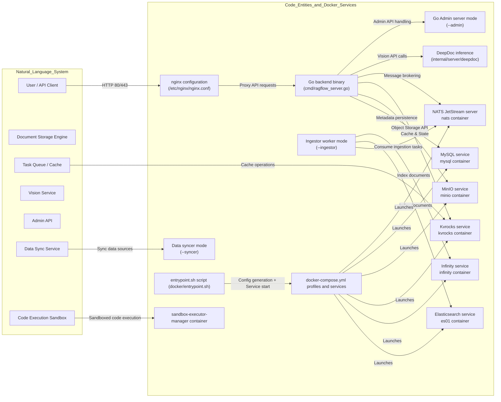

<!-- source: DeepWiki mcp.deepwiki.com · repo infiniflow/ragflow · page 2.1 Docker Compose Deployment · fetched 2026-10-29 -->

# Docker Compose Deployment

<details>
<summary>Relevant source files</summary>

The following files were used as context for generating this wiki page:

- [Dockerfile](Dockerfile)
- [docker/.env](docker/.env)
- [docker/README.md](docker/README.md)
- [docker/docker-compose-base.yml](docker/docker-compose-base.yml)
- [docker/docker-compose.yml](docker/docker-compose.yml)
- [docker/entrypoint.sh](docker/entrypoint.sh)
- [docker/infinity_conf.toml](docker/infinity_conf.toml)
- [docker/launch_backend_service.sh](docker/launch_backend_service.sh)
- [pyproject.toml](pyproject.toml)
- [sdk/python/pyproject.toml](sdk/python/pyproject.toml)
- [sdk/python/uv.lock](sdk/python/uv.lock)
- [uv.lock](uv.lock)

</details>


This page provides a detailed technical guide to deploying RAGFlow using Docker Compose. It covers the service architecture, container configurations, environment variables, port mappings, and the deployment process. This guide is intended for technical operators and developers who want to self-host RAGFlow services in a containerized environment [docker/README.md:1-57]().

---

## Overview

RAGFlow’s Docker Compose deployment orchestrates multiple containerized components forming a complex application stack. The deployment consists of:

- A **main compose file** `docker-compose.yml` that manages the RAGFlow CPU/GPU application containers [docker/docker-compose.yml:1-58]().
- A **base compose file** `docker-compose-base.yml` that manages dependency services like MySQL, Elasticsearch/Infinity, MinIO, Kvrocks, NATS, and ClickHouse, as well as alternative document engines [docker/docker-compose-base.yml:1-221]().
- Use of **Docker Compose profiles** to selectively enable services based on hardware (CPU/GPU) and chosen document storage engine [docker/.env:8-53]().

This orchestrated stack delivers the full RAGFlow engine functionality including API servers, background task executors, data stores, and optional components like the Admin Server and MCP Server [docker/README.md:17-48]().

Sources:  
[docker/docker-compose.yml:1-58](),  
[docker/docker-compose-base.yml:1-221](),  
[docker/.env:8-53](),  
[docker/README.md:1-57]()

---

## Service Architecture

The RAGFlow Docker Compose deployment is designed with a clear separation between client interaction, application logic, and persistence layers. This is articulated via multiple containers communicating over Docker networks and exposed ports [docker/docker-compose-base.yml:1-221]().

### System Component Interaction Diagram

```mermaid
graph TB
    subgraph "Natural_Language_Space_Client"
        User["User / API Client"]
    end

    subgraph "Code_Entity_Space_RAGFlow_Stack"
        Nginx["nginx (web proxy)\nConfigs: /etc/nginx/nginx.conf"]
        GoServer["Go Server\n(cmd/ragflow_server.go)"]
        AdminSvr["Admin Server\n(internal/server/admin)"]
        Ingestor["Ingestor Worker\n(internal/server/ingestor)"]
        Syncer["Data Syncer\n(internal/server/syncer)"]
        DeepDoc["DeepDoc Vision Service\n(internal/server/deepdoc)"]
        SandboxExecutorManager["sandbox-executor-manager\n(Code Execution Sandbox)"]
    end
    
    subgraph "Storage_Layer_Persistence"
        MySQL["mysql (MySQL 8.0)\nDatabase: rag_flow"]
        MinIO["minio (Object Storage)\nS3 Compatible"]
        Kvrocks["kvrocks (Redis-compatible)\nCache & State"]
        NATS["nats (NATS Server)\nMessage Queue (JetStream)"]
        ClickHouse["clickhouse (Analytics DB)"]
    end

    subgraph "Document_Engines_Mutually_Exclusive_Profiles"
        ES["es01 (Elasticsearch 8.11.3)"]
        Infinity["infinity (Infinity v0.7.4)"]
        OS["opensearch01 (OpenSearch 2.19.1)"]
        OB["oceanbase (OceanBase 4.4.1)"]
        SeekDB["seekdb (SeekDB latest)"]
        SereneDB["serenedb (SereneDB 26.07.5)"]
    end
    
    User -->|"Port: SVR_WEB_HTTP_PORT"| Nginx
    Nginx -->|"Proxy to Go API server"| GoServer
    GoServer -->|"Metadata queries"| MySQL
    GoServer -->|"Object storage queries"| MinIO
    GoServer -->|"Cache & state (Kvrocks)"| Kvrocks
    GoServer -->|"Message queue (NATS JetStream)"| NATS
    GoServer -->|"Vision API calls"| DeepDoc
    GoServer -->|"Code Execution"| SandboxExecutorManager
    Ingestor -->|"Consume tasks from NATS"| NATS
    Ingestor -->|"Index and Search"| ES
    Ingestor -->|"Index and Search"| Infinity
    GoServer -->|"Query Document Engine"| ES
    GoServer -->|"Query Document Engine"| Infinity
```



**Key Points:**

- The **nginx** container proxies web and API traffic directly to the Go backend (`bin/ragflow_server --api`) [docker/entrypoint.sh:169-175]().
- The **ragflow-cpu** container hosts the Go-native server binary running multiple modes: `--api`, `--admin`, `--ingestor`, and `--syncer` [docker/docker-compose.yml:6-32](), [docker/entrypoint.sh:164-188]().
- The **DeepDoc Vision Service** runs in-process within the main container, providing functionalities including document layout analysis (DLA), OCR, and table structure recognition using ONNX Runtime [Dockerfile:32-53]().
- The **sandbox-executor-manager** provides isolated sandbox environments to safely run arbitrary user code, supporting RAGFlow’s agent workflows [docker/docker-compose-base.yml:218-221]().
- Document engines (Elasticsearch, Infinity, OpenSearch, OceanBase, SeekDB, SereneDB) are mutually exclusive profiles controlled via Docker Compose profiles, selected based on the `DOC_ENGINE` environment variable [docker/.env:27-37]().

Sources:  
[docker/docker-compose.yml:1-58](),  
[docker/docker-compose-base.yml:1-221](),  
[docker/entrypoint.sh:164-190](),  
[docker/.env:27-37](),  
[Dockerfile:32-53]()

---

## Core Service Components

### Document Storage Engines (Profile-Based)

RAGFlow supports multiple document storage backends through Docker Compose profiles and environment-driven selection. These engines store and allow complex search over documents and their vectorized chunks [docker/.env:27-37]().

| Service Name    | Docker Image                              | Profile         | Default Exposed Port              | Description                                   |
|-----------------|-----------------------------------------|-----------------|---------------------------------|-----------------------------------------------|
| `es01`          | `elasticsearch:${STACK_VERSION}`        | `elasticsearch` | `${ES_PORT}:9200` (default 1200) | Elasticsearch full-text and vector search    |
| `infinity`      | `infiniflow/infinity:v0.7.4-x64-v3`     | `infinity`      | `${INFINITY_THRIFT_PORT}:23817`  | High-performance vector database             |
| `opensearch01`  | `opensearchproject/opensearch:2.19.1`   | `opensearch`    | `${OS_PORT}:9201`                | OpenSearch alternative with Elasticsearch API |
| `oceanbase`     | `oceanbase/oceanbase-ce:4.4.1.0-...`    | `oceanbase`     | `${OCEANBASE_PORT}:2881`         | Distributed database with vector capabilities|
| `seekdb`        | `oceanbase/seekdb:latest`                | `seekdb`        | `${SEEKDB_PORT}:2881`            | Lightweight OceanBase variant for RAGFlow    |
| `serenedb`      | `serenedb/serenedb:26.07.5`             | `serenedb`      | `${SERENEDB_PORT}:7890`          | PostgreSQL-compatible vector engine           |

Profiles are enabled by the environment variable `DOC_ENGINE` and included in the `COMPOSE_PROFILES` composite setting [docker/.env:27-53]().

Sources:  
[docker/docker-compose-base.yml:2-216](),  
[docker/.env:27-53]()

---

### Persistent Data Services

RAGFlow uses several persistent data services deployed either as containers or external services [docker/docker-compose-base.yml:1-221]().

| Service | Description | Image / Version | Default Ports | Notes |
|---------|-------------|-----------------|---------------|-------|
| **MySQL** | Metadata database storing users, tenants, datasets, sync states | `mysql:8.0` | Internal: 3306, External: configurable | Database name `rag_flow` configurable, controlled via `.env` [docker/.env:38-40]() |
| **MinIO** | Object storage for raw documents, blobs | `minio/minio` | API and Console ports (`MINIO_PORT`, `MINIO_CONSOLE_PORT`) | S3-compatible API, credentials from `.env` [docker/README.md:104-114]() |
| **Kvrocks** | Redis-compatible cache and task queue server | `kvrocks:latest` | default 6379 | Used by Go backend for caching and state management [docker/docker-compose.yml:44-50]() |
| **NATS** | Message broker (JetStream) for ingestion and async task delivery | `nats:latest` | default 4222 | Used for high throughput internal messaging via NATS JetStream |
| **ClickHouse** | Analytical column-store DB | `clickhouse/clickhouse-server` | 9000, 8123 | Stores analytics and monitoring data |

Sources:  
[docker/docker-compose-base.yml:1-221](),  
[docker/README.md:104-136]()

---

## Entrypoint Script Behavior (`entrypoint.sh`)

The `entrypoint.sh` script inside the main application container manages startup logic including configuration rendering, migrations, and process launches [docker/entrypoint.sh:1-190]().

### Key Functionalities

- **Argument parsing** enabling:
  - Disabling/enabling API server (`--disable-api-server`) [docker/entrypoint.sh:41-44]().
  - Disabling ingestor workers (`--disable-ingestor`) [docker/entrypoint.sh:45-48]().
  - Disabling data sync workers (`--disable-syncer`) [docker/entrypoint.sh:49-52]().
  - Enabling the Admin server (`--enable-adminserver`) [docker/entrypoint.sh:53-56]().
  - Running model provider table migrations (`--init-model-provider-tables`) [docker/entrypoint.sh:57-60]().
  - Initializing superuser (`--init-superuser`) [docker/entrypoint.sh:61-64]().
  - Setting number of ingestors (`--ingestors=<num>`) [docker/entrypoint.sh:65-68]().

- **Config generation:**
  - Reads `service_conf.yaml.template` [docker/entrypoint.sh:75-79]().
  - Applies environment variable substitutions with default fallbacks [docker/entrypoint.sh:83-97]().
  - Writes to `service_conf.yaml` at runtime [docker/entrypoint.sh:80]().

- **Running database migrations:**
  - Runs Go-based migrations (`bin/ragflow_server --migrate`) before any server starts, unless using GaussDB [docker/entrypoint.sh:107-118]().

- **Service startup & supervisor loop:**
  - Starts Go backend services (`--syncer`, `--admin`, `--api`, `--ingestor`) conditionally with restart loops (`run_with_restart`) [docker/entrypoint.sh:135-188]().

Sources:  
[docker/entrypoint.sh:1-190]()

---

## Ports and Network Mappings

RAGFlow Docker Compose exposes several ports which are configurable in `.env` and mapped to container services as follows [docker/.env:1-165]():

| Environment Variable       | Default | Description                                      | Container Service           |
|----------------------------|---------|------------------------------------------------|-----------------------------|
| `SVR_WEB_HTTP_PORT`         | 80      | Public HTTP web interface and API               | nginx (web proxy)            |
| `SVR_WEB_HTTPS_PORT`        | 443     | Public HTTPS web interface and API              | nginx                       |
| `SVR_HTTP_PORT`             | 9380    | Go API server port                              | ragflow-cpu (Go backend)    |
| `ADMIN_SVR_HTTP_PORT`       | 9381    | Admin server API port                           | ragflow-cpu (Go Admin)      |
| `MINIO_PORT`                | 9000    | MinIO S3 API port                               | minio                       |
| `MINIO_CONSOLE_PORT`        | 9001    | MinIO web console                               | minio                       |
| `ES_PORT`                   | 1200    | Elasticsearch HTTP API port                      | Elasticsearch               |
| `OS_PORT`                   | 1201    | OpenSearch HTTP API port                         | OpenSearch                  |
| `INFINITY_THRIFT_PORT`      | 23817   | Infinity vector DB thrift port                   | infinity                    |
| `INFINITY_HTTP_PORT`        | 23820   | Infinity HTTP API port                           | infinity                    |
| `OCEANBASE_PORT`            | 2881    | OceanBase SQL port                              | oceanbase                   |
| `SEEKDB_PORT`               | 2881    | SeekDB port                                     | seekdb                      |
| `SERENEDB_PORT`             | 7890    | SereneDB port                                   | serenedb                    |
| `KVROCKS_PORT`              | 6379    | Kvrocks Redis-compatible port                   | kvrocks                     |

All ports are environment-driven to allow flexible deployment scenarios and avoid port conflicts. Internally containers connect via Docker networks with hostnames, e.g., `mysql`, `kvrocks`, `nats`, `es01` etc [docker/docker-compose-base.yml:1-221]().

Sources:  
[docker/.env:1-165](),  
[docker/docker-compose-base.yml:1-221](),  
[docker/docker-compose.yml:1-58]()

---

## Docker Compose Profiles and Environment Control

RAGFlow uses Docker Compose **profiles** to modularize component startup based on [docker/.env:27-53]():

- Document engine (`elasticsearch`, `infinity`, `opensearch`, `oceanbase`, `seekdb`, `serenedb`)
- Hardware profile (`cpu`, `gpu`)
- Metadata database profile (`metadata-mysql`, `metadata-gaussdb`, etc.)

The `.env` file sets the combined profile list using `COMPOSE_PROFILES`, for example [docker/.env:53]():

```bash
COMPOSE_PROFILES=${DOC_ENGINE},${DEVICE},metadata-${METADATA_DB_PROFILE}
```

Changing `DOC_ENGINE` in `.env` activates the associated document engine profile, enabling the corresponding container and configuration [docker/.env:27-37]().

Sources:  
[docker/.env:27-53](),  
[docker/docker-compose-base.yml:1-221]()

---

## Volumes and Data Persistence

The deployment defines a set of persistent volumes and bind mounts to preserve data and configuration over container restarts and upgrades [docker/docker-compose.yml:33-40]().

| Volume / Bind Mount             | Purpose                      | Container Path                          |
|-------------------------------|------------------------------|---------------------------------------|
| `./ragflow-logs`               | Application log files         | `/ragflow/logs`                       |
| `./service_conf.yaml.template` | Config template               | `/ragflow/conf/service_conf.yaml.template` |
| `./entrypoint.sh`              | Container startup script      | `/ragflow/entrypoint.sh`              |
| `esdata01`                    | Elasticsearch data volume     | `/usr/share/elasticsearch/data`      |
| `infinity_data`               | Infinity vector DB storage    | `/var/infinity`                       |
| `serenedb_data`               | SereneDB data volume          | `/var/lib/serenedb`                   |

Sources:  
[docker/docker-compose.yml:33-40](),  
[docker/docker-compose-base.yml:1-221]()

---

## Summary: Natural Language to Code Entity Mapping

The following diagram associates high-level system components mentioned in natural language with their corresponding key Go code entities, scripts, or Docker components.



Sources:  
[docker/docker-compose.yml:1-58](),  
[docker/entrypoint.sh:1-190](),  
[docker/docker-compose-base.yml:1-221](),  
[Dockerfile:32-53](),  
[cmd/ragflow_server.go:1-192]()

---

