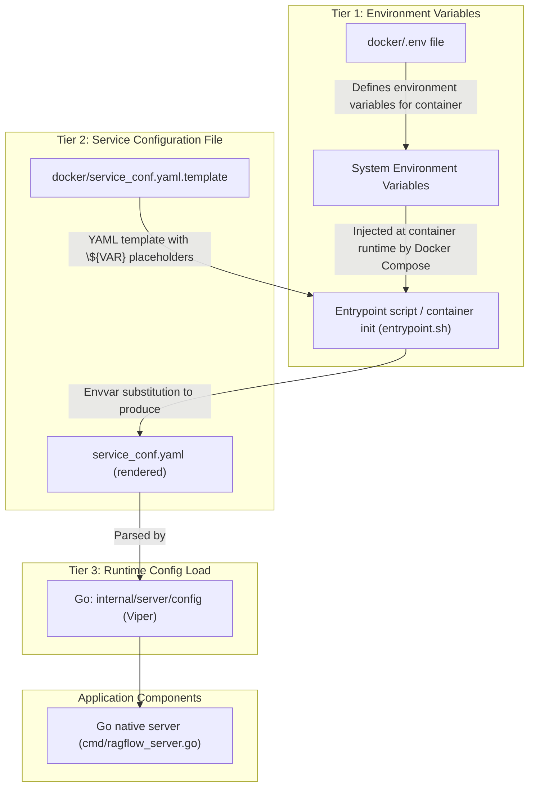
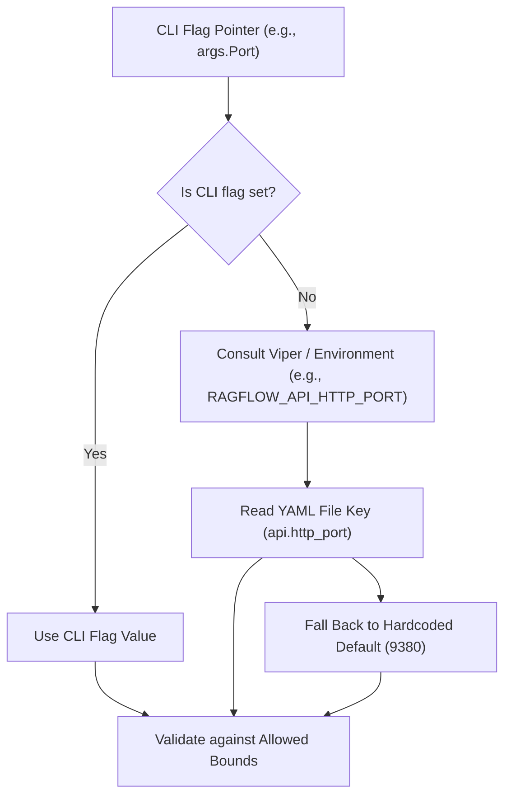
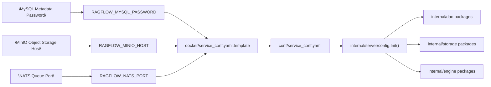
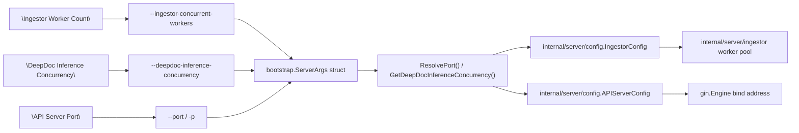

<!-- source: DeepWiki mcp.deepwiki.com · repo infiniflow/ragflow · page 2.2 Configuration Management · fetched 2026-10-29 -->

# Configuration Management

Relevant source files

The following files were used as context for generating this wiki page:

- [cmd/args_flag_test.go](cmd/args_flag_test.go)
- [cmd/deepdoc_server_ee.go](cmd/deepdoc_server_ee.go)
- [cmd/ragflow_server.go](cmd/ragflow_server.go)
- [cmd/ragflow_server_deepdoc_test.go](cmd/ragflow_server_deepdoc_test.go)
- [cmd/ragflow_server_test.go](cmd/ragflow_server_test.go)
- [conf/service_conf.yaml](conf/service_conf.yaml)
- [docker/service_conf.yaml.template](docker/service_conf.yaml.template)
- [docs/administrator/setup/configuration.md](docs/administrator/setup/configuration.md)
- [docs/develop/mcp/connect_an_external_mcp_to_ragflow.md](docs/develop/mcp/connect_an_external_mcp_to_ragflow.md)
- [internal/common/allow_private_host.go](internal/common/allow_private_host.go)
- [internal/common/environments.go](internal/common/environments.go)
- [internal/common/http.go](internal/common/http.go)
- [internal/common/http_test.go](internal/common/http_test.go)
- [internal/dao/tenant_model_group_ee.go](internal/dao/tenant_model_group_ee.go)
- [internal/handler/auth.go](internal/handler/auth.go)
- [internal/handler/providers_ee.go](internal/handler/providers_ee.go)
- [internal/handler/system.go](internal/handler/system.go)
- [internal/handler/user.go](internal/handler/user.go)
- [internal/ingestion/component/vision_source_admission_test.go](internal/ingestion/component/vision_source_admission_test.go)
- [internal/ingestion/service/execute_memory_task_panic_test.go](internal/ingestion/service/execute_memory_task_panic_test.go)
- [internal/mcp/client/mcp_call.go](internal/mcp/client/mcp_call.go)
- [internal/mcp/client/mcp_client.go](internal/mcp/client/mcp_client.go)
- [internal/mcp/client/mcp_ssrf.go](internal/mcp/client/mcp_ssrf.go)
- [internal/server/api/server.go](internal/server/api/server.go)
- [internal/server/bootstrap/args.go](internal/server/bootstrap/args.go)
- [internal/server/bootstrap/runtime.go](internal/server/bootstrap/runtime.go)
- [internal/server/config.go](internal/server/config.go)
- [internal/server/config/admin_config.go](internal/server/config/admin_config.go)
- [internal/server/config/api_server_config.go](internal/server/config/api_server_config.go)
- [internal/server/config/api_server_config_test.go](internal/server/config/api_server_config_test.go)
- [internal/server/config/base.go](internal/server/config/base.go)
- [internal/server/config/environments.go](internal/server/config/environments.go)
- [internal/server/config/general_config.go](internal/server/config/general_config.go)
- [internal/server/config/ingestor_config.go](internal/server/config/ingestor_config.go)
- [internal/server/config/ingestor_config_test.go](internal/server/config/ingestor_config_test.go)
- [internal/server/config/log_config.go](internal/server/config/log_config.go)
- [internal/server/config/mcp_config_test.go](internal/server/config/mcp_config_test.go)
- [internal/server/config/storage_engine_config.go](internal/server/config/storage_engine_config.go)
- [internal/server/config/storage_environment_test.go](internal/server/config/storage_environment_test.go)
- [internal/server/config_getallconfigs_test.go](internal/server/config_getallconfigs_test.go)
- [internal/server/deepdoc/server.go](internal/server/deepdoc/server.go)
- [internal/server/ingestor/server.go](internal/server/ingestor/server.go)
- [internal/server/local/admin_status.go](internal/server/local/admin_status.go)
- [internal/server/local/admin_status_ee.go](internal/server/local/admin_status_ee.go)
- [internal/server/syncer/server.go](internal/server/syncer/server.go)
- [internal/service/system.go](internal/service/system.go)
- [internal/service/user.go](internal/service/user.go)

## Purpose and Scope

This page details RAGFlow's configuration system, describing how environment variables, templated YAML service configurations (`service_conf.yaml.template`), and runtime command-line flags interact. It covers Viper-based parsing in `internal/server/config`, environment variable resolution, and strict precedence rules governing CLI flags, environment variables, and configuration files.

Sources: [docker/service_conf.yaml.template:1-184](), [internal/server/config.go:39-160](), [cmd/ragflow_server.go:102-188]()

---

## Configuration Architecture and Processing Flow

RAGFlow employs a tiered configuration model designed to separate build-time templates, deployment secrets, and runtime overrides. 

- **Tier 1:** Environment variables are defined in container environments or configuration files like `docker/.env`.
- **Tier 2:** The template `docker/service_conf.yaml.template` contains environment variable placeholders (e.g., `${MYSQL_DBNAME:-rag_flow}`) which are substituted to generate `service_conf.yaml`.
- **Tier 3:** The Go server initializes configuration using the `viper` library via initialization routines in `internal/server/config.go`, reading the YAML file and overlaying environment overrides prefixed with `RAGFLOW` [internal/server/config.go:39-68]().

Sources: [conf/service_conf.yaml:1-201](), [docker/service_conf.yaml.template:1-184](), [internal/server/config.go:39-68](), [cmd/ragflow_server.go:19-49]()

---

## Service Configuration File Schema

The concrete runtime configuration file (`conf/service_conf.yaml`) structures parameters into functional subsections parsed by specific loader functions in `internal/server/config` [conf/service_conf.yaml:1-201](), [internal/server/config.go:73-160]().

### Main Configuration Subsections

| Section Key     | Corresponding Go Parser Function        | Description                                       |
|-----------------|-----------------------------------------|---------------------------------------------------|
| `general`       | `ParseGeneralConfig`                    | Global settings like `heartbeat_interval`         |
| `api`           | `ParseAPIServerConfig`                  | API server network bindings and trusted proxies   |
| `admin`         | `ParseAdminConfig`                      | Admin server HTTP host and port bindings          |
| `mysql`         | `ParseDatabaseConfig`                   | Relational metadata database connection settings  |
| `minio`         | `ParseStorageEngineConfig`              | Object storage configuration and credentials      |
| `es` / `os`     | `ParseDocEngineConfig`                  | Document search engine endpoints and authentication|
| `kvrocks`       | `ParseCacheEngineConfig`                | Redis/Kvrocks caching cluster parameters          |
| `nats`          | `ParseQueueEngineConfig`                | NATS message queue broker coordinates             |
| `clickhouse`    | `ParseAnalyticEngineConfig`             | ClickHouse analytics storage configuration        |
| `ingestor`      | `ParseIngestorConfig`                   | Worker count, page parallelism, ONNX concurrency  |

Sources: [conf/service_conf.yaml:1-201](), [internal/server/config.go:73-160]()

---

## Viper Parsing and Runtime Resolution

The configuration parsing engine is implemented in `internal/server/config.go` and its sub-packages. When configuration initialization executes:

1. A new `viper.Viper` instance is instantiated [internal/server/config.go:39-50]().
2. The config file path is resolved explicitly via `configPath` or falls back to searching default search paths for `service_conf.yaml` [internal/server/config.go:45-54]().
3. Environment variables are automatically enabled with the `RAGFLOW` prefix and dot-to-underscore key replacement [internal/server/config.go:56-59]().
4. Subsections are parsed into strongly-typed structures using dedicated handlers.

### Concurrency and Port Resolution

Specialized getters handle hierarchical validation and bounds checking, merging config-file values with explicit command-line pointers (`*int` or `*string`) [cmd/ragflow_server.go:102-188]().

Sources: [internal/server/config.go:39-160](), [cmd/ragflow_server.go:102-188]()

---

## Configuration Precedence

RAGFlow enforces a strict 4-tier precedence hierarchy across configuration inputs, ensuring that operator overrides at runtime take immediate effect without modifying files:

| Precedence Order | Source Tier | Description & Code Handler |
|------------------|-------------|----------------------------|
| **1 (Highest)**  | **CLI Flags** | Parsed in `cmd/ragflow_server.go` via `parseArgsFrom` (e.g., `--port`, `--log-level`, `--deepdoc-inference-concurrency`) [cmd/ragflow_server.go:102-188]() |
| **2**            | **Environment Variables** | Automatically parsed via Viper `AutomaticEnv` with `RAGFLOW_` prefix or checked via `os.Getenv` [internal/server/config.go:56-59]() |
| **3**            | **Configuration File** | Rendered YAML values from `service_conf.yaml` parsed via sub-config functions [internal/server/config.go:73-160]() |
| **4 (Lowest)**   | **Hardcoded Defaults** | Built-in defaults defined in config initializers |

Sources: [cmd/ragflow_server.go:102-188](), [internal/server/config.go:39-160]()

---

## Natural Language Space to Code Entity Mapping

The following diagrams bridge natural language configuration concepts to their concrete representations in the codebase.

### Diagram 1: Infrastructure and Storage Bindings

Sources: [docker/service_conf.yaml.template:30-112](), [internal/server/config.go:39-108]()

### Diagram 2: Runtime Execution and Concurrency Parameters

Sources: [cmd/ragflow_server.go:102-188](), [internal/server/config.go:73-160]()

---

