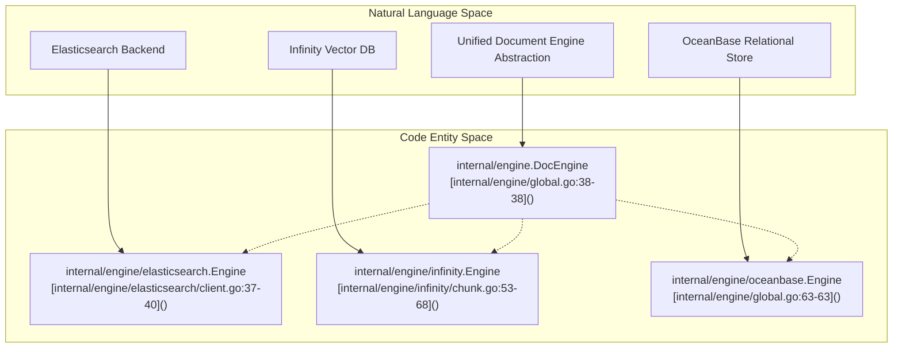
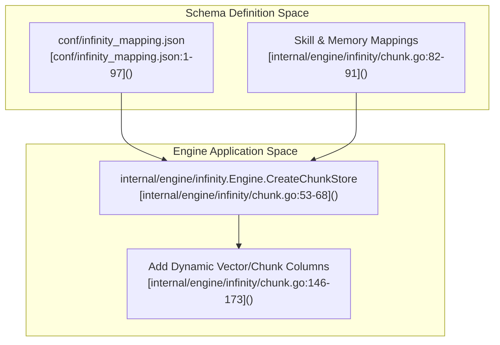
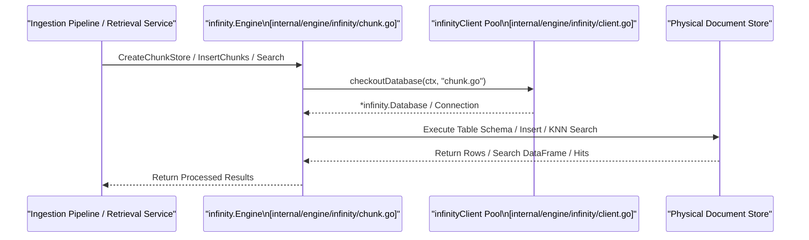

<!-- source: DeepWiki mcp.deepwiki.com · repo infiniflow/ragflow · page 2.3 Document Engine Selection · fetched 2026-10-29 -->

# Document Engine Selection

Relevant source files

The following files were used as context for generating this wiki page:

- [conf/infinity_mapping.json](conf/infinity_mapping.json)
- [internal/cli/table.go](internal/cli/table.go)
- [internal/engine/elasticsearch/client.go](internal/engine/elasticsearch/client.go)
- [internal/engine/elasticsearch/metadata.go](internal/engine/elasticsearch/metadata.go)
- [internal/engine/global.go](internal/engine/global.go)
- [internal/engine/infinity/chunk.go](internal/engine/infinity/chunk.go)
- [internal/engine/infinity/chunk_transform_test.go](internal/engine/infinity/chunk_transform_test.go)
- [internal/engine/infinity/client.go](internal/engine/infinity/client.go)
- [internal/engine/infinity/client_test.go](internal/engine/infinity/client_test.go)
- [internal/engine/infinity/common.go](internal/engine/infinity/common.go)
- [internal/engine/infinity/document.go](internal/engine/infinity/document.go)
- [internal/engine/infinity/integration_test.go](internal/engine/infinity/integration_test.go)
- [internal/engine/infinity/metadata.go](internal/engine/infinity/metadata.go)
- [internal/engine/infinity/sql.go](internal/engine/infinity/sql.go)
- [internal/engine/infinity/sql_test.go](internal/engine/infinity/sql_test.go)
- [internal/ingestion/knowledge_compile/wiki_contribution.go](internal/ingestion/knowledge_compile/wiki_contribution.go)
- [internal/ingestion/knowledge_compile/wiki_map_store.go](internal/ingestion/knowledge_compile/wiki_map_store.go)
- [internal/ingestion/knowledge_compile/wiki_map_store_test.go](internal/ingestion/knowledge_compile/wiki_map_store_test.go)
- [internal/ingestion/service/ingestor_lifecycle_test.go](internal/ingestion/service/ingestor_lifecycle_test.go)
- [internal/service/document/document_metadata.go](internal/service/document/document_metadata.go)
- [internal/service/document/document_metadata_test.go](internal/service/document/document_metadata_test.go)
- [internal/utility/path.go](internal/utility/path.go)

This page provides a technical guide for choosing, configuring, and understanding the document engines supported by RAGFlow's Go-native backend. Document engines form the backbone of RAGFlow's retrieval subsystem, providing hybrid search (full-text lexicals combined with vector similarity) and robust metadata filtering.

## Overview and Engine Abstraction

RAGFlow abstracts document storage behind the `DocEngine` interface defined across engine packages [internal/engine/global.go:37-80](), allowing the system to plug in different search backends. The choice of document engine affects search latency, index mapping structures, bulk ingestion throughput, and operational complexity. Selection is controlled via configuration settings and environment variables parsed in `internal/server/config` [internal/engine/global.go:49-50]().

The following diagram bridges the natural language concepts of document engines to their concrete Go code entities and package implementations:

Sources: [internal/engine/global.go:37-80](), [internal/engine/elasticsearch/client.go:37-40](), [internal/engine/infinity/chunk.go:53-68]()

---

## Supported Document Engines and Tradeoffs

| Engine | Key Use Cases | Main Implementation / Package |
| :--- | :--- | :--- |
| **Elasticsearch** | Mature, robust full-text and vector search, extensive ecosystem | `internal/engine/elasticsearch.Engine` [internal/engine/elasticsearch/client.go:37-40]() |
| **Infinity** | High-performance vector search, low-latency table scans | `internal/engine/infinity.Engine` [internal/engine/infinity/chunk.go:53-68]() |
| **OpenSearch** | AWS-compatible fork of Elasticsearch with hybrid pipelines | `internal/engine/opensearch` |
| **OceanBase** | Distributed SQL relational store with native vector extensions | `internal/engine/oceanbase` [internal/engine/global.go:58-64]() |
| **SereneDB** | Planned high-performance analytical storage variant | `internal/engine/serenedb` [internal/engine/global.go:65-66]() |

Sources: [internal/engine/global.go:37-80](), [internal/engine/elasticsearch/client.go:37-40](), [internal/engine/infinity/chunk.go:53-68]()

### 1. Elasticsearch
Elasticsearch manages indexes and templates via `internal/engine/elasticsearch/client.go`. It handles bulk chunk writes, schema mapping, and index template creation [internal/engine/elasticsearch/client.go:83-91]().
- **Index Templates:** Automatically applies `ragflow_mapping` for chunk indices (`ragflow_*`) and `ragflow_doc_meta_mapping` for metadata indices (`ragflow_doc_meta_*`) [internal/engine/elasticsearch/client.go:83-91]().
- **Hybrid & KNN Search:** Combines lexical query string match expressions with dense vector KNN clauses (`knn`), accepting runtime configurations [internal/engine/elasticsearch/client.go:37-94]().

Sources: [internal/engine/elasticsearch/client.go:37-94](), [internal/engine/elasticsearch/metadata.go:39-87]()

### 2. Infinity
Infinity manages columnar table data and vector indexes via `internal/engine/infinity/chunk.go` and connection pools managed in `internal/engine/infinity/client.go`.
- **Schema Management:** Automatically reconciles missing columns, such as dynamically adding vector dimensions (`q_<dim>_vec`) or table-parser payload columns (`chunk_data`) when embedding models change [internal/engine/infinity/chunk.go:133-173]().
- **Connection Pooling:** Uses `infinity.ConnectionPool` bounded by max open (`resolvePoolMaxSize`) and idle parameters (`resolvePoolMaxIdle`) [internal/engine/infinity/client.go:85-117]().

Sources: [internal/engine/infinity/chunk.go:53-192](), [internal/engine/infinity/client.go:85-209]()

---

## Index Mappings and Schema Definitions

Document engines rely on precise field mappings to index unstructured chunks alongside structured metadata. Infinity schemas are defined in JSON mapping files such as `conf/infinity_mapping.json` [conf/infinity_mapping.json:1-97]().

Sources: [conf/infinity_mapping.json:1-97](), [internal/engine/infinity/chunk.go:53-192]()

Key mapped fields include:
- `id`, `doc_id`, `kb_id`: Identifiers for chunks, documents, and knowledge bases [conf/infinity_mapping.json:2-4]().
- `content`: Analyzed text field with multiple analyzers like `rag-coarse`, `rag-fine`, and `sparsegram-3-12-fold` [conf/infinity_mapping.json:17]().
- `q_<dim>_vec`: Dynamic dense float vector columns representing embedding outputs [internal/engine/infinity/chunk.go:124-124]().
- `tag_feas`: Rank features used for numeric scoring boosts [conf/infinity_mapping.json:32]().

Sources: [conf/infinity_mapping.json:1-97](), [internal/engine/infinity/chunk.go:124-124]()

---

## Physical Storage and Metadata Tables

Beyond indexing chunks in document engines, RAGFlow stores document metadata and binary files. Metadata stores are created per tenant using `CreateMetadataStore` in Infinity and Elasticsearch [internal/engine/infinity/metadata.go:39-47](), [internal/engine/elasticsearch/metadata.go:39-40]().
- Infinity tenant metadata tables use secondary indexes on `id`, `kb_id`, and `meta_fields` [internal/engine/infinity/metadata.go:101-133]().
- Elasticsearch uses dedicated document metadata indices (`ragflow_doc_meta_*`) [internal/engine/elasticsearch/client.go:88-91]().

Sources: [internal/engine/infinity/metadata.go:39-135](), [internal/engine/elasticsearch/metadata.go:39-87]()

---

## Search and Ingestion Execution Data Flow

The following sequence diagram details the interaction during chunk writing and retrieval between services and the underlying document engine implementation:

Sources: [internal/engine/infinity/chunk.go:53-68](), [internal/engine/infinity/client.go:41-63]()

---

## Summary

Choosing the correct document engine balances vector performance, full-text lexical search requirements, and operational infrastructure maturity:
- **Elasticsearch:** Recommended for general-purpose setups requiring proven stability and rich template management [internal/engine/elasticsearch/client.go:37-94]().
- **Infinity:** Ideal for high-throughput vector embedding workloads with strict latency bounds and columnar scaling [internal/engine/infinity/chunk.go:53-192]().
- **OceanBase / OpenSearch:** Suited for specialized distributed SQL or cloud-native AWS deployments [internal/engine/global.go:58-64]().

Sources: [internal/engine/global.go:37-80](), [internal/engine/elasticsearch/client.go:37-94](), [internal/engine/infinity/chunk.go:53-192]()

---

