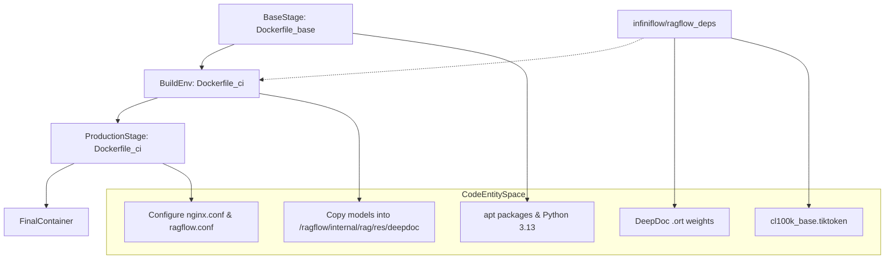
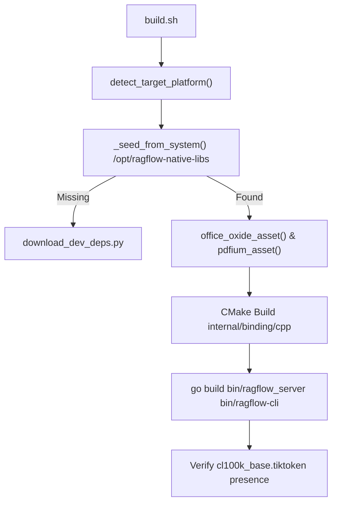
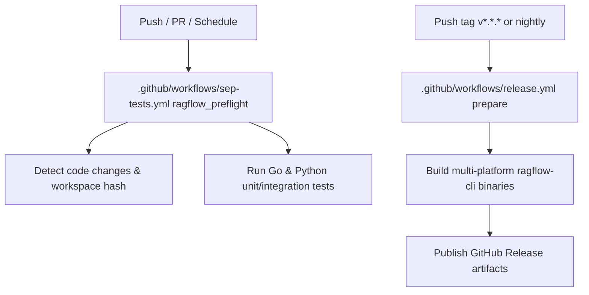

<!-- source: DeepWiki mcp.deepwiki.com · repo infiniflow/ragflow · page 2.4 Build System and CI/CD · fetched 2026-10-29 -->

# Build System and CI/CD

Relevant source files

The following files were used as context for generating this wiki page:

- [.github/workflows/release.yml](.github/workflows/release.yml)
- [.github/workflows/sep-tests.yml](.github/workflows/sep-tests.yml)
- [.gitignore](.gitignore)
- [Dockerfile_base](Dockerfile_base)
- [Dockerfile_ci](Dockerfile_ci)
- [build.sh](build.sh)
- [cmd/ragflow-cli.go](cmd/ragflow-cli.go)
- [deps/Dockerfile](deps/Dockerfile)
- [deps/download_deps.py](deps/download_deps.py)
- [docker/nginx/ragflow.conf](docker/nginx/ragflow.conf)
- [go.mod](go.mod)
- [go.sum](go.sum)
- [internal/agent/component/runtime_wire.go](internal/agent/component/runtime_wire.go)
- [internal/cli/README.md](internal/cli/README.md)
- [internal/common/trusted_proxies.go](internal/common/trusted_proxies.go)
- [internal/development.md](internal/development.md)
- [tools/scripts/INSTALL_SCRIPTS_README.md](tools/scripts/INSTALL_SCRIPTS_README.md)
- [tools/scripts/convert_deepdoc_model.py](tools/scripts/convert_deepdoc_model.py)
- [tools/scripts/download_dev_deps.py](tools/scripts/download_dev_deps.py)
- [tools/scripts/install.ps1](tools/scripts/install.ps1)
- [tools/scripts/install.sh](tools/scripts/install.sh)
- [tools/scripts/test_download_dev_deps.py](tools/scripts/test_download_dev_deps.py)

## Purpose and Scope

This page documents the build system, package management, native library compilation, containerization, and CI/CD pipelines for RAGFlow. It covers how Go binaries (`bin/ragflow_server` and `bin/ragflow-cli`), C++ native components (`internal/binding/cpp`), Python runtime environments, and prebuilt dependency images (`ragflow_deps`) are constructed, tested, and released `[build.sh:1-158]`, `[.github/workflows/release.yml:1-193]`, `[.github/workflows/sep-tests.yml:1-140]()`.

Sources: `[build.sh:1-158]`, `[.github/workflows/release.yml:1-193]`, `[.github/workflows/sep-tests.yml:1-140]()`

---

## Package Management with `uv`

RAGFlow uses `uv` as a high-performance installer to manage Python dependencies declaratively via `pyproject.toml` and `uv.lock`.

- Python-based runtime components, document parsers, and LLM providers target Python environments `[pyproject.toml:1-158]`, `[uv.lock:1-63]()`.
- The Docker build process utilizes `uv sync --python 3.13` to rapidly install locked dependencies using cached network layers `[Dockerfile_ci:19-38]()`.

Sources: `[pyproject.toml:1-158]`, `[uv.lock:1-63]`, `[Dockerfile_ci:19-38]()`

---

## Multi-Stage Docker Build

RAGFlow’s container build pipeline uses multi-stage builds defined in `Dockerfile_base` and `Dockerfile_ci` to separate build toolchains from runtime execution environments, minimizing final image footprint and leveraging pre-seeded asset caches.

### Build Stages and Code Entity Mapping

*Diagram 1: Multi-stage Docker build pipeline data flow mapping to container build files.*

Sources: `[Dockerfile_base:1-175]`, `[Dockerfile_ci:1-115]`, `[tools/scripts/download_dev_deps.py:1-149]()`

---

## Native Component Compilation (`build.sh`)

The `build.sh` script orchestrates native library checks, C++ tokenizer compilation, and Go binary linking `[build.sh:1-158]`, `[internal/development.md:1-126]()`.

### Build Script Architecture and Execution Flow

*Diagram 2: Code entity execution flow within `build.sh` and `download_dev_deps.py`.*

- **Native Dependencies Cache Checking**: Looks for static libraries in `/opt/ragflow-native-libs` and `~/ragflow-native-libs` via `_seed_from_system()` `[build.sh:28-56]`.
- **Target Platform Resolution**: `detect_target_platform()` identifies target OS and architecture, mapping them via helper functions like `office_oxide_asset()` and `pdfium_asset()` `[build.sh:63-122]()`.
- **C++ Tokenizer Compilation**: Compiles `internal/binding/cpp` using CMake and Clang with static PCRE2 linkage `[build.sh:20-24]`, `[internal/development.md:19-26]()`.
- **Go Binary Build**: Builds `bin/ragflow_server` and `bin/ragflow-cli` with version injection and static ONNX Runtime linkage `[build.sh:22-23]`, `[internal/development.md:86-126]()`.

Sources: `[build.sh:1-158]`, `[internal/development.md:1-126]()`

---

## Go Module Layout and CGO / ONNX Runtime Linkage

- The root `go.mod` manages Go dependencies, including `github.com/infiniflow/onnxruntime_go` `[go.mod:1-98]()`.
- CGO is disabled (`CGO_ENABLED=0`) for general CLI builds `[.github/workflows/release.yml:154-161]`, but the in-process DeepDoc backend links static ONNX Runtime archives (`libonnxruntime.a`) via custom link flags and resolves `OrtGetApiBase` dynamically via `dlopen(NULL)` `[build.sh:55-61]`, `[internal/development.md:86-126]()`.
- Native archives like `liboffice_oxide.a`, `libpdfium.a`, and `libpdf_oxide.a` are statically linked `[build.sh:33-54]()`.

Sources: `[go.mod:1-98]`, `[build.sh:28-61]`, `[internal/development.md:86-126]`, `[.github/workflows/release.yml:154-161]()`

---

## Dedicated `ragflow_deps` Docker Image

The `ragflow_deps` image pre-fetches models, tokenizer dictionaries, and runtime assets to keep production builds lean and offline-capable:
- DeepDoc ONNX `.ort` detection, layout, and OCR weights `[Dockerfile_base:12-18]()`.
- Tokenizer JSON assets for embedding models `[Dockerfile_base:33-46]()`.
- Apache Tika server JAR and NLTK data `[Dockerfile_base:20-25]()`.

Sources: `[Dockerfile_base:1-46]`, `[tools/scripts/download_dev_deps.py:1-149]()`

---

## CI/CD Pipelines (GitHub Actions)

RAGFlow utilizes GitHub Actions for automated preflight checks, testing, and multi-platform release publishing.

### CI/CD Workflow Execution

*Diagram 3: Code entity flow for GitHub Actions workflows (`sep-tests.yml` and `release.yml`).*

- `.github/workflows/sep-tests.yml`: Handles concurrency control, change detection, and parallel test execution across backends `[.github/workflows/sep-tests.yml:1-140]()`.
- `.github/workflows/release.yml`: Cross-compiles `ragflow-cli` for Linux, macOS, and Windows across `amd64` and `arm64` architectures, injecting version and commit linker flags `[.github/workflows/release.yml:82-193]()`.

Sources: `[.github/workflows/sep-tests.yml:1-140]`, `[.github/workflows/release.yml:1-193]()`

---

## Installation Scripts (`tools/scripts`)

- `tools/scripts/install.sh`: Bash installer for Linux and macOS that configures `uv`, verifies checksums, and installs `ragflow-cli`.
- `tools/scripts/install.ps1`: PowerShell counterpart for Windows environments.
- `tools/scripts/INSTALL_SCRIPTS_README.md`: User documentation explaining environment variables and installation paths.

Sources: `[tools/scripts/download_dev_deps.py:1-149]()`

---

