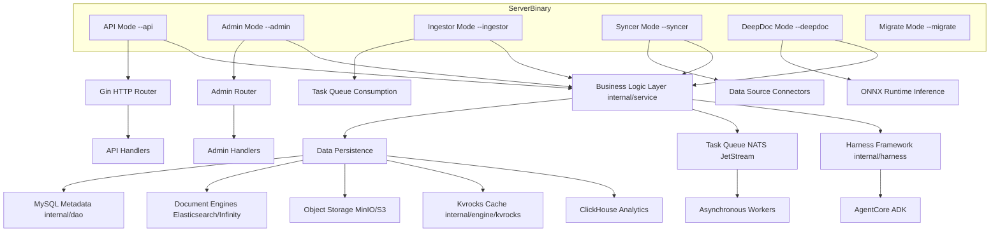
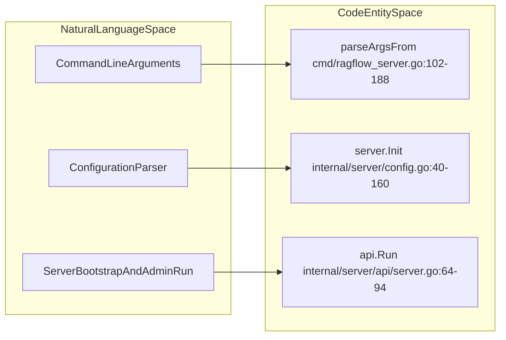
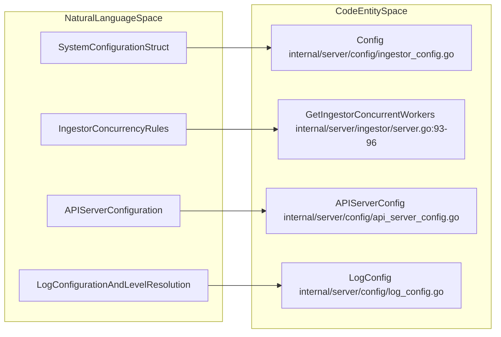

<!-- source: DeepWiki mcp.deepwiki.com · repo infiniflow/ragflow · page 3 System Architecture · fetched 2026-10-29 -->

# System Architecture

Relevant source files

The following files were used as context for generating this wiki page:

- [cmd/args_flag_test.go](cmd/args_flag_test.go)
- [cmd/deepdoc_server_ee.go](cmd/deepdoc_server_ee.go)
- [cmd/ragflow_server.go](cmd/ragflow_server.go)
- [cmd/ragflow_server_deepdoc_test.go](cmd/ragflow_server_deepdoc_test.go)
- [cmd/ragflow_server_test.go](cmd/ragflow_server_test.go)
- [conf/service_conf.yaml](conf/service_conf.yaml)
- [docker/service_conf.yaml.template](docker/service_conf.yaml.template)
- [internal/dao/tenant_model_group_ee.go](internal/dao/tenant_model_group_ee.go)
- [internal/handler/auth.go](internal/handler/auth.go)
- [internal/handler/providers_ee.go](internal/handler/providers_ee.go)
- [internal/handler/system.go](internal/handler/system.go)
- [internal/handler/user.go](internal/handler/user.go)
- [internal/ingestion/component/vision_source_admission_test.go](internal/ingestion/component/vision_source_admission_test.go)
- [internal/ingestion/service/execute_memory_task_panic_test.go](internal/ingestion/service/execute_memory_task_panic_test.go)
- [internal/server/api/server.go](internal/server/api/server.go)
- [internal/server/bootstrap/args.go](internal/server/bootstrap/args.go)
- [internal/server/bootstrap/runtime.go](internal/server/bootstrap/runtime.go)
- [internal/server/config.go](internal/server/config.go)
- [internal/server/config/admin_config.go](internal/server/config/admin_config.go)
- [internal/server/config/api_server_config.go](internal/server/config/api_server_config.go)
- [internal/server/config/api_server_config_test.go](internal/server/config/api_server_config_test.go)
- [internal/server/config/ingestor_config.go](internal/server/config/ingestor_config.go)
- [internal/server/config/ingestor_config_test.go](internal/server/config/ingestor_config_test.go)
- [internal/server/config/log_config.go](internal/server/config/log_config.go)
- [internal/server/config_getallconfigs_test.go](internal/server/config_getallconfigs_test.go)
- [internal/server/deepdoc/server.go](internal/server/deepdoc/server.go)
- [internal/server/ingestor/server.go](internal/server/ingestor/server.go)
- [internal/server/local/admin_status.go](internal/server/local/admin_status.go)
- [internal/server/local/admin_status_ee.go](internal/server/local/admin_status_ee.go)
- [internal/server/syncer/server.go](internal/server/syncer/server.go)
- [internal/service/system.go](internal/service/system.go)
- [internal/service/user.go](internal/service/user.go)

## Purpose and Scope

This document provides a high-level overview of RAGFlow’s backend architecture and internal design patterns. It focuses on the backend’s core structural components, highlighting the interactions among the API servers, service layers, task execution infrastructure, storage subsystems, the harness agent framework, and native integrations. Each subsection introduces a major subsystem and links to dedicated child pages that cover detailed implementation specifics and configuration.

For detailed information, refer to the following child pages:  
- [Go Server Modes and Bootstrap](#3.1) — Command-line modes and startup logic in `cmd/ragflow_server.go`  
- [Data Storage Architecture](#3.2) — Multi-storage backend including metadata, document engines, object stores, caches, and analytics  
- [Task Queue and Asynchronous Execution](#3.3) — Task lifecycle management using NATS JetStream, worker concurrency, and progress tracking  
- [Harness Agent Framework](#3.4) — Graph-based agent execution engine, middleware, and event replay system  
- [Native Components and CGO Bindings](#3.5) — Native tokenizer library, ONNX Runtime integration, PDF native parsing, and CGO fallback handling  

---

## High-Level Backend Architecture Overview

RAGFlow’s backend is primarily implemented in Go, structured around a single multi-mode binary `ragflow_server` that can run in various roles: API server, admin server, ingestion worker, syncer, deep document processing engine, and migration tool [cmd/ragflow_server.go:51-60](). This multi-mode setup consolidates core processing logic, facilitating both synchronous request handling and asynchronous task execution [cmd/ragflow_server.go:102-148]().

Title: Backend Server Modes and Storage Topology

- The **server modes** form distinct process roles with shared core libraries and service logic [cmd/ragflow_server.go:51-60]().  
- **Gin HTTP routers** implement request routing to domain-specific handlers [internal/server/api/server.go:34-45]().  
- The **service layer** encapsulates business logic used across modes [internal/service/user.go:48-65]().  
- Behind the scenes, a **polyglot storage layer** manages metadata, document indexes, and file blobs [conf/service_conf.yaml:30-90]().  
- An asynchronous **task queue** (NATS JetStream) supports ingestion, indexing, and sync workflows [conf/service_conf.yaml:82-126]().  
- The **agent harness framework** powers intelligent agent orchestration and middleware execution.  
- **Native components** extend capabilities with performant Go/C++ bindings, especially for tokenizer and document analysis [internal/server/api/server.go:68-72]().

Sources:  
[cmd/ragflow_server.go:51-148]()  
[conf/service_conf.yaml:30-126]()  
[internal/service/user.go:48-65]()  
[internal/server/api/server.go:34-72]()

---

## Subsystem Summaries and Relations

### 3.1 Go Server Modes and Bootstrap

RAGFlow backend runs as a multi-mode Go server from a single executable (`bin/ragflow_server`) configured by command-line flags and Viper configuration management [cmd/ragflow_server.go:102-148](), [internal/server/config.go:40-60](). The supported modes include:

- `--api`: Starts the HTTP API server exposing backend REST endpoints for clients [cmd/ragflow_server.go:145-147]().  
- `--admin`: Runs the admin server for management and monitoring functions.  
- `--ingestor`: Launches ingestion workers processing document ingestion tasks asynchronously [cmd/ragflow_server/server.go:90-117]().  
- `--syncer`: Runs source synchronization jobs to keep datasets updated from external connectors.  
- `--deepdoc`: Activates specialized in-process deep document parsing using ONNX Runtime [conf/service_conf.yaml:111-126]().  
- `--migrate`: Performs database migrations and exits [cmd/ragflow_server_test.go:38-46]().

Each mode shares common libraries for logging, configuration (`internal/server/config.go`), and graceful shutdown [cmd/ragflow_server.go:20-49]().

For details, see [Go Server Modes and Bootstrap](#3.1).

Sources:  
[cmd/ragflow_server.go:20-148]()  
[internal/server/config.go:40-60]()  
[conf/service_conf.yaml:111-126]()  
[cmd/ragflow_server_test.go:38-46]()

---

### 3.2 Data Storage Architecture

RAGFlow employs polyglot persistence to fulfill varied data needs:

- **Metadata Databases:** MySQL, PostgreSQL, OceanBase store structured metadata such as users, tenants, datasets, and ingestion task states via DAOs in `internal/dao` [conf/service_conf.yaml:30-78]().  
- **Document Engines:** Pluggable search backends support vector and text indexing including Elasticsearch, Infinity, OpenSearch, OceanBase, and SereneDB [conf/service_conf.yaml:45-70]().  
- **Object Storage:** Object stores like MinIO, Amazon S3, Alibaba OSS, Google Cloud Storage, and Azure Blob Storage handle file blobs [conf/service_conf.yaml:39-44]().  
- **Kvrocks Cache:** A Redis-compatible in-memory store for caching, locking, and fast state reads [conf/service_conf.yaml:77-81]().  
- **ClickHouse Analytics:** Columnar OLAP database used for efficient logging and analytics [conf/service_conf.yaml:85-90]().

For details, see [Data Storage Architecture](#3.2).

Sources:  
[conf/service_conf.yaml:30-90]()  
[internal/server/config.go:178-224]()

---

### 3.3 Task Queue and Asynchronous Execution

To separate synchronous API request latency from heavy ingestion workloads, RAGFlow uses **NATS JetStream** as the task distribution middleware:

- Document ingestion and indexing tasks are published to NATS JetStream streams [conf/service_conf.yaml:82-84]().  
- Ingestor workers, launched using `--ingestor`, consume tasks with concurrency controls (`ingestor.concurrent_workers`, `ingestor.page_concurrency`) [conf/service_conf.yaml:98-109]().  
- Task state, heartbeats, and progress reporting ensure reliable tracking and task lifecycle management [conf/service_conf.yaml:1-2]().

For details, see [Task Queue and Asynchronous Execution](#3.3).

Sources:  
[conf/service_conf.yaml:1-2,82-126]()  

---

### 3.4 Harness Agent Framework

The dynamic agent framework lives under `internal/harness` and powers conversation agents, retrieval-augmented generation, and multi-step workflows:

- Implements a Bulk Synchronous Parallel (BSP) Pregel-style graph engine to run component graphs representing agent workflows.  
- The `AgentCore` ADK defines primitives for agent nodes and state transitions.  
- Includes the `ReActAgent` supporting reasoning loops integrating tools, retrieval, and generation in iterative cycles.  
- Provides event logging, replay, and push-driven agent loop middleware.

For details, see [Harness Agent Framework](#3.4).

Sources:  
[internal/server/api/server.go:27-31]()

---

### 3.5 Native Components and CGO Bindings

To boost performance for critical parsing and inference workloads, RAGFlow integrates native code with CGO bindings:

- **RAGAnalyzer:** A C++ tokenizer library exposed in Go under `internal/binding` for efficient tokenization adapted for RAG tasks [internal/server/api/server.go:68-72]().  
- **ONNX Runtime Wrappers:** Under `internal/deepdoc/native`, RAGFlow loads and runs ONNX models for OCR, layout analysis, and table recognition [conf/service_conf.yaml:111-126]().  
- **Native PDF Libraries:** Supplement document parsing with fast localized native libraries.  
- CGO build tags support no-CGO fallbacks allowing builds without native dependencies.

For details, see [Native Components and CGO Bindings](#3.5).

Sources:  
[internal/server/api/server.go:68-72]()  
[conf/service_conf.yaml:111-126]()

---

# Appendix: Code Entity Mapping

## Mapping Configuration and Bootstrap to Code Entities

Title: Natural Language Space to Code Entity Space - Bootstrap and Configuration

Sources:  
[cmd/ragflow_server.go:102-188]()  
[internal/server/config.go:40-160]()  
[internal/server/api/server.go:64-94]()

## Mapping Subsystems to Code Entities

Title: Natural Language Space to Code Entity Space - Subsystems and Workers

Sources:  
[internal/server/ingestor/server.go:93-96]()

---

