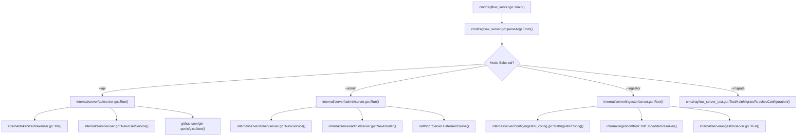
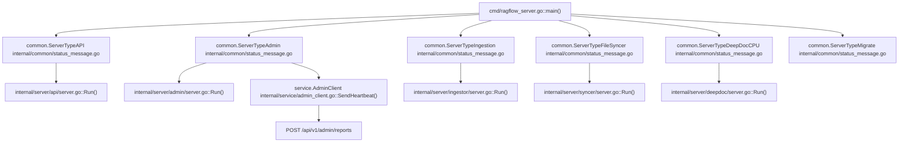

<!-- source: DeepWiki mcp.deepwiki.com · repo infiniflow/ragflow · page 3.1 Go Server Modes and Bootstrap · fetched 2026-10-29 -->

# Go Server Modes and Bootstrap

Relevant source files

The following files were used as context for generating this wiki page:

- [cmd/args_flag_test.go](cmd/args_flag_test.go)
- [cmd/deepdoc_server_ee.go](cmd/deepdoc_server_ee.go)
- [cmd/ragflow_server.go](cmd/ragflow_server.go)
- [cmd/ragflow_server_deepdoc_test.go](cmd/ragflow_server_deepdoc_test.go)
- [cmd/ragflow_server_test.go](cmd/ragflow_server_test.go)
- [conf/service_conf.yaml](conf/service_conf.yaml)
- [docker/service_conf.yaml.template](docker/service_conf.yaml.template)
- [internal/admin/license_ee.go](internal/admin/license_ee.go)
- [internal/admin/state.go](internal/admin/state.go)
- [internal/common/error_code.go](internal/common/error_code.go)
- [internal/common/status_message.go](internal/common/status_message.go)
- [internal/dao/tenant_model_group_ee.go](internal/dao/tenant_model_group_ee.go)
- [internal/handler/auth.go](internal/handler/auth.go)
- [internal/handler/providers_ee.go](internal/handler/providers_ee.go)
- [internal/handler/system.go](internal/handler/system.go)
- [internal/handler/user.go](internal/handler/user.go)
- [internal/ingestion/component/vision_source_admission_test.go](internal/ingestion/component/vision_source_admission_test.go)
- [internal/ingestion/service/execute_memory_task_panic_test.go](internal/ingestion/service/execute_memory_task_panic_test.go)
- [internal/server/admin/server.go](internal/server/admin/server.go)
- [internal/server/api/server.go](internal/server/api/server.go)
- [internal/server/bootstrap/args.go](internal/server/bootstrap/args.go)
- [internal/server/bootstrap/bootstrap.go](internal/server/bootstrap/bootstrap.go)
- [internal/server/bootstrap/bootstrap_test.go](internal/server/bootstrap/bootstrap_test.go)
- [internal/server/bootstrap/runtime.go](internal/server/bootstrap/runtime.go)
- [internal/server/config.go](internal/server/config.go)
- [internal/server/config/admin_config.go](internal/server/config/admin_config.go)
- [internal/server/config/api_server_config.go](internal/server/config/api_server_config.go)
- [internal/server/config/api_server_config_test.go](internal/server/config/api_server_config_test.go)
- [internal/server/config/ingestor_config.go](internal/server/config/ingestor_config.go)
- [internal/server/config/ingestor_config_test.go](internal/server/config/ingestor_config_test.go)
- [internal/server/config/log_config.go](internal/server/config/log_config.go)
- [internal/server/config_getallconfigs_test.go](internal/server/config_getallconfigs_test.go)
- [internal/server/deepdoc/server.go](internal/server/deepdoc/server.go)
- [internal/server/ingestor/server.go](internal/server/ingestor/server.go)
- [internal/server/local/admin_status.go](internal/server/local/admin_status.go)
- [internal/server/local/admin_status_ee.go](internal/server/local/admin_status_ee.go)
- [internal/server/syncer/server.go](internal/server/syncer/server.go)
- [internal/service/admin_client.go](internal/service/admin_client.go)
- [internal/service/admin_client_ee.go](internal/service/admin_client_ee.go)
- [internal/service/system.go](internal/service/system.go)
- [internal/service/user.go](internal/service/user.go)
- [internal/utility/fingerprint_ee.go](internal/utility/fingerprint_ee.go)

This page details the startup and bootstrap process of the Go server in RAGFlow, implemented in the single binary `ragflow_server` (`cmd/ragflow_server.go`). It explains the operational modes, command-line flags, subsystem initializations, concurrency settings, logging configuration, component setup, and graceful shutdown. This coverage is essential for understanding how the Go runtime environment manages different service roles such as API serving (`internal/server/api/server.go`), admin backend (`internal/server/admin/server.go`), ingestor workers (`internal/server/ingestor/server.go`), synchronizers, and migrations.

---

## Overview

The Go server binary located at `cmd/ragflow_server.go` supports several mutually exclusive runtime modes, selected via command-line flags (`cmd/ragflow_server_test.go:38-46`):

- `--api`: The main user-facing REST API server exposing dataset, document, chat, and knowledge services (`internal/server/api/server.go`).
- `--admin`: An administrative API server for user, role, and service management (`internal/server/admin/server.go`).
- `--ingestor`: Worker pool consuming ingestion pipeline tasks from the message queue (`internal/server/ingestor/server.go`).
- `--syncer`: Synchronization service for incremental ingestion from external data sources (`internal/server/syncer/server.go`).
- `--deepdoc`: Dedicated DeepDoc document layout, OCR, and table recognition backend (`internal/server/deepdoc/server.go`).
- `--migrate`: Runs database migration scripts and exits immediately (`cmd/ragflow_server_test.go:38-46`).

Each mode boots only the components it requires, loads configuration and logging, initializes subsystems, and runs a blocking main loop. Configuration parsing and environment merging are managed via Viper (`internal/server/config.go`).

Sources:  
[cmd/ragflow_server_test.go:38-46](), [internal/server/api/server.go:64-94](), [internal/server/admin/server.go:40-134](), [internal/server/ingestor/server.go:120-168](), [internal/server/syncer/server.go:1-30](), [internal/server/deepdoc/server.go:1-30]()

---

## Command-line Flag Parsing and Validation

The entrypoint parses CLI flags using the standard library `flag` package via `parseArgsFrom` (`cmd/ragflow_server.go:102-188`). The accepted syntax supports standard flag spellings: `-flag value`, `-flag=value`, `--flag value`, and `--flag=value` (`cmd/ragflow_server_test.go:50-58`). Mode flags share a single slot where the last one specified on the command line wins (`cmd/ragflow_server_test.go:99-119`).

| Flag | Purpose | Code Entity / Reference |
|---|---|---|
| `--api` | Starts API server mode | `internal/server/api/server.go` (`cmd/ragflow_server.go:145-147`) |
| `--admin` | Starts Admin server mode | `internal/server/admin/server.go` (`cmd/ragflow_server.go:145-147`) |
| `--ingestor` | Starts ingestion worker mode | `internal/server/ingestor/server.go` (`cmd/ragflow_server.go:145-147`) |
| `--syncer` | Starts synchronization worker mode | `internal/server/syncer/server.go` (`cmd/ragflow_server.go:145-147`) |
| `--deepdoc` | Starts DeepDoc backend mode | `internal/server/deepdoc/server.go` (`cmd/ragflow_server.go:145-147`) |
| `--migrate` | Runs database migrations and exits | `cmd/ragflow_server_test.go:38-46` (`cmd/ragflow_server.go:145-147`) |
| `--log-level=[debug|info|warn|error]` | Sets logging verbosity | `bootstrap.SelectedLogLevel` (`cmd/ragflow_server.go:128`) |
| `--config=<file>` / `-f` | Specifies custom configuration file path | `server.Init` (`cmd/ragflow_server.go:129-130`) |
| `--init-superuser` | Initializes a default superuser in Admin mode | `internal/server/admin/server.go` (`cmd/ragflow_server.go:139`) |
| `--profile` | Enables pprof HTTP profiling server | `startPProf` (`cmd/ragflow_server.go:140`) |
| `--deepdoc-inference-concurrency` | Overrides max concurrent in-process DeepDoc inference runs | `conf/service_conf.yaml` (`cmd/ragflow_server.go:135`) |
| `--ingestor-concurrent-workers` | Overrides NATS consumer worker count | `conf/service_conf.yaml` (`cmd/ragflow_server.go:136`) |

Sources:  
[cmd/ragflow_server.go:102-188](), [cmd/ragflow_server_test.go:30-151](), [conf/service_conf.yaml:98-126]()

---

## Bootstrap: Initialization Workflow

After parsing flags, the main bootstrap sequence proceeds through several structured phases managed by `internal/server/bootstrap` and `internal/server/config.go`:

1. **Configuration Loading**: Merges YAML configuration files (`conf/service_conf.yaml`, `docker/service_conf.yaml.template`) with environment variables prefixed by `RAGFLOW` using Viper (`internal/server/config.go:40-72`).
2. **Logging Setup**: Configures structured logging with rotated files and log levels resolved via `bootstrap.SetLogger()` and `common.SetLogLevel()` (`internal/handler/system.go:159`).
3. **Database and DAO Initialization**: Connects to the metadata database via GORM (`dao.DB`) and sets up data access objects (`internal/dao/`) (`internal/server/api/server.go:140`).
4. **Document Engine Selection**: Initializes the document store interface based on configuration (Elasticsearch, Infinity, OpenSearch, OceanBase) (`internal/engine/`) (`internal/server/api/server.go:144`).
5. **Component Wiring**: Wires HTTP routers, NATS queue consumers, syncer schedulers, or DeepDoc inference runners depending on the active mode (`internal/server/api/server.go:96-170`, `internal/server/admin/server.go:51-83`).
6. **Graceful Shutdown**: Listens for `SIGINT` and `SIGTERM` signals using context cancellation and performs clean shutdowns with timeouts (`cmd/ragflow_server.go:28-32`, `internal/server/admin/server.go:118-131`).

Sources:  
[internal/server/config.go:40-160](), [internal/server/api/server.go:64-170](), [internal/server/admin/server.go:40-134](), [internal/server/ingestor/server.go:120-168]()

---

## High-Initialization Flow Diagram (Code Entity Space)

This diagram bridges natural language runtime descriptions to specific initialization packages and functions in the codebase.

Sources:  
[cmd/ragflow_server.go:102-188](), [internal/server/api/server.go:64-170](), [internal/server/admin/server.go:40-134](), [internal/server/ingestor/server.go:54-168]()

---

## Mode-Specific Runtime Behavior

### API Server (`--api`)
Binds to the configured API host and HTTP port (`api.host`, `api.http_port`), setting up Gin in release or debug mode depending on the configuration (`internal/server/api/server.go:98-105`). It registers token resolvers via `UserService` (`internal/service/user.go:60-65`), authentication middleware via `AuthHandler` (`internal/handler/auth.go:66-70`), and wires all business services (`internal/server/api/server.go:107-130`). It also registers optional standalone MCP listener settings from configuration (`conf/service_conf.yaml:13-25`).

### Admin Server (`--admin`)
Managed by package `admin` (`internal/server/admin/server.go:19`). Binds to `admin.http_port`, configures recovery and logging middleware, initializes licenses (`internal/server/admin/server.go:54-56`), sets up default superusers if requested (`internal/server/admin/server.go:58-63`), and starts a scheduled heartbeat validator (`internal/service/admin_client.go:35-59`, `internal/server/admin/server.go:105-107`).

### Ingestor (`--ingestor`)
Spawns consumers bounded by `concurrent_workers` to process ingestion tasks concurrently (`internal/server/ingestor/server.go`, `conf/service_conf.yaml:98-104`). Validates ingestor dependencies and coordinates process-wide page parsing concurrency (`conf/service_conf.yaml:105-109`).

### DeepDoc (`--deepdoc`)
Boots standalone DeepDoc inference servers (CPU/GPU/Ascend) via `isStandaloneDeepDocServer` (`cmd/ragflow_server.go:51-60`). These boot the ONNX runtime only and bypass full RAGFlow infrastructure initialization (Redis, DB, engine, cache, storage, MQ).

### Migrate (`--migrate`)
Executes database migrations and exits immediately without starting network servers (`cmd/ragflow_server_test.go:38-46`, `cmd/ragflow_server_test.go:135-151`).

Sources:  
[cmd/ragflow_server.go:51-60](), [conf/service_conf.yaml:13-30](), [internal/server/api/server.go:96-130](), [internal/server/admin/server.go:39-134](), [internal/server/ingestor/server.go:54-168](), [internal/service/user.go:60-65](), [internal/handler/auth.go:66-70]()

---

## System Components and Mode Mapping Diagram

Sources:  
[cmd/ragflow_server.go:17-49](), [internal/server/api/server.go:64-94](), [internal/server/admin/server.go:38-134](), [internal/server/ingestor/server.go:120-168](), [internal/service/admin_client.go:35-59]()

---

## Concurrency Flags and Overrides

Concurrency settings follow a strict precedence order: CLI flag > Environment Variable > Configuration File > Built-in Default (`conf/service_conf.yaml:98-126`).

| Flag / Parameter | Configuration Key | Default | Valid Range / Validation Rule |
|---|---|---|---|
| `--ingestor-concurrent-workers` | `ingestor.concurrent_workers` | `1` | `[1, 256]` (`conf/service_conf.yaml:104`) |
| `--ingestor-page-concurrency` | `ingestor.page_concurrency` | `2` | `[1, 16]` (`conf/service_conf.yaml:109`) |
| `--deepdoc-inference-concurrency` | `ingestor.inference_concurrency` | `1` | Positive integer $\le$ machine CPU count (`conf/service_conf.yaml:118`) |
| `--deepdoc-inference-cpu-cores` | `ingestor.inference_cpu_cores` | `0` (all cores) | $\le$ machine CPU count (`conf/service_conf.yaml:126`) |

Sources:  
[conf/service_conf.yaml:98-126](), [cmd/ragflow_server.go:135-138]()

---

