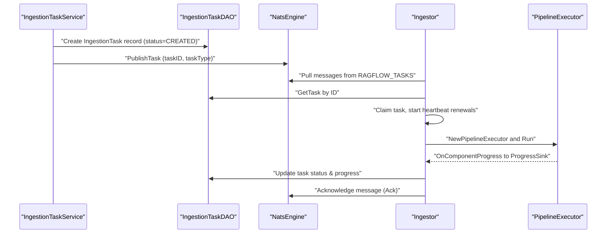
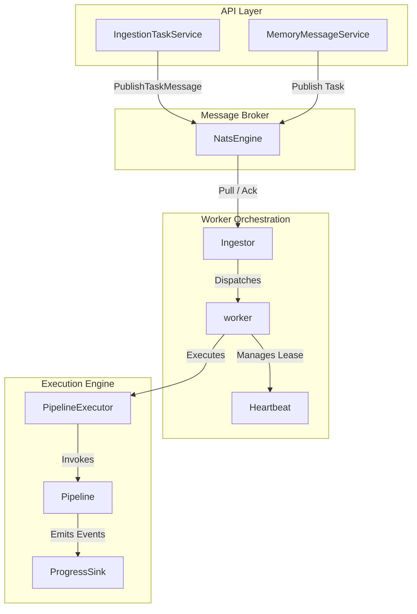

<!-- source: DeepWiki mcp.deepwiki.com · repo infiniflow/ragflow · page 3.3 Task Queue and Asynchronous Execution · fetched 2026-10-29 -->

# Task Queue and Asynchronous Execution

Relevant source files

The following files were used as context for generating this wiki page:

- [internal/dao/ingestion_task_test.go](internal/dao/ingestion_task_test.go)
- [internal/dao/sync_task.go](internal/dao/sync_task.go)
- [internal/dao/sync_task_test.go](internal/dao/sync_task_test.go)
- [internal/engine/kvrocks/redis.go](internal/engine/kvrocks/redis.go)
- [internal/engine/kvrocks/redis_test.go](internal/engine/kvrocks/redis_test.go)
- [internal/engine/oceanbase/schema.go](internal/engine/oceanbase/schema.go)
- [internal/engine/vastbase/schema.go](internal/engine/vastbase/schema.go)
- [internal/ingestion/pipeline/pipeline.go](internal/ingestion/pipeline/pipeline.go)
- [internal/ingestion/pipeline/pipeline_test.go](internal/ingestion/pipeline/pipeline_test.go)
- [internal/ingestion/service/ingestion_service.go](internal/ingestion/service/ingestion_service.go)
- [internal/ingestion/service/progress_sink.go](internal/ingestion/service/progress_sink.go)
- [internal/ingestion/service/progress_sink_test.go](internal/ingestion/service/progress_sink_test.go)
- [internal/ingestion/service/worker_dispatcher_integration_test.go](internal/ingestion/service/worker_dispatcher_integration_test.go)
- [internal/ingestion/task/pipeline_executor.go](internal/ingestion/task/pipeline_executor.go)
- [internal/ingestion/task/pipeline_executor_test.go](internal/ingestion/task/pipeline_executor_test.go)
- [internal/server/variable.go](internal/server/variable.go)
- [internal/server/variable_test.go](internal/server/variable_test.go)
- [internal/service/document/document_list.go](internal/service/document/document_list.go)
- [internal/service/ingestion_task_service.go](internal/service/ingestion_task_service.go)
- [internal/service/ingestion_task_service_test.go](internal/service/ingestion_task_service_test.go)
- [internal/service/sync_task_service.go](internal/service/sync_task_service.go)
- [internal/syncer/connector_lock.go](internal/syncer/connector_lock.go)
- [internal/syncer/prune_runner.go](internal/syncer/prune_runner.go)
- [internal/syncer/sync_runner.go](internal/syncer/sync_runner.go)
- [internal/syncer/syncer.go](internal/syncer/syncer.go)
- [internal/syncer/syncer_test.go](internal/syncer/syncer_test.go)
- [internal/syncer/task_coordinator.go](internal/syncer/task_coordinator.go)
- [internal/syncer/task_worker.go](internal/syncer/task_worker.go)

## Purpose and Scope

This page details RAGFlow's asynchronous task distribution and execution system. It explains the use of NATS JetStream for reliable task queueing and distribution, ingestion worker concurrency management, heartbeat mechanisms to maintain leased task ownership, and progress sinks that track lifecycle events and pipeline progress. Additionally, it covers the end-to-end task lifecycle from API request creation to task completion acknowledgment.

Sources: [internal/ingestion/service/ingestion_service.go:54-116](), [internal/ingestion/task/pipeline_executor.go:73-84]()

---

## System Overview

RAGFlow's asynchronous task execution revolves around NATS JetStream as a distributed message broker providing durable streams to reliably distribute tasks in a pull-based, work-queue pattern. This architecture supports:

- Reliable messaging with automatic redelivery for unacknowledged tasks via `NatsEngine` [internal/engine/nats/nats.go:95-103]().
- Configurable concurrency for ingestion and memory extraction workers managed by `Ingestor` [internal/ingestion/service/ingestion_service.go:54-116]().
- Heartbeats maintaining the ownership lease of in-flight tasks via `activeLease` and `Heartbeat` instances [internal/ingestion/service/ingestion_service.go:156-164]().
- Event reporting through `ProgressSink` implementations for monitoring pipeline component execution [internal/ingestion/pipeline/pipeline.go:81-98]().
- A task lifecycle model managed via `IngestionTaskService` [internal/service/ingestion_task_service.go:65-85]() and executed by `PipelineExecutor` [internal/ingestion/task/pipeline_executor.go:73-84]().

While the system initially used Redis Streams for tasks, it has migrated to the NATS JetStream model while retaining task metadata and state in MySQL tables accessed via `dao.IngestionTaskDAO`.

Sources: [internal/engine/nats/nats.go:95-103](), [internal/ingestion/service/ingestion_service.go:54-116](), [internal/ingestion/pipeline/pipeline.go:81-98](), [internal/service/ingestion_task_service.go:65-85]()

---

## NATS JetStream Task Distribution

### Task Message Publication

Ingestion or memory extraction tasks begin their lifecycle via API calls through `IngestionTaskService.CreateForDocuments` [internal/service/ingestion_task_service.go:101-143](), which creates task metadata records with status `common.CREATED` in the MySQL ingestion task table. Corresponding task messages are then published on the NATS JetStream subject `"tasks.RAGFLOW"` [internal/service/ingestion_task_service_test.go:91-93]() via `TaskPublisher` and `NatsEngine.PublishTask` [internal/engine/nats/nats.go:140-165](). These messages contain the task ID and type, enabling subscribing worker consumers to process the tasks asynchronously.

### Task Subscription and Concurrency Control

The ingestion service, represented by the `Ingestor` struct [internal/ingestion/service/ingestion_service.go:54-116](), subscribes to the `"tasks.RAGFLOW"` subject using a durable shared JetStream consumer. It maintains a bounded worker pool whose size is configured by `maxConcurrency` [internal/ingestion/service/ingestion_service.go:64](). Worker goroutines pull tasks from the JetStream stream via worker inboxes (`worker` struct) [internal/ingestion/service/ingestion_service.go:151-154](), claim task ownership, and process them.

Task cancellation is checked asynchronously inside workers via the configurable `cancelCheck` predicate [internal/ingestion/service/ingestion_service.go:135-141](), which queries Redis (`kvrocks` client) or falls back to the database. If a cancellation is detected, pipeline execution is halted gracefully.

Sources: [internal/engine/nats/nats.go:140-165](), [internal/service/ingestion_task_service.go:101-143](), [internal/ingestion/service/ingestion_service.go:54-141]()

---

## Task Lifecycle from API Request to Completion

The complete asynchronous task lifecycle spans these steps:

Title: "End-to-End Task Lifecycle and Code Entities"

Key points:
- The API layer creates task records and publishes messages using `IngestionTaskService` [internal/service/ingestion_task_service.go:101-143]().
- NATS JetStream queues ensure reliable delivery to worker subscribers through `NatsEngine` [internal/engine/nats/nats.go:95-103]().
- `Ingestor` manages concurrency, claims ownership, maintains leases via heartbeats, and dispatches task execution.
- `PipelineExecutor` runs the ingestion pipeline graph via `Pipeline.Run` and reports progress and results.
- Upon terminal success or failure, the task status is updated and the JetStream message acknowledged to remove it from the stream.

Sources: [internal/service/ingestion_task_service.go:101-143](), [internal/engine/nats/nats.go:95-103](), [internal/ingestion/service/ingestion_service.go:54-116]()

---

## Ingestor Worker Concurrency and Management

### Ingestor Struct and Worker Pool

The `Ingestor` struct [internal/ingestion/service/ingestion_service.go:54-116]() is the central orchestrator of ingestion task execution. Its core fields related to concurrency are:
- `maxConcurrency` (`int32`): maximum number of parallel worker goroutines executing tasks [internal/ingestion/service/ingestion_service.go:64]().
- `workerQueue` (`chan *worker`): buffered channel of idle workers waiting for task assignments [internal/ingestion/service/ingestion_service.go:85]().
- `activeWorkers` (`atomic.Int32`): counter tracking goroutines currently active [internal/ingestion/service/ingestion_service.go:76]().
- `currentTasks` (`map[string]struct{}`): set of task IDs claimed by workers to prevent duplicates [internal/ingestion/service/ingestion_service.go:72]().
- `heartbeatInterval` (`time.Duration`): interval to renew JetStream message leases [internal/ingestion/service/ingestion_service.go:67]().

Workers are represented as instances of the internal `worker` struct [internal/ingestion/service/ingestion_service.go:151-154](), each owning its own `inbox` channel for receiving task handles (`common.TaskHandle`).

### Leasing, Heartbeat, and Cancellation

For each claimed task, the ingestor records an `activeLease` [internal/ingestion/service/ingestion_service.go:156-158]() with an associated `Heartbeat` object responsible for renewing the JetStream ack deadline every `defaultHeartbeatInterval` (`2 * time.Second`) [internal/ingestion/service/ingestion_service.go:52-52]().

The heartbeat renewals prevent the broker from redelivering the message prematurely. If a worker fails, lack of heartbeats causes the message to be redelivered safely after the acknowledgement deadline expires.

Sources: [internal/ingestion/service/ingestion_service.go:52-158]()

---

## Progress Sinks and Lifecycle Event Reporting

Status reporting during ingestion pipeline execution is handled via `ProgressSink` interfaces defined in the pipeline package [internal/ingestion/pipeline/pipeline.go:95-98](). The sink interface declares:
- `OnComponentTotal(ctx context.Context, taskID string, total int)`: reports the total number of components in the pipeline for rendering progress fractions [internal/ingestion/pipeline/pipeline.go:96]().
- `OnComponentProgress(ctx context.Context, ev ProgressEvent)`: reports component-level lifecycle events, including textual messages and numeric phases [internal/ingestion/pipeline/pipeline.go:97]().

The `PipelineExecutor` accepts a configured progress sink and emits progress notifications during execution. This abstraction decouples pipeline components from persistence and allows plugging in DB-backed sinks, remote telemetry, or no-ops for tests (`PipelineOption` via `WithProgressSink`) [internal/ingestion/pipeline/pipeline.go:103-105]().

Sources: [internal/ingestion/pipeline/pipeline.go:95-105]()

---

## PipelineExecutor: Running Ingestion Pipelines

The `PipelineExecutor` struct, defined in `internal/ingestion/task/pipeline_executor.go`, is the core runtime for ingestion pipelines. It encapsulates the following responsibilities:
- Holds a `TaskContext` tracking task metadata, document info, tenant, and knowledge base [internal/ingestion/task/pipeline_executor.go:74]().
- Loads and compiles the ingestion pipeline canvas DSL from the database via load methods.
- Runs the ingestion graph with pipeline parameters, optionally with a progress sink for lifecycle events [internal/ingestion/task/pipeline_executor.go:83]().
- Writes indexing chunks via a bulk chunk index writer (`chunkIndexWriter`) with deferred index refresh (`insertChunksForIngestion` vs `insertFinalChunksForIngestion`) for performance [internal/ingestion/task/pipeline_executor.go:79]().
- Supports debug mode (`PipelineResult.Chunks`) to capture emitted chunks without persisting them [internal/ingestion/task/pipeline_executor.go:52]().
- Performs chunk deletions and cleanup on failures to maintain index consistency via `DeleteChunksFunc` [internal/ingestion/task/pipeline_executor.go:80]().

Sources: [internal/ingestion/task/pipeline_executor.go:48-84]()

---

## Memory Extraction & Syncer Task Integration

Memory extraction tasks share ingestion concurrency resources and the NATS JetStream queue with regular ingestion tasks. They are dispatched via `runMemoryTask` [internal/ingestion/service/ingestion_service.go:128-128]() and handled by `MemoryMessageService.HandleSaveToMemoryTask` [internal/service/memory_extractor.go:133-163]().

Similarly, synchronization tasks operate through task DAOs and log tables, scheduling jobs through bounded database polls and task broker integrations.

Sources: [internal/ingestion/service/ingestion_service.go:128-128](), [internal/service/memory_extractor.go:133-163]()

---

## Summary Diagram: System Architecture to Code Entities

Title: "Task Queue Subsystem Code Mapping"

Sources: [internal/service/ingestion_task_service.go:65-85](), [internal/ingestion/service/ingestion_service.go:54-154](), [internal/ingestion/task/pipeline_executor.go:73-84](), [internal/ingestion/pipeline/pipeline.go:38-98]()

---

# References

- `internal/ingestion/service/ingestion_service.go`  
- `internal/ingestion/task/pipeline_executor.go`  
- `internal/service/ingestion_task_service.go`  
- `internal/ingestion/pipeline/pipeline.go`  
- `internal/engine/nats/nats.go`  
- `internal/service/memory_extractor.go`

---

