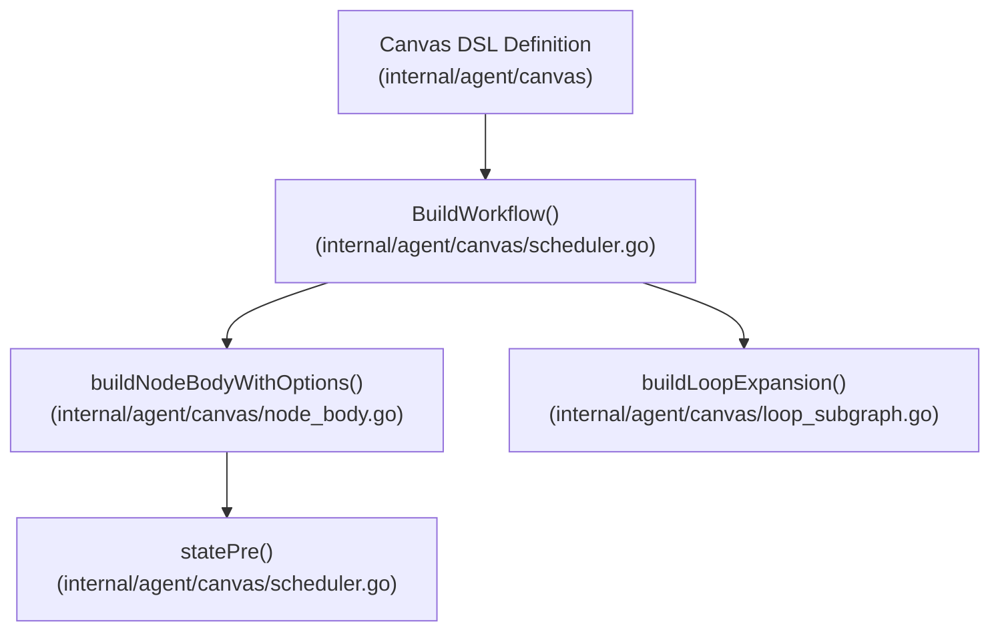
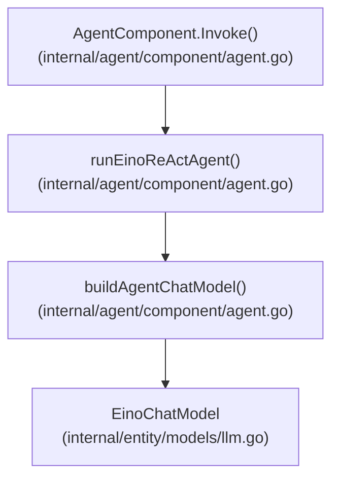
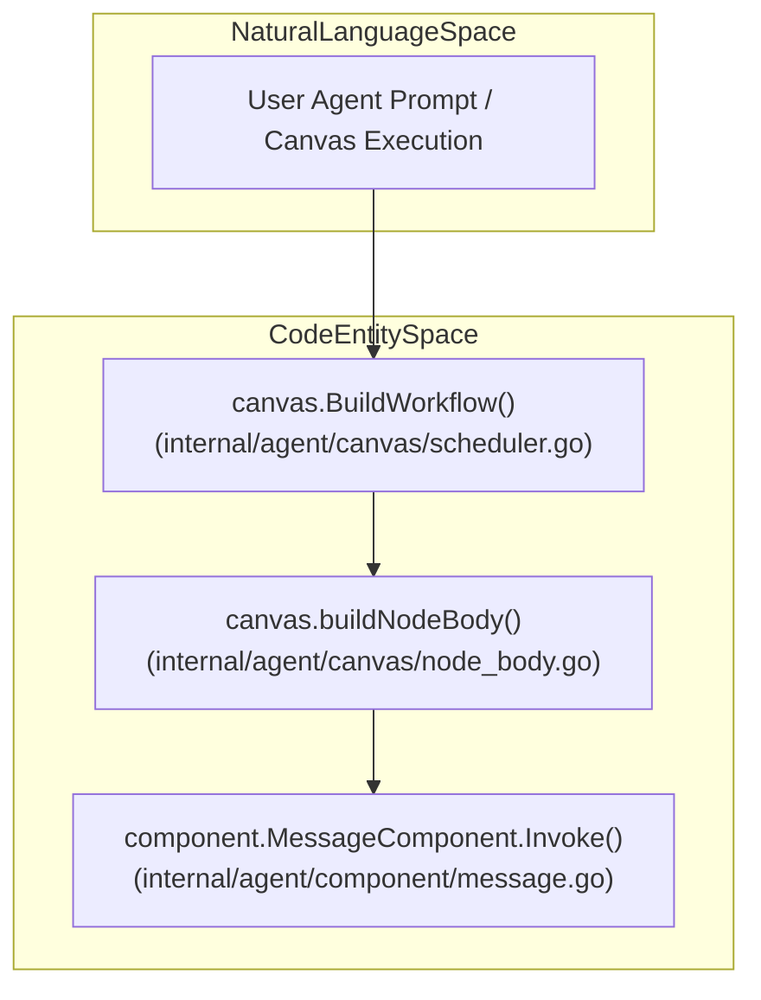
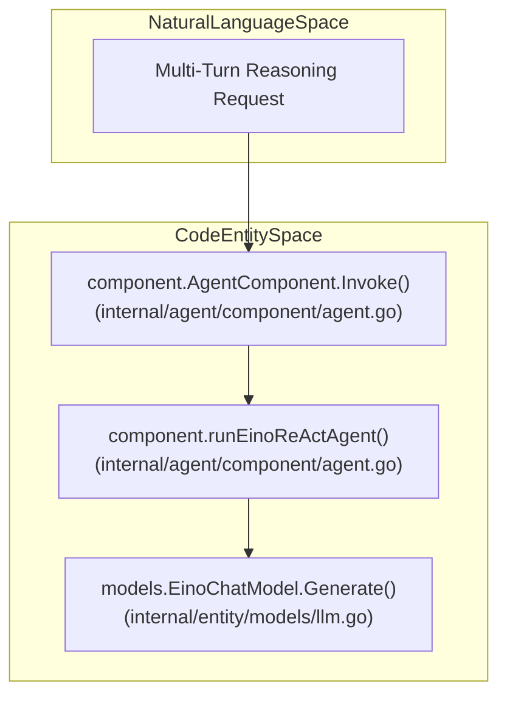

<!-- source: DeepWiki mcp.deepwiki.com · repo infiniflow/ragflow · page 3.4 Harness Agent Framework · fetched 2026-10-29 -->

# Harness Agent Framework

Relevant source files

The following files were used as context for generating this wiki page:

- [internal/agent/canvas/canvas_streaming_e2e_test.go](internal/agent/canvas/canvas_streaming_e2e_test.go)
- [internal/agent/canvas/direct_message_downstream_test.go](internal/agent/canvas/direct_message_downstream_test.go)
- [internal/agent/canvas/loop_subgraph.go](internal/agent/canvas/loop_subgraph.go)
- [internal/agent/canvas/node_body.go](internal/agent/canvas/node_body.go)
- [internal/agent/canvas/node_body_timeout_test.go](internal/agent/canvas/node_body_timeout_test.go)
- [internal/agent/canvas/scheduler.go](internal/agent/canvas/scheduler.go)
- [internal/agent/component/agent.go](internal/agent/component/agent.go)
- [internal/agent/component/agent_test.go](internal/agent/component/agent_test.go)
- [internal/agent/component/llm.go](internal/agent/component/llm.go)
- [internal/agent/component/llm_retry.go](internal/agent/component/llm_retry.go)
- [internal/agent/component/llm_retry_test.go](internal/agent/component/llm_retry_test.go)
- [internal/agent/component/llm_test.go](internal/agent/component/llm_test.go)
- [internal/agent/component/message.go](internal/agent/component/message.go)
- [internal/agent/component/message_test.go](internal/agent/component/message_test.go)
- [internal/agent/component/reference_recording_tool.go](internal/agent/component/reference_recording_tool.go)
- [internal/agent/component/reference_recording_tool_test.go](internal/agent/component/reference_recording_tool_test.go)
- [internal/agent/component/streaming_test.go](internal/agent/component/streaming_test.go)
- [internal/agent/runtime/context.go](internal/agent/runtime/context.go)
- [internal/entity/models/llm.go](internal/entity/models/llm.go)
- [internal/entity/models/llm_test.go](internal/entity/models/llm_test.go)
- [web/src/pages/agent/log-sheet/tool-timeline-item.tsx](web/src/pages/agent/log-sheet/tool-timeline-item.tsx)

The **Harness Agent Framework** (`internal/agent` and related graph runtime packages) serves as the Go-native engine for building stateful, multi-agent workflows, tool-augmented reasoning loops, and graph-based execution pipelines in RAGFlow. This document details its architecture, including graph compilation, Pregel-style bulk synchronous parallel (BSP) execution, the Eino-based ReAct agent runtime, model bridging, and tool execution.

---

## 1. Pregel BSP Graph Engine and Workflow Compilation

At the heart of the agent runtime is the graph compilation and execution layer, which maps visual Canvas DSL definitions onto CloudWeGo Eino workflows [internal/agent/canvas/scheduler.go:1-19](). 

- **Workflow Construction:** `BuildWorkflow` turns a declarative `Canvas` structure into an executable `*compose.Workflow[map[string]any, map[string]any]` [internal/agent/canvas/scheduler.go:1-19]().
- **State Propagation:** The graph runtime injects `statePre` and `statePost` handlers into every node. The `statePre` function synchronizes the Eino per-run state with the overarching `CanvasState` context so that downstream nodes can inspect upstream outputs [internal/agent/canvas/scheduler.go:147-168]().
- **Loop Macro Expansion:** Loops and iterations in the DSL are dynamically expanded into sub-graphs (`*compose.Workflow`) via `buildLoopExpansion`, wrapping loop bodies with initial variable setup and conditional termination checks (`workflowx.LoopCondition`) [internal/agent/canvas/loop_subgraph.go:17-50]().

Sources:  
- [internal/agent/canvas/scheduler.go:1-34]()  
- [internal/agent/canvas/node_body.go:123-137]()  
- [internal/agent/canvas/loop_subgraph.go:17-50]()

---

## 2. ReAct Agent Runtime and Model Bridge

Multi-turn reasoning and tool invocation are handled by the ReAct agent component, which integrates directly with CloudWeGo Eino's `flow/agent/react` package [internal/agent/component/agent.go:1-11]().

- **Agent Component:** `AgentComponent` executes multi-turn tool-calling loops using `runEinoReActAgent`, which compiles the agent parameters, resolves registered tools, and executes the conversation steps [internal/agent/component/agent.go:67-175]().
- **Model Adapter:** `EinoChatModel` bridges existing RAGFlow provider-specific `*ChatModel` instances to Eino's `model.BaseChatModel` and `model.ToolCallingChatModel` interfaces, providing failover chains and sticky cursor management [internal/entity/models/llm.go:17-83]().

Sources:  
- [internal/agent/component/agent.go:1-11]()  
- [internal/agent/component/agent.go:166-175]()  
- [internal/entity/models/llm.go:17-83]()

---

## 3. Natural Language Space to Code Entity Space Bridges

The following diagrams map natural language user prompts and agent execution intents to the corresponding Go functions and structs within the framework.

### Diagram 1: Canvas Workflow Execution Path

Sources:  
- [internal/agent/canvas/scheduler.go:1-34]()  
- [internal/agent/canvas/node_body.go:123-137]()  
- [internal/agent/component/message.go:174-182]()

### Diagram 2: ReAct Agent and Tool Dispatch

Sources:  
- [internal/agent/component/agent.go:67-70]()  
- [internal/agent/component/agent.go:166-170]()  
- [internal/entity/models/llm.go:63-83]()

---

## 4. Component Adapters and Routers

The framework implements specialized component types that handle node invocation logic, text templating, LLM completions, and outputs [internal/agent/component/agent.go:67-70]() [internal/agent/component/message.go:48-64]() [internal/agent/component/llm.go:39-42]().

| Component Name | Description | Implementation File |
|----------------|-------------|---------------------|
| `AgentComponent` | Multi-turn ReAct agent powered by Eino's workflow and tool calling interfaces. | `internal/agent/component/agent.go` [internal/agent/component/agent.go:67-70]() |
| `MessageComponent` | Canvas terminal output node that resolves Jinja2-style templates against `CanvasState`. | `internal/agent/component/message.go` [internal/agent/component/message.go:48-64]() |
| `LLMComponent` | One-shot LLM invocation component supporting system/user prompts and structured JSON outputs. | `internal/agent/component/llm.go` [internal/agent/component/llm.go:39-42]() |

Sources:  
- [internal/agent/component/agent.go:67-70]()  
- [internal/agent/component/message.go:48-64]()  
- [internal/agent/component/llm.go:39-42]()

---

# References

- [internal/agent/canvas/scheduler.go:1-34]()  
- [internal/agent/canvas/node_body.go:123-137]()  
- [internal/agent/canvas/loop_subgraph.go:17-50]()  
- [internal/agent/component/agent.go:1-175]()  
- [internal/agent/component/message.go:48-182]()  
- [internal/agent/component/llm.go:39-42]()  
- [internal/entity/models/llm.go:17-83]()

---

