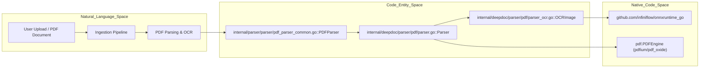
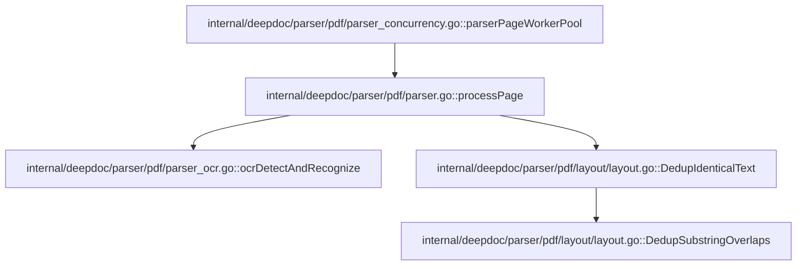

<!-- source: DeepWiki mcp.deepwiki.com · repo infiniflow/ragflow · page 3.5 Native Components and CGO Bindings · fetched 2026-10-29 -->

# Native Components and CGO Bindings

Relevant source files

The following files were used as context for generating this wiki page:

- [internal/deepdoc/parser/pdf/layout/chars_boxes.go](internal/deepdoc/parser/pdf/layout/chars_boxes.go)
- [internal/deepdoc/parser/pdf/layout/chars_boxes_test.go](internal/deepdoc/parser/pdf/layout/chars_boxes_test.go)
- [internal/deepdoc/parser/pdf/layout/layout.go](internal/deepdoc/parser/pdf/layout/layout.go)
- [internal/deepdoc/parser/pdf/layout/layout_test.go](internal/deepdoc/parser/pdf/layout/layout_test.go)
- [internal/deepdoc/parser/pdf/layout/toc_header_footer.go](internal/deepdoc/parser/pdf/layout/toc_header_footer.go)
- [internal/deepdoc/parser/pdf/layout/toc_header_footer_test.go](internal/deepdoc/parser/pdf/layout/toc_header_footer_test.go)
- [internal/deepdoc/parser/pdf/native_text_test.go](internal/deepdoc/parser/pdf/native_text_test.go)
- [internal/deepdoc/parser/pdf/parser.go](internal/deepdoc/parser/pdf/parser.go)
- [internal/deepdoc/parser/pdf/parser_concurrency.go](internal/deepdoc/parser/pdf/parser_concurrency.go)
- [internal/deepdoc/parser/pdf/parser_concurrency_test.go](internal/deepdoc/parser/pdf/parser_concurrency_test.go)
- [internal/deepdoc/parser/pdf/parser_ocr.go](internal/deepdoc/parser/pdf/parser_ocr.go)
- [internal/deepdoc/parser/pdf/parser_ocr_test.go](internal/deepdoc/parser/pdf/parser_ocr_test.go)
- [internal/deepdoc/parser/pdf/parser_ocr_warp_test.go](internal/deepdoc/parser/pdf/parser_ocr_warp_test.go)
- [internal/deepdoc/parser/pdf/parser_parallel_test.go](internal/deepdoc/parser/pdf/parser_parallel_test.go)
- [internal/deepdoc/parser/pdf/parser_test.go](internal/deepdoc/parser/pdf/parser_test.go)
- [internal/deepdoc/parser/pdf/table/box_overlap_page_test.go](internal/deepdoc/parser/pdf/table/box_overlap_page_test.go)
- [internal/deepdoc/parser/pdf/table/table_replace_bench_test.go](internal/deepdoc/parser/pdf/table/table_replace_bench_test.go)
- [internal/deepdoc/parser/pdf/table/table_replace_opt_test.go](internal/deepdoc/parser/pdf/table/table_replace_opt_test.go)
- [internal/deepdoc/parser/pdf/toc_box_removal_test.go](internal/deepdoc/parser/pdf/toc_box_removal_test.go)
- [internal/deepdoc/parser/pdf/util/garbled.go](internal/deepdoc/parser/pdf/util/garbled.go)
- [internal/deepdoc/parser/pdf/util/garbled_ocr_test.go](internal/deepdoc/parser/pdf/util/garbled_ocr_test.go)
- [internal/parser/parser/pdf_parser_common.go](internal/parser/parser/pdf_parser_common.go)
- [internal/parser/parser/pdf_parser_opendataloader.go](internal/parser/parser/pdf_parser_opendataloader.go)
- [internal/parser/parser/pdf_parser_opendataloader_cgo.go](internal/parser/parser/pdf_parser_opendataloader_cgo.go)
- [internal/parser/parser/pdf_parser_opendataloader_cgo_test.go](internal/parser/parser/pdf_parser_opendataloader_cgo_test.go)
- [internal/parser/parser/pdf_parser_opendataloader_nocgo.go](internal/parser/parser/pdf_parser_opendataloader_nocgo.go)
- [internal/parser/parser/pdf_parser_opendataloader_nocgo_test.go](internal/parser/parser/pdf_parser_opendataloader_nocgo_test.go)
- [internal/parser/parser/pdf_parser_opendataloader_positions_test.go](internal/parser/parser/pdf_parser_opendataloader_positions_test.go)
- [internal/parser/parser/pdf_parser_opendataloader_test.go](internal/parser/parser/pdf_parser_opendataloader_test.go)
- [internal/parser/parser/pdf_parser_remote_common.go](internal/parser/parser/pdf_parser_remote_common.go)
- [internal/parser/parser/pdf_parser_table_contract_test.go](internal/parser/parser/pdf_parser_table_contract_test.go)
- [internal/parser/parser/pdf_parser_tcadp.go](internal/parser/parser/pdf_parser_tcadp.go)
- [internal/parser/parser/pdf_parser_tcadp_test.go](internal/parser/parser/pdf_parser_tcadp_test.go)
- [internal/parser/parser/pdf_table_no_html_text_test.go](internal/parser/parser/pdf_table_no_html_text_test.go)

## Purpose and Scope

This section details the native components embedded in the RAGFlow Go backend, their integration via CGO, and the configuration/build mechanisms that enable fallbacks. It covers native tokenizer configurations, the ONNX Runtime wrappers used in DeepDoc for PDF processing, layout/OCR pipelines, native PDF libraries (`pdfium`, `pdf_oxide`), page worker concurrency budgets, and build-tag-based `nocgo` fallback modes.

Sources: `internal/deepdoc/parser/pdf/parser.go:21-27](), internal/parser/parser/pdf_parser_common.go:57-113()`

---

## PDFParser Configuration and Engine Dispatch

### Overview

Document parsing workflows utilize `PDFParser` (`internal/parser/parser/pdf_parser_common.go:57-113()`), a stateless dispatcher that supports multiple local and remote extraction methods including `deepdoc`, `plain_text`, `mineru`, `docling`, `opendataloader`, `somark`, and `tcadp`.

### Implementation Details

- The parser struct tracks options like `FlattenMediaToText`, `RemoveTOC`, `RemoveHeaderFooter`, and page restriction ranges via `Pages` (`internal/parser/parser/pdf_parser_common.go:62-75()`).
- When executing local deepdoc parsing under restricted non-CGO environments, the system returns `ErrPDFEngineUnavailable` because native bindings require CGO compilation (`internal/parser/parser/pdf_parser_common.go:37-42()`).
- Remote parsing fallbacks such as OpenDataLoader (`internal/parser/parser/pdf_parser_opendataloader.go:25-101()`) and TCADP (`internal/parser/parser/pdf_parser_tcadp.go:17-21()`) handle network-backed document reconstruction when local native engines are bypassed or disabled.

Sources: `internal/parser/parser/pdf_parser_common.go:37-113()`, `internal/parser/parser/pdf_parser_opendataloader.go:25-101()`, `internal/parser/parser/pdf_parser_tcadp.go:17-21()`

---

## DeepDoc Native ONNX Runtime Wrappers and Concurrency Budgets

### Overview

The DeepDoc subsystem performs advanced PDF parsing, layout detection (DLA), OCR, and table recognition (TSR) using ONNX machine learning models via native runtime wrappers.

### Key Concurrency and Inference Controls

- **Inference Budget (`DeepDocConcurrency`)**: Limits the process-wide number of ONNX runs in flight concurrently. Because each session runs single-threaded (`intraOpThreads = 1`), this parameter directly controls inference thread consumption (`internal/deepdoc/parser/pdf/parser_concurrency.go:39-59()`).
- **Page Concurrency (`PageConcurrency`)**: Governs per-document page parallelism (`N`), sizing the shared page worker pool `parserPageWorkerPool` (`internal/deepdoc/parser/pdf/parser_concurrency.go:74-98(), internal/deepdoc/parser/pdf/parser_concurrency.go:157-171()`).
- **Batch Execution**: OCR recognition batches image crops using `recBatchNum = 16` (`internal/deepdoc/parser/pdf/parser_ocr.go:19-25()`), sorting crops by aspect ratio and padding them locally to match reference Python behavior.

Sources: `internal/deepdoc/parser/pdf/parser_concurrency.go:39-171()`, `internal/deepdoc/parser/pdf/parser_ocr.go:19-152()`

---

## Layout Processing and Text Deduplication

### Overview

To prevent redundant or overlapping text blocks generated by repeated OCR passes or split bounding boxes, layout engines execute structured filtering passes.

### Key Functions

- `layout.DedupIdenticalText`: Collapses boxes whose text is byte-identical on the same page and whose vertical bands are pairwise disjoint, provided they form a rolling-stride chain (`internal/deepdoc/parser/pdf/layout/layout.go:43-124()`).
- `layout.DedupSubstringOverlaps`: Eliminates inner fragments where a box's text is a contiguous substring of another containing box geometrically (`internal/deepdoc/parser/pdf/layout/layout.go:164-175()`).

Sources: `internal/deepdoc/parser/pdf/layout/layout.go:43-175()`

---

## Build System, Static Linkage, and CGO Environment

### Build Tags and Fallbacks

- Go build tags (e.g., `//go:build cgo`) control conditional compilation, permitting `nocgo` fallback builds where native bindings are stubbed out for restricted environments.
- When `cgo` is enabled, PDFium and ONNX Runtime are linked directly into the server binary via CGO directives.

Sources: `internal/parser/parser/pdf_parser_common.go:37-42()`

---

## Data Flow: From Natural Language Space to Native Code Components

Sources: `internal/parser/parser/pdf_parser_common.go:57-113()`, `internal/deepdoc/parser/pdf/parser.go:21-27()`, `internal/deepdoc/parser/pdf/parser_ocr.go:30-32()`

---

## Data Flow: Page Worker Pool and Layout Processing Pipeline

Sources: `internal/deepdoc/parser/pdf/parser_concurrency.go:161-171()`, `internal/deepdoc/parser/pdf/parser.go:169-193()`, `internal/deepdoc/parser/pdf/parser_ocr.go:34-181()`, `internal/deepdoc/parser/pdf/layout/layout.go:43-124()`, `internal/deepdoc/parser/pdf/layout/layout.go:164-175()`

---

