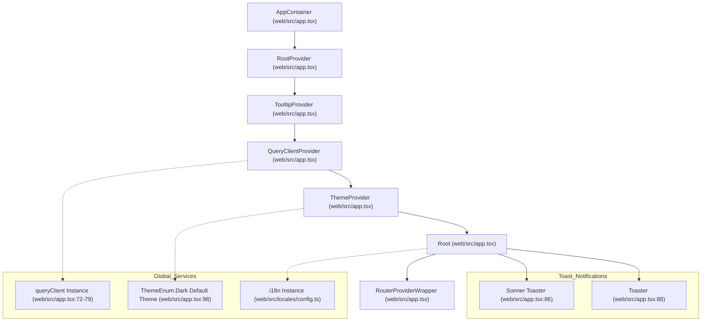
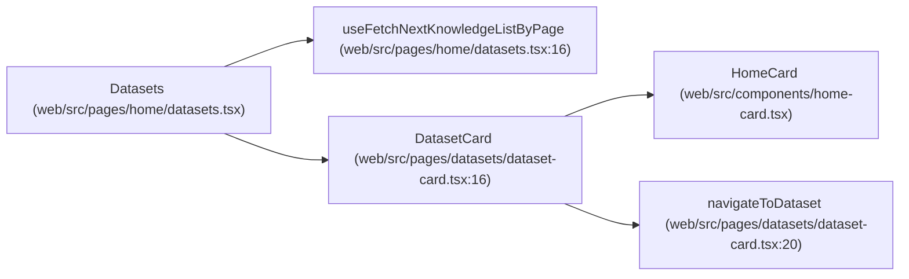

<!-- source: DeepWiki mcp.deepwiki.com · repo infiniflow/ragflow · page 4 Frontend Application · fetched 2026-10-29 -->

# Frontend Application

Relevant source files

The following files were used as context for generating this wiki page:

- [web/package-lock.json](web/package-lock.json)
- [web/package.json](web/package.json)
- [web/src/app.tsx](web/src/app.tsx)
- [web/src/components/ui/badge.tsx](web/src/components/ui/badge.tsx)
- [web/src/components/ui/button.tsx](web/src/components/ui/button.tsx)
- [web/src/components/ui/checkbox.tsx](web/src/components/ui/checkbox.tsx)
- [web/src/constants/common.ts](web/src/constants/common.ts)
- [web/src/locales/config.ts](web/src/locales/config.ts)
- [web/src/pages/datasets/dataset-card.tsx](web/src/pages/datasets/dataset-card.tsx)
- [web/src/pages/home/applications.tsx](web/src/pages/home/applications.tsx)
- [web/src/pages/home/banner.tsx](web/src/pages/home/banner.tsx)
- [web/src/pages/home/datasets.tsx](web/src/pages/home/datasets.tsx)
- [web/src/pages/home/index.tsx](web/src/pages/home/index.tsx)
- [web/tailwind.config.js](web/tailwind.config.js)
- [web/tailwind.css](web/tailwind.css)

Overview of the React web frontend architecture, linking to child pages for i18n, components, theming/build, and page/state structure.

The RAGFlow frontend is a modern React-based web application built with Vite that provides the user interface for all system features including dataset management, chat assistants, agent workflows, and search interfaces. The application emphasizes internationalization (supporting 15+ languages), theming (light/dark mode), and a component-driven architecture using a hybrid UI library approach.

For detailed information about specific frontend subsystems, see [Internationalization System](#4.1), [UI Component Architecture](#4.2), [Theming and Build Setup](#4.3), and [Page Structure and State Management](#4.4). For backend API integration, see [Backend API System](#7) and [API Architecture and Python SDK](#7.1).

---

## Technology Stack

The frontend leverages a rich set of technologies chosen for scalability, usability, and modern UX:

| Category         | Technology               | Version  | Purpose                                      |
|------------------|--------------------------|----------|----------------------------------------------|
| Build Tool       | Vite                     | 7.3.7    | Fast dev server and production bundler       |
| Framework        | React                    | 18.2.0   | UI component library                          |
| Routing          | React Router             | 7.10.1   | Declarative client-side routing               |
| UI Libraries     | Ant Design               | 5.2.6    | Icons, common UI components                   |
|                  | Radix UI                 | 1.1.4    | Accessible headless primitives                |
|                  | Tailwind CSS             | 3.x      | Utility-first styling with CSS variables     |
| State Management | React Query              | 5.40.0   | Server state caching and synchronization      |
|                  | Zustand                  | 4.5.2    | Client-side global store management            |
| i18n             | i18next                  | 23.7.16  | Internationalization framework                 |
| Visualization    | React Flow (@xyflow/react)| 12.3.6  | Node-based graph editor for agent canvas      |
| Type System      | TypeScript               | 5.9.3    | Static type checking                           |

Sources: [web/package.json:1-195]()

---

## Application Entry Point and Provider Hierarchy

The root of the frontend is the `AppContainer` component located in `web/src/app.tsx`. This component sets up the global provider hierarchy essential for theming, routing, state management, tooltips, and notifications.

Diagram: Root Provider Hierarchy Bridging Natural Language to Code Entities ("AppContainer", "RootProvider", "web/src/app.tsx")

### Key Provider Roles

- **`QueryClientProvider`**: Supplies React Query's client which handles server state fetching, caching, and background update of data with options disabling refetch on window focus and setting a retry policy [web/src/app.tsx:72-79]().
- **`ThemeProvider`**: Manages theming modes (`dark`, `light`, `system`), defaulting to dark theme via `ThemeEnum.Dark` and persists the user's theme preference using localStorage (`"ragflow-ui-theme"` key) [web/src/app.tsx:97-100]().
- **`RootProvider`**: Wraps the app with tooltip context and React Query's provider, additionally triggering language initialization for i18n [web/src/locales/config.ts:125-129]().
- **`TooltipProvider`**: Provides accessible tooltip support using Radix UI primitives [web/src/app.tsx:95]().
- **Toasters**: Two kinds of toast notifications, `Sonner` (a rich, positioned toaster) and a custom `Toaster`, provide transient UI feedback [web/src/app.tsx:17-18]().

Sources: [web/src/app.tsx:1-121](), [web/src/locales/config.ts:125-129]()

---

## State Management Architecture

RAGFlow's frontend adopts a hybrid state management approach balancing server and client state needs:

- **Server State**: React Query handles fetching, caching, and synchronization of data from backend APIs. This includes datasets, chat conversations, agents, searches, memory objects, etc [web/src/app.tsx:72-79](), [web/package.json:69]().
- **Client State**: Zustand is used for frontend local UI states such as modal visibility, canvas editor state, or ephemeral UI controls not persisted on backend [web/package.json:135]().
- **Persistence**: User preferences such as theme choice and language preference are saved to `localStorage` and integrated with `next-themes` and `i18next` for consistency across sessions [web/src/app.tsx:97-100](), [web/src/locales/config.ts:116-118]().

Sources: [web/src/app.tsx:72-120](), [web/package.json:69,135](), [web/src/locales/config.ts:116-118]()

---

## UI Component Architecture

The UI design follows a layered component strategy combining primitives, third-party libraries, and custom-built UI elements:

- **Radix UI Primitives**: Employed for accessible building blocks such as accordions, dialogs, popovers, checkboxes, switches, tabs, toast notifications, etc [web/package.json:42-57]().
- **Ant Design**: Primarily provides icons and complex visualization components, complementing Radix UI and custom components [web/package.json:10-11]().
- **Custom Components**: Extensive custom components built with Tailwind and `class-variance-authority`, including a versatile `Button` component with variants, sizes, and states, badges, modals, and notification toasters [web/src/components/ui/button.tsx:1-202]().
- **Visualization and Graph Editing**: For agent workflows and canvas editing, a custom fork of React Flow (`@xyflow/react`) offers powerful node and edge management capabilities [web/package.json:66]().
- **Document Preview**: Specialized React components enable inline previews of Word documents (`@extend-ai/react-docx`), Excel (`@js-preview/excel`), PowerPoint (`pptx-preview`), Markdown, and PDFs [web/package.json:25,28,98]().

Diagram: Dataset Component Data Flow Bridging Natural Language to Code Entities ("Datasets", "useFetchNextKnowledgeListByPage", "DatasetCard", "HomeCard")

Sources: [web/package.json:10-125](), [web/src/pages/home/datasets.tsx:8-52](), [web/src/pages/datasets/dataset-card.tsx:16-40](), [web/src/components/ui/button.tsx:1-202]()

---

## Internationalization System

The frontend uses `i18next` to provide internationalization encompassing:

- **Extensive Language Support**: Over 15 languages including English, Simplified and Traditional Chinese, Russian, Indonesian, Spanish, Vietnamese, Japanese, Portuguese (Brazil), German, French, Italian, Bulgarian, Arabic, Turkish, Korean, and others supported with language code and locale mappings [web/src/constants/common.ts:18-102](), [web/src/locales/config.ts:14-33]().
- **Lazy Loading of Locale Data**: Language translation resources are split by language and feature namespaces; they load asynchronously on demand to optimize initial load time and provide a fallback [web/src/locales/config.ts:80-100]().
- **Language Detection and Persistence**: The language detector primarily uses localStorage. DOM language attributes and directionality are set accordingly [web/src/locales/config.ts:57-61]().

For details, see [Internationalization System](#4.1).

Sources: [web/src/locales/config.ts:1-129](), [web/package.json:83](), [web/src/constants/common.ts:18-102]()

---

## Theming and Build Setup

The theming and build subsystem combines CSS variables, Tailwind CSS, and Vite:

- **CSS Variable Theming**: Theme semantic colors and design tokens are defined as CSS custom properties in `web/tailwind.css`, with distinct sets for light (`:root`) and dark (`.dark`) modes [web/tailwind.css:6-217]().
- **Tailwind CSS Integration**: The Tailwind config (`web/tailwind.config.js`) maps CSS variables into Tailwind utility classes. It extends breakpoints, border radii, colors, and custom keyframes [web/tailwind.config.js:1-192]().
- **Theme Switching Logic**: `ThemeProvider` in the app harness toggles these CSS classes based on user preference or system settings, storing choice in localStorage [web/src/app.tsx:97-100]().
- **Build Tooling**: The frontend uses Vite for fast development and optimized production builds. Environment files and plugin configurations support React, TypeScript, and static asset handling [web/package.json:8-18]().

For details, see [Theming and Build Setup](#4.3).

Sources: [web/tailwind.css:1-217](), [web/tailwind.config.js:1-192](), [web/src/app.tsx:97-100](), [web/package.json:8-18]()

---

## Page Structure and State Management

The frontend organizes content with React Router and modular page components:

- **Routing**: Routes defined via React Router's router support lazy-loaded components and nested layouts. Primary routes include `home`, `datasets`, `chat`, `agent`, `search`, `memory`, `files`, and `user-setting` [web/src/pages/home/index.tsx:1-21]().
- **Server State Management**: Each route fetches data using React Query, caching backend responses for efficiency and smooth UX [web/src/app.tsx:72-79]().
- **Client UI State**: Local state such as modals, selections, and transient UI flags are managed with Zustand stores [web/package.json:135]().

For details, see [Page Structure and State Management](#4.4).

Sources: [web/src/app.tsx:72-113](), [web/package.json:69,135](), [web/src/pages/home/index.tsx:1-21]()

---

This high-level overview introduces the major subsystems of the RAGFlow frontend application. For deeper technical details, refer to the linked child pages:

- [Internationalization System](#4.1) — i18n supporting 15+ languages, translation key hierarchy by feature, lazy locale loading, and language switching.
- [UI Component Architecture](#4.2) — Ant Design + Radix UI + custom primitives, shared form field components, dynamic forms, tables, dialogs, and React Flow usage in the agent canvas.
- [Theming and Build Setup](#4.3) — Tailwind config, CSS-variable theming, dark/light mode, and the Vite build/dev-server configuration with env files.
- [Page Structure and State Management](#4.4) — Routing, React Query server state, Zustand client state, and provider hierarchy across home/dataset/chat/agent/search/memory/files/user-setting pages.

Sources: All files cited above.

---

