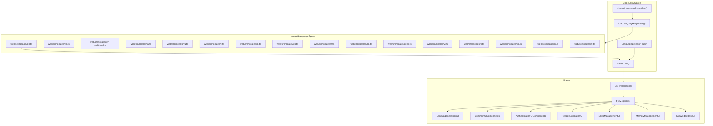
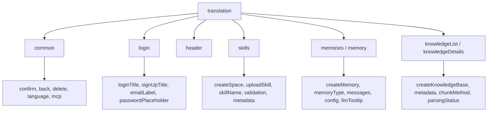
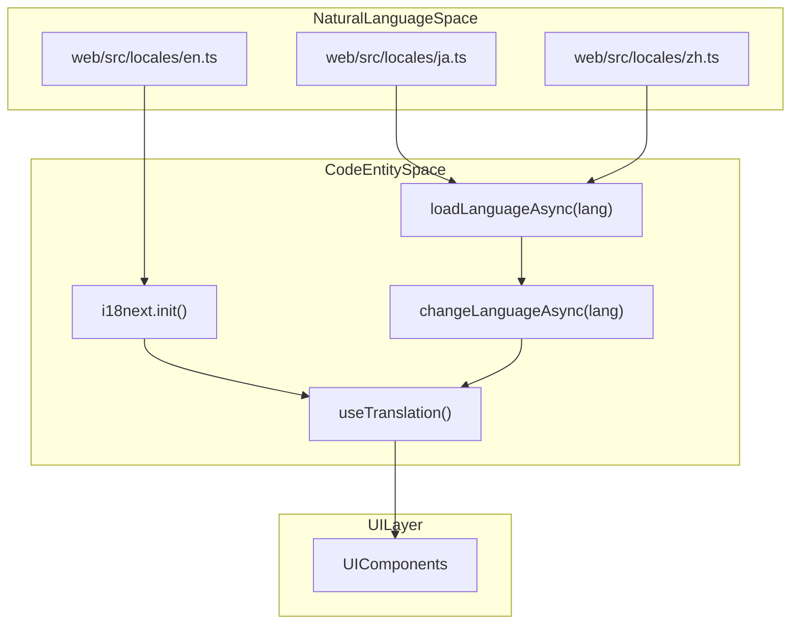

<!-- source: DeepWiki mcp.deepwiki.com · repo infiniflow/ragflow · page 4.1 Internationalization System · fetched 2026-10-29 -->

# Internationalization System

<details>
<summary>Relevant source files</summary>

The following files were used as context for generating this wiki page:

- [web/src/locales/ar.ts](web/src/locales/ar.ts)
- [web/src/locales/bg.ts](web/src/locales/bg.ts)
- [web/src/locales/de.ts](web/src/locales/de.ts)
- [web/src/locales/en.ts](web/src/locales/en.ts)
- [web/src/locales/es.ts](web/src/locales/es.ts)
- [web/src/locales/fr.ts](web/src/locales/fr.ts)
- [web/src/locales/id.ts](web/src/locales/id.ts)
- [web/src/locales/it.ts](web/src/locales/it.ts)
- [web/src/locales/ja.ts](web/src/locales/ja.ts)
- [web/src/locales/ko.ts](web/src/locales/ko.ts)
- [web/src/locales/pt-br.ts](web/src/locales/pt-br.ts)
- [web/src/locales/ru.ts](web/src/locales/ru.ts)
- [web/src/locales/tr.ts](web/src/locales/tr.ts)
- [web/src/locales/vi.ts](web/src/locales/vi.ts)
- [web/src/locales/zh-traditional.ts](web/src/locales/zh-traditional.ts)
- [web/src/locales/zh.ts](web/src/locales/zh.ts)

</details>


This document details the internationalization (i18n) system implemented in the RAGFlow web frontend. The system enables rich multilingual user interfaces through a structured translation key hierarchy, supporting dynamic language loading and seamless localization for over 15 languages.

## Overview

RAGFlow's internationalization infrastructure is based on the widely used [`i18next`](https://www.i18next.com/) library, with the React integration provided by [`react-i18next`](https://react.i18next.com/). The system supports 15+ languages including English, Simplified & Traditional Chinese, Japanese, Russian, German, French, Spanish, Italian, Dutch, Portuguese (Brazil), Vietnamese, Indonesian, Bulgarian, Arabic, and Turkish.

To optimize frontend performance and reduce initial bundle size, the English locale (`en`) forms a static base bundle included in the main JavaScript payload. Other languages are lazy-loaded asynchronously on demand when the user switches language or on first rendering in their locale. This dynamic import mechanism reduces the initial load, accelerating page rendering especially for users who keep English as default.

The i18n module organizes translation keys by feature namespaces, facilitating maintainable, modular translation management. It provides a consistent method to switch languages on the fly and to interpolate dynamic content within strings.

Sources: [web/src/locales/en.ts:1-203](), [web/src/locales/zh.ts:1-216](), [web/src/locales/zh-traditional.ts:1-186](), [web/src/locales/ja.ts:1-223](), [web/src/locales/vi.ts:1-153](), [web/src/locales/de.ts:1-174](), [web/src/locales/ru.ts:1-186](), [web/src/locales/id.ts:1-147](), [web/src/locales/pt-br.ts:1-147](), [web/src/locales/es.ts:1-142](), [web/src/locales/fr.ts:1-45](), [web/src/locales/tr.ts:1-196]()

## Supported Languages

RAGFlow supports the following languages, each identified by their locale code and backed by TypeScript translation files under `web/src/locales/`:

| Language             | Locale Code      | File                  |
|----------------------|------------------|-----------------------|
| English              | `en`             | `en.ts`               |
| Simplified Chinese   | `zh`             | `zh.ts`               |
| Traditional Chinese  | `zh-traditional` | `zh-traditional.ts`   |
| Russian              | `ru`             | `ru.ts`               |
| Indonesian           | `id`             | `id.ts`               |
| Japanese             | `ja`             | `ja.ts`               |
| Vietnamese           | `vi`             | `vi.ts`               |
| Portuguese (Brazil)  | `pt-br`          | `pt-br.ts`            |
| German               | `de`             | `de.ts`               |
| Italian              | `it`             | `it.ts`               |
| Spanish              | `es`             | `es.ts`               |
| French               | `fr`             | `fr.ts`               |
| Bulgarian            | `bg`             | `bg.ts`               |
| Arabic               | `ar`             | `ar.ts`               |
| Turkish              | `tr`             | `tr.ts`               |
| Dutch                | `nl`             | `nl.ts`               |

Each file exports a nested JSON-like object under the top-level `translation` key, extending from general to feature-focused keys.

Sources: [web/src/locales/en.ts:3-60](), [web/src/locales/zh.ts:3-60](), [web/src/locales/zh-traditional.ts:3-60](), [web/src/locales/ja.ts:3-60](), [web/src/locales/vi.ts:3-48](), [web/src/locales/de.ts:3-56](), [web/src/locales/ru.ts:3-60](), [web/src/locales/id.ts:3-44](), [web/src/locales/pt-br.ts:3-50](), [web/src/locales/es.ts:3-50](), [web/src/locales/fr.ts:3-20](), [web/src/locales/tr.ts:3-60]()

## System Architecture and Data Flow

The i18n system integrates static and runtime translation sources with React components, enabling lazy loading and language switching. The key components are:

- **Translation Files:** Statically authored `.ts` files exporting the language-specific translation JSON.
- **i18next Core:** Provides language detection, resource management, and translation querying.
- **Language Detection:** Detects browser language or falls back to default on load.
- **Lazy Loading:** Dynamically imports language packs other than English.
- **React Integration:** The `useTranslation` hook supplies access to the current translation function `t()`.

### Data Flow Diagram: Translation Files to React UI Components

Diagram: "i18nDataFlow"

Sources: [web/src/locales/en.ts:1-2](), [web/src/locales/ja.ts:1-2](), [web/src/locales/zh.ts:1-2](), [web/src/locales/tr.ts:1-2]()

## Translation Key Hierarchy

Translations use a well-defined hierarchical namespace rooted in the `translation` namespace. This structure ensures clear separation of concerns, easier translation management, and mitigates key name clashes.

### Key Namespace Domains by UI Feature

Diagram: "i18nNamespaceHierarchy"

Sources: [web/src/locales/en.ts:3-203](), [web/src/locales/zh.ts:80-216](), [web/src/locales/de.ts:73-174](), [web/src/locales/ru.ts:80-186](), [web/src/locales/zh-traditional.ts:82-186](), [web/src/locales/tr.ts:97-196]()

## Technical Implementation Details

### Interpolation and Parameterized Translations

Translation strings support variable interpolation with the `{{variable}}` syntax. This flexibility allows inserting dynamic data such as counts, usernames, or other runtime parameters into translations.

Example snippets from English translations:

```ts
"skills.filesCount": "{{count}} files",
"common.top": "Top {{top}}",
"common.descriptionMaxLength": "Description must be at most {{max}} characters.",
```

Interpolation is handled transparently by the `t()` function provided by `useTranslation()` and supports pluralization and formatting when necessary.

Sources: [web/src/locales/en.ts:18-25](), [web/src/locales/en.ts:27-28](), [web/src/locales/en.ts:171]()

### Deeply Nested Keys and Rich Metadata

Several translation namespaces contain complex nested keys for advanced application scenarios:

- **Memory subsystem**: Includes explanation tooltips for different memory types (raw, semantic, episodic, procedural), size calculations, deletion warnings, and UI labels for memory sessions and messages.
- **Skills UI**: Has detailed validation messages (e.g., missing `SKILL.md` file, incorrect version formats), semantic version help text, file upload status messages, and metadata field descriptions.
- **Knowledge base UI**: Contains elaborate chunking method explanations, parsing progress messages, retrieval similarity threshold tooltips, and dataset configuration terms.

This structure ensures the frontend can express detailed contextual information, improving end-user clarity in various locales.

Sources: [web/src/locales/en.ts:168-203](), [web/src/locales/zh.ts:148-216](), [web/src/locales/de.ts:113-174](), [web/src/locales/ru.ts:120-186](), [web/src/locales/zh-traditional.ts:92-186](), [web/src/locales/tr.ts:141-196]()

---

## Summary Diagram: Mapping Natural Language System to Code Entities

Diagram: "i18nCodeEntityMapping"

Sources: [web/src/locales/en.ts:1-2](), [web/src/locales/ja.ts:1-2](), [web/src/locales/zh.ts:1-2](), [web/src/locales/tr.ts:1-2]()

---

# References

- `web/src/locales/en.ts`, lines 1-203  
- `web/src/locales/zh.ts`, lines 1-216  
- `web/src/locales/zh-traditional.ts`, lines 1-186  
- `web/src/locales/ja.ts`, lines 1-223  
- `web/src/locales/vi.ts`, lines 1-153  
- `web/src/locales/de.ts`, lines 1-174  
- `web/src/locales/ru.ts`, lines 1-186  
- `web/src/locales/id.ts`, lines 1-147  
- `web/src/locales/pt-br.ts`, lines 1-147  
- `web/src/locales/es.ts`, lines 1-142  
- `web/src/locales/fr.ts`, lines 1-45  
- `web/src/locales/tr.ts`, lines 1-196  
- `web/src/locales/nl.ts`

---

