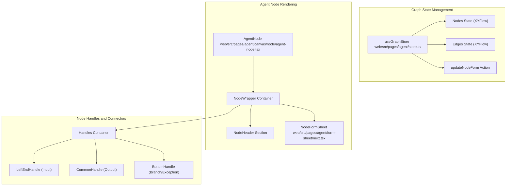

<!-- source: DeepWiki mcp.deepwiki.com · repo infiniflow/ragflow · page 4.2 UI Component Architecture · fetched 2026-10-29 -->

# UI Component Architecture

<details>
<summary>Relevant source files</summary>

The following files were used as context for generating this wiki page:

- [.gitattributes](.gitattributes)
- [internal/parser/parser/testdata/sample.msg](internal/parser/parser/testdata/sample.msg)
- [lefthook.yml](lefthook.yml)
- [test/test_check_files.py](test/test_check_files.py)
- [tools/hooks/check_files.py](tools/hooks/check_files.py)
- [web/src/components/auto-keywords-form-field.tsx](web/src/components/auto-keywords-form-field.tsx)
- [web/src/components/children-delimiter-form.test.tsx](web/src/components/children-delimiter-form.test.tsx)
- [web/src/components/children-delimiter-form.tsx](web/src/components/children-delimiter-form.tsx)
- [web/src/components/delimiter-form-field.tsx](web/src/components/delimiter-form-field.tsx)
- [web/src/components/dynamic-form.tsx](web/src/components/dynamic-form.tsx)
- [web/src/components/entity-types-form-field.tsx](web/src/components/entity-types-form-field.tsx)
- [web/src/components/excel-to-html-form-field.tsx](web/src/components/excel-to-html-form-field.tsx)
- [web/src/components/llm-setting-items/slider.tsx](web/src/components/llm-setting-items/slider.tsx)
- [web/src/components/max-token-number-from-field.tsx](web/src/components/max-token-number-from-field.tsx)
- [web/src/components/message-history-window-size-item.tsx](web/src/components/message-history-window-size-item.tsx)
- [web/src/components/originui/number-input.tsx](web/src/components/originui/number-input.tsx)
- [web/src/components/page-rank-form-field.tsx](web/src/components/page-rank-form-field.tsx)
- [web/src/components/rerank.tsx](web/src/components/rerank.tsx)
- [web/src/components/similarity-slider/index.tsx](web/src/components/similarity-slider/index.tsx)
- [web/src/components/slider-input-form-field.tsx](web/src/components/slider-input-form-field.tsx)
- [web/src/components/top-n-item.tsx](web/src/components/top-n-item.tsx)
- [web/src/components/ui/input.tsx](web/src/components/ui/input.tsx)
- [web/src/components/ui/label.tsx](web/src/components/ui/label.tsx)
- [web/src/components/ui/modal/modal.tsx](web/src/components/ui/modal/modal.tsx)
- [web/src/components/ui/select.tsx](web/src/components/ui/select.tsx)
- [web/src/components/ui/switch.tsx](web/src/components/ui/switch.tsx)
- [web/src/constants/form.ts](web/src/constants/form.ts)
- [web/src/hooks/common-hooks.tsx](web/src/hooks/common-hooks.tsx)
- [web/src/pages/agent/form/categorize-form/dynamic-categorize.tsx](web/src/pages/agent/form/categorize-form/dynamic-categorize.tsx)
- [web/src/pages/agent/form/categorize-form/dynamic-example.tsx](web/src/pages/agent/form/categorize-form/dynamic-example.tsx)
- [web/src/pages/agent/form/categorize-form/index.tsx](web/src/pages/agent/form/categorize-form/index.tsx)
- [web/src/pages/agent/form/categorize-form/use-form-schema.ts](web/src/pages/agent/form/categorize-form/use-form-schema.ts)
- [web/src/pages/agent/form/token-chunker-form/index.tsx](web/src/pages/agent/form/token-chunker-form/index.tsx)
- [web/src/pages/agent/form/variable-aggregator-form/name-input.tsx](web/src/pages/agent/form/variable-aggregator-form/name-input.tsx)
- [web/src/pages/dataset/dataset-overview/overview-table.tsx](web/src/pages/dataset/dataset-overview/overview-table.tsx)
- [web/src/pages/next-chats/chat/app-settings/dynamic-variable.tsx](web/src/pages/next-chats/chat/app-settings/dynamic-variable.tsx)
- [web/src/pages/user-setting/components/user-setting-header/index.tsx](web/src/pages/user-setting/components/user-setting-header/index.tsx)
- [web/src/pages/user-setting/data-source/add-datasource-modal.tsx](web/src/pages/user-setting/data-source/add-datasource-modal.tsx)
- [web/src/pages/user-setting/data-source/component/added-source-card.tsx](web/src/pages/user-setting/data-source/component/added-source-card.tsx)
- [web/src/pages/user-setting/data-source/component/box-token-field.tsx](web/src/pages/user-setting/data-source/component/box-token-field.tsx)
- [web/src/pages/user-setting/data-source/component/gmail-token-field.tsx](web/src/pages/user-setting/data-source/component/gmail-token-field.tsx)
- [web/src/pages/user-setting/data-source/component/google-drive-token-field.tsx](web/src/pages/user-setting/data-source/component/google-drive-token-field.tsx)
- [web/src/pages/user-setting/data-source/constant/bitbucket-constant.tsx](web/src/pages/user-setting/data-source/constant/bitbucket-constant.tsx)
- [web/src/pages/user-setting/data-source/constant/confluence-constant.tsx](web/src/pages/user-setting/data-source/constant/confluence-constant.tsx)
- [web/src/pages/user-setting/data-source/constant/jira-constant.tsx](web/src/pages/user-setting/data-source/constant/jira-constant.tsx)
- [web/src/pages/user-setting/data-source/constant/s3-constant.tsx](web/src/pages/user-setting/data-source/constant/s3-constant.tsx)
- [web/src/pages/user-setting/data-source/constant/seafile-constant.tsx](web/src/pages/user-setting/data-source/constant/seafile-constant.tsx)
- [web/src/pages/user-setting/data-source/data-source-detail-page/index.tsx](web/src/pages/user-setting/data-source/data-source-detail-page/index.tsx)
- [web/src/pages/user-setting/data-source/hooks.ts](web/src/pages/user-setting/data-source/hooks.ts)
- [web/src/pages/user-setting/data-source/index.tsx](web/src/pages/user-setting/data-source/index.tsx)
- [web/src/pages/user-setting/sidebar/hooks.tsx](web/src/pages/user-setting/sidebar/hooks.tsx)
- [web/src/services/data-source-service.ts](web/src/services/data-source-service.ts)
- [web/src/stories/number-input.stories.ts](web/src/stories/number-input.stories.ts)

</details>


## Purpose and Scope

This page documents the UI component architecture of the RAGFlow web frontend (`web/src/`). The system relies on a hybrid UI stack combining **Ant Design (AntD)**, **Radix UI**, and custom UI primitives built with **Tailwind CSS**. It covers shared form field components, dynamic forms (`DynamicForm`), tabular data grids (`@tanstack/react-table`), dialogs and modals (`Modal`), and graph workflow editing using React Flow (`@xyflow/react`) in the agent canvas.

---

## Architecture Overview and UI Layering

The RAGFlow frontend adopts a layered approach where raw browser primitives and headless UI building blocks are wrapped into high-level design system components and domain-specific configuration forms.

```mermaid
graph TD
    subgraph "Application Shell & Providers"
        AppContainer["AppContainer web/src/app.tsx"] --> RootProvider["RootProvider web/src/app.tsx"]
        RootProvider --> ThemeProvider["ThemeProvider web/src/components/theme-provider.tsx"]
        RootProvider --> QueryClientProvider["QueryClientProvider"]
        RootProvider --> TooltipProvider["TooltipProvider"]
    end

    subgraph "State & Data Management"
        useGraphStore["useGraphStore web/src/pages/agent/store.ts"] --> XYFlowState["@xyflow/react State"]
        reactQuery["React Query (Server State)"]
        ZustandStore["Zustand Client Store"]
    end

    subgraph "Form and Validation Layer"
        useForm["useForm react-hook-form"] --> zodResolver["zodResolver @hookform/resolvers/zod"]
        zodResolver --> FormSchema["FormSchema ZodSchema web/src/components/dynamic-form.tsx"]
        DynamicForm["DynamicForm web/src/components/dynamic-form.tsx"] --> useForm
    end

    subgraph "Primitive and Component Space"
        RadixPrimitives["Radix UI Primitives (Select, Dialog, Popover)"] --> TailwindCSS["Tailwind CSS web/tailwind.css"]
        TailwindCSS --> SharedFormFields["Shared Form Fields (Input, NumberInput, SliderInputFormField)"]
        AntD["Ant Design Components"] --> SharedFormFields
    end

    subgraph "Agent Canvas"
        XYFlowReact["@xyflow/react web/src/pages/agent/canvas/"] --> AgentNodes["Agent Node Components web/src/pages/agent/canvas/node/agent-node.tsx"]
        AgentNodes --> Handles["Handles (LeftEndHandle, CommonHandle)"]
    end
```


Sources: [web/src/app.tsx:92-120](), [web/src/pages/agent/store.ts:146-220](), [web/src/components/dynamic-form.tsx:17-49](), [web/package.json:20,42-67,75]()

---

## Ant Design, Radix UI, and Custom Component Primitives

RAGFlow combines three distinct UI libraries to balance enterprise functionality, accessibility, and visual customization:

- **Ant Design (AntD):** Selected for specific complex modal dialogs, icon sets, and structured enterprise UI affordances.
- **Radix UI:** Provides unstyled, accessible primitives (`Select`, `Dialog`, `Popover`, `Tabs`) that power keyboard navigation and ARIA compliance without locking down visual styling.
- **Custom Components:** Styled via **Tailwind CSS**, these components build on native or Radix elements to offer specialized RAG behaviors (e.g., `Input`, `NumberInput`, `MultiSelect`, `SliderInputFormField`).

### Key UI Primitives

- **Input & Variations:** `Input` supports prefixes, suffixes, password toggles, and clear states [web/src/components/ui/input.tsx:18-154](). Specialized variants include `SearchInput` and `BlurInput` (`InnerBlurInput`) [web/src/components/ui/input.tsx:160-213]().
- **NumberInput:** Extends native input controls with step increments/decrements, decimal precision clamping (`limitDecimals`), and integer restrictions (`BlockedIntegerKeys`) [web/src/components/originui/number-input.tsx:32-114]().
- **Select:** Built on `@radix-ui/react-select`, providing keyboard-accessible drop-downs, viewport scrolling, and indicator checks [web/src/components/ui/select.tsx:1-174]().

Sources: [web/src/components/ui/input.tsx:1-234](), [web/src/components/originui/number-input.tsx:1-259](), [web/src/components/ui/select.tsx:1-174]()

---

## Shared Form Fields and Dynamic Form System

Forms across dataset configuration, data source connections (`SourceDetailPage`), and agent node properties utilize a unified architecture combining **React Hook Form**, **Zod**, and declarative field configs.

### DynamicForm Implementation

The `DynamicForm` component parses an array of `FormFieldConfig` objects to render forms dynamically [web/src/components/dynamic-form.tsx:124-170]():

- **Field Type Enumeration (`FormFieldType`):** Supports text, email, password, number, textarea, select, multi-select, checkbox, switch, tag, segmented controls, and custom render functions [web/src/components/dynamic-form.tsx:63-76]().
- **Schema Generation (`generateSchema`):** Automatically maps `FormFieldConfig[]` entries into a unified `ZodSchema` using `z.coerce.number()`, `z.string().email()`, and custom validations [web/src/components/dynamic-form.tsx:173-206]().
- **Conditional Rendering:** Fields evaluate `shouldRender(formValues)` to dynamically display or hide themselves based on sibling form values [web/src/components/dynamic-form.tsx:108]().

```typescript
export interface FormFieldConfig {
  name: string;
  label: string;
  type: FormFieldType;
  required?: boolean;
  placeholder?: string;
  options?: { label: string; value: string }[];
  defaultValue?: any;
  shouldRender?: (formValues: any) => boolean;
  render?: (fieldProps: ControllerRenderProps) => React.ReactNode;
}
```
Sources: [web/src/components/dynamic-form.tsx:63-121](), [web/src/pages/user-setting/data-source/data-source-detail-page/index.tsx:68-129]()

### Specialized Form Components

- **SliderInputFormField:** Combines `SingleFormSlider` and `NumberInput` inside a react-hook-form `FormField`, supporting percentage conversions and step normalization [web/src/components/slider-input-form-field.tsx:51-160]().
- **SimilaritySliderFormField:** Renders similarity thresholds and keyword-to-vector balance sliders for retrieval evaluation [web/src/components/similarity-slider/index.tsx:53-149]().
- **RerankFormField:** Integrates `ModelTreeSelect` to choose reranking models (`rerank_id`) backed by Zod validation schemas [web/src/components/rerank.tsx:38-73]().

Sources: [web/src/components/slider-input-form-field.tsx:51-160](), [web/src/components/similarity-slider/index.tsx:53-149](), [web/src/components/rerank.tsx:38-73]()

---

## React Flow Integration for Agent Canvas and Workflow Editing

The agent canvas uses `@xyflow/react` to render an interactive node graph for agent workflows and prompt pipelines.

### Graph State and Component Architecture


Sources: [web/src/pages/agent/store.ts:106-220](), [web/src/pages/agent/canvas/node/agent-node.tsx:17-112](), [web/src/pages/agent/form-sheet/next.tsx:52-56]()

- **Zustand Graph Store (`useGraphStore`):** Manages nodes, edges, selections, and execution flows with `immer` state immutability.
- **Node Forms:** Operators like `TokenChunkerForm` and `CategorizeForm` bind local `react-hook-form` instances to node data payloads, syncing changes back to the graph store via `useWatchFormChange` [web/src/pages/agent/form/token-chunker-form/index.tsx:82-114](), [web/src/pages/agent/form/categorize-form/index.tsx:27-32]().

Sources: [web/src/pages/agent/store.ts:146-220](), [web/src/pages/agent/canvas/node/agent-node.tsx:17-112](), [web/src/pages/agent/form/token-chunker-form/index.tsx:82-114]()

---

## Table Components and Dialogs

### TanStack Table Integration

Data-heavy screens (such as dataset file logs and document tables) use `@tanstack/react-table` for headless table orchestration combined with custom UI components [web/src/pages/dataset/dataset-overview/overview-table.tsx:29-39]():

- **Column Definitions (`ColumnDef`):** Built with custom cell formatters, tooltip wrappers (`TooltipContent`), sorting toggles (`ArrowUpDown`), and status badges (`FileStatusBadge`) [web/src/pages/dataset/dataset-overview/overview-table.tsx:56-199]().
- **Pagination & Sorting:** Managed natively through table hooks (`getCoreRowModel`, `getPaginationRowModel`, `getSortedRowModel`) and paired with `RAGFlowPagination` [web/src/pages/dataset/dataset-overview/overview-table.tsx:7,29-39]().

Sources: [web/src/pages/dataset/dataset-overview/overview-table.tsx:29-199]()

### Dialog and Modal Subsystem

Modals and dialogs are implemented using Radix UI Dialog primitives wrapped in `Modal` (`web/src/components/ui/modal/modal.tsx`) [web/src/components/ui/modal/modal.tsx:3-9]():

- **Imperative & Declarative API:** Supports both controlled `<Modal open={...}>` components and static helper methods (`Modal.show`, `Modal.confirm`, `Modal.warning`) [web/src/components/ui/modal/modal.tsx:44-53]().
- **Configurable Footers:** Manages loading indicators (`confirmLoading`), custom action buttons, and keyboard dismissal handlers for `Escape` key events [web/src/components/ui/modal/modal.tsx:83-172]().

Sources: [web/src/components/ui/modal/modal.tsx:1-229]()

---

## Summary

RAGFlow's UI component architecture integrates **Ant Design**, **Radix UI**, and custom **Tailwind CSS** primitives to build a responsive, type-safe, and accessible interface. Through declarative dynamic forms, React Hook Form validation, TanStack tables, and React Flow graph execution, the frontend maintains consistency across settings, pipelines, and visual agent editing.

Sources: [web/src/components/dynamic-form.tsx:1-206](), [web/src/components/ui/modal/modal.tsx:1-229](), [web/src/pages/dataset/dataset-overview/overview-table.tsx:29-54](), [web/src/pages/agent/store.ts:146-220]()

---

