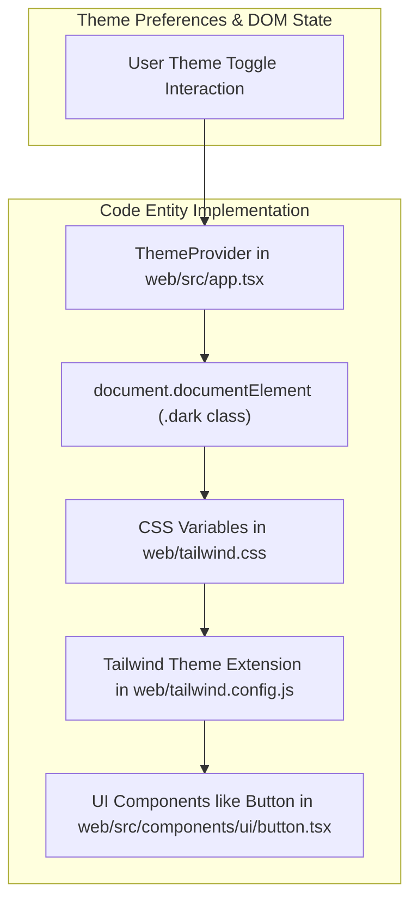
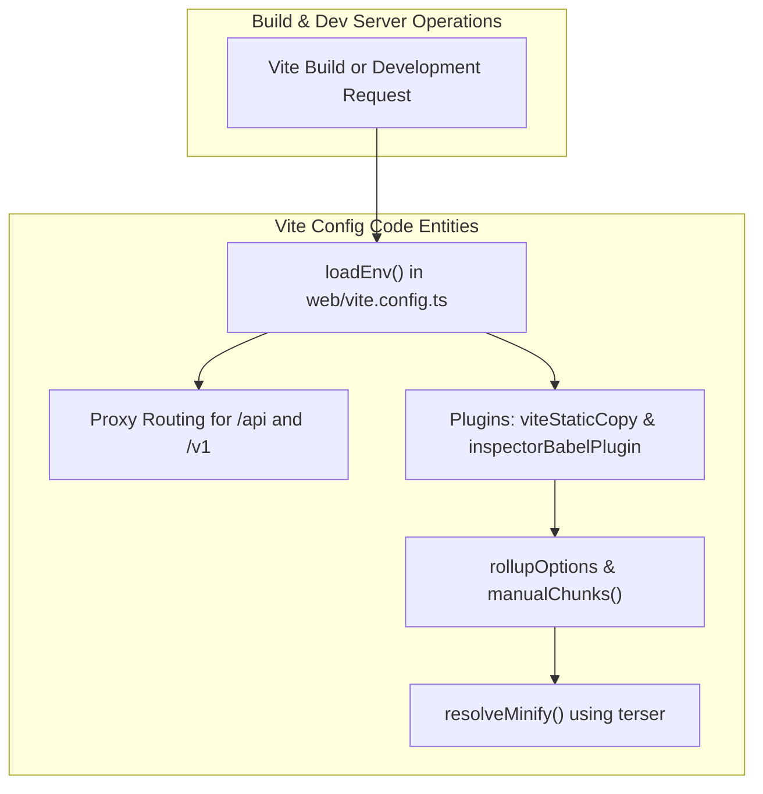

<!-- source: DeepWiki mcp.deepwiki.com · repo infiniflow/ragflow · page 4.3 Theming and Build Setup · fetched 2026-10-29 -->

# Theming and Build Setup

<details>
<summary>Relevant source files</summary>

The following files were used as context for generating this wiki page:

- [web/.env.development](web/.env.development)
- [web/.env.production](web/.env.production)
- [web/package-lock.json](web/package-lock.json)
- [web/package.json](web/package.json)
- [web/src/app.tsx](web/src/app.tsx)
- [web/src/components/ui/badge.tsx](web/src/components/ui/badge.tsx)
- [web/src/components/ui/button.tsx](web/src/components/ui/button.tsx)
- [web/src/components/ui/checkbox.tsx](web/src/components/ui/checkbox.tsx)
- [web/src/components/webhook-response-status.tsx](web/src/components/webhook-response-status.tsx)
- [web/src/constants/common.ts](web/src/constants/common.ts)
- [web/src/locales/config.ts](web/src/locales/config.ts)
- [web/src/pages/agent/form/begin-form/schema.ts](web/src/pages/agent/form/begin-form/schema.ts)
- [web/src/pages/agent/form/begin-form/use-handle-mode-change.ts](web/src/pages/agent/form/begin-form/use-handle-mode-change.ts)
- [web/src/pages/agent/form/begin-form/utils.test.ts](web/src/pages/agent/form/begin-form/utils.test.ts)
- [web/src/pages/agent/form/begin-form/utils.ts](web/src/pages/agent/form/begin-form/utils.ts)
- [web/src/pages/agent/form/begin-form/webhook/auth.tsx](web/src/pages/agent/form/begin-form/webhook/auth.tsx)
- [web/src/pages/agent/form/begin-form/webhook/dynamic-request.tsx](web/src/pages/agent/form/begin-form/webhook/dynamic-request.tsx)
- [web/src/pages/agent/form/begin-form/webhook/dynamic-response.tsx](web/src/pages/agent/form/begin-form/webhook/dynamic-response.tsx)
- [web/src/pages/agent/form/begin-form/webhook/index.tsx](web/src/pages/agent/form/begin-form/webhook/index.tsx)
- [web/src/pages/agent/form/begin-form/webhook/request-schema.tsx](web/src/pages/agent/form/begin-form/webhook/request-schema.tsx)
- [web/src/pages/agent/form/begin-form/webhook/response.tsx](web/src/pages/agent/form/begin-form/webhook/response.tsx)
- [web/src/pages/agent/form/components/dynamic-string-form.tsx](web/src/pages/agent/form/components/dynamic-string-form.tsx)
- [web/src/pages/agent/form/message-form/index.tsx](web/src/pages/agent/form/message-form/index.tsx)
- [web/src/pages/agent/form/message-form/use-show-response-status.ts](web/src/pages/agent/form/message-form/use-show-response-status.ts)
- [web/src/pages/agent/hooks/use-build-webhook-url.ts](web/src/pages/agent/hooks/use-build-webhook-url.ts)
- [web/src/pages/datasets/dataset-card.tsx](web/src/pages/datasets/dataset-card.tsx)
- [web/src/pages/home/applications.tsx](web/src/pages/home/applications.tsx)
- [web/src/pages/home/banner.tsx](web/src/pages/home/banner.tsx)
- [web/src/pages/home/datasets.tsx](web/src/pages/home/datasets.tsx)
- [web/src/pages/home/index.tsx](web/src/pages/home/index.tsx)
- [web/tailwind.config.js](web/tailwind.config.js)
- [web/tailwind.css](web/tailwind.css)
- [web/vite.config.ts](web/vite.config.ts)

</details>


## Purpose and Scope

This page provides an in-depth technical overview of the theming and build configuration for the RAGFlow frontend application. It covers how Tailwind CSS is customized using CSS variables for light/dark mode theming, how the React runtime manages theme state and class toggling, and how Vite is configured to enable modern build features and environment-specific behavior.

Sources: `[web/tailwind.css:5-216]()`, `[web/tailwind.config.js:5-184]()`

---

## 1. Theming System Overview

RAGFlow's theming is architected on layered abstractions:
- **Global CSS Variables** defining semantic color tokens and design variables for all UI elements.
- **Tailwind CSS Extension** that maps utility colors and styles directly to these CSS variables.
- **Runtime React Theme Management** with a `ThemeProvider` that toggles the `.dark` class on the root HTML node and persists user preferences.
- **Build Integration** via Vite to handle CSS preprocessing, environment variables, static assets, optimized builds, and dev proxying.

Sources: `[web/tailwind.css:5-216]()`, `[web/tailwind.config.js:5-184]()`, `[web/src/app.tsx:80-105]()`

---

## 2. CSS Variable Theming with Light and Dark Modes

### CSS Custom Properties Definition (`web/tailwind.css`)

The core of theming is the use of CSS custom properties (variables) defined inside `web/tailwind.css`:
- The `:root` selector defines the **light mode** version of all variables `[web/tailwind.css:5-118]()`.
- The `.dark` CSS class defines the **dark mode** variant by overriding those variables `[web/tailwind.css:120-216]()`.

Example variables include:
- Background and foreground hues (`--background`, `--foreground`)
- Semantic colors for UI elements (`--primary`, `--secondary`, `--muted`, `--destructive`)
- Border and ring colors (`--border`, `--ring`)
- Radius and spacing (`--radius`)
- Sidebar specific color set (`--sidebar-background`, `--sidebar-foreground`)

Sources: `[web/tailwind.css:5-216]()`

---

## 3. Tailwind CSS Configuration (`web/tailwind.config.js`)

### Dark Mode Strategy

Tailwind CSS is configured with `[web/tailwind.config.js:6]()`:
```js
darkMode: ['selector'],
```
This setting instructs Tailwind to enable dark mode styles based on the presence of a `.dark` selector on the root element.

### Content Paths and Theme Extension

Tailwind scans specific component and page paths `[web/tailwind.config.js:7-11]()`. The `theme.extend.colors` block defines comprehensive mappings of semantic colors to CSS variables `[web/tailwind.config.js:33-154]()`:

```js
colors: {
  border: 'var(--border-default)',
  input: 'hsl(var(--input))',
  ring: 'hsl(var(--ring))',
  background: 'var(--background)',
  foreground: 'var(--colors-text-neutral-strong)',
  // ...
}
```

Custom screen breakpoints are also defined to support wide dashboards and agent canvases `[web/tailwind.config.js:20-28]()`.

Sources: `[web/tailwind.config.js:5-184]()`

---

## 4. Runtime Theme Management in React

### `ThemeProvider` Component (`web/src/app.tsx`)

The React root component tree is wrapped inside a `ThemeProvider` which is responsible for managing theme state (`dark`, `light`, or `system`), persisting user theme preferences in `localStorage` under `"ragflow-ui-theme"` `[web/src/app.tsx:97-100]()`, and toggling the `.dark` class on `document.documentElement`.

The available themes are enumerated in `ThemeEnum` `[web/src/constants/common.ts:237-241]()`:
```ts
export enum ThemeEnum {
  Dark = 'dark',
  Light = 'light',
  System = 'system',
}
```

Sources: `[web/src/app.tsx:80-105]()`, `[web/src/constants/common.ts:237-241]()`

---

## 5. Vite Build and Development Server Configuration (`web/vite.config.ts`)

### Environment Variables and Proxy Setup

Vite utilizes `loadEnv(mode, process.cwd(), '')` to load layered `.env` files `[web/vite.config.ts:43]()`. It also defines proxy routing for local development backend connectivity `[web/vite.config.ts:46-62]()`:

| Frontend API Path | Proxy Target |
|---|---|
| `/api/v1/admin` | `http://127.0.0.1:9381/` |
| `/api` | `http://127.0.0.1:9380/` |
| `/v1` | `http://127.0.0.1:9380/` |

### Build Options and Chunking

The build configuration outputs to `dist/` with asset naming conventions, manual chunking for vendor libraries (e.g. `d3`, `ajv`, `antv`, `lodash`) `[web/vite.config.ts:159-194]`, minification via `terser` `[web/vite.config.ts:32,202]`, and ES2015 target compatibility `[web/vite.config.ts:221]()`.

Sources: `[web/vite.config.ts:41-234]()`

---

## 6. Theming and Build Architecture Diagrams

### Diagram 1: Theming & Runtime Execution



Sources: `[web/tailwind.css:5-216]()`, `[web/tailwind.config.js:5-184]()`, `[web/src/app.tsx:80-105]()`, `[web/src/components/ui/button.tsx:9-32]()`

### Diagram 2: Vite Build and Dev Server Configuration Pipeline



Sources: `[web/vite.config.ts:41-234]()`

---

