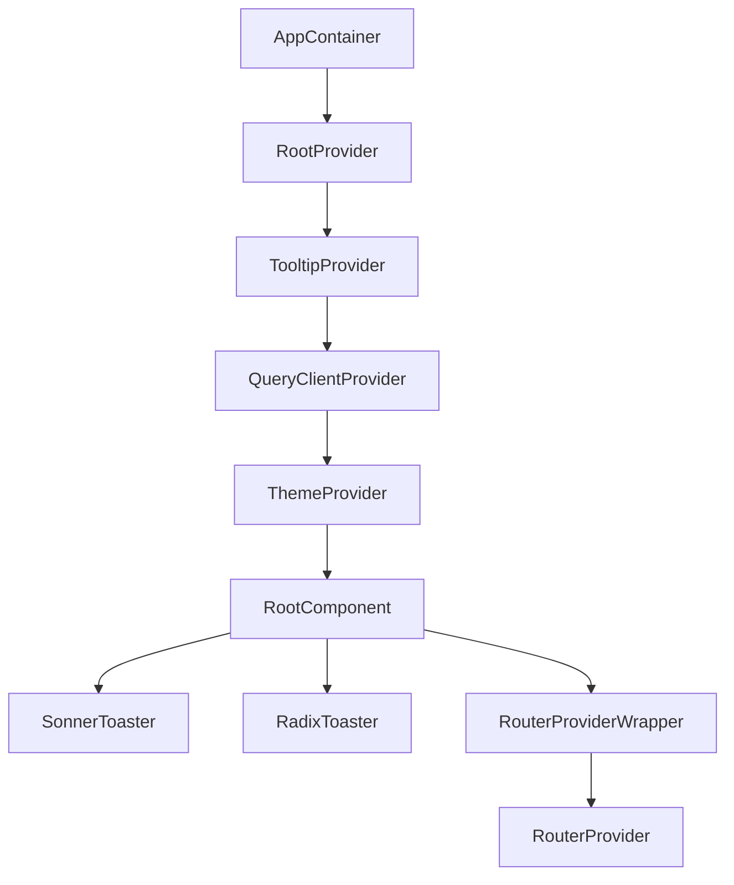
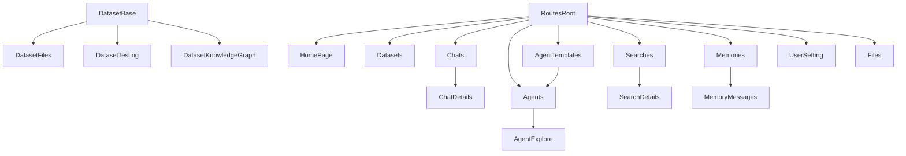
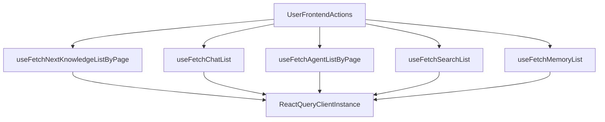
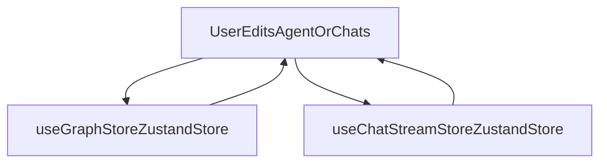
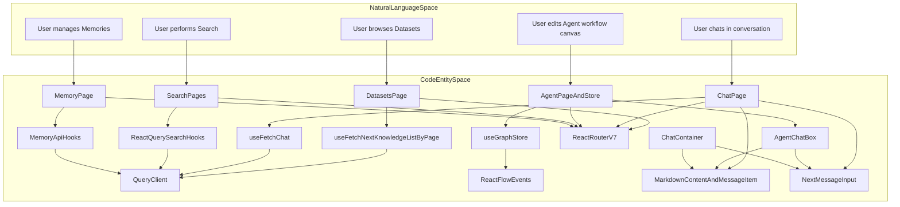

<!-- source: DeepWiki mcp.deepwiki.com · repo infiniflow/ragflow · page 4.4 Page Structure and State Management · fetched 2026-10-29 -->

# Page Structure and State Management

Relevant source files

The following files were used as context for generating this wiki page:

- [web/src/components/embed-container.tsx](web/src/components/embed-container.tsx)
- [web/src/components/embed-dialog/__tests__/index.test.tsx](web/src/components/embed-dialog/__tests__/index.test.tsx)
- [web/src/components/embed-dialog/index.tsx](web/src/components/embed-dialog/index.tsx)
- [web/src/components/embed-dialog/use-show-embed-dialog.ts](web/src/components/embed-dialog/use-show-embed-dialog.ts)
- [web/src/components/floating-chat-widget.tsx](web/src/components/floating-chat-widget.tsx)
- [web/src/components/message-input/next.tsx](web/src/components/message-input/next.tsx)
- [web/src/components/message-item/group-button.tsx](web/src/components/message-item/group-button.tsx)
- [web/src/components/message-item/hooks.ts](web/src/components/message-item/hooks.ts)
- [web/src/components/message-item/index.tsx](web/src/components/message-item/index.tsx)
- [web/src/components/next-message-item/index.tsx](web/src/components/next-message-item/index.tsx)
- [web/src/components/search-highlight.tsx](web/src/components/search-highlight.tsx)
- [web/src/constants/authorization.ts](web/src/constants/authorization.ts)
- [web/src/hooks/auth-hooks.ts](web/src/hooks/auth-hooks.ts)
- [web/src/hooks/logic-hooks.ts](web/src/hooks/logic-hooks.ts)
- [web/src/hooks/use-login-request.ts](web/src/hooks/use-login-request.ts)
- [web/src/hooks/use-send-message.ts](web/src/hooks/use-send-message.ts)
- [web/src/pages/admin/layouts/authorized-layout.tsx](web/src/pages/admin/layouts/authorized-layout.tsx)
- [web/src/pages/admin/layouts/navigation-layout.tsx](web/src/pages/admin/layouts/navigation-layout.tsx)
- [web/src/pages/admin/layouts/root-layout.tsx](web/src/pages/admin/layouts/root-layout.tsx)
- [web/src/pages/admin/login.tsx](web/src/pages/admin/login.tsx)
- [web/src/pages/agent/chat/box.tsx](web/src/pages/agent/chat/box.tsx)
- [web/src/pages/agent/chat/chat-sheet.tsx](web/src/pages/agent/chat/chat-sheet.tsx)
- [web/src/pages/agent/chat/use-send-agent-message.ts](web/src/pages/agent/chat/use-send-agent-message.ts)
- [web/src/pages/agent/hooks/use-send-shared-message.ts](web/src/pages/agent/hooks/use-send-shared-message.ts)
- [web/src/pages/agent/share/index.tsx](web/src/pages/agent/share/index.tsx)
- [web/src/pages/home/agent-list.tsx](web/src/pages/home/agent-list.tsx)
- [web/src/pages/home/application-card.tsx](web/src/pages/home/application-card.tsx)
- [web/src/pages/home/chat-list.tsx](web/src/pages/home/chat-list.tsx)
- [web/src/pages/home/search-list.tsx](web/src/pages/home/search-list.tsx)
- [web/src/pages/next-chats/chat-stream/run-stream.ts](web/src/pages/next-chats/chat-stream/run-stream.ts)
- [web/src/pages/next-chats/chat-stream/store.ts](web/src/pages/next-chats/chat-stream/store.ts)
- [web/src/pages/next-chats/chat-stream/utils.ts](web/src/pages/next-chats/chat-stream/utils.ts)
- [web/src/pages/next-chats/chat/chat-box/next-multiple-chat-box.test.tsx](web/src/pages/next-chats/chat/chat-box/next-multiple-chat-box.test.tsx)
- [web/src/pages/next-chats/chat/chat-box/next-multiple-chat-box.tsx](web/src/pages/next-chats/chat/chat-box/next-multiple-chat-box.tsx)
- [web/src/pages/next-chats/chat/chat-box/single-chat-box.tsx](web/src/pages/next-chats/chat/chat-box/single-chat-box.tsx)
- [web/src/pages/next-chats/hooks/use-send-chat-message.ts](web/src/pages/next-chats/hooks/use-send-chat-message.ts)
- [web/src/pages/next-chats/hooks/use-send-shared-message.ts](web/src/pages/next-chats/hooks/use-send-shared-message.ts)
- [web/src/pages/next-chats/hooks/use-send-single-message.ts](web/src/pages/next-chats/hooks/use-send-single-message.ts)
- [web/src/pages/next-chats/hooks/use-upload-file.ts](web/src/pages/next-chats/hooks/use-upload-file.ts)
- [web/src/pages/next-chats/share/index.tsx](web/src/pages/next-chats/share/index.tsx)
- [web/src/pages/user-setting/index.tsx](web/src/pages/user-setting/index.tsx)
- [web/src/pages/user-setting/mcp/index.tsx](web/src/pages/user-setting/mcp/index.tsx)
- [web/src/pages/user-setting/mcp/use-bulk-operate-mcp.tsx](web/src/pages/user-setting/mcp/use-bulk-operate-mcp.tsx)
- [web/src/pages/user-setting/mcp/use-import-mcp.ts](web/src/pages/user-setting/mcp/use-import-mcp.ts)
- [web/src/pages/user-setting/profile/hooks/use-profile.ts](web/src/pages/user-setting/profile/hooks/use-profile.ts)
- [web/src/pages/user-setting/profile/index.tsx](web/src/pages/user-setting/profile/index.tsx)
- [web/src/pages/user-setting/setting-team/add-user-modal.tsx](web/src/pages/user-setting/setting-team/add-user-modal.tsx)
- [web/src/pages/user-setting/setting-team/hooks.ts](web/src/pages/user-setting/setting-team/hooks.ts)
- [web/src/pages/user-setting/setting-team/index.tsx](web/src/pages/user-setting/setting-team/index.tsx)
- [web/src/pages/user-setting/setting-team/tenant-table.tsx](web/src/pages/user-setting/setting-team/tenant-table.tsx)
- [web/src/pages/user-setting/setting-team/user-table.tsx](web/src/pages/user-setting/setting-team/user-table.tsx)
- [web/src/pages/user-setting/sidebar/index.tsx](web/src/pages/user-setting/sidebar/index.tsx)
- [web/src/routes.tsx](web/src/routes.tsx)
- [web/src/services/admin-service.ts](web/src/services/admin-service.ts)
- [web/src/services/chat-completion-stream.ts](web/src/services/chat-completion-stream.ts)
- [web/src/services/user-service.ts](web/src/services/user-service.ts)
- [web/src/utils/authorization-util.ts](web/src/utils/authorization-util.ts)

This document explains the frontend application's page structure, routing configuration, and state management architecture. It covers the provider hierarchy, routing system using React Router v7, server state management via React Query across home, dataset, chat, agent, search, memory, files, and user-setting pages, and client-side state management using Zustand (for example, the visual agent canvas editor store and chat stream store). The section also discusses integration of these mechanisms for coherent data flow and UI consistency.

---

## 1. Application Entry Point and Provider Hierarchy

The root of the frontend app is in `web/src/app.tsx`. Here, the main component `AppContainer` sets up a layered provider hierarchy and initializes React Router along with localization and theming.

### Provider Stack Overview

The nested providers orchestrate global states and utilities such as localization, tooltip management, state caching, theming, and routing context. This layered pattern is vital for consistent, cross-cutting concerns.

**Diagram: Frontend Provider Hierarchy**

Sources: [web/src/app.tsx:66-113](), [web/src/locales/config.ts:14-31]()

- The hierarchy begins with `RootProvider`, which initializes language settings and global UI configs [web/src/app.tsx:66-113]().
- `TooltipProvider` from Radix UI provides tooltips to all components [web/src/app.tsx:66-113]().
- `QueryClientProvider` from React Query manages the server state client with a configured query client (`refetchOnWindowFocus: false`, `retry: 2`) [web/src/app.tsx:66-113]().
- `ThemeProvider` toggles dark/light modes using CSS variables, defaulting to dark mode stored under `"ragflow-ui-theme"` [web/src/app.tsx:66-113]().
- The `RouterProvider` uses a centralized router instance from `web/src/routes.tsx` that governs page routing and subroutes [web/src/routes.tsx:1-217]().
- Additional toast notification systems (`Sonner` and Radix `Toaster`) inject notifications accessible across the app [web/src/app.tsx:66-113]().

Inside `RootProvider` initialization, language synchronization takes place via the initialization utilities:
- This aligns the UI language within i18n, Day.js localization, and persists user preferences [web/src/locales/config.ts:14-31]().
- It supports cross-module locale consistency for date/time and text translations [web/src/locales/config.ts:100-126]().

Sources: [web/src/app.tsx:66-113](), [web/src/locales/config.ts:14-31](), [web/src/locales/config.ts:100-126]()

---

## 2. Routing System and Page Layouts

Routing utilizes React Router v7 (`react-router`) with routes configured explicitly in `web/src/routes.tsx`. The routing tree logically segments the app into major domains including datasets, chat, agents, search, memory, files, and user settings.

**Diagram: Major Application Routes and Hierarchy**

Sources: [web/src/routes.tsx:1-217]()

Routing integrates React Router hooks to synchronize UI state with URL query parameters for search, pagination, and filters, ensuring shareable URLs and consistent user experience [web/src/hooks/logic-hooks.ts:87-133]().

### Key Routing Utilities

- **`useGetPaginationWithRouter` hook**  
  Synchronizes page number and page size state with URL search parameters, driving Ant Design and Radix UI pagination components seamlessly [web/src/hooks/logic-hooks.ts:87-133]().
- **`useGoToPreviousPageOnEmpty` hook**  
  Automatically handles edge cases when deleting items on the last page or when a filtered dataset list becomes empty, resetting filters or navigating back [web/src/hooks/logic-hooks.ts:141-189]().
- Route components are lazy-loaded via `withLazyRoute` to improve initial load performance [web/src/routes.tsx:104-120]().

Sources: [web/src/routes.tsx:1-217](), [web/src/hooks/logic-hooks.ts:87-189]()

---

## 3. Server State Management with React Query

RAGFlow frontend uses `@tanstack/react-query` (`QueryClient`) to manage server-synced data — caching, fetching, updating, and invalidation — across domains such as datasets, chats, agents, searches, and memory.

**Diagram: React Query Data Flow**

Sources: [web/src/hooks/logic-hooks.ts:87-133]()

### Dataset List Fetching
- Fetches paged dataset knowledge lists [web/src/hooks/logic-hooks.ts:87-133]().
- Handles parameters: debounced search string, page, page size, filter values, and sorting [web/src/hooks/logic-hooks.ts:191-210]().
- React Query keys include these parameters, ensuring precise cache partitioning and automatic invalidation on mutation.

### Chat Dialogs (`useFetchChat`)
- Fetches paginated user chat dialogs and individual chat metadata [web/src/pages/next-chats/chat/chat-box/next-multiple-chat-box.tsx:139-140]().
- Supports search, filters, and tenant scoping.
- Supports mutations to create or patch chat properties via `useUpdateChat`, triggering query invalidation and refetching [web/src/pages/next-chats/chat/chat-box/next-multiple-chat-box.tsx:162-180]().

Sources: [web/src/hooks/logic-hooks.ts:191-210](), [web/src/pages/next-chats/chat/chat-box/next-multiple-chat-box.tsx:139-180]()

---

## 4. Client State Management with Zustand

For complex client-only state, particularly in the interactive agent canvas visual editor and multi-turn chat stream handlers, Zustand is used for immutable updates and transient session state storage.

**Diagram: Zustand Client State Stores**

Sources: [web/src/pages/agent/chat/use-send-agent-message.ts:40-40](), [web/src/pages/next-chats/chat-stream/store.ts:20-22]()

### Agent Canvas Store (`useGraphStore`)
- Central client state for the visual agent workflow editor canvas [web/src/pages/agent/chat/use-send-agent-message.ts:40-40]().
- Maintains nodes, edges, selections, UI collapsed states, and temporary runtime states.
- Supports immutable state updates with precise handlers for node addition, removal, and edge wiring [web/src/pages/agent/chat/box.tsx:50-61]().

### Chat Stream Store (`useChatStreamStore`)
- Manages real-time message streams, pending inputs, and session lifecycles for chats [web/src/pages/next-chats/chat-stream/store.ts:20-22]().
- Allows seamless switching between conversations without interrupting active SSE streams [web/src/pages/next-chats/hooks/use-send-chat-message.ts:34-40]().

Sources: [web/src/pages/agent/chat/use-send-agent-message.ts:40-40](), [web/src/pages/next-chats/chat-stream/store.ts:20-22](), [web/src/pages/next-chats/hooks/use-send-chat-message.ts:34-40]()

---

## 5. Page Integration and Data Flow

Each major page combines routing, React Query server state, Zustand client stores, and UI hooks/components for a cohesive user experience.

### Chat Page Integration
- Routing: uses React Router param `/chat/:id` with navigation hooks [web/src/routes.tsx:174-176]().
- Server data fetched by `useFetchChat` and mutation hooks [web/src/pages/next-chats/chat/chat-box/next-multiple-chat-box.tsx:139-140]().
- Client state for streaming messages managed in `web/src/pages/next-chats/chat-stream/store.ts` [web/src/pages/next-chats/hooks/use-send-chat-message.ts:34-40]().
- `useSendMessage` hook handles chat inputs, message composition, file uploads, streaming responses, and state synchronization [web/src/pages/next-chats/hooks/use-send-chat-message.ts:66-132]().

### Agent Page Integration
- Route `/agent/:id` loads agent editor with React Flow canvas [web/src/pages/agent/chat/box.tsx:23-38]().
- Zustand store manages the visual graph via `useGraphStore` [web/src/pages/agent/chat/use-send-agent-message.ts:40-40]().
- Hooks `useFetchAgent` and file upload hooks fetch and save agent DSL state [web/src/pages/agent/chat/box.tsx:24-43]().

### Summary Diagram: Natural Language Actions to Core Frontend Code Entities

Sources: [web/src/app.tsx:66-113](), [web/src/routes.tsx:1-217](), [web/src/hooks/logic-hooks.ts:87-133](), [web/src/pages/agent/chat/box.tsx:23-43](), [web/src/pages/next-chats/hooks/use-send-chat-message.ts:34-132]()

---

# Summary

This page described how the frontend application is structured and manages state in RAGFlow:
- **Provider hierarchy** initialized in `AppContainer` encapsulates localization, tooltips, server-state caching (React Query), theming, and routing (React Router v7) [web/src/app.tsx:66-113]().
- **Routing system** organizes the app into main pages with hooks to tie URL query parameters to pagination, search, and filter state [web/src/routes.tsx:1-217](), [web/src/hooks/logic-hooks.ts:87-189]().
- **Server state management** leverages React Query hooks per domain to asynchronously fetch, cache, and mutate data [web/src/hooks/logic-hooks.ts:87-133]().
- **Client state management** uses Zustand for complex UI states requiring local-only state persistence, notably the visual agent canvas editor and chat stream store [web/src/pages/agent/chat/use-send-agent-message.ts:40-40](), [web/src/pages/next-chats/chat-stream/store.ts:20-22]().

Sources: [web/src/app.tsx:66-113](), [web/src/routes.tsx:1-217](), [web/src/hooks/logic-hooks.ts:87-189](), [web/src/pages/agent/chat/use-send-agent-message.ts:40-40](), [web/src/pages/next-chats/chat-stream/store.ts:20-22]()

---

