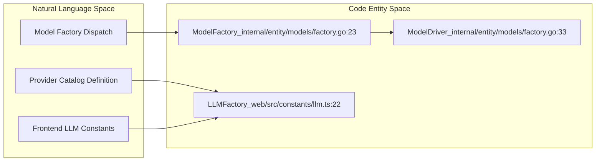
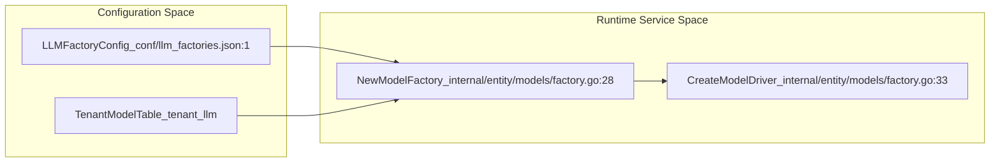

<!-- source: DeepWiki mcp.deepwiki.com · repo infiniflow/ragflow · page 5 LLM Integration System · fetched 2026-10-29 -->

# LLM Integration System

Relevant source files

The following files were used as context for generating this wiki page:

- [conf/llm_factories.json](conf/llm_factories.json)
- [conf/model.md](conf/model.md)
- [conf/models/worldrouter.json](conf/models/worldrouter.json)
- [internal/entity/models/factory.go](internal/entity/models/factory.go)
- [internal/entity/models/worldrouter.go](internal/entity/models/worldrouter.go)
- [internal/entity/models/worldrouter_test.go](internal/entity/models/worldrouter_test.go)
- [web/src/assets/svg/llm/worldrouter.svg](web/src/assets/svg/llm/worldrouter.svg)
- [web/src/components/svg-icon.tsx](web/src/components/svg-icon.tsx)
- [web/src/constants/llm.ts](web/src/constants/llm.ts)

The LLM Integration System in RAGFlow provides a unified abstraction layer that facilitates seamless interaction with a wide variety of AI providers. Built natively in Go, it supports multiple model types such as chat, embeddings, reranking, text-to-speech (TTS), speech-to-text (ASR), and OCR, all with tenant-aware configuration, error handling, and robust execution pipelines.

This page serves as a high-level overview of the model subsystem and links to dedicated child pages that delve into technical details:

- [Model Driver Interface and Factory](#5.1) — Defines the `ModelDriver` interface, shared model behaviors, model factory with provider dispatch, model types, and usage reporting.  
- [Provider Implementations and Model Catalog](#5.2) — Implements concrete provider drivers located in `internal/entity/models` and static catalog configurations (`conf/models/*.json`, `conf/llm_factories.json`).  
- [Model Resolution and Call Service](#5.3) — Resolves model references using `ModelSolver`, dispatches calls by model type via `ModelCallService`, and manages usage accounting and retry logic.  
- [Tenant Configuration and Model Management](#5.4) — Manages tenant-specific provider-instance-model tables, API endpoints, connection checks, and offers the provider-instance configuration UI.  
- [Tool Calling and MCP Integration](#5.5) — Supports LLM tool/function schema binding, MCP client/server protocol implementations, and agent external tool invocation.  

Sources: [internal/entity/models/factory.go:23-33](), [conf/llm_factories.json:1-15]()

---

## Model Driver Interface and Factory

The subsystem relies on a unified driver interface implemented across numerous AI providers. The `ModelFactory` dynamically dispatches provider names to concrete driver implementations at runtime [internal/entity/models/factory.go:23-33](). It maps lowercased provider identifiers (such as `openai`, `anthropic`, `worldrouter`, etc.) to specific `ModelDriver` instances.

For details on the shared behaviors, base models, factory dispatch logic, and request/response handling, see [Model Driver Interface and Factory](#5.1).

Sources: [internal/entity/models/factory.go:23-190]()

---

## Provider Implementations and Model Catalog

Concrete provider integrations (such as OpenAI, Anthropic, DeepSeek, Ollama, vLLM, Bedrock, WorldRouter, and GreenPT) are implemented within `internal/entity/models` [internal/entity/models/factory.go:34-190](). These drivers interact with the static model catalog defined in configuration files and JSON descriptors [conf/llm_factories.json:1-54](), supporting features like dynamic model discovery and capabilities tagging.

For details on concrete provider drivers and the catalog structure, see [Provider Implementations and Model Catalog](#5.2).

Sources: [conf/llm_factories.json:1-54](), [internal/entity/models/factory.go:34-190](), [internal/entity/models/worldrouter.go:31-55]()

---

## Model Resolution and Call Service

References to models in RAGFlow are structured as compound identifiers (`model@instance@provider`). The `ModelSolver` resolves these references, while the call service dispatches requests across chat, streaming, embedding, rerank, and multimodal tasks [internal/entity/models/factory.go:23-33]().

For details on reference resolution, request dispatch, usage accounting, and error retry policies, see [Model Resolution and Call Service](#5.3).

Sources: [internal/entity/models/factory.go:23-33]()

---

## Tenant Configuration and Model Management

Multi-tenancy is supported through isolated provider, instance, and model database tables. Tenants manage their API keys, endpoints, and custom model deployments through the web administration interface [web/src/constants/llm.ts:22-123](), which defines enumerations for hundreds of supported providers and icons.

For details on tenant database schema, endpoint health checks, and the configuration UI, see [Tenant Configuration and Model Management](#5.4).

Sources: [web/src/constants/llm.ts:22-123]()

---

## Tool Calling and MCP Integration

To support advanced agentic workflows, the LLM integration system binds tool and function schemas directly to model generation parameters (such as `is_tools: true` in factory configurations) [conf/llm_factories.json:25-31](). Furthermore, Model Context Protocol (MCP) clients and servers enable agents to securely interface with external tools.

For details on function binding, the MCP protocol implementation, and tool execution loops, see [Tool Calling and MCP Integration](#5.5).

Sources: [conf/llm_factories.json:25-31]()

---

## Code-to-System Mapping Diagrams

The following diagrams bridge natural language concepts to their corresponding code entities within the codebase.

### Diagram 1: Natural Language Concept to Code Entities

Sources: [internal/entity/models/factory.go:23-33](), [web/src/constants/llm.ts:22-123]()

### Diagram 2: Configuration and Factory Instantiation Flow

Sources: [conf/llm_factories.json:1-10](), [internal/entity/models/factory.go:28-33]()

---

# Summary

The LLM Integration System in RAGFlow unifies access to a vast ecosystem of AI providers under a Go-native architecture. By decoupling provider drivers via `ModelFactory`, standardizing schemas through catalog configurations, and supporting multi-tenancy and tool calling, RAGFlow ensures reliable and extensible AI operations.

For in-depth technical details, consult the child pages linked at the top of this document.

---

