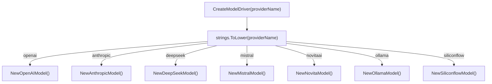
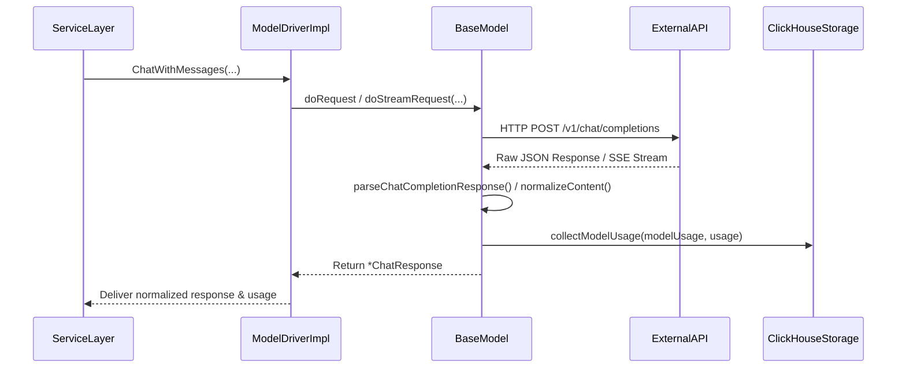
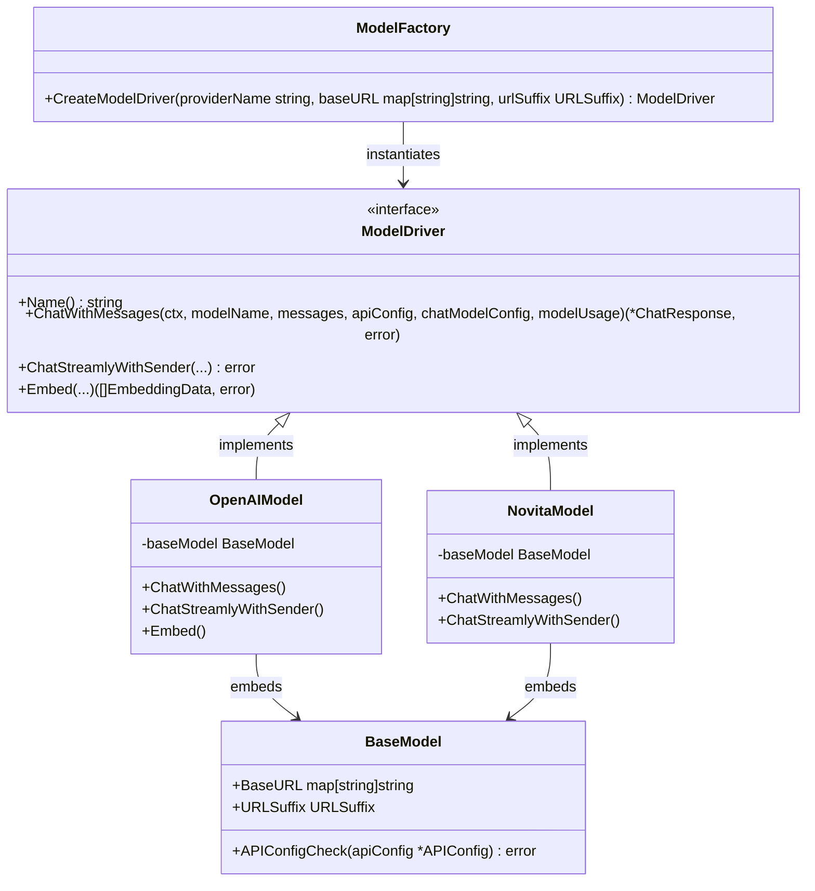

<!-- source: DeepWiki mcp.deepwiki.com · repo infiniflow/ragflow · page 5.1 Model Driver Interface and Factory · fetched 2026-10-29 -->

# Model Driver Interface and Factory

Relevant source files

The following files were used as context for generating this wiki page:

- [conf/llm_factories.json](conf/llm_factories.json)
- [conf/model.md](conf/model.md)
- [conf/models/mistral.json](conf/models/mistral.json)
- [conf/models/novita.json](conf/models/novita.json)
- [conf/models/openrouter.json](conf/models/openrouter.json)
- [conf/models/voyage.json](conf/models/voyage.json)
- [conf/models/worldrouter.json](conf/models/worldrouter.json)
- [internal/entity/models/baichuan.go](internal/entity/models/baichuan.go)
- [internal/entity/models/baidu.go](internal/entity/models/baidu.go)
- [internal/entity/models/base_model.go](internal/entity/models/base_model.go)
- [internal/entity/models/cohere.go](internal/entity/models/cohere.go)
- [internal/entity/models/factory.go](internal/entity/models/factory.go)
- [internal/entity/models/fishaudio.go](internal/entity/models/fishaudio.go)
- [internal/entity/models/mistral.go](internal/entity/models/mistral.go)
- [internal/entity/models/mistral_test.go](internal/entity/models/mistral_test.go)
- [internal/entity/models/modelscope.go](internal/entity/models/modelscope.go)
- [internal/entity/models/modelscope_test.go](internal/entity/models/modelscope_test.go)
- [internal/entity/models/n1n.go](internal/entity/models/n1n.go)
- [internal/entity/models/novita.go](internal/entity/models/novita.go)
- [internal/entity/models/novita_test.go](internal/entity/models/novita_test.go)
- [internal/entity/models/openai.go](internal/entity/models/openai.go)
- [internal/entity/models/openrouter.go](internal/entity/models/openrouter.go)
- [internal/entity/models/openrouter_test.go](internal/entity/models/openrouter_test.go)
- [internal/entity/models/voyage.go](internal/entity/models/voyage.go)
- [internal/entity/models/voyage_test.go](internal/entity/models/voyage_test.go)
- [internal/entity/models/worldrouter.go](internal/entity/models/worldrouter.go)
- [internal/entity/models/worldrouter_test.go](internal/entity/models/worldrouter_test.go)
- [web/src/assets/svg/llm/worldrouter.svg](web/src/assets/svg/llm/worldrouter.svg)
- [web/src/components/svg-icon.tsx](web/src/components/svg-icon.tsx)
- [web/src/constants/llm.ts](web/src/constants/llm.ts)

## Purpose and Scope

This page details the foundational Go implementation of RAGFlow's AI model abstraction layer, located in `internal/entity/models`. It covers the core `ModelDriver` interface defining unified operations across multi-modal AI capabilities, the `BaseModel` shared behavior in [internal/entity/models/base_model.go:34-62](), the `ModelFactory` dispatch router in [internal/entity/models/factory.go:23-192](), model types spanning chat, embedding, rerank, TTS, ASR, and OCR, as well as centralized token usage tracking and response normalization.

Sources: [internal/entity/models/factory.go:23-30](), [internal/entity/models/base_model.go:34-62]()

---

## The `ModelDriver` Interface and Model Types

RAGFlow integrates diverse AI providers through a unified Go interface. The `ModelDriver` interface specifies contracts across all supported model capabilities:

- **Chat & Generation**: Synchronous (`ChatWithMessages`) and streaming (`ChatStreamlyWithSender`) completions supporting text, multimodal content, tools, and reasoning tokens [internal/entity/models/openai.go:64-136]().
- **Vector Embeddings**: Text vectorization via `Embed` returning `EmbeddingData` arrays with token counts [internal/entity/models/openai.go:157-214]().
- **Reranking & Advanced Features**: Cross-encoder relevance scoring and specialized model parameters such as reasoning effort and thinking toggles [internal/entity/models/baidu.go:53-119](), [internal/entity/models/openrouter.go:57-85]().
- **Audio Processing & OCR**: Speech-to-text transcription and text-to-speech synthesis, alongside document/image parsing integrations [internal/entity/models/factory.go:99-165]().

Sources: [internal/entity/models/openai.go:64-214](), [internal/entity/models/factory.go:99-165]()

---

## The `BaseModel` Shared Behavior

[internal/entity/models/base_model.go:34-176]() provides shared functionality inherited by concrete provider drivers:

- **HTTP Transport & SSRF Protection**: Manages standard HTTP clients configured with SSRF prevention [internal/entity/models/openai.go:45-53]().
- **Authentication**: Supports standard Bearer token headers as well as custom provider authentication hooks for non-standard vendors via `authHeader` [internal/entity/models/base_model.go:57-62]().
- **Error Handling**: Defines `APIStatusError` [internal/entity/models/base_model.go:38-49]() to preserve HTTP status codes and response bodies across provider calls, enabling intelligent retry and failover strategies.
- **Token Usage & Telemetry**: Implements `recordResponseUsage` and `collectModelUsage` [internal/entity/models/base_model.go:109-149]() to persist token counts, request IDs, and response latency directly to ClickHouse via `clickhouse.GetDriver()`.
- **Streaming Usage**: Exposes `applyStreamUsage` [internal/entity/models/base_model.go:160-176]() to capture usage chunks sent during server-sent events (SSE) streaming without interrupting the client stream.

Sources: [internal/entity/models/base_model.go:34-176](), [internal/entity/models/openai.go:45-53]()

---

## The `ModelFactory` and Provider Dispatch

[internal/entity/models/factory.go:23-192]() defines `ModelFactory`, which maps provider name strings to concrete driver constructors.

### Dispatch Mechanism

When requested via `CreateModelDriver(providerName string, baseURL map[string]string, urlSuffix URLSuffix)`, the factory normalizes the provider name to lowercase and matches it against supported vendors such as `openai`, `anthropic`, `deepseek`, `mistral`, `ollama`, `siliconflow`, `novitaai`, and `zhipu-ai` [internal/entity/models/factory.go:33-191]().

Diagram: Provider Dispatch Flow

Sources: [internal/entity/models/factory.go:23-192]()

---

## Response and Usage Handling Flow

RAGFlow normalizes varied provider responses into a uniform structure (`ChatResponse`, `EmbeddingData`, etc.) and routes token metrics to analytics sinks.

Diagram: Response and Telemetry Processing Flow

Sources: [internal/entity/models/base_model.go:79-149](), [internal/entity/models/openai.go:64-95]()

---

## Bridging Natural Language Spaces to Go Code Entities

The following class and component diagrams map high-level AI provider concepts and multi-modal model capabilities to their concrete Go code structures within `internal/entity/models`.

Diagram: Model Driver Class Hierarchy

Sources: [internal/entity/models/base_model.go:51-62](), [internal/entity/models/factory.go:23-33](), [internal/entity/models/openai.go:37-53](), [internal/entity/models/novita.go:31-45]()

---

