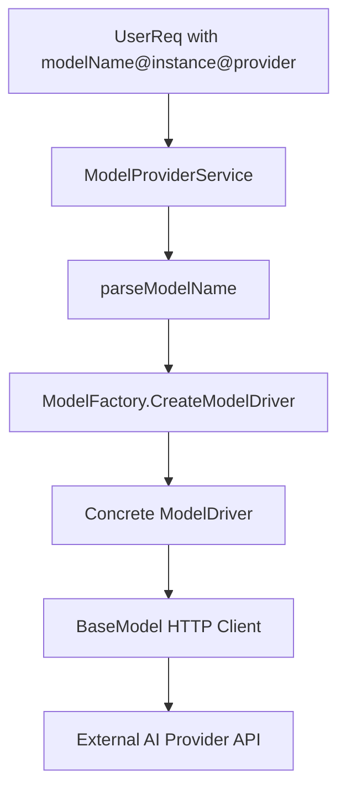
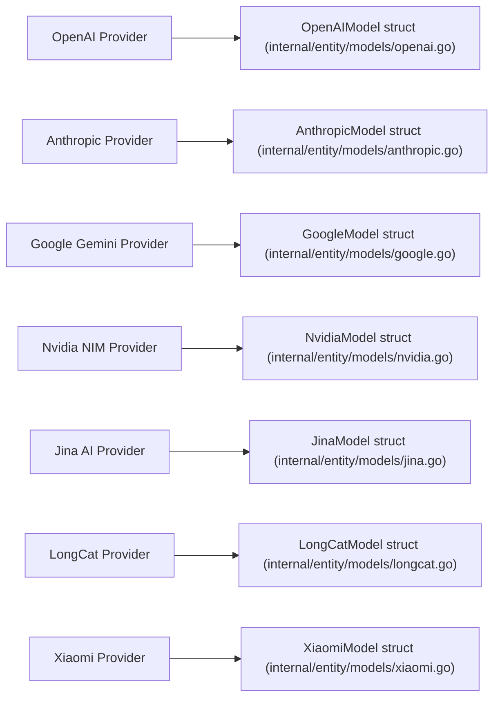
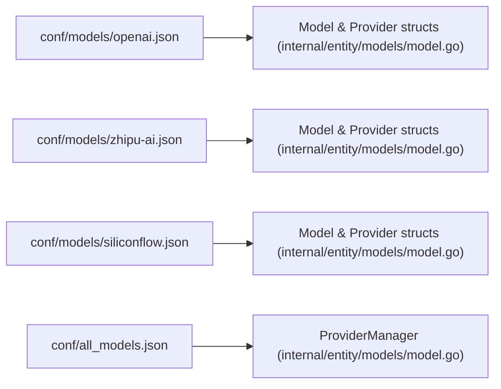

<!-- source: DeepWiki mcp.deepwiki.com · repo infiniflow/ragflow · page 5.2 Provider Implementations and Model Catalog · fetched 2026-10-29 -->

# Provider Implementations and Model Catalog

<details>
<summary>Relevant source files</summary>

The following files were used as context for generating this wiki page:

- [conf/all_models.json](conf/all_models.json)
- [conf/models/anthropic.json](conf/models/anthropic.json)
- [conf/models/baichuan.json](conf/models/baichuan.json)
- [conf/models/baidu.json](conf/models/baidu.json)
- [conf/models/bedrock.json](conf/models/bedrock.json)
- [conf/models/cohere.json](conf/models/cohere.json)
- [conf/models/deepinfra.json](conf/models/deepinfra.json)
- [conf/models/deepseek.json](conf/models/deepseek.json)
- [conf/models/funasr.json](conf/models/funasr.json)
- [conf/models/gitee.json](conf/models/gitee.json)
- [conf/models/google.json](conf/models/google.json)
- [conf/models/gpustack.json](conf/models/gpustack.json)
- [conf/models/groq.json](conf/models/groq.json)
- [conf/models/huggingface.json](conf/models/huggingface.json)
- [conf/models/hunyuan.json](conf/models/hunyuan.json)
- [conf/models/jina.json](conf/models/jina.json)
- [conf/models/llmman.json](conf/models/llmman.json)
- [conf/models/lmstudio.json](conf/models/lmstudio.json)
- [conf/models/localai.json](conf/models/localai.json)
- [conf/models/longcat.json](conf/models/longcat.json)
- [conf/models/minimax.json](conf/models/minimax.json)
- [conf/models/moonshot.json](conf/models/moonshot.json)
- [conf/models/nvidia.json](conf/models/nvidia.json)
- [conf/models/ollama.json](conf/models/ollama.json)
- [conf/models/openai.json](conf/models/openai.json)
- [conf/models/perplexity.json](conf/models/perplexity.json)
- [conf/models/replicate.json](conf/models/replicate.json)
- [conf/models/siliconflow.json](conf/models/siliconflow.json)
- [conf/models/stepfun.json](conf/models/stepfun.json)
- [conf/models/togetherai.json](conf/models/togetherai.json)
- [conf/models/upstage.json](conf/models/upstage.json)
- [conf/models/volcengine.json](conf/models/volcengine.json)
- [conf/models/xai.json](conf/models/xai.json)
- [conf/models/xiaomi.json](conf/models/xiaomi.json)
- [conf/models/xinference.json](conf/models/xinference.json)
- [conf/models/xunfei.json](conf/models/xunfei.json)
- [conf/models/zhipu-ai.json](conf/models/zhipu-ai.json)
- [internal/cli/response_test.go](internal/cli/response_test.go)
- [internal/entity/models/302ai_test.go](internal/entity/models/302ai_test.go)
- [internal/entity/models/anthropic.go](internal/entity/models/anthropic.go)
- [internal/entity/models/anthropic_test.go](internal/entity/models/anthropic_test.go)
- [internal/entity/models/base_model_test.go](internal/entity/models/base_model_test.go)
- [internal/entity/models/bedrock.go](internal/entity/models/bedrock.go)
- [internal/entity/models/bedrock_test.go](internal/entity/models/bedrock_test.go)
- [internal/entity/models/deepinfra_test.go](internal/entity/models/deepinfra_test.go)
- [internal/entity/models/funasr.go](internal/entity/models/funasr.go)
- [internal/entity/models/funasr_test.go](internal/entity/models/funasr_test.go)
- [internal/entity/models/gitee_test.go](internal/entity/models/gitee_test.go)
- [internal/entity/models/google.go](internal/entity/models/google.go)
- [internal/entity/models/google_test.go](internal/entity/models/google_test.go)
- [internal/entity/models/gpustack.go](internal/entity/models/gpustack.go)
- [internal/entity/models/gpustack_rerank_audio_test.go](internal/entity/models/gpustack_rerank_audio_test.go)
- [internal/entity/models/gpustack_test.go](internal/entity/models/gpustack_test.go)
- [internal/entity/models/groq.go](internal/entity/models/groq.go)
- [internal/entity/models/groq_test.go](internal/entity/models/groq_test.go)
- [internal/entity/models/huaweicloud.go](internal/entity/models/huaweicloud.go)
- [internal/entity/models/huggingface.go](internal/entity/models/huggingface.go)
- [internal/entity/models/hunyuan.go](internal/entity/models/hunyuan.go)
- [internal/entity/models/hunyuan_test.go](internal/entity/models/hunyuan_test.go)
- [internal/entity/models/jiekouai.go](internal/entity/models/jiekouai.go)
- [internal/entity/models/jina.go](internal/entity/models/jina.go)
- [internal/entity/models/jina_test.go](internal/entity/models/jina_test.go)
- [internal/entity/models/llmman.go](internal/entity/models/llmman.go)
- [internal/entity/models/llmman_test.go](internal/entity/models/llmman_test.go)
- [internal/entity/models/localai.go](internal/entity/models/localai.go)
- [internal/entity/models/localai_test.go](internal/entity/models/localai_test.go)
- [internal/entity/models/longcat.go](internal/entity/models/longcat.go)
- [internal/entity/models/longcat_test.go](internal/entity/models/longcat_test.go)
- [internal/entity/models/model.go](internal/entity/models/model.go)
- [internal/entity/models/model_test.go](internal/entity/models/model_test.go)
- [internal/entity/models/model_type_infer.go](internal/entity/models/model_type_infer.go)
- [internal/entity/models/nvidia.go](internal/entity/models/nvidia.go)
- [internal/entity/models/nvidia_rerank_test.go](internal/entity/models/nvidia_rerank_test.go)
- [internal/entity/models/nvidia_test.go](internal/entity/models/nvidia_test.go)
- [internal/entity/models/orcarouter.go](internal/entity/models/orcarouter.go)
- [internal/entity/models/perplexity.go](internal/entity/models/perplexity.go)
- [internal/entity/models/perplexity_test.go](internal/entity/models/perplexity_test.go)
- [internal/entity/models/ppio.go](internal/entity/models/ppio.go)
- [internal/entity/models/ppio_test.go](internal/entity/models/ppio_test.go)
- [internal/entity/models/provider_response_usage_test.go](internal/entity/models/provider_response_usage_test.go)
- [internal/entity/models/qiniu.go](internal/entity/models/qiniu.go)
- [internal/entity/models/replicate.go](internal/entity/models/replicate.go)
- [internal/entity/models/replicate_test.go](internal/entity/models/replicate_test.go)
- [internal/entity/models/stepfun.go](internal/entity/models/stepfun.go)
- [internal/entity/models/stepfun_test.go](internal/entity/models/stepfun_test.go)
- [internal/entity/models/togetherai.go](internal/entity/models/togetherai.go)
- [internal/entity/models/togetherai_test.go](internal/entity/models/togetherai_test.go)
- [internal/entity/models/tokenhub.go](internal/entity/models/tokenhub.go)
- [internal/entity/models/tokenhub_test.go](internal/entity/models/tokenhub_test.go)
- [internal/entity/models/tokenpony.go](internal/entity/models/tokenpony.go)
- [internal/entity/models/upstage.go](internal/entity/models/upstage.go)
- [internal/entity/models/upstage_test.go](internal/entity/models/upstage_test.go)
- [internal/entity/models/xiaomi.go](internal/entity/models/xiaomi.go)
- [internal/entity/models/xiaomi_test.go](internal/entity/models/xiaomi_test.go)
- [internal/entity/models/xinference.go](internal/entity/models/xinference.go)
- [internal/entity/models/xinference_test.go](internal/entity/models/xinference_test.go)

</details>


This page provides a comprehensive technical overview of the concrete provider drivers implemented in the RAGFlow codebase (`internal/entity/models`) and the corresponding model metadata catalogs stored as JSON configuration files (`conf/models/*.json`, `conf/all_models.json`, and `conf/llm_factories.json`). These components collectively enable unified, extensible access to a diverse range of Large Language Models (LLMs) and related AI capabilities from multiple providers, including OpenAI, Anthropic, Google Gemini, DeepSeek, Ollama, vLLM, Bedrock, Nvidia, ZhipuAI, VolcEngine, and others.

---

## 1. Driver Interface and BaseModel Abstraction

Each provider implementation in Go adheres to the common `ModelDriver` interface defined in the models package (`[internal/entity/models/types.go:43-78]()`). This interface specifies methods supporting core AI capabilities such as:

- `ChatWithMessages` — Handles chat/completion requests with multiple role-based messages (`[internal/entity/models/types.go:48-49]()`).
- `ChatStreamlyWithSender` — Streaming chat completions with callback sender functions (`[internal/entity/models/types.go:50-51]()`).
- `Embed` — Embedding generation requests (`[internal/entity/models/types.go:53-53]()`).
- Optional methods for reranking (`[internal/entity/models/types.go:54-55]()`), text-to-speech (TTS) (`[internal/entity/models/types.go:59-61]()`), automatic speech recognition (ASR) (`[internal/entity/models/types.go:56-58]()`), optical character recognition (OCR) (`[internal/entity/models/types.go:62-63]()`), and balance checking.

To minimize duplication, providers compose the shared `BaseModel` struct (`[internal/entity/models/model.go:35-50]()`). `BaseModel` provides:
- Base URL resolution, supporting multiple endpoints and regions.
- HTTP client creation secured against Server-Side Request Forgery (SSRF) attacks via `common.GetSSRFHTTPClient()` (`[internal/entity/models/jina.go:35-50]()`, `[internal/entity/models/nvidia.go:39-57]()`).
- Centralized request building and HTTP header injection (API keys, custom auth headers like Xiaomi's `api-key` header [`[internal/entity/models/xiaomi.go:34-51]()`]).
- Timeout management for streaming and non-streaming calls.
- Utilities for handling responses and streaming events.

Sources:
- `[internal/entity/models/types.go:43-78]()`
- `[internal/entity/models/model.go:35-50]()`
- `[internal/entity/models/jina.go:35-50]()`
- `[internal/entity/models/nvidia.go:39-57]()`
- `[internal/entity/models/xiaomi.go:34-51]()`

---

## 2. Concrete Provider Drivers (`internal/entity/models`)

Concrete drivers tune request construction and response parsing to specific upstream API requirements, including reasoning flags, streaming formats, tool call payloads, and custom authentication schemes.

### Selected Major Provider Implementations

- **OpenAI (`[internal/entity/models/openai.go:37-137]()`)**: Supports GPT models via OpenAI-compatible endpoints `/chat/completions` and `/embeddings`. Implements Server-Sent Events (SSE) streaming and reasoning flags (`enable_thinking`).
- **Anthropic (`[internal/entity/models/anthropic.go:32-110]()`)**: Implements Anthropic Claude API patterns, including delta-based streaming events and multi-turn conversations.
- **DeepSeek (`[internal/entity/models/deepseek.go:30-140]()`)**: Implements reasoning effort flags and thinking configuration controlled from client requests (`[internal/entity/models/deepseek.go:101-132]()`).
- **Google Gemini (`[internal/entity/models/google.go:17-217]()`)**: Uses the official Google `genai` client (`[google.golang.org/genai:28-28]()`). Handles paginated model listing, filters models by RAGFlow-usable supported actions (`generateContent`, `embedContent`, etc.) (`[internal/entity/models/google.go:54-71]()`), supports multimodal chat content, and parses system instructions specially for Gemini (`[internal/entity/models/google.go:191-208]()`).
- **Nvidia (`[internal/entity/models/nvidia.go:39-121]()`)**: Resolves explicit model endpoint URLs overridden in presets (`[internal/entity/models/nvidia.go:73-89]()`). Embeds passage and query texts distinctly (`input_type="passage"` vs `"query"`) (`[internal/entity/models/nvidia.go:182-198]()`).
- **Jina (`[internal/entity/models/jina.go:35-213]()`)**: Provides embedding (`JinaEmbeddingResponse` [`[internal/entity/models/jina.go:62-76]()`]) and reranking (`JinaRerankResponse` [`[internal/entity/models/jina.go:78-93]()`]) API access, plus special leading system message merging for Jina APIs (`[internal/entity/models/jina.go:191-214]()`).
- **LongCat (`[internal/entity/models/longcat.go:28-138]()`)**: Meituan's OpenAI-compatible provider supporting reasoning token tracking in completion details (`[internal/entity/models/longcat.go:69-76]()`).
- **Xiaomi (`[internal/entity/models/xiaomi.go:34-60]()`)**: Implements non-standard `api-key` header authentication (`[internal/entity/models/xiaomi.go:44-48]()`), ASR transcription, and streaming responses (`[internal/entity/models/xiaomi.go:196-215]()`).

Sources:
- `[internal/entity/models/openai.go:37-137]()`
- `[internal/entity/models/anthropic.go:32-110]()`
- `[internal/entity/models/deepseek.go:30-140]()`
- `[internal/entity/models/google.go:17-217]()`
- `[internal/entity/models/nvidia.go:39-121]()`
- `[internal/entity/models/jina.go:35-213]()`
- `[internal/entity/models/longcat.go:28-138]()`
- `[internal/entity/models/xiaomi.go:34-60]()`

---

### Explicit Go Factory Creation (`[internal/entity/models/factory.go:33-170]()`)

Given a provider name string (case-insensitive), the factory function `CreateModelDriver(providerName string)` returns an instance of a concrete `ModelDriver` via a dispatch switch.

Title: Model Driver Instantiation Flow
```mermaid
graph LR
    ProviderName["ProviderName"] --> Factory["CreateModelDriver"]
    Factory --> Switch["switch strings.ToLower(providerName)"]
    Switch -->|\"openai\"| OpenAI["NewOpenAIModel"]
    Switch -->|\"anthropic\"| Anthropic["NewAnthropicModel"]
    Switch -->|\"google\"| Google["NewGoogleModel"]
    Switch -->|\"nvidia\"| Nvidia["NewNvidiaModel"]
    Switch -->|\"ollama\"| Ollama["NewOllamaModel"]
    Switch -->|\"deepseek\"| DeepSeek["NewDeepSeekModel"]
    Switch -->|\"jina\"| Jina["NewJinaModel"]
    Switch -->|others| OtherModels["OtherProviderConstructors"]
```
Sources:
- `[internal/entity/models/factory.go:33-170]()`

---

## 3. Model Metadata Catalogs (`conf/models/*.json`, `conf/all_models.json`)

RAGFlow maintains a comprehensive global model metadata repository across JSON configuration files under `conf/models/` (e.g., `openai.json`, `google.json`, `deepseek.json`, `nvidia.json`, `volcengine.json`, `zhipu-ai.json`, `siliconflow.json`) and aggregated in `conf/all_models.json` (`[conf/all_models.json:1-302]()`).

Each provider configuration file defines:
- `name`: Provider identifier (`[conf/models/openai.json:2-3]()`, `[conf/models/zhipu-ai.json:2-3]()`).
- `rank`: Sorting priority for selection and UI display (`[conf/models/openai.json:3-4]()`, `[conf/models/zhipu-ai.json:3-4]()`).
- `url`: Regional or default endpoint map (`[conf/models/openai.json:4-6]()`, `[conf/models/zhipu-ai.json:4-6]()`).
- `url_suffix`: API routes for chat, embedding, models list, reranking, OCR, ASR, TTS, and files (`[conf/models/openai.json:7-13]()`, `[conf/models/zhipu-ai.json:7-18]()`).
- `class`: Model category (`"gpt"`, `"glm"`, `"volcengine"`, etc.) (`[conf/models/openai.json:14-15]()`, `[conf/models/zhipu-ai.json:19-20]()`).
- `models`: Detailed array of supported model specs including context lengths, max output tokens, supported model types (`chat`, `embedding`, `rerank`, `tts`, `asr`, `vision`, `ocr`), thinking/reasoning parameters, and tool support flags (`[conf/models/openai.json:15-318]()`, `[conf/models/zhipu-ai.json:20-305]()`).

Sources:
- `[conf/all_models.json:1-302]()`
- `conf/models/openai.json`
- `conf/models/google.json`
- `conf/models/deepseek.json`
- `conf/models/nvidia.json`
- `conf/models/volcengine.json`
- `conf/models/zhipu-ai.json`
- `conf/models/siliconflow.json`

---

## 4. Tenant Model Resolution and Data Flow

RAGFlow supports multi-tenant configurations where tenants configure private provider instances and API keys. References to models follow a composite naming convention:
```
modelName@instanceName@providerName
```
The dispatch layer (`[internal/ingestion/component/dispatch_model.go:68-158]()`) parses this reference to look up the configured tenant API parameters, initialize the corresponding `ModelDriver` via the factory, and execute model calls.

Title: Model Resolution and Request Data Flow

Sources:
- `[internal/ingestion/component/dispatch_model.go:68-158]()`
- `[internal/entity/models/factory.go:33-170]()`

---

## 5. Natural Language Space to Code Entity Space

The following diagrams map human-facing provider and model designations to their concrete Go structs and configuration artifacts within the codebase.

Title: Provider System Mapping to Go Code Entities

Sources:
- `[internal/entity/models/openai.go:37-137]()`
- `[internal/entity/models/anthropic.go:32-110]()`
- `[internal/entity/models/google.go:17-217]()`
- `[internal/entity/models/nvidia.go:39-121]()`
- `[internal/entity/models/jina.go:35-50]()`
- `[internal/entity/models/longcat.go:28-32]()`
- `[internal/entity/models/xiaomi.go:34-36]()`

Title: Model Catalog Artifact Mapping

Sources:
- `[internal/entity/models/model.go:160-207]()`
- `conf/models/openai.json`
- `conf/models/zhipu-ai.json`
- `conf/models/siliconflow.json`
- `[conf/all_models.json:1-302]()`

---

## 6. Summary Table: Key Providers and Implementation Details

| Provider Name | Go Model Struct | JSON Config File | Key Capabilities & Features |
| :--- | :--- | :--- | :--- |
| **OpenAI** | `OpenAIModel` | `conf/models/openai.json` | Chat, streaming, embedding, TTS/ASR, tooling |
| **Anthropic** | `AnthropicModel` | Built-in / Custom | Claude API, streaming, multi-turn messages |
| **DeepSeek** | `DeepSeekModel` | `conf/models/deepseek.json` | Chat, embedding, thinking/reasoning flags |
| **Google Gemini** | `GoogleModel` | `conf/models/google.json` | `genai` client integration, model listing, multimodal |
| **Nvidia** | `NvidiaModel` | `conf/models/nvidia.json` | Endpoint overrides, `input_type` embedding tuning |
| **Jina** | `JinaModel` | `conf/models/jina.json` | Multi-vector embeddings and reranking |
| **LongCat** | `LongCatModel` | `conf/models/longcat.json` | OpenAI-compatible chat with reasoning details |
| **Xiaomi** | `XiaomiModel` | `conf/models/xiaomi.json` | Non-standard `api-key` auth, ASR, streaming |
| **VolcEngine** | `VolcEngineModel` | `conf/models/volcengine.json` | Ark API bindings, reasoning effort controls |
| **ZhipuAI** | `ZhipuAIModel` | `conf/models/zhipu-ai.json` | GLM chat, tools, thinking support |

Sources:
- `[internal/entity/models/openai.go:37-137]()`
- `[internal/entity/models/anthropic.go:32-110]()`
- `[internal/entity/models/deepseek.go:30-140]()`
- `[internal/entity/models/google.go:17-217]()`
- `[internal/entity/models/nvidia.go:39-121]()`
- `[internal/entity/models/jina.go:35-50]()`
- `[internal/entity/models/longcat.go:28-32]()`
- `[internal/entity/models/xiaomi.go:34-36]()`
- `conf/models/openai.json`
- `conf/models/zhipu-ai.json`
- `conf/models/siliconflow.json`
- `conf/models/volcengine.json`

---

