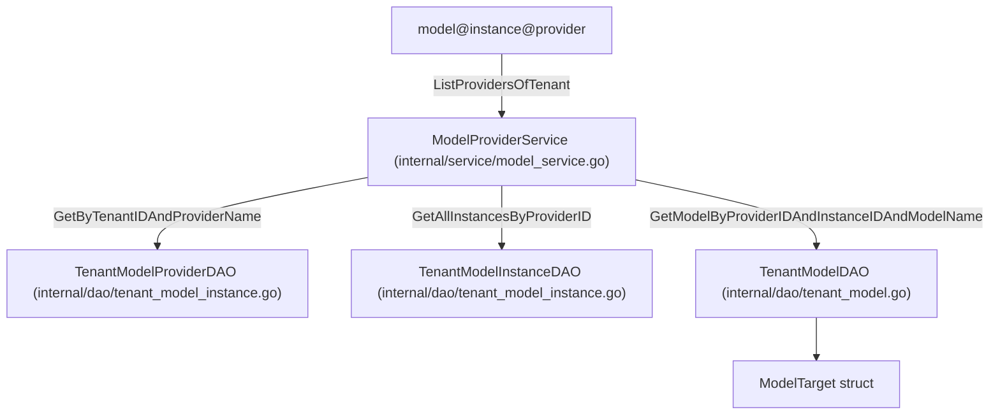
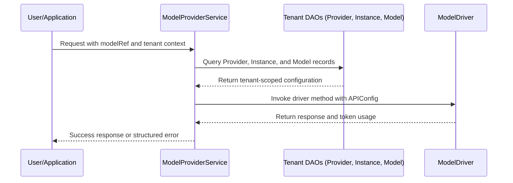

<!-- source: DeepWiki mcp.deepwiki.com · repo infiniflow/ragflow · page 5.3 Model Resolution and Call Service · fetched 2026-10-29 -->

# Model Resolution and Call Service

<details>
<summary>Relevant source files</summary>

The following files were used as context for generating this wiki page:

- [conf/models/aliyun.json](conf/models/aliyun.json)
- [internal/agent/component/model_driver_test.go](internal/agent/component/model_driver_test.go)
- [internal/common/model.go](internal/common/model.go)
- [internal/dao/file2document.go](internal/dao/file2document.go)
- [internal/dao/file2document_test.go](internal/dao/file2document_test.go)
- [internal/dao/model_context.go](internal/dao/model_context.go)
- [internal/dao/model_context_test.go](internal/dao/model_context_test.go)
- [internal/entity/base.go](internal/entity/base.go)
- [internal/entity/models/aliyun.go](internal/entity/models/aliyun.go)
- [internal/entity/models/aliyun_test.go](internal/entity/models/aliyun_test.go)
- [internal/entity/models/deepseek.go](internal/entity/models/deepseek.go)
- [internal/entity/models/dummy.go](internal/entity/models/dummy.go)
- [internal/entity/models/gitee.go](internal/entity/models/gitee.go)
- [internal/entity/models/lmstudio.go](internal/entity/models/lmstudio.go)
- [internal/entity/models/minimax.go](internal/entity/models/minimax.go)
- [internal/entity/models/minimax_test.go](internal/entity/models/minimax_test.go)
- [internal/entity/models/mistral_ocr.go](internal/entity/models/mistral_ocr.go)
- [internal/entity/models/mistral_ocr_test.go](internal/entity/models/mistral_ocr_test.go)
- [internal/entity/models/moonshot.go](internal/entity/models/moonshot.go)
- [internal/entity/models/ollama.go](internal/entity/models/ollama.go)
- [internal/entity/models/siliconflow.go](internal/entity/models/siliconflow.go)
- [internal/entity/models/types.go](internal/entity/models/types.go)
- [internal/entity/models/vllm.go](internal/entity/models/vllm.go)
- [internal/entity/models/volcengine.go](internal/entity/models/volcengine.go)
- [internal/entity/models/xai.go](internal/entity/models/xai.go)
- [internal/entity/models/zhipu-ai.go](internal/entity/models/zhipu-ai.go)
- [internal/handler/chat_audio_wav.go](internal/handler/chat_audio_wav.go)
- [internal/handler/chat_audio_wav_test.go](internal/handler/chat_audio_wav_test.go)
- [internal/handler/providers.go](internal/handler/providers.go)
- [internal/handler/providers_test.go](internal/handler/providers_test.go)
- [internal/ingestion/component/dispatch_model.go](internal/ingestion/component/dispatch_model.go)
- [internal/ingestion/component/dispatch_model_test.go](internal/ingestion/component/dispatch_model_test.go)
- [internal/ingestion/component/pdf_parser_model.go](internal/ingestion/component/pdf_parser_model.go)
- [internal/service/model_call.go](internal/service/model_call.go)
- [internal/service/model_factory.go](internal/service/model_factory.go)
- [internal/service/model_service.go](internal/service/model_service.go)
- [internal/service/model_service_test.go](internal/service/model_service_test.go)

</details>


This page documents the Go-native model resolution and call dispatch system in RAGFlow. It covers the `ModelSolver` which resolves composite model references into fully configured model targets, and the `ModelCallService` which dispatches requests (chat, stream, embed, rerank, TTS, ASR, OCR) to the resolved drivers with usage accounting and error management. The page describes the internal data flow, key classes and functions, and error/retry behaviors in detail.

Sources: `[internal/service/model_service.go:1-81]`, `[internal/entity/models/types.go:42-78]()`

---

## 1. Purpose and Scope

RAGFlow integrates multiple LLM providers and instance configurations in a multi-tenant environment. Each model is referred to by a composite key of format:

```
modelName[@instanceName][@providerName]
```

For example:
- `gpt-4@default@OpenAI`
- `text-embedding-nomic-embed-text-v1.5@q8_0@lmstudio@LM-Studio`

`ModelSolver` encapsulates the logic to parse and resolve such references into a `ModelTarget` structure containing the provider, instance, API credentials, driver, and model metadata needed to make calls. `ModelCallService` provides a unified API layer that accepts user requests identifying a target by model reference and request payload, and calls the appropriate driver with correct configuration and usage tracking.

Sources: `[internal/service/model_service.go:39-81]`, `[internal/handler/providers.go:58-73]()`

---

## 2. ModelSolver: Resolving Composite Model References

### 2.1 Role and Overview

`ModelSolver` is a dedicated service object responsible for resolving composite model references (strings) into concrete model call targets represented by `ModelTarget` structs. It performs tenant-scoped Data Access Object (DAO) lookups on model providers, model instances, and models.

It merges tenant-specific configurations, applies defaults, and instantiates the suitable model driver implementation via `NewModelProviderService()` (`[internal/service/model_service.go:67-78]()`).

Sources: `[internal/service/model_service.go:67-87]`, `[internal/handler/providers.go:102-114]()`

### 2.2 Key Data Structure: ModelTarget

`ModelTarget` contains the resolved details required to execute a model call across various provider implementations such as Aliyun (`[internal/entity/models/aliyun.go:38-52]()`), SiliconFlow (`[internal/entity/models/siliconflow.go:34-48]()`), Ollama (`[internal/entity/models/ollama.go:31-46]()`), and Zhipu AI (`[internal/entity/models/zhipu-ai.go:33-47]()`):

| Field          | Description                                             |
|----------------|---------------------------------------------------------|
| ModelID        | Unique tenant model identifier                          |
| ModelName      | Model name string (catalog name)                        |
| ModelType      | Model type enum (chat, embedding, rerank, etc.)         |
| ProviderName   | Catalog provider name                                   |
| InstanceID     | Model instance ID (tenant-configured API credentials)   |
| InstanceName   | Name of the tenant model instance                       |
| Driver         | Concrete `ModelDriver` implementation interface         |
| APIConfig      | API key, endpoint URLs, and other provider config       |
| ModelInfo      | Metadata catalog info from static or DB models          |
| ContextLength  | Maximum tokens of context window                        |
| MaxTokens      | Maximum output tokens allowed                           |
| SupportsTools  | Boolean indicating ability to call external tools       |

Sources: `[internal/service/model_service.go:39-65]`, `[internal/entity/models/types.go:42-78]()`

### 2.3 Parsing Composite Model Names

Composite model references follow a specific scheme with `@` delimiters from right to left. Splitting is right-anchored to handle model names that may contain `@` characters. If the instance name is omitted, `"default"` is assumed.

Sources: `[internal/service/model_service.go:43-65]()`

Sources for Section 2: `[internal/service/model_service.go:39-87]`, `[internal/entity/models/types.go:42-78]()`

---

## 3. ModelCallService Dispatch: Chat, Stream, Embed, Rerank, TTS, ASR, OCR

`ModelCallService` routes high-level engine operations to the correct backing model driver implementing the `ModelDriver` interface (`[internal/entity/models/types.go:43-78]()`).

### 3.1 Chat, Completion, and Streaming
Handles synchronous chat completions via `ChatWithMessages` and streaming output via `ChatStreamlyWithSender` (`[internal/entity/models/types.go:48-51]()`). Resolves the target chat model, attaches system prompts, manages token limits, and streams chunk tokens back to the caller. Specific provider nuances—such as Qwen3 thinking defaults in Aliyun (`[internal/entity/models/aliyun.go:151-164]()`) and SiliconFlow (`[internal/entity/models/siliconflow.go:81-83]()`), or Minimax group ID bundling (`[internal/entity/models/minimax.go:38-63]()`)—are handled transparently during request dispatch.

Sources: `[internal/entity/models/types.go:43-51]`, `[internal/entity/models/aliyun.go:62-149]`, `[internal/entity/models/minimax.go:38-78]()`

### 3.2 Embedding
Coordinates batch text embedding for documents and queries via `Embed` (`[internal/entity/models/types.go:53]()`). Validates input dimensions and batch sizes against model capabilities using validation rules (`[internal/service/model_service_test.go:85-191]()`).

Sources: `[internal/entity/models/types.go:53]`, `[internal/service/model_service_test.go:85-191]()`

### 3.3 Rerank, TTS, ASR, and OCR
- **Rerank**: Scores retrieved document chunks against query text (`[internal/entity/models/types.go:54]()`).
- **TTS**: Dispatches text-to-speech tasks mapping parameters like voice and language to provider payloads (`[internal/entity/models/types.go:59-61]()`).
- **ASR & OCR**: Converts audio/image streams into text tokens using provider endpoints or native deepdoc bindings (`[internal/entity/models/types.go:56-65]()`).

Sources: `[internal/entity/models/types.go:54-65]`, `[internal/service/model_service.go:76-128]()`

Sources for Section 3: `[internal/entity/models/types.go:42-78]`, `[internal/entity/models/aliyun.go:62-164]`, `[internal/service/model_service_test.go:85-191]()`

---

## 4. Usage Accounting and Error/Retry Behavior

### 4.1 Usage Accounting
Model execution results accumulate token usage statistics (`common.ModelUsage`) across prompt tokens, completion tokens, and embedding counts, persisting metrics for tenant reporting and quota governance (`[internal/entity/models/types.go:87-94]()`).

Sources: `[internal/entity/models/types.go:87-94]`, `[internal/common/model.go:1-50]()`

### 4.2 Error Handling and Retries
Model configuration failures that cannot be repaired by retrying return `errModelConfigUnavailable` (`[internal/service/model_service.go:41-43]()`). Transient upstream provider errors (such as rate limits or network timeouts) trigger exponential backoff retry mechanisms, while non-recoverable client errors bubble up with normalized `common.ErrorCode` definitions (`[internal/handler/providers.go:204-213]()`).

Sources: `[internal/service/model_service.go:39-44]`, `[internal/handler/providers.go:204-213]()`

Sources for Section 4: `[internal/entity/models/types.go:87-94]`, `[internal/service/model_service.go:39-44]`, `[internal/handler/providers.go:204-213]()`

---

## 5. Natural Language Space to Code Entity Mapping

### 5.1 Model Reference Resolution Mapping

This diagram illustrates how user-provided strings traverse `ModelProviderService`, tenant model provider DAOs, instance DAOs, and model DAOs to yield resolved model targets.


Sources: `[internal/service/model_service.go:67-189]`, `[internal/dao/tenant_model_instance.go:28-66]()`, `[internal/dao/tenant_model.go:102-109]()`

### 5.2 Model Call Dispatch Flow

This diagram maps model dispatch requests through `ProviderHandler`, `ModelProviderService`, and backing `ModelDriver` implementations across providers like Aliyun, SiliconFlow, and Ollama.

```mermaid
flowchart TD
    Caller[""ProviderHandler / HTTP API Request (internal/handler/providers.go)""]
    ModelProviderService["ModelProviderService (internal/service/model_service.go)"]
    ModelDriverInterface["ModelDriver Interface (internal/entity/models/types.go)"]
    AliyunModel["AliyunModel Driver (internal/entity/models/aliyun.go)"]
    SiliconflowModel["SiliconflowModel Driver (internal/entity/models/siliconflow.go)"]
    OllamaModel["OllamaModel Driver (internal/entity/models/ollama.go)"]

    Caller -->|ListProviders / ListModels| ModelProviderService
    ModelProviderService --> ModelDriverInterface
    ModelDriverInterface --> AliyunModel
    ModelDriverInterface --> SiliconflowModel
    ModelDriverInterface --> OllamaModel
```
Sources: `[internal/handler/providers.go:75-114]`, `[internal/service/model_service.go:76-128]`, `[internal/entity/models/types.go:43-78]`, `[internal/entity/models/aliyun.go:38-60]`, `[internal/entity/models/siliconflow.go:34-56]`, `[internal/entity/models/ollama.go:31-54]()`

---

## 6. Key Functions and Classes

- `NewModelProviderService()`: Initializes `ModelProviderService` with provider, instance, model, and tenant DAOs (`[internal/service/model_service.go:67-78]()`).
- `ModelDriver`: Interface defining core AI capabilities including `ChatWithMessages`, `ChatStreamlyWithSender`, `Embed`, `Rerank`, and `CheckConnection` (`[internal/entity/models/types.go:43-78]()`).
- `AliyunModel`: Concrete model driver implementing Aliyun DashScope specifics and thinking defaults (`[internal/entity/models/aliyun.go:38-60]()`).
- `SiliconflowModel`: Concrete driver for SiliconFlow with batch cap checks (`[internal/entity/models/siliconflow.go:34-56]()`).
- `OllamaModel`: Local inference driver supporting Ollama endpoints and multimodal inputs (`[internal/entity/models/ollama.go:31-54]()`).

Sources: `[internal/service/model_service.go:67-87]`, `[internal/entity/models/types.go:43-78]`, `[internal/entity/models/aliyun.go:38-60]`, `[internal/entity/models/siliconflow.go:34-56]`, `[internal/entity/models/ollama.go:31-54]()`

---

## 7. Internal Data Flow Summary


Sources: `[internal/service/model_service.go:100-189]`, `[internal/dao/tenant_model_instance.go:56-83]`, `[internal/dao/tenant_model.go:90-100]()`

---

